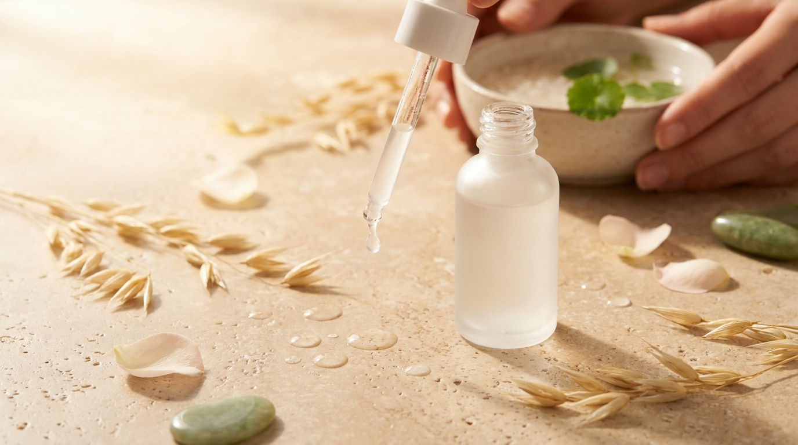
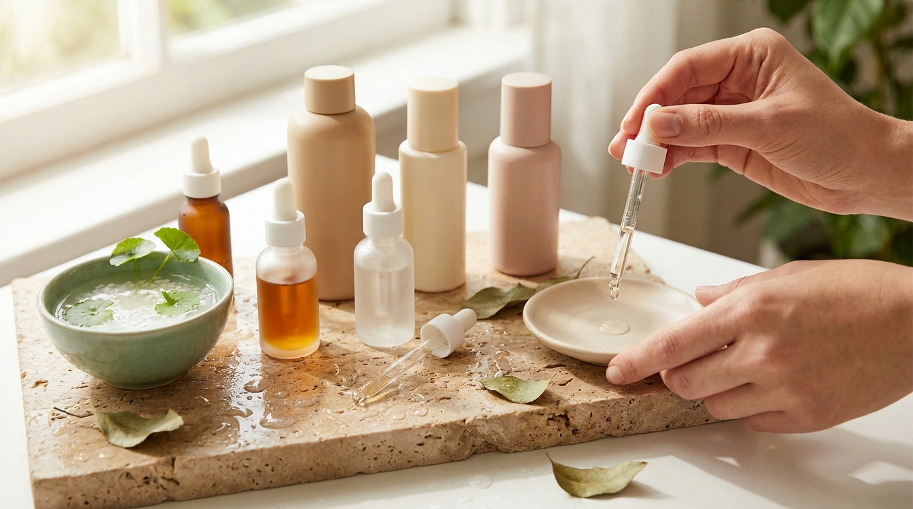

Al observar los sueros y tónicos más populares en las tiendas de cosmética en Corea del Sur, como Olive Young, hay un ingrediente que domina casi todas las etiquetas de hidratación: el ácido hialurónico. Sin embargo, en los últimos años, los laboratorios cosméticos coreanos y los consumidores más exigentes han dirigido su atención hacia otro ingrediente extraordinario: el beta-glucano.

Muchas personas que cuidan su piel desde casa en Latinoamérica o España experimentan una frustración común: aplican un suero cargado de ácido hialurónico esperando una piel luminosa y flexible, pero terminan sintiendo tirantez o sequedad a las pocas horas. ¿Por qué ocurre esto? ¿Es el ácido hialurónico multimolecular la solución definitiva para la piel deshidratada o el beta-glucano ofrece una retención de agua superior? Analizamos qué dice la ciencia cosmética coreana sobre estos dos titanes de la hidratación profunda.

## Puntos clave

- El ácido hialurónico multimolecular combina diferentes tamaños de molécula para actuar en la superficie y en las capas superiores del estrato córneo, pero puede evaporarse o causar tirantez si el clima es muy seco.
- El beta-glucano, un polisacárido derivado de levaduras, hongos o avena, retiene aproximadamente un 20% más de agua que el ácido hialurónico estándar y refuerza la barrera sin depender tanto de la humedad ambiental.
- Mientras que el ácido hialurónico aporta un efecto de relleno óptico rápido y frescura inmediata, el beta-glucano destaca por su capacidad para calmar rojeces y proteger pieles sensibilizadas.
- Ambos ingredientes no compiten de forma excluyente; de hecho, en las fórmulas coreanas más avanzadas suelen coexistir para ofrecer hidratación multicapa y reparación celular.

---

## Ácido hialurónico multimolecular: cómo funciona en la cosmética coreana

El ácido hialurónico (HA) es un glicosaminoglicano presente de forma natural en nuestra matriz extracelular. En cosmética, funciona como un potente humectante capaz de atraer y retener hasta 1.000 veces su propio peso en agua. Sin embargo, su eficacia depende drásticamente de su tamaño molecular.

### Diferencia entre pesos moleculares (alto, medio y bajo)

En el pasado, la mayoría de los cosméticos utilizaban únicamente ácido hialurónico de alto peso molecular. Los formuladores coreanos revolucionaron este enfoque al popularizar los complejos de 5, 8 o incluso 10 tipos de pesos moleculares en un solo producto:

1. **Alto peso molecular (High Molecular Weight - HMW):** Supera los 1.000 a 1.500 kDa. Debido a su gran tamaño, no penetra la piel; se queda en la superficie creando una película invisible hidrofílica que evita la pérdida transepidérmica de agua (TEWL) y suaviza la textura de inmediato.
2. **Medio peso molecular (Medium Molecular Weight - MMW):** Oscila entre 100 y 1.000 kDa. Ayuda a mantener la hidratación en las capas intermedias del estrato córneo, mejorando la elasticidad superficial.
3. **Bajo y muy bajo peso molecular (Low & Oligo Molecular Weight - LMW):** Inferior a 50 kDa (a menudo rotulado en el INCI como *Hydrolyzed Hyaluronic Acid* o *Hydrolyzed Sodium Hyaluronate*). Estas microfracciones consiguen penetrar más profundamente en las capas externas de la epidermis, ayudando a retener agua donde las células más lo necesitan.

En las tablas de ventas de cosmética en Seúl, los tónicos hidratantes acuosos suelen incorporar este gradiente de pesos para lograr la codiciada textura ligera pero densa en agua que caracteriza a una [rutina coreana para Glass Skin](/blog/rutina-coreana-piel-de-porcelana-glass-skin/).

### El dilema del efecto rebote en ambientes secos

A pesar de su fama, el ácido hialurónico tiene una debilidad física: es un imán de humedad ciego. Atrae agua de donde esté disponible. Si el entorno presenta una humedad relativa alta (como el verano en Seúl o en zonas costeras), el ácido hialurónico atrapará la humedad del aire y la mantendrá sobre la piel.

No obstante, en climas secos, con uso de calefacción en invierno o en estancias con aire acondicionado constante, la humedad relativa ambiental puede caer por debajo del 40%. En estas circunstancias, si el ácido hialurónico no está sellado con una crema oclusiva o emoliente, puede extraer el agua de las capas profundas de la dermis hacia el exterior, donde termina evaporándose. Esto explica por qué muchas personas sienten tirantez tras usar sueros puros de ácido hialurónico sin una capa posterior adecuada.

---

## Beta-glucano: el polisacárido calmante que gana terreno en Seúl



<p class="img-cap">※ Imagen ilustrativa generada con IA</p>

Frente a las limitaciones ambientales del ácido hialurónico, el beta-glucano (*Beta-Glucan* en el listado INCI) se ha consolidado en Corea como el humectante reparador por excelencia. Químicamente, es un polímero de glucosa natural que se extrae habitualmente de las paredes celulares de la avena, la cebada, la levadura de panadero (*Saccharomyces cerevisiae*) o ciertos hongos medicinales asiáticos como el *Split Gill* (*Schizophyllum commune*).

```
[Fuentes de Beta-glucano en K-Beauty]
   ├── Avena / Granos (Calmante, ideal para dermatitis y picor)
   ├── Levadura de panadero (Alta pureza, estimula defensas cutáneas)
   └── Hongos asiáticos / Chaga (Mayor poder filmógeno y antioxidante)
```

### Mayor retención hídrica y menor dependencia climática

Diversos estudios reológicos y cosméticos han señalado que el beta-glucano derivado de hongos y levaduras posee una capacidad de retención de agua aproximadamente un 20% superior a la del ácido hialurónico estándar a la misma concentración.

A diferencia del ácido hialurónico tradicional, el beta-glucano forma una red molecular flexible y permeable que no solo retiene moléculas de agua, sino que reduce activamente la evaporación sin crear una sensación pesada ni pegajosa. Su estructura le permite mantener la hidratación incluso en condiciones de baja humedad relativa, lo que minimiza considerablemente el riesgo de deshidratación por evaporación rápida.

### Reparación de la barrera cutánea y respuesta inmunitaria

El gran valor diferencial del beta-glucano radica en su actividad biológica. En el cuerpo humano, los macrófagos y las células de Langerhans poseen receptores específicos (como Dectin-1 y TLR-2) capaces de reconocer la estructura molecular del beta-glucano. Al interactuar con la epidermis:

- Estimula la proliferación celular y la regeneración tisular.
- Estimula indirectamente la síntesis de colágeno por parte de los fibroblastos.
- Reduce los marcadores proinflamatorios, mitigando rojeces, irritaciones y sensibilidad.

Por esta razón, en la dermatología cosmética de Seúl, el beta-glucano rara vez se presenta como un simple humectante; se formula en tratamientos diseñados para [reparar la barrera cutánea dañada](/blog/reparar-barrera-cutanea-ceramidas-coreanas/) o tras exposiciones climáticas severas.

---

## Comparativa directa: Ácido Hialurónico vs Beta-Glucano

Para entender cuál encaja mejor en cada necesidad, es fundamental contrastar sus propiedades según los parámetros que evalúan los laboratorios coreanos:

| Parámetro | Ácido Hialurónico Multimolecular | Beta-Glucano |
| :--- | :--- | :--- |
| **Origen principal** | Biotecnológico (fermentación bacteriana) | Vegetal (avena) o fúngico (levaduras y hongos) |
| **Capacidad de retención** | Hasta 1.000 veces su peso en agua | Hasta un 20% más eficiente en pruebas comparativas |
| **Comportamiento en clima seco** | Propenso a evaporarse si no se sella de inmediato | Mantiene la retención sin deshidratar la piel |
| **Efecto en la barrera** | Hidratación pasiva y relleno hídrico superficial | Hidratación activa, reparación y estímulo inmunitario |
| **Textura habitual** | Acuosa, ligeramente viscosa o gelatinosa | Sedosa, suave, ligeramente deslizante y no pegajosa |
| **Acción calmante** | Neutra (aporta frescor) | Alta (calma rojeces, picor e irritación) |
| **Ideal para** | Pieles deshidratadas normales a mixtas | Pieles sensibles, secas, con barrera comprometida |

---

## Cuál hidrata mejor según tu tipo de piel y entorno

La respuesta científica no es que uno sea universalmente superior al otro, sino que responden a necesidades fisiológicas distintas:

### Elige ácido hialurónico multimolecular si:
1. **Buscas un efecto "plump" inmediato:** El relleno óptico superficial que otorgan los altos pesos moleculares alisa las líneas de expresión finas causadas por deshidratación en cuestión de minutos.
2. **Prefieres capas ultra ligeras:** Si practicas la técnica coreana del "layering" (aplicar múltiples capas finas de tónico acuoso), el ácido hialurónico de bajo peso molecular se absorbe con extrema rapidez sin dejar residuo.
3. **Vives en un clima templado o húmedo:** En estas condiciones, el ácido hialurónico rinde al máximo nivel extrayendo agua del ambiente hacia la superficie cutánea.

### Elige beta-glucano si:
1. **Tu piel está reactiva, sensibilizada o con rojeces:** Si los sueros tradicionales te provocan escozor, el beta-glucano ofrece una tolerancia cutánea excepcional gracias a sus propiedades inmunomoduladoras y calmantes.
2. **Vives en climas fríos, áridos o con calefacción constante:** Al ser menos dependiente de la humedad del aire exterior, garantiza que la piel retenga el agua durante toda la jornada.
3. **Tienes la barrera lipídica debilitada:** Si has usado demasiados exfoliantes ácidos o retinoides y notas la piel tirante, áspera y desprotegida, el beta-glucano ayuda activamente a restaurar la homeostasis cutánea.

> **Pauta recomendada de aplicación:**  
> Al utilizar productos formulados con ácido hialurónico multimolecular (se puede consultar la [guía para comprar cosmética coreana online desde casa](/blog/como-comprar-cosmetica-coreana-online-desde-casa/)), es habitual recomendar aplicarlos siempre con la piel ligeramente humedecida tras la limpieza o bruma facial. Además, conviene sellar invariablemente con una emulsión o crema hidratante que contenga lípidos (ceramidas, escualano o ácidos grasos) para evitar la evaporación transepidérmica.

---

## Cómo combinarlos en una rutina de estilo coreano



<p class="img-cap">※ Imagen ilustrativa generada con IA</p>

No es necesario renunciar a uno para disfrutar de las ventajas del otro. De hecho, muchas de las fórmulas más vendidas en Corea combinan ambos compuestos para aprovechar su sinergia. Una rutina estratégica para una piel con deshidratación profunda puede organizarse de la siguiente manera:

1. **Limpieza respetuosa:** Un limpiador con pH fisiológico (5.5) que no retire los lípidos naturales.
2. **Tónico o esencia con ácido hialurónico multimolecular:** Aplicado sobre el rostro húmedo mediante suaves toques (*patting*), saturando las capas superficiales de agua.
3. **Suero concentrado con beta-glucano:** Proporciona un escudo calmante y reparador, fijando las moléculas de agua y estimulando la recuperación celular.
4. **Crema hidratante / humectante con ceramidas:** Crea el sello oclusivo indispensable para retener todo el caudal hídrico dentro del estrato córneo.
5. **Protector solar / bloqueador solar (de día):** Esencial para evitar la degradación de colágeno y la pérdida de agua causada por el daño oxidativo de los rayos UV.

---

## Preguntas frecuentes (FAQ)

### ¿Se pueden aplicar ácido hialurónico y beta-glucano en la misma rutina?
Sí, son totalmente compatibles. No presentan incompatibilidades químicas ni riesgo de irritación por interacción. De hecho, aplicar primero un tónico con ácido hialurónico sobre la piel húmeda y luego un suero con beta-glucano es una de las estrategias más recomendadas en formulación coreana para tratar la deshidratación severa.

### ¿El beta-glucano obstruye los poros en pieles grasas o con tendencia a granitos?
No. El beta-glucano no es un lípido ni un aceite, sino un polisacárido soluble en agua. Tiene una calificación de comedogenicidad de 0. En las reseñas de usuarios en Corea se destaca habitualmente que las pieles grasas pero deshidratadas lo toleran con gran facilidad, ya que aporta hidratación profunda sin añadir pesadez ni grasa.

### ¿Por qué noto sensación de tirantez tras usar ácido hialurónico?
Esto suele deberse a dos factores: aplicarlo sobre la piel completamente seca o encontrarse en un ambiente con baja humedad sin aplicar una crema selladora después. El ácido hialurónico necesita agua para operar; si no la encuentra en el ambiente ni sobre la superficie del rostro, facilitará la evaporación del agua interna de la epidermis.

### ¿Qué término debo buscar en la lista INCI para identificar el beta-glucano?
En la lista de ingredientes oficial suele figurar simplemente como `Beta-Glucan`. En ocasiones, si procede de hongos específicos muy cotizados en la cosmética asiática, puede aparecer bajo nombres biotecnológicos como `Schizophyllan` o extractos fermentados de levaduras (`Yeast Beta-Glucan`).