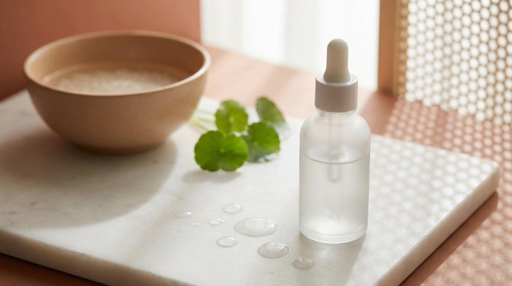
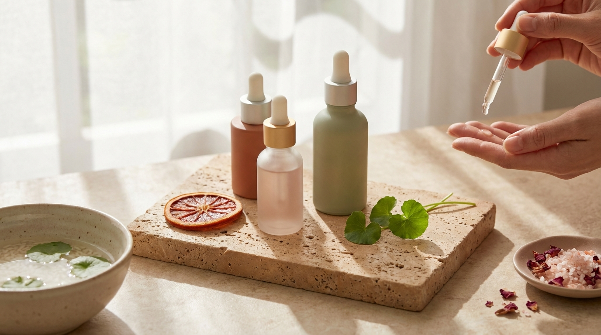

¡Hola! Soy J desde Seúl. Si alguna vez has visto un K-Drama o has observado las campañas de cosmética en las calles de Myeongdong o Seongsu, habrás notado que el objetivo principal del cuidado de la piel en Corea rara vez es "blanquear" de forma agresiva. El verdadero estándar de belleza coreano se centra en la claridad, la uniformidad y una luminosidad limpia que refleje salud interna.

Para lograr ese aspecto luminoso y descansado, los laboratorios cosméticos de Corea del Sur han perfeccionado una fórmula que une lo mejor de dos mundos: la sabiduría botánica tradicional de la península y la investigación dermatológica contemporánea. En el centro de esta unión destacan dos ingredientes estrella: el extracto de arroz (*Oryza sativa*) y la niacinamida (vitamina B3). A continuación, analizamos cómo funciona esta sinergia, qué revela el listado INCI y cómo puedes aprovechar sus propiedades desde casa sin caer en promesas irreales.

## Puntos clave

- **Origen complementario:** Combina un ingrediente botánico con siglos de historia en la península coreana con una molécula respaldada por amplia evidencia dermatológica.
- **Acción multifuncional:** Mientras el arroz aporta nutrición, lípidos y antioxidantes para calmar y suavizar, la niacinamida interrumpe la transferencia de pigmento hacia la superficie cutánea.
- **Tolerancia cutánea:** A diferencia de ácidos exfoliantes fuertes, este dúo destaca en los análisis cosméticos por su suavidad, siendo adecuado para pieles sensibles o con barrera comprometida.
- **Uso progresivo:** La uniformidad del tono y la atenuación de manchas por hiperpigmentación requieren constancia diaria y el acompañamiento innegociable de un protector solar / bloqueador solar.

---

## La tradición del agua de arroz: de la dinastía Joseon a la cosmética actual

En la historia de Corea, el arroz nunca ha sido únicamente la base de la alimentación diaria; también ha sido un recurso fundamental para el cuidado dérmico. Durante la dinastía Joseon, las mujeres de la corte y del pueblo utilizaban el *migam-su* (미감수), que es el agua lechosa resultante del primer y segundo lavado del grano de arroz, para enjuagarse el rostro cada mañana.

En los registros históricos se describe que este gesto dejaba la piel suave, flexible y con un aspecto aterciopelado. Sin embargo, el método casero tradicional presentaba inconvenientes biológicos: el agua de arroz natural se fermenta con rapidez, acumula bacterias si se almacena a temperatura ambiente y puede contener restos de polvo o impurezas del cultivo.

Hoy en día, la industria del K-Beauty ha transformado ese ritual ancestral mediante procesos estandarizados de biotecnología. Las marcas coreanas purifican el grano, aíslan sus fracciones activas y, en muchos casos, aplican procesos de fermentación controlada para reducir el tamaño molecular de los nutrientes y facilitar su absorción.

### Componentes activos del arroz en el listado INCI

Cuando revisas la etiqueta de un cosmético coreano formulado con arroz, es común encontrar distintas variantes según la parte del grano utilizada y el método de procesamiento:

1. **Oryza Sativa (Rice) Bran Water:** Agua de salvado de arroz. Es la capa externa del grano, rica en lípidos nutritivos, vitaminas del complejo B y antioxidantes. Se utiliza como base sustituta del agua purificada común para ofrecer una hidratación más densa.
2. **Oryza Sativa (Rice) Extract:** Extracto integral del grano. Contiene aminoácidos esenciales, minerales y almidones que ayudan a formar una película protectora ligera sobre la piel, reteniendo la humedad.
3. **Ácido ferúlico y gamma-orizanol:** Son dos de los antioxidantes naturales más potentes del arroz. Contribuyen a neutralizar los radicales libres generados por la radiación ultravioleta y la contaminación urbana, factores directos del envejecimiento prematuro y la aparición de manchas.
4. **Filtrados de arroz fermentado (*Rice Ferment Filtrate*):** Obtenidos mediante microorganismos benéficos, estos extractos aumentan la disponibilidad de péptidos y mejoran la textura cutánea áspera sin causar irritación mecánica.

Esta riqueza nutricional convierte al arroz en un ingrediente base excelente dentro de una [rutina coreana para Glass Skin: 5 pasos esenciales según tu tipo de piel](/blog/rutina-coreana-piel-de-porcelana-glass-skin/), donde se busca hidratar por capas para lograr un acabado translúcido.

---

## Niacinamida: el estándar científico para unificar el tono y regular el sebo



<p class="img-cap">※ Imagen ilustrativa generada con IA</p>

Si el arroz representa el legado botánico, la niacinamida encarna la precisión de la cosmética funcional moderna. Conocida químicamente como nicotinamida o vitamina B3, es una sustancia hidrosoluble con un perfil de estabilidad y tolerancia excepcionalmente alto.

En el marco regulatorio del Ministerio de Seguridad de Alimentos y Medicamentos de Corea del Sur (MFDS), la niacinamida está catalogada formalmente como un ingrediente funcional para el cuidado del tono cuando se incluye en concentraciones a partir del 2%.

### Mecanismo de acción frente a las manchas

A diferencia de otros activos despigmentantes que actúan destruyendo las células productoras de color o inhibiendo agresivamente la enzima tirosinasa, la niacinamida opera de manera más respetuosa con el tejido cutáneo:

- **Frena la transferencia de melanosomas:** La melanina se produce en los melanocitos situados en la capa basal de la epidermis. Para que una mancha sea visible en la superficie, estos paquetes de pigmento (melanosomas) deben viajar hacia los queratinocitos circundantes. La niacinamida interrumpe este transporte, impidiendo que el exceso de pigmentación suba a las capas visibles de la piel.
- **Refuerza la síntesis de ceramidas:** Estimula la producción natural de lípidos y ácidos grasos libres en el estrato córneo, lo que fortalece la barrera cutánea frente a la deshidratación y agresores externos.
- **Regulación sebácea y propiedades calmantes:** Ayuda a equilibrar la secreción de grasa en los poros y modula las respuestas inflamatorias leves, resultando muy útil para quienes buscan prevenir la hiperpigmentación posinflamatoria (las marcas oscuras o rojizas que suelen quedar tras los brotes de acné).

### Concentraciones en la cosmética coreana: ¿más es siempre mejor?

En los mercados occidentales se han popularizado concentraciones elevadas de niacinamida (10%, 15% o incluso 20%). Sin embargo, la formulación clásica del K-Beauty suele apostar por rangos del **2% al 5%**.

La literatura dermatológica señala que el rango de 2% a 5% es el que cuenta con mayor respaldo de estudios clínicos independientes para mejorar la apariencia de manchas y luminosidad sin alterar la barrera cutánea. En Seúl, los formuladores priorizan la compatibilidad diaria y la aplicación por capas sobre la alta potencia aislada, evitando el enrojecimiento o ardor transitorio que a veces provocan los porcentajes elevados.

---

## Por qué el arroz y la niacinamida forman el dúo iluminador por excelencia

La razón por la cual este par de ingredientes domina las secciones de cuidado facial en tiendas como Olive Young se debe a su complementariedad biológica. La hiperpigmentación y el tono apagado rara vez tienen una única causa; suelen ser el resultado combinado de deshidratación, estrés oxidativo, inflamación y acumulación desordenada de melanina.

Cuando se formulan juntos o se combinan en la misma rutina, cubren múltiples frentes simultáneos:

```
[Estrés ambiental / UV] ──> Antioxidantes del Arroz (neutralizan radicales libres)
                                      │
[Fase de pigmentación]  ──> Niacinamida (bloquea la subida de melanosomas)
                                      │
[Superficie cutánea]   ──> Hidratación y lípidos del Arroz (suavizan y reflejan la luz)
                                      │
                        = Tono visiblemente más uniforme y piel flexible
```

1. **Aporte de luminosidad óptica vs. biológica:** El extracto de arroz acondiciona el relieve de la piel, alisando zonas secas o ásperas para que la luz natural se refleje de manera uniforme (efecto inmediato de piel descansada). Al mismo tiempo, la niacinamida trabaja a nivel celular atenuando gradualmente las manchas oscuras (efecto a mediano plazo).
2. **Sinergia antiinflamatoria:** Las pieles con tendencia a manchas posacné se benefician de la calma que proporciona la fracción lipídica del arroz unida al efecto modulador de la niacinamida, reduciendo las probabilidades de que un granito derive en una marca persistente.
3. **Estabilidad química:** A diferencia de la vitamina C pura (ácido L-ascórbico), que es altamente vulnerable al calor, la luz y el aire, tanto el extracto de arroz como la niacinamida son activos sumamente estables que no se oxidan con facilidad dentro del envase.

Para conocer cómo este tipo de formulaciones escala posiciones en el mercado local, puedes consultar el reporte sobre [los productos de skincare más vendidos en Olive Young Corea y por qué triunfan en Seúl](/blog/olive-young-mas-vendidos-corea-2026/).

---

## Comparativa técnica: Arroz frente a Niacinamida

Para entender con claridad qué esperar de cada activo, hemos resumido sus características técnicas y su comportamiento habitual en la piel:

| Criterio | Extracto / Agua de Arroz (*Oryza Sativa*) | Niacinamida (Vitamina B3) |
| :--- | :--- | :--- |
| **Naturaleza del activo** | Complejo botánico natural (extracto o fermento) | Molécula hidrosoluble sintética o purificada |
| **Función principal** | Nutrición, retención de agua y suavidad cutánea | Desacelerar transferencia de pigmento y reforzar barrera |
| **Impacto en manchas** | Preventivo e indirecto (antioxidante) | Directo sobre la dispersión de la melanina |
| **Regulación de sebo** | Baja o neutra (aporta emoliencia suave) | Alta (equilibra la producción en la zona T) |
| **Tolerancia dérmica** | Excelente, muy baja probabilidad de reactividad | Muy alta entre el 2% y 5%; vigilar >10% en piel sensible |
| **Paso típico en rutina** | Tónicos lechosos, esencias hidratantes, cremas | Sueros (serums), ampollas concentradas, cremas gel |

Esta distinción aclara por qué no es necesario elegir entre uno u otro: mientras el arroz crea el entorno hidratante ideal, la niacinamida realiza el trabajo correctivo específico.

---

## Cómo integrar este dúo en tu rutina facial paso a paso

Integrar arroz y niacinamida no requiere una rutina exhaustiva de diez pasos. La versatilidad de ambos permite incorporarlos tanto en rutinas matutinas como nocturnas.

```
Paso 1: Limpieza suave
Paso 2: Tónico de arroz lechoso (humectar y preparar)
Paso 3: Suero con niacinamida (foco en manchas y poros)
Paso 4: Crema hidratante / humectante
Paso 5 (Día): Protector solar / bloqueador solar (imprescindible)
```

### 1. El tónico de arroz lechoso como primer velo de hidratación
Los tónicos de arroz suelen distinguirse visualmente por su tonalidad blanquecina, parecida a la leche de arroz ligera. 
- Aplica unas gotas directamente en las palmas de las manos (evita el disco de algodón para no desperdiciar producto) y presiona suavemente sobre el rostro limpio.
- Si notas la piel especialmente seca o deshidratada tras el invierno o exposiciones climáticas fuertes, puedes aplicar dos capas sucesivas antes de que la anterior se absorba por completo.

### 2. El suero concentrado para tratar áreas específicas
Si tu producto de arroz ya contiene niacinamida integrada en su fórmula, habrás simplificado el proceso en un solo paso. En caso de usar un suero de niacinamida independiente:
- Coloca dos o tres gotas tras el tónico.
- Distribúyelo por todo el rostro, haciendo especial énfasis en mejillas, frente o áreas propensas a hiperpigmentación posacné o manchas solares.

### 3. Sellado y protección indispensable
Para que los ingredientes activos realicen su trabajo sin interferencias externas, sella la hidratación con una crema adaptada a tu biotipo cutáneo. Durante la rutina de día, la aplicación de protector solar o bloqueador solar es de carácter obligatorio: de nada servirá tratar una mancha si la radiación UV continúa activando la producción descontrolada de melanina en la base epidérmica.

> **Consejo editorial de compra y aplicación:**  
> Si adquieres cosmética coreana con extracto de arroz a través de plataformas internacionales, revisa siempre que el envase mantenga su precinto original de fábrica. Antes de aplicar cualquier producto nuevo en todo el rostro, realiza una prueba de parche en la cara interna del antebrazo durante 24 a 48 horas. Para saber cómo identificar distribuidores oficiales y evitar falsificaciones, puedes apoyarte en nuestra [guía para comprar cosmética coreana original: Olive Young Global y YesStyle](/blog/como-comprar-cosmetica-coreana-online-desde-casa/).

---

## Precauciones y combinaciones con otros ingredientes activos



<p class="img-cap">※ Imagen ilustrativa generada con IA</p>

A pesar de ser ingredientes con un perfil de seguridad dermatológica muy favorable, conviene tener en cuenta ciertas normas de convivencia cosmética para evitar desequilibrios en la barrera de la piel:

- **Con Vitamina C (ácido ascórbico puro):** Existía el mito histórico de que la niacinamida y la vitamina C se anulaban mutuamente formando ácido nicotínico. La formulación cosmética moderna ha demostrado que pueden coexistir en la misma rutina sin problemas en pieles sanas. No obstante, si tu piel tiende a enrojecerse con facilidad, es más prudente usar la vitamina C por la mañana y la niacinamida con arroz por la noche.
- **Con ácidos exfoliantes (AHA / BHA):** El extracto de arroz y la niacinamida son excelentes compañeros post-exfoliación química suave, ya que calman el tejido y restablecen la hidratación perdida tras el uso de ácido glicólico o salicílico.
- **Con retinoides:** La capacidad de la niacinamida para estimular las ceramidas la convierte en el amortiguador ideal para acompañar tratamientos con retinol o retinal, reduciendo el riesgo de descamación y tirantez.

---

## Preguntas frecuentes (FAQ)

### ¿El tónico de arroz puede obstruir los poros o provocar brotes en pieles grasas?
En general, no. El agua de arroz cosmética y los extractos purificados no contienen aceites pesados ni comedogénicos por sí mismos. Lo que determina si un producto es apto para piel grasa es el conjunto de la fórmula: si la base del tónico es acuosa y ligera, resultará beneficiosa. Si incluye aceites vegetales espesos para piel seca, podría sentirse pesada. Revisa que el producto indique textura fluida o acabado fresco.

### ¿Cuánto tiempo tarda en notarse una mejoría en las manchas oscuras?
Los ciclos de renovación celular de la epidermis tardan en promedio entre 28 y 40 días, dependiendo de la edad. Por ello, la reducción visual de manchas o marcas posinflamatorias con niacinamida y arroz suele requerir de 6 a 12 semanas de aplicación constante dos veces al día, siempre acompañada de protección solar rigurosa. Los efectos en hidratación y luminosidad superficial, por el contrario, suelen percibirse desde las primeras aplicaciones.

### ¿Es recomendable preparar agua de arroz casera en lugar de comprar un cosmético formulado?
Aunque la receta tradicional es popular en internet, los dermatólogos y formuladores desaconsejan el uso prolongado de agua de arroz casera no estandarizada. El agua casera carece de conservantes, por lo que acumula hongos y bacterias en cuestión de horas. Además, las moléculas de almidón caseras son demasiado grandes para penetrar en la piel y pueden arrastrar residuos de pesticidas presentes en los granos comerciales no destinados a uso cosmético.

### ¿Puedo utilizar arroz y niacinamida si tengo piel con rosácea o rojeces frecuentes?
Sí, de hecho suele ser una de las combinaciones mejor toleradas para pieles reactivas gracias a la acción calmante y fortalecedora de la barrera. Si presentas rojeces constantes, asegúrate de que la concentración de niacinamida no supere el 5% y verifica que la fórmula no incluya fragancias sintéticas ni aceites esenciales irritantes. Para pieles muy sensibles, combinar este régimen con activos de [Centella Asiática (Cica)](/blog/centella-asiatica-cica-beneficios-piel-sensible/) suele proporcionar un alivio adicional notable.