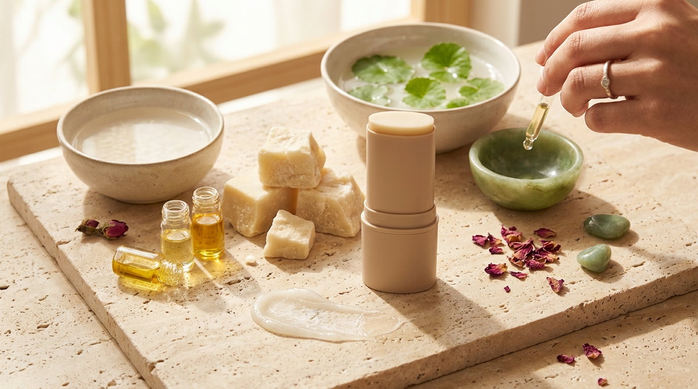
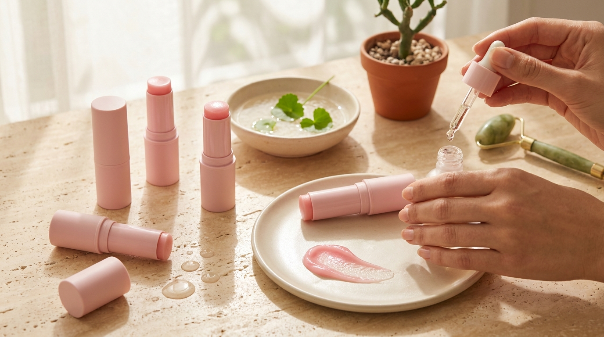

¡Hola! Soy J desde Seúl. Si disfrutas con frecuencia de las series coreanas, es casi seguro que has presenciado esta escena: la protagonista se encuentra en su escritorio de oficina, dentro de su coche antes de una cita o caminando por la calle, saca de su bolso un pequeño cilindro rosado o dorado y lo desliza con suavidad sobre los pómulos, el cuello y los labios. En apenas tres segundos, su rostro luce jugoso, luminoso y descansado.

Esta constante aparición ha despertado una enorme curiosidad fuera de Corea. Muchas personas se preguntan si se trata de un simple truco publicitario o si los llamados *multi-balm* (bálsamos multiusos en barra) son herramientas cosméticas realmente útiles para el cuidado diario. Para entender su verdadero valor, es necesario analizar tanto el contexto sociocultural en Seúl como la química detrás de sus formulaciones.

## Puntos clave

- **Fórmula oclusiva portátil**: los multi-balm son emulsiones anhidras o de muy bajo contenido acuoso, diseñadas para sellar la humedad en zonas puntuales propensas a la deshidratación.
- **Doble función cosmética**: combinan el tratamiento de líneas finas de expresión con un acabado óptico de piel de porcelana (*glass skin*) sin necesidad de purpurina o iluminadores tradicionales.
- **Idoneidad según el tipo de piel**: resultan sumamente beneficiosos para pieles secas, maduras o expuestas a calefacción y aire acondicionado, pero deben usarse con cautela en pieles grasas o con tendencia acneica.
- **Técnica de aplicación estratégica**: para no arrastrar la base de maquillaje, la técnica preferida en Seúl consiste en calentar el producto con las yemas de los dedos o aplicarlo mediante toques suaves en lugar de frotar la barra directamente.

---

## El fenómeno del Multi-Balm: entre el patrocinio televisivo y la vida en Seúl

La presencia masiva de estos bálsamos en las pantallas internacionales comenzó formalmente como una estrategia de *PPL* (*Product Placement* o emplazamiento de producto). En la industria televisiva de Corea del Sur, las marcas de belleza invierten sumas considerables para integrar sus lanzamientos en las tramas cotidianas de los personajes. Como analizamos al explicar las [costumbres de los K-Dramas explicadas desde Seúl](/blog/costumbres-curiosas-kdramas-explicadas-por-coreano/), los hábitos de autocuidado en Corea son sumamente visibles en la vida pública y no se limitan a la intimidad del cuarto de baño.

Sin embargo, el éxito sostenido de este formato no se debe únicamente a la publicidad. En Seúl, las condiciones ambientales justifican plenamente la necesidad de un cosmético hidratante de bolsillo:

1. **El impacto del clima interior**: durante el invierno coreano, el uso intensivo del sistema de calefacción tradicional (*ondol*) y de calefactores de aire en oficinas y transportes públicos deshidrata la piel a un ritmo acelerado. En verano, el aire acondicionado produce un efecto deshidratante similar.
2. **Jornadas laborales prolongadas**: retocar una rutina facial completa durante el día laboral resulta inviable. El formato en barra permite reaplicar agentes emolientes sin ensuciarse las manos y en cuestión de segundos.
3. **Cultura de la prevención**: en el K-Beauty, la aparición de arrugas superficiales se atribuye en gran medida a la pérdida transepidérmica de agua (TEWL). Tratar las zonas críticas antes de que la tirantez se consolide es una norma básica.

Por estas razones, los lineales de tiendas como Olive Young en barrios como Myeongdong o Gangnam cuentan con secciones enteras dedicadas a barras hidratantes, aclarantes y calmantes de diversas marcas locales.

---

## Anatomía de un bálsamo en barra: qué contiene realmente su fórmula

※ Imagen ilustrativa generada con IA

Para comprender para qué sirve un bálsamo multiusos, conviene revisar la lista oficial de ingredientes (INCI) de las referencias más vendidas en Corea. A diferencia de una crema hidratante tradicional, que suele contener entre un 60% y un 80% de agua purificada, el multi-balm se basa en matrices lipídicas compactas.

### La base oclusiva y emoliente
La estructura sólida de estas barras se consigue mediante ceras sintéticas o de origen vegetal (como cera de candelilla, cera de abejas o cera de arroz) combinadas con aceites vegetales altamente afines al sebo humano, tales como el aceite de semilla de girasol, de jojoba o manteca de karité. Esta mezcla crea una barrera física sobre el estrato córneo que minimiza la evaporación del agua celular.

### Activos antiedad y reafirmantes
En los rankings coreanos, las fórmulas más demandadas suelen incorporar:
- **Colágeno hidrolizado o de bajo peso molecular**: ayuda a acondicionar la superficie cutánea y retener humedad.
- **PDRN de salmón (polidesoxirribonucleótido)**: un ingrediente ampliamente utilizado en la cosmética coreana moderna para favorecer los procesos naturales de regeneración de la barrera cutánea.
- **Péptidos**: cadenas de aminoácidos que contribuyen a mejorar la elasticidad y firmeza superficial.

### Agentes iluminadores y antioxidantes
Muchas versiones integran niacinamida y extractos fermentados para aportar luminosidad progresiva y combatir el aspecto apagado que produce el estrés diario. Si buscas entender cómo actúan estos activos para emparejar el rostro, puedes profundizar en nuestra guía sobre [extracto de arroz y niacinamida para iluminar la piel](/blog/agua-de-arroz-niacinamida-iluminar-piel/).

Esta combinación produce de inmediato ese efecto luminoso tan codiciado en las series, el cual forma parte indispensable de la [rutina coreana para lograr Glass Skin](/blog/rutina-coreana-piel-de-porcelana-glass-skin/).

---

## Comparativa práctica: Multi-Balm frente a otros formatos de hidratación

Antes de decidir si este producto encaja en tu tocador, resulta útil comparar sus características con las de alternativas convencionales:

| Característica | Multi-Balm en barra | Crema hidratante facial | Aceite facial líquido |
| :--- | :--- | :--- | :--- |
| **Contenido principal** | Ceras y aceites vegetales densos | Emulsión equilibrada de agua y lípidos | Lípidos puros 100% líquidos |
| **Portabilidad** | Excelente (sin riesgo de derrames) | Regular (envases grandes o tarros) | Baja (frascos con gotero frágiles) |
| **Uso sobre maquillaje** | Muy fácil (zonas altas del rostro) | Difícil (suele mover la base) | Complejo (puede disolver pigmentos) |
| **Efecto visual inmediato** | Brillo húmedo focalizado (*glow*) | Acabado natural o satinado | Brillo global en todo el rostro |
| **Tipo de piel recomendado** | Seca, normal, madura o deshidratada | Todos los tipos de piel | Seca o con barrera muy dañada |
| **Comedogenicidad potencial** | Media-alta (por ceras/mantecas) | Variable (según formulación) | Variable (según tipo de aceite) |

---

## ¿Cuándo tiene sentido incorporar un bálsamo en barra?

El multi-balm no fue concebido para sustituir a tu crema hidratante matutina ni a tu tratamiento de noche. Su propósito principal es el **rescate focalizado** a lo largo del día.

### Casos en los que resulta sumamente útil:
1. **Líneas del cuello y escote**: el cuello tiene menos glándulas sebáceas que el rostro, por lo que tiende a resecarse rápidamente. Aplicar la barra en sentido ascendente mantiene la zona elástica.
2. **Pata de gallo y contorno de ojos**: hacia la mitad de la jornada, la piel del contorno suele acusar fatiga y el corrector puede cuartearse. Un leve toque de bálsamo devuelve frescura al instante.
3. **Puntos altos del rostro como iluminador natural**: si prefieres el estilo de belleza sobrio característico de las actrices coreanas, puedes revisar nuestro análisis sobre el [maquillaje natural de actrices de K-Drama](/blog/maquillaje-natural-actrices-kdrama-paso-a-paso/). Un multi-balm funciona como un iluminador sin partículas brillantes, reflejando la luz natural de manera orgánica.
4. **Zonas ásperas adicionales**: labios secos, comisuras de la nariz irritadas por resfriados o alergias, y cutículas de las uñas.

### Cuándo conviene prescindir de él o extremar precauciones:
- **Pieles grasas o con brotes de acné activo**: la alta concentración de ceras y ésteres grasos puede obstruir los poros dilatados de la zona T (frente, nariz y mentón), favoreciendo la aparición de comedones cerrados.
- **Climas con humedad ambiental extrema**: si vives en una zona tropical o muy húmeda, la capa oclusiva puede sentirse pesada e incómoda sobre la piel.

> **Consejo desde Seúl:** Si llevas base de maquillaje o protector solar con color, no deslices la barra con fuerza sobre la mejilla, ya que la fricción arrastrará el pigmento y creará parches irregulares. La técnica recomendada por los estilistas en Corea consiste en frotar suavemente la superficie de la barra con la yema del dedo anular limpio y depositar el producto mediante pequeños toques de presión sobre el pómulo.

---

## Cómo elegir la opción adecuada según tus necesidades

※ Imagen ilustrativa generada con IA

El mercado coreano ha diversificado las barras multiusos para responder a distintas problemáticas, alejándose del modelo único original:

### 1. Barras de colágeno y nutrición (las clásicas de color rosa)
Están orientadas a pieles que buscan elasticidad, firmeza y un acabado notablemente jugoso. Suelen contener péptidos y derivados marinos. Son las que ofrecen el brillo más evidente.

### 2. Barras calmantes (habitualmente verdes o blancas)
Formuladas con extracto de centella asiática, madecassoside o árbol de té. Están diseñadas para calmar rojeces localizadas y aportar alivio en mejillas irritadas por el viento o los cambios bruscos de temperatura, con una textura considerablemente menos grasa.

### 3. Barras de vitamina C y aclarantes (tonos amarillos o anaranjados)
Enfocadas en aportar luminosidad a manchas solares superficiales y pecas. Suelen combinar derivados estables de vitamina C con bisabolol o niacinamida.

Si deseas adquirir estos productos de forma directa y segura desde Latinoamérica o España, recuerda verificar que procedan de distribuidores autorizados revisando nuestra [guía para comprar cosmética coreana online](/blog/como-comprar-cosmetica-coreana-online-desde-casa/).

---

## Preguntas frecuentes (FAQ)

### ¿El multi-balm sustituye a mi crema de noche o a mi contorno de ojos habitual?
No. Los bálsamos multiusos están diseñados como un complemento portátil de retoque o un sellador puntual. Su textura densa no reemplaza el aporte equilibrado de agua y activos que suministra una rutina facial completa compuesta por tónico, sérum y crema hidratante.

### ¿Se contamina la barra al aplicarla repetidamente sobre la piel?
Al tratarse de un formato en barra que entra en contacto con la piel, existe una transferencia natural de microorganismos y residuos de sebo. Para mantenerla higiénica, se aconseja limpiar periódicamente la superficie superior de la barra con un pañuelo de papel limpio humedecido con alcohol o, preferiblemente, tomar el producto con los dedos limpios en lugar de frotar el tubo directamente sobre el rostro maquillado.

### ¿Se puede utilizar debajo del protector solar por la mañana?
Es posible aplicarlo en áreas muy secas antes del protector solar, pero se debe esperar unos minutos a que se asiente para que la base grasa no interfiera con la formación homogénea de la película protectora del bloqueador solar. Si tu protector ya es hidratante, suele ser más prudente reservar el multi-balm únicamente para retoques diurnos.

### ¿Por qué a algunas personas les produce pequeños granitos?
Esto suele ocurrir cuando personas con piel mixta o con predisposición a poros obstruidos lo aplican de manera indiscriminada en todo el rostro, especialmente en la zona T. Al ser una fórmula predominantemente oclusiva, atrapa el sebo y las células muertas si los poros son propensos a taparse. En pieles mixtas, su uso debe restringirse a los pómulos altos y el cuello.