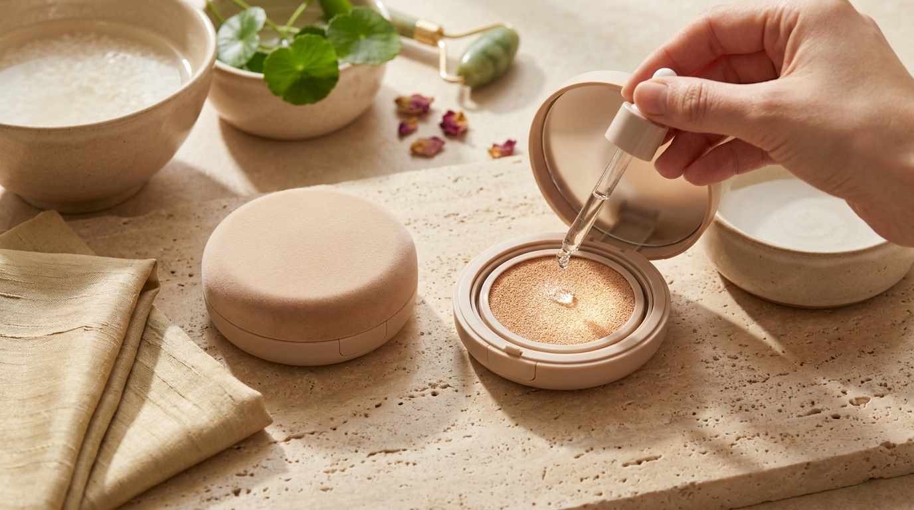

¡Hola! Soy J desde Seúl. Si alguna vez has visto un K-Drama o has navegado por las secciones de maquillaje de Olive Young, seguro que te has fijado en esos elegantes estuches compactos que las actrices sacan del bolso para retocarse en cuestión de segundos. La base cushion (*cushion foundation*) revolucionó la industria cosmética coreana hace más de quince años y hoy sigue siendo el formato preferido en Seúl por su practicidad, ligereza y acabado uniforme.

Sin embargo, cuando decides comprar una base cushion desde Latinoamérica o España a través de tiendas online, surgen dos grandes dudas: ¿qué significan exactamente números como 21, 23 o 25? y ¿cuál es la diferencia real entre un acabado jugoso (*glow*) y uno aterciopelado (*semimate*)? En esta guía analizamos cómo funciona el sistema de tonalidades en K-Beauty, qué ingredientes caracterizan a cada fórmula y cómo acertar en tu elección sin salir de casa.

## Puntos clave

- **Sistema numérico estándar**: La cosmética coreana no suele utilizar nombres descriptivos (como "Ivory" o "Beige"), sino un rango numérico donde los números más bajos representan tonos más claros y los más altos, tonos más profundos.
- **Subtonos C, N y W**: La letra que acompaña al número define si la fórmula tiene una base fría y rosada (Cool), neutra (Neutral) o cálida y amarillenta (Warm).
- **Glow vs. Semimate**: Las versiones *glow* contienen polímeros hidratantes y emolientes pensados para piel normal a seca, mientras que las semimate integran polvos esféricos absorbentes diseñados para piel mixta o grasa.
- **Preparación y técnica**: A diferencia de las bases fluidas occidentales, el cushion se aplica mediante toques suaves (*patting*) con su borla especializada, sin arrastrar el producto sobre la piel.

---

## El sistema numérico de tonos en K-Beauty: qué significan 19, 21, 23 y 25

Una de las mayores sorpresas para quienes se acercan por primera vez al maquillaje coreano es encontrarse con una gama de tonos numerada de forma muy compacta. Mientras que las marcas occidentales suelen ofrecer decenas de opciones con nombres abstractos, las marcas de K-Beauty se basan históricamente en un estándar industrial desarrollado en Corea del Sur.

```
Escala de Tonos K-Beauty:
[13 / 17] Muy claro (Fair/Light)
   ↓
[19 / 21] Claro a medio claro (Light to Light-Medium) — Tono estándar en Seúl
   ↓
[23]      Medio neutro (Medium) — Subtono más balanceado
   ↓
[25]      Medio cálido (Medium Tan) — Diseñado para pieles ligeramente bronceadas
```

### El tono 21: el epicentro del mercado coreano

El número **21** es la referencia absoluta en Corea del Sur. Casi el 60% de los lanzamientos y reposiciones en las tiendas Olive Young de Seúl se concentran en esta tonalidad. Representa una piel clara a medio-clara, equivalente a un tono MAC NC15-NC20 o un tono 110-120 en gamas globales estándar. Si en las bases occidentales sueles elegir las opciones más claras de la gama media, el 21 suele ser la opción habitual.

### El tono 23: el tono medio natural

El número **23** es la segunda opción más popular y la más recomendada para quienes tienen un tono de piel trigueño claro o beige natural. Equivale aproximadamente a un MAC NC25-NC30. Si el tono 21 te resulta demasiado blanquecino o cenizo en fotografía, el 23 ofrece una calidez más equilibrada y suele fundirse con mayor facilidad en pieles de subtono neutro o ligeramente dorado.

### El tono 25 y los tonos especiales (13, 17, 19)

- **Tonos 13 y 17**: Creados para pieles extremadamente claras (porcelana), habituales en marcas juveniles como Rom&nd o Clio.
- **Tono 19**: Un paso intermedio para quienes encuentran el 17 muy blanco pero el 21 ligeramente oscuro.
- **Tono 25**: Es el tono más profundo dentro de las líneas habituales de K-Beauty (equivalente aproximado a MAC NC35 o ligeramente superior). Marcas como Laneige, Espoir o Missha suelen incluirlo en sus líneas globales. Si tienes una tez morena o bronceada, el número 25 es el punto de partida mínimo a considerar.

### Cómo descifrar los subtonos: C, N y W

En los últimos años, para satisfacer la demanda internacional y la creciente preferencia por acabados naturales, las marcas han añadido letras al número principal:

- **C (Cool / Rosado)**: 21C o 23C. Aporta luminosidad con pigmentos fríos. Es ideal si tu piel tiende a quemarse fácilmente bajo el sol y tus venas se ven azuladas o violáceas.
- **N (Neutral / Neutro)**: 21N o 23N. Mantiene un equilibrio entre beige y amarillo, sin virar al rosa. Es la opción más segura si tienes dudas sobre tu subtono.
- **W (Warm / Cálido o Amarillo)**: 21W o 23W. Neutraliza rojeces leves y complementa pieles con subtonos cetrinos, dorados o aceitunados.

Para quienes buscan replicar el estilo fresco de las producciones coreanas, conocer este equilibrio es crucial. Puedes profundizar en estas técnicas en nuestro artículo sobre [maquillaje de K-Drama al detalle: claves del estilo natural de las actrices](/blog/maquillaje-natural-actrices-kdrama-paso-a-paso/).

---

## Acabado Glow vs. Acabado Semimate: ¿cuál encaja mejor con tu piel?



<p class="img-cap">※ Imagen ilustrativa generada con IA</p>

Más allá del color, el gran dilema al elegir un cushion coreano radica en su textura final. En Seúl, las tendencias cambian según la estación: en otoño e invierno domina el brillo acuoso (*mool-gwang*), mientras que en el caluroso y húmedo verano coreano triunfa el acabado aterciopelado (*velvet* o semimate).

```
          ┌───────────────────────────┐
          │   ¿Qué buscas en tu piel? │
          └─────────────┬─────────────┘
                        │
         ┌──────────────┴──────────────┐
         ▼                             ▼
   [Luminosidad /                [Duración /
    Efecto Jugoso]              Control de Sebo]
         │                             │
         ▼                             ▼
   ACABADO GLOW                 ACABADO SEMIMATE
 (Ácido hialurónico,          (Polvos de sílice,
  aceites botánicos)           polímeros fijadores)
```

### Cojín Glow (Dewy / Jugoso)

Las bases cushion de acabado *glow* están formuladas para recrear la famosa piel luminosa coreana. Si sigues una [rutina coreana para Glass Skin: 5 pasos esenciales según tu tipo de piel](/blog/rutina-coreana-piel-de-porcelana-glass-skin/), este acabado es la extensión cosmética natural de ese cuidado previo.

- **Composición típica**: Suelen contener alto porcentaje de esencias hidratantes, ácido hialurónico de bajo peso molecular, glicerina y extractos como savia de abedul o agua de rosas.
- **Sensación al tacto**: Deja la piel elástica y fresca, reflejando la luz en puntos estratégicos (pómulos, puente de la nariz y frente).
- **Para quién es ideal**: Piel seca, deshidratada, madura o personas que viven en climas fríos y de baja humedad ambiental.
- **Puntos a considerar**: Su durabilidad suele ser menor (entre 4 y 6 horas) y pueden transferirse ligeramente a la mascarilla o la ropa si no se sellan en zonas críticas con polvos translúcidos.

### Cojín Semimate (Velvet / Satinado)

El cushion semimate no busca un efecto mate acartonado o empolvado clásico de los años 90, sino lo que en Corea se describe como piel de melocotón: suave, uniforme y con una mínima luminosidad interna, pero sin brillo oleoso superficial.

- **Composición típica**: Incorpora polímeros formadores de película ligera (*film-formers*) y polvos esféricos de sílice (*silica*) que absorben el exceso de sebo a lo largo del día.
- **Sensación al tacto**: Fijación rápida, sensación seca al tacto tras un minuto de aplicación y mayor resistencia a la fricción.
- **Para quién es ideal**: Piel mixta, grasa o personas que residen en climas cálidos y húmedos donde el maquillaje tiende a descomponerse rápidamente.
- **Puntos a considerar**: Requiere que la piel esté bien exfoliada e hidratada previamente; de lo contrario, puede acentuar parches secos alrededor de la nariz o líneas de expresión finas.

---

## Tabla comparativa: fórmulas, acabados y tipos de piel

Para facilitarte la decisión antes de revisar catálogos online, esta tabla resume cómo se comportan las dos grandes familias de cushions en función de sus características formuladas:

| Característica | Cushion Glow (Acabado Luminoso) | Cushion Semimate (Acabado Velvet) |
| :--- | :--- | :--- |
| **Tipo de piel recomendado** | Seca, normal, deshidratada o madura | Mixta, grasa o con poros dilatados |
| **Nivel de cobertura** | Ligera a media modulable | Media a media-alta |
| **Ingredientes clave (INCI)** | Ácido hialurónico, glicerina, escualano | Polvos de sílice, dimeticona ligera, niacinamida |
| **Duración media estimada** | 4 a 6 horas (requiere retoque) | 7 a 10 horas (alta resistencia) |
| **Efecto visual** | Reflejo de luz acuoso (*Glass Skin*) | Textura difuminada y control de brillos (*Soft Focus*) |
| **Sensación en la piel** | Humectante, muy flexible | Ligera, fijada, apenas perceptible |
| **Transferencia** | Moderada | Muy baja tras fijarse |

---

## Cómo aplicar la base cushion para un resultado profesional

El éxito de una base cushion reside en un 50% en la fórmula y en otro 50% en la borla (*rubycell puff*) y la técnica de aplicación. Muchos usuarios acostumbrados a las brochas o esponjas humedecidas cometen errores al usar el cojín coreano por primera vez.

1. **Presión controlada**: Introduce dos o tres dedos bajo la cinta de la borla. Presiona suavemente la esponja impregnada en el centro del cojín. Con un solo toque ligero obtendrás suficiente producto para la mitad del rostro.
2. **Descarga en la contratapa**: Casi todos los estuches cushion incluyen una tapa interna que aísla la esponja del cojín. Antes de llevar la borla al rostro, dale un par de toques a la parte posterior de esa compuerta plástica para repartir la base de manera uniforme por la superficie de la borla.
3. **Técnica de toquecitos (*patting*)**: Aplica la base dando pequeños toques rítmicos sobre el rostro, empezando por las zonas más amplias (mejillas y frente) y avanzando hacia el centro (nariz y barbilla). **Nunca arrastres la borla**, ya que desplazarías el protector solar previo y crearías parches desiguales.
4. **Construcción por capas**: Si necesitas más cobertura sobre alguna marca o rojez, vuelve a tomar una cantidad mínima de producto y aplícala únicamente en esa zona puntual mediante pequeños golpecitos continuos.

> **Consejo de compra desde Seúl**: Si compras tu cushion a través de plataformas internacionales autorizadas como las que detallamos en nuestra [guía para comprar cosmética coreana original: Olive Young Global y YesStyle](/blog/como-comprar-cosmetica-coreana-online-desde-casa/), comprueba siempre si el producto incluye el repuesto (*refill*). Muchas marcas coreanas venden el estuche principal acompañado de una recarga adicional en la misma caja, lo que reduce sustancialmente el coste por mililitro.

---

## Preguntas frecuentes (FAQ)

### ¿La base cushion sustituye al protector solar diario?
Aunque la gran mayoría de cushions coreanos indican factores de protección altos (como SPF50+ PA++++), **no deben sustituir a tu protector solar habitual**. Para alcanzar el nivel de fotoprotección indicado en el envase se necesitaría aplicar aproximadamente 1,2 gramos de producto en el rostro (el equivalente a dos dedos de base fluida), una cantidad que ningún usuario aplica en maquillaje. El cushion debe considerarse un refuerzo adicional durante los retoques del día, pero siempre sobre un protector solar bien absorbido.

### ¿Con qué frecuencia se debe limpiar la borla (*puff*)?
Por motivos de higiene y para evitar la proliferación de bacterias dentro del estuche hermético, se recomienda lavar la borla al menos una vez por semana con agua tibia y un jabón suave o limpiador de brochas. Sécala presionándola entre toallas de papel sin retorcerla y déjala secar completamente al aire antes de guardarla. Si notas que ha perdido flexibilidad o que el producto no se descarga uniformemente, en tiendas online se venden paquetes de borlas de repuesto universales muy económicos.

### ¿Qué tono elijo si estoy indecisa entre el 21 y el 23?
Si tu piel no es extremadamente pálida y tienes dudas, la regla práctica más segura al comprar cosmética coreana online suele ser elegir el **tono 23**. Muchas personas hispanohablantes descubren que el tono 21, aunque en el frasco parece claro, tiene una alta concentración de dióxido de titanio que puede dejar un ligero velo blanquecino en persona o bajo flash fotográfico. Si eliges el 23 y resulta ligeramente oscuro, es mucho más fácil de equilibrar con un corrector claro que corregir una base 21 que te quede demasiado blanca.

### ¿Por qué mi cushion semimate se cuartea alrededor de la nariz?
Casi siempre se debe a una preparación insuficiente de la piel antes del maquillaje o a un exceso de acumulación de células muertas. Las fórmulas semimate contienen polvos que buscan adherirse rápidamente; si la piel presenta deshidratación superficial, la fórmula absorberá la poca humedad disponible y se quebrará. Asegúrate de aplicar una loción o crema hidratante ligera unos 5 minutos antes de la base y evita frotar la borla en los pliegues de la nariz: en esa área, utiliza solo el producto sobrante que quede en el borde de la esponja con toques muy tenues.