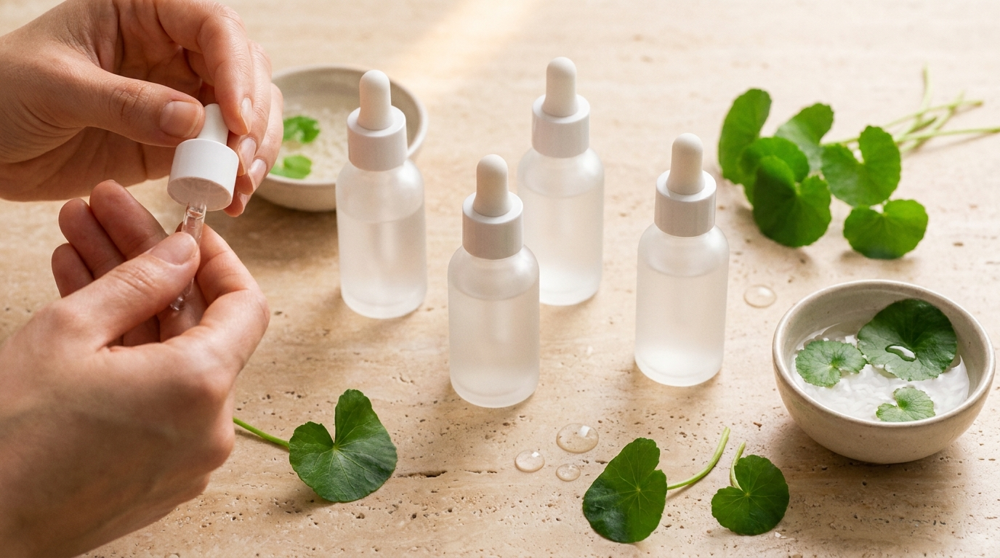
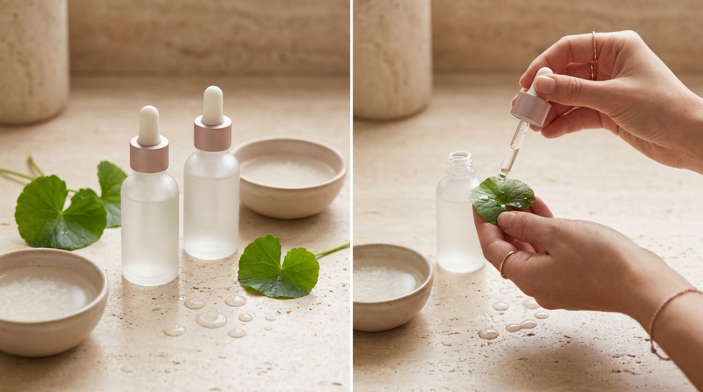

El término **Cica** es omnipresente en el mundo del cuidado facial surcoreano. En las tiendas de cosmética de Seúl y en las plataformas internacionales de K-Beauty, esta palabra figura en una inmensa variedad de presentaciones, desde tónicos acuosos y discos impregnados hasta cremas densas de rescate nocturno.

Detrás del concepto comercial «Cica» se encuentra una de las plantas más investigadas dentro de la botánica aplicada a la dermatología cosmética: la *Centella Asiatica*. Para quienes buscan mejorar el estado de su piel desde países hispanohablantes como México, Colombia, España, Argentina o Chile, comprender este ingrediente es fundamental para seleccionar fórmulas que ayuden a reconfortar la piel sensible, suavizar la apariencia de las rojeces y reforzar la función barrera sin dejarse llevar por reclamos desmedidos.

A continuación, se detalla la base científica de esta planta, sus cuatro moléculas activas purificadas y las claves para interpretar la lista de ingredientes (INCI) de los productos coreanos.

## Puntos clave

* **Origen y tradición**: La centella asiática, llamada localmente *byeongpul*, pasó de los ungüentos clásicos de botiquín al núcleo de la cosmética calmante actual.
* **Más allá del extracto simple**: Las fórmulas más avanzadas aíslan compuestos triterpénicos específicos como el madecassoside, el asiaticoside, el ácido madecásico y el ácido asiático.
* **Cuidado de la barrera cutánea**: Contribuye a minimizar la pérdida transepidérmica de agua y a aliviar la piel reactiva ante agresiones externas, cambios de temperatura o exfoliación excesiva.
* **Alta compatibilidad**: Se trata de un ingrediente versátil que suele combinarse de forma segura con activos intensos como el retinol, la vitamina C o los alfahidroxiácidos y betahidroxiácidos.

## Qué es la Centella Asiática y por qué Corea la llama «Cica»

La *Centella Asiatica* es una hierba perenne que se desarrolla predominantemente en zonas húmedas y pantanosas de Asia. Tradicionalmente se la ha denominado «hierba del tigre» (*tiger grass*), debido a historias populares que describían cómo estos felinos se frotaban contra la planta para aliviar heridas superficiales.

En Corea del Sur, la familiaridad con este ingrediente tiene antecedentes clínicos y caseros muy consolidados. Durante décadas, uno de los ungüentos farmacéuticos más comunes en los hogares del país ha sido *Madecassol*, formulado a partir del extracto de centella. Con el desarrollo de la cosmética orientada a pieles sensibilizadas por la polución urbana y el estrés ambiental, los laboratorios coreanos incorporaron esta base botánica a sus líneas de uso cotidiano.

La palabra **Cica** deriva históricamente del vocablo latino *cicatrix* (o del concepto francés de cicatrización cosmética). En el contexto moderno del K-Beauty, funciona como un término genérico para identificar productos diseñados con centella asiática o sus fracciones activas, orientados a brindar confort, mejorar la hidratación y reducir visiblemente el enrojecimiento superficial.

## Los cuatro activos clave en el INCI: cómo descifrarlos

※ Imagen ilustrativa generada con IA

Al examinar la nomenclatura internacional de ingredientes cosméticos (INCI) en un envase coreano, se observa que la concentración y el tipo de extracto varían de manera considerable entre productos.

Muchas opciones básicas emplean *Centella Asiatica Extract* o *Centella Asiatica Leaf Water*. Aunque estos extractos aportan frescura e hidratación ligera, las fórmulas más avanzadas —frecuentemente pertenecientes a líneas denominadas *Derma* o *Barrier Repair*— incorporan fracciones triterpénicas purificadas, conocidas en el sector como TECA (*Titrated Extract of Centella Asiatica*).

Estos son los cuatro derivados fundamentales que conviene identificar:

### Madecassoside
Es uno de los compuestos más valorados en las formulaciones coreanas. Se trata de una saponina triterpénica que destaca por su eficacia para mitigar la sensación de ardor y reducir visiblemente las rojeces ocasionadas por agentes ambientales o reactividad cutánea. Resulta idóneo en casos de tirantez o incomodidad tras la limpieza.

### Asiaticoside
Este glucósido triterpénico apoya la preservación de las proteínas estructurales en la superficie epidérmica. En dermocosmética suele incorporarse en tratamientos formulados para apoyar la elasticidad, mejorar la textura y acompañar el proceso natural de recuperación cutánea.

### Ácido Madecásico (Madecassic Acid)
Es una molécula de estructura aglicona reconocida por sus propiedades acondicionadoras. En las reseñas de usuarios en Corea se destaca con frecuencia su capacidad para suavizar áreas ásperas, descamadas o afectadas por deshidratación severa.

### Ácido Asiático (Asiatic Acid)
Al igual que el ácido madecásico, es un triterpeno purificado con notable acción antioxidante. Su presencia en la fórmula contribuye a neutralizar el impacto del estrés oxidativo y a respaldar la integridad de los lípidos intercelulares que forman la barrera cutánea.

## Tabla comparativa de derivados de la Centella Asiática

La siguiente relación permite contrastar las propiedades cosméticas de cada fracción presente en las etiquetas:

| Nombre en el INCI | Tipo de molécula | Beneficio principal cosmético | Textura habitual en K-Beauty |
| :--- | :--- | :--- | :--- |
| **Centella Asiatica Extract** | Extracto vegetal global | Hidratación base y alivio ligero | Tónicos acuosos, brumas y esencias |
| **Madecassoside** | Saponina triterpénica | Calma rojeces visibles e incomodidad | Sérums, ampollas y mascarillas de tela |
| **Asiaticoside** | Glucósido triterpénico | Favorece elasticidad y regeneración | Cremas barrera y emulsiones ligeras |
| **Madecassic Acid** | Ácido triterpénico | Suaviza zonas ásperas y descamadas | Bálsamos de rescate y pomadas cica |
| **Asiatic Acid** | Ácido triterpénico | Refuerzo antioxidante de la barrera | Cremas de noche y tratamientos densos |

## Cómo calma las rojeces y protege la barrera cutánea

Las rojeces cutáneas suelen vincularse a la hiperreactividad capilar frente a estímulos externos (fricción, cambios climáticos bruscos, limpiadores agresivos) y a un deterioro en la barrera lipídica, que incrementa la vulnerabilidad frente a partículas externas y acelera la deshidratación.

La centella asiática actúa mediante mecanismos complementarios:

1. **Acondicionamiento y confort dérmico**: Sus triterpenos intervienen favorablemente en las vías asociadas al disconfort cutáneo, reduciendo la apariencia de congestión y enrojecimiento.
2. **Soporte de la barrera lipídica**: Ayuda a mantener la cohesión epidérmica, lo que previene la pérdida transepidérmica de agua (TEWL) y preserva los niveles óptimos de humedad.
3. **Protección frente a radicales libres**: Su perfil antioxidante apoya la neutralización del daño inducido por la radiación ultravioleta y la contaminación, factores que suelen perpetuar la reactividad en pieles sensibles.

## Cómo integrar la cica en tu rutina según tu tipo de piel

La versatilidad de la centella asiática reside en que no es un ingrediente inherentemente oclusivo; sus características finales dependen de la formulación en la que se integre.

### Piel grasa o con tendencia a imperfecciones
Es habitual recomendar formulaciones en gel o ampollas de base acuosa. Este perfil permite reconfortar zonas con brotes visibles sin añadir pesadez ni obstruir los poros, frecuentemente en sinergia con ingredientes complementarios como el árbol de té (*tea tree*) o el ácido succínico.

### Piel seca o deshidratada
Las cremas de tipo bálsamo (*cica balms*) o emulsiones enriquecidas suelen combinar el extracto con ceramidas, escualano o lípidos vegetales. Esta combinación ayuda a sellar la hidratación y alivia la sensación persistente de tirantez.

### Piel mixta o con rojeces difusas
Los tónicos calmantes ligeros y los discos impregnados (*toner pads*) con madecassoside son formatos de gran aceptación. Es común su aplicación localizada durante varios minutos en mejillas o frente a modo de compresa refrescante.

> **Recomendación de uso:** Aunque la centella asiática presenta un excelente perfil de tolerancia, cualquier compuesto botánico puede desencadenar sensibilidad individual. Antes de incorporar un cosmético concentrado, es aconsejable aplicar una pequeña muestra en la zona interna del antebrazo durante 24 horas para comprobar la compatibilidad dérmica.

## Cómo identificar productos de calidad al comprar cosmética coreana

※ Imagen ilustrativa generada con IA

Al adquirir productos mediante distribuidores autorizados o plataformas de importación, conviene considerar estos criterios:

* **Ubicación en el INCI**: Cuando se busca un efecto calmante apreciable, es preferible que la centella asiática o sus triterpenos aparezcan en los primeros puestos del listado, y no de forma testimonial al final.
* **Complejos estandarizados**: Diversos laboratorios coreanos incorporan mezclas patentadas que integran los cuatro triterpenos (madecassoside, asiaticoside, ácido madecásico y ácido asiático) junto con agentes humectantes como el pantenol (provitamina B5).
* **Fórmulas libres de aceites esenciales fuertes**: Para pieles con tendencia a la reactividad o rojeces frecuentes, suele ser recomendable priorizar fórmulas sin fragancias añadidas ni aceites esenciales intensos (como cítricos o lavanda), los cuales podrían contrarrestar el efecto calmante.

## Preguntas frecuentes (FAQ)

### ¿La centella asiática cura afecciones como el acné o la rosácea?
No. Los productos cosméticos con centella asiática no son medicamentos y no curan patologías dermatológicas como la rosácea o el acné, las cuales requieren supervisión médica y tratamiento farmacológico específico. No obstante, dentro de una rutina cosmética adecuada, la centella asiática contribuye a calmar la apariencia de irritación, reconfortar la tirantez y mantener la barrera cutánea en buen estado de hidratación.

### ¿Se puede usar Cica junto con retinol, vitamina C o ácidos exfoliantes?
Sí, es una de las combinaciones más frecuentes en K-Beauty. La centella asiática y sus derivados aportan soporte calmante, lo que ayuda a reducir la propensión a la sequedad o a las rojeces superficiales al utilizar activos transformadores intensos.

### ¿Qué diferencia existe entre la centella asiática y el pantenol?
Ambos ingredientes favorecen el bienestar cutáneo, pero operan de forma distinta. El pantenol actúa principalmente como un potente agente humectante que capta y retiene humedad en el tejido epidérmico. La centella asiática destaca por sus propiedades acondicionadoras y calmantes frente a la incomodidad cutánea. Por esta complementariedad, es muy común encontrarlos combinados en fórmulas reparadoras.

### ¿Puede aplicarse de día antes del protector solar?
Sí. La centella asiática carece de potencial fotosensibilizante. Su aplicación matutina ayuda a acondicionar la piel frente a factores ambientales adversos y ofrece una base hidratada y confortable antes de colocar el protector o bloqueador solar.