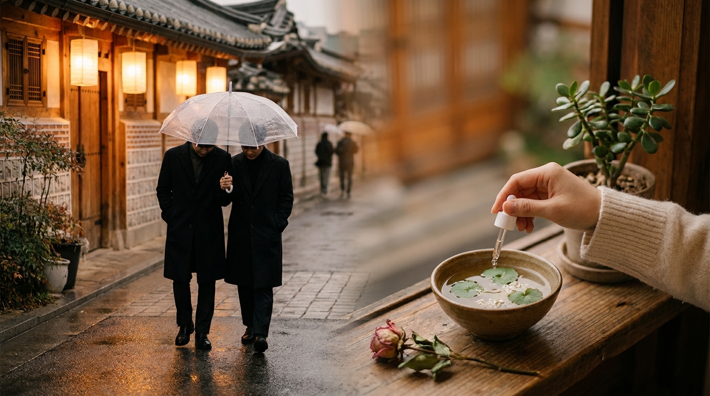
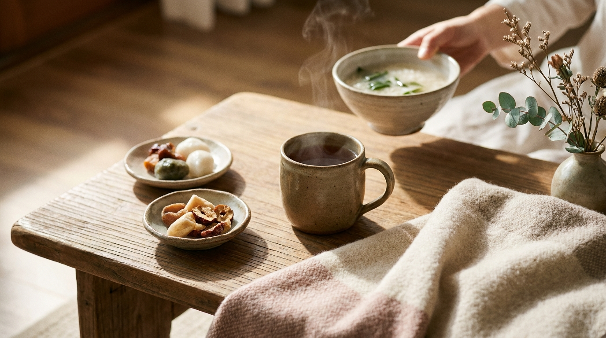

¡Hola! Soy J desde Seúl. Si disfrutas de las series coreanas desde casa, es prácticamente imposible que no hayas visto esta escena: cae una lluvia torrencial, aparece un paraguas amarillo (o transparente de tienda de conveniencia) que cubre a la protagonista mientras el hombro del chico termina empapado, o el clásico regreso a casa donde el protagonista masculino lleva a la chica a cuestas cuesta arriba por un callejón empinado.

Para los espectadores de habla hispana en Latinoamérica o España, estos recursos pueden parecer simples fórmulas melodramáticas diseñadas para acelerar el romance en pantalla. Sin embargo, en Corea del Sur, muchos de estos momentos tienen una base física, geográfica y cultural muy concreta. En este artículo analizamos cinco de los clichés románticos más repetidos de los K-Dramas, desglosando qué parte corresponde a la dramatización televisiva y qué parte refleja la vida cotidiana real en Seúl.

## Puntos clave

- El *piggyback ride* (*eobuba*) combina una raíz histórica de cuidado familiar con la compleja topografía de colinas y escaleras que caracteriza a los barrios tradicionales de Seúl.
- La escena del paraguas compartido nace de la época del monzón coreano (*jangma*) y funciona como un código visual de sacrificio silencioso mediante el lenguaje corporal.
- Los clichés de cuidado físico —como desinfectar un rasguño menor o envolver al otro en una bufanda— canalizan el concepto cultural de *jeong* (afecto y empatía comunitaria) en una sociedad donde el contacto físico público solía ser reservado.
- La televisión coreana ha evolucionado notablemente: recursos antes populares, como el agarre brusco de muñeca, han dado paso a dinámicas de consentimiento y apoyo mutuo.

---

## 1. El 'Piggyback ride' (Eobuba): geografía urbana y cuidado físico

El acto de llevar a alguien sobre la espalda, conocido en inglés como *piggyback* y en coreano como *eopgi* (업기) o de forma cariñosa *eobuba* (어부바), es probablemente el cliché más reconocible del romance coreano en televisión. En la ficción, suele ocurrir cuando la protagonista ha bebido demasiado soju en una cena de trabajo o se ha torcido un tobillo con tacones altos.

### La geografía de Seúl y el acceso peatonal

Para entender por qué este recurso es tan creíble para el público coreano, basta con observar el trazado urbano de Seúl. A diferencia de ciudades con cuadrículas planas, la capital surcoreana está construida entre colinas y montañas (como Namsan, Inwangsan o Bukak). Muchos barrios residenciales históricos o zonas populares como Huam-dong, Itaewon, Hyehwa o Hannam-dong cuentan con pendientes pronunciadas, pasajes estrechos y tramos interminables de escaleras de piedra.

En estas zonas:
- Los taxis locales difícilmente pueden entrar por callejones angostos.
- Subir una pendiente empinada tras una jornada laboral de pie resulta agotador.
- Si una persona no puede caminar por una molestia en el pie o por haber bebido de más, la única manera práctica de llevarla hasta la puerta de su casa (*villa* o pequeño edificio de apartamentos) es cargándola a la espalda.

### La raíz emocional del término 'Eobuba'

El término *eobuba* es una de las primeras palabras que escuchan los niños en Corea. Tradicionalmente, las madres y abuelas coreanas cargaban a los bebés a la espalda mediante una manta especial (*podaegi*) para poder continuar con las labores domésticas. Por extensión, llevar a alguien en la espalda representa la máxima expresión de protección y entrega de energía física. Más tarde, ese mismo gesto se asoció a la piedad filial: los hijos adultos cargaban a sus padres ancianos cuando estos perdían movilidad.

Al trasladar este acto a una relación romántica en un K-Drama, el espectador local no solo interpreta atracción física, sino un compromiso profundo de soporte mutuo, tal como explicamos al analizar otras [10 costumbres de los K-Dramas explicadas desde Seúl: realidad y significado](/blog/costumbres-curiosas-kdramas-explicadas-por-coreano/).

---

## 2. El paraguas compartido y el hombro empapado

※ Imagen ilustrativa generada con IA

Pocas imágenes sintetizan mejor el romance de televisión coreana que dos personas caminando bajo un paraguas demasiado pequeño, mientras la persona que lo sostiene inclina el mango deliberadamente hacia el otro lado, dejando que la lluvia moje por completo su propio hombro exterior.

### El fenómeno meteorológico del Jangma

La lluvia en Corea del Sur tiene un peso cultural notable debido a la temporada del monzón estival (*jangma*), que suele extenderse entre finales de junio y julio, dejando precipitaciones continuas y repentinas. Durante esta temporada y en las tormentas de otoño:
- Casi todas las tiendas de conveniencia (CU, GS25, 7-Eleven) colocan cubos con paraguas de vinilo transparente o amarillos económicos justo al lado de la puerta de entrada.
- Es muy común salir del trabajo o la universidad sin previsión de tormenta y encontrarse atrapado en la salida del metro subterráneo.

### La sutileza del lenguaje no verbal

En la cultura coreana tradicional, expresar el amor con grandes declaraciones verbales directas suele considerarse poco elegante o excesivamente teatral. El afecto se comunica a través de pequeñas atenciones prácticas. El hombro empapado es la traducción visual de este principio: una renuncia silenciosa a la comodidad propia para asegurar el bienestar del otro, sin necesidad de pronunciar una sola palabra.

---

## 3. Curar rasguños leves con desmedida preocupación

En los dramas occidentales, una escena médica suele reservarse para heridas graves o emergencias dramáticas. En los K-Dramas, en cambio, basta un rasguño diminuto en la comisura del labio o una pequeña rozadura en el dedo con una hoja de papel para desplegar un botiquín completo con solución antiséptica, pinzas, gasas y tiritas decoradas.

### El concepto de 'Jeong' (정) en la vida cotidiana

Este cuidado casi maternal responde al concepto de *jeong* (정), un vínculo afectivo intrínseco a la sociedad coreana que combina calidez, empatía comunitaria y sentido del deber hacia el bienestar ajeno. Preguntar constantemente si alguien ha comido (*Bap meogeosseoyo?*) o preocuparse visiblemente por una herida menor no es invasivo en Corea; es la norma básica de cortesía y afecto.

Si te interesa conocer cómo estos modismos y conceptos verbales articulan las relaciones en pantalla, puedes revisar nuestro [diccionario de K-Dramas con el significado de Oppa, Unnie y más](/blog/expresiones-coreanas-kdramas-significado-real/). En la ficción, este cliché permite acortar la distancia física entre los personajes: para aplicar la pomada o soplar suavemente sobre la herida, ambos deben situarse a escasos centímetros, creando una tensión visual que sustituye al contacto físico explícito.

---

## 4. El abrigo prestado y la bufanda colocada con cuidado

El invierno en Seúl es seco, ventoso y riguroso, con temperaturas que descienden con frecuencia por debajo de los -10 °C o -15 °C. En este contexto climático, la ropa de abrigo no es solo moda: es una necesidad de supervivencia diaria.

### El abrigo de gran tamaño (*Oversized Coat*)

En los melodramas ambientados en invierno, es un estándar que el protagonista masculino se quite su abrigo largo o su cazadora para colocársela sobre los hombros a la protagonista, quien suele llevar un atuendo más ligero.

Más allá del simbolismo romántico:
- El gesto envuelve físicamente a la persona dentro del aroma y la temperatura corporal del otro.
- Representa caballerosidad activa: soportar el frío gélido de la calle para mitigar el destemple de la pareja.
- Acompañar el gesto acomodando una bufanda alrededor del cuello del otro añade un elemento táctil íntimo (las manos tocando suavemente el rostro o la barbilla) muy codificado en la televisión de horario estelar.

---

## 5. El agarre de muñeca (*Wrist Grab*): de tropo clásico a su reconsideración moderna

Históricamente, uno de los recursos más recurrentes en los dramas de los años 2000 y principios de los 2010 era el repentino agarre de muñeca: un personaje detiene a otro en plena marcha sujetándole el brazo para impedir que se marche o para confrontarlo.

### Evolución hacia el respeto y el consentimiento

En la sociedad surcoreana contemporánea, así como entre los guionistas de K-Dramas actuales, este gesto ha sido objeto de profunda revisión. Lo que en producciones antiguas se mostraba como una muestra de pasión o determinación masculina hoy suele percibirse como un comportamiento brusco o anticuado.

En las producciones recientes emitidas en Seúl:
- El agarre de muñeca forzado ha disminuido sustancialmente o se contextualiza como un error que el personaje debe corregir.
- Los guiones prefieren recursos más respetuosos: bloquear suavemente el paso, tocar con timidez la punta de los dedos (*finger-touch*) o colocarse frente a la persona esperando pacientemente a que decida detenerse a hablar.

---

## Comparativa: Dramatización televisiva vs. Realidad cotidiana en Seúl

Para comprender de un vistazo cómo se traducen estos clichés en el día a día de Corea del Sur, la siguiente tabla sintetiza sus diferencias principales:

| Cliché del K-Drama | Cómo se presenta en la serie | Contexto real en el Seúl actual |
| :--- | :--- | :--- |
| **Piggyback (*Eobuba*)** | El protagonista carga a la chica varios kilómetros mientras hablan del amor. | Se da puntualmente en cuestas pronunciadas si alguien se lastima un pie o tras una cena de trabajo (*hoesik*), pero distancias largas se resuelven en taxi. |
| **Paraguas compartido** | El chico inclina el paraguas hasta empapar su abrigo para protegerla a ella. | Muy común en la temporada de *jangma*; comprar un paraguas de vinilo transparente en una tienda de conveniencia es un acto reflejo cotidiano. |
| **Curar rasguños leves** | Desinfección minuciosa con soplidos suaves a escasos centímetros. | Reflejo del concepto de *jeong* y el hábito extendido de tener botiquines muy completos en casa y farmacias de barrio siempre accesibles. |
| **Ceder el abrigo / Bufanda** | El protagonista soporta temperaturas bajo cero sin inmutarse tras ceder su prenda. | Es un gesto de cortesía real, aunque en el invierno real de Seúl ambos suelen refugiarse rápidamente en una cafetería con calefacción. |
| **Agarre de muñeca** | Detención dramática para evitar una despedida o forzar una confesión. | En desuso en la ficción actual y desaconsejado en la vida real, sustituido por gestos consensuados y comunicación verbal clara. |

---

## Cómo vivir la atmósfera de estas escenas desde casa

※ Imagen ilustrativa generada con IA

No necesitas viajar a Seúl para conectar con estas tradiciones narrativas. Gran parte del encanto de ver K-Dramas reside en comprender los matices culturales mientras disfrutas de una tarde de descanso.

> **Apunte de J desde Seúl:**  
> Si quieres ambientar tu propia sesión de drama coreano en casa, puedes acompañar los capítulos con un té de cebada caliente (*boricha*), algún aperitivo tradicional y tu rutina de cuidado facial. Para planificar una velada completa con los mejores tentempiés y mascarillas, te sugiero leer nuestra guía para organizar una [noche de K-Drama en casa con snacks coreanos, bebidas y mascarilla nocturna](/blog/como-organizar-maraton-kdrama-en-casa-snacks/). Entender el porqué de cada escena hace que la experiencia sea mucho más enriquecedora.

---

## Preguntas frecuentes (FAQ)

### ¿La gente realmente hace el 'piggyback' en las calles de Seúl?
Sí, aunque no con la frecuencia ni la duración idílica que muestra la televisión. Es común presenciarlo tarde por la noche los fines de semana en zonas de ocio nocturno (como Hongdae o Gangnam) o en barrios con muchas escaleras, generalmente cuando una persona no puede caminar por una molestia articular, cansancio extremo o los efectos del alcohol tras una reunión de empresa.

### ¿Por qué los paraguas de los K-Dramas suelen ser transparentes o amarillos?
Los paraguas transparentes son los más vendidos en las cadenas de tiendas de conveniencia de Corea por su bajo precio (alrededor de 4.000 a 6.000 wones) ante tormentas imprevistas. A nivel cinematográfico, los directores los eligen porque permiten que la cámara capte las expresiones faciales de los actores sin que el marco del paraguas cree sombras oscuras sobre el rostro. El color amarillo, por su parte, se asocia tradicionalmente en Corea a la protección escolar infantil y a la visibilidad en días grises.

### ¿Por qué el contacto físico romántico suele tardar tantos capítulos en ocurrir?
A diferencia de producciones occidentales donde el beso puede darse en los primeros episodios, el formato estándar de miniserie coreana (12 a 16 episodios) prioriza el desarrollo de la conexión emocional (*seolleim*, el cosquilleo de la anticipación). Históricamente, la televisión pública surcoreana contaba con estrictas normas de emisión para horarios familiares, lo que empujó a los guionistas a utilizar miradas, manos rozadas y gestos de ayuda como paraguas o abrigos para construir la tensión romántica antes del clímax.