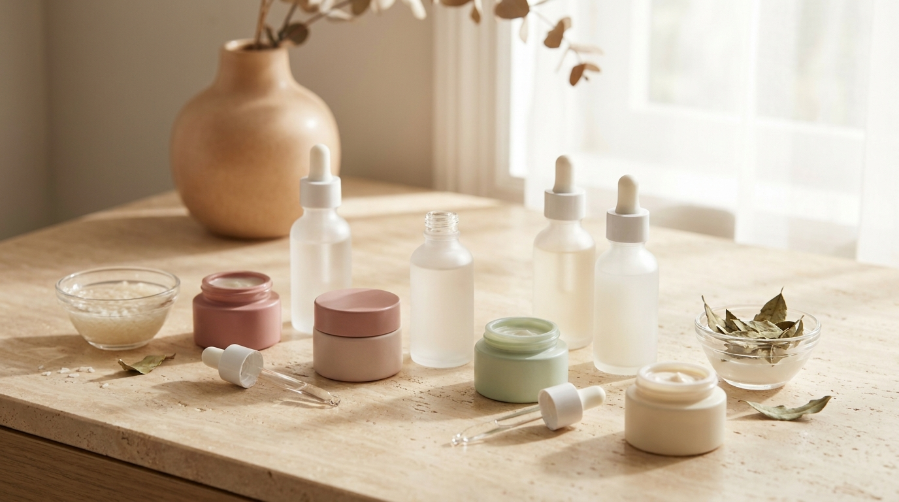
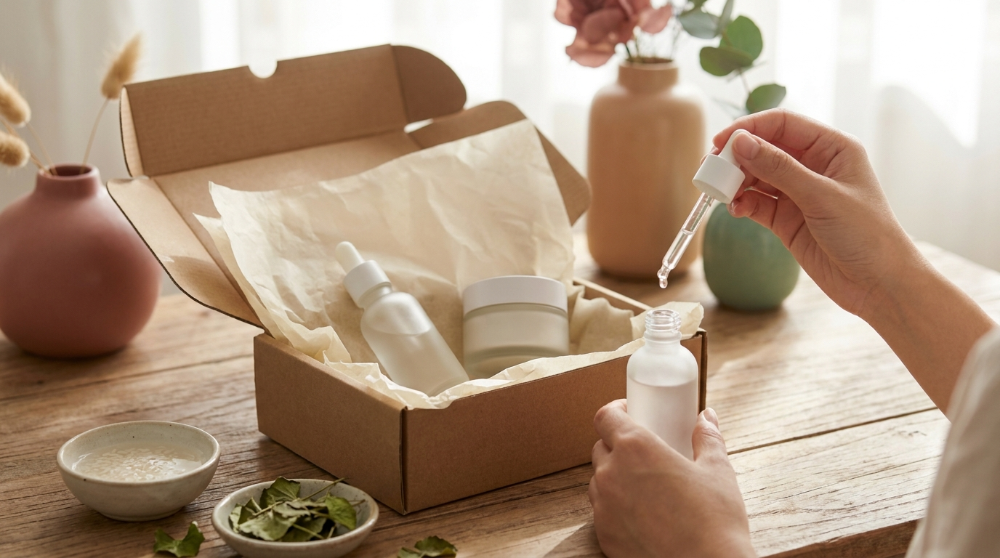

¡Hola! Soy J desde Seúl. Muchos amantes de la cultura coreana y los K-Dramas me preguntan frecuentemente cómo pueden acceder a los mismos productos que lideran las listas de popularidad en las tiendas físicas de Seúl, sin necesidad de tomar un vuelo a Corea ni exponerse a imitaciones en mercados no oficiales. 

El auge global del K-Beauty ha facilitado que fórmulas innovadoras con centella asiática, mucina de caracol o ceramidas lleguen a cualquier rincón del mundo. Sin embargo, surgen dudas razonables sobre los tiempos de entrega, la autenticidad del producto, los cargos aduaneros y las diferencias entre las principales plataformas de comercio electrónico. Esta guía reúne información detallada sobre las dos tiendas internacionales más consolidadas para adquirir cosmética coreana original desde España y Latinoamérica: Olive Young Global y YesStyle.

## Puntos clave

- **Autenticidad garantizada**: Comprar en plataformas que gestionan su propio inventario en Corea o con distribuidores certificados elimina el riesgo de adquirir copias no reguladas.
- **Olive Young Global frente a YesStyle**: Olive Young destaca por su catálogo idéntico a las tendencias actuales de Seúl y envíos exprés, mientras que YesStyle ofrece un catálogo más amplio y herramientas de compensación de aduanas.
- **Gestión aduanera inteligente**: Conocer las normativas locales (como el sistema IOSS en la Unión Europea o los umbrales de importación en América Latina) evita costos imprevistos al recibir el paquete.
- **Lectura del embalaje**: Interpretar correctamente la simbología coreana de fechas de fabricación y caducidad asegura el uso de fórmulas frescas y estables.

---

## Olive Young Global: la experiencia oficial de Seúl en casa

Olive Young es la cadena de tiendas de salud y belleza más influyente de Corea del Sur. Su plataforma internacional, Olive Young Global, envía productos directamente desde sus almacenes centrales en Corea, lo que garantiza que las referencias coincidan con los lotes que se venden a diario en los distritos de Myeongdong o Gangnam.

### Características del catálogo y tendencias en tiempo real

La mayor ventaja de esta plataforma radica en su sincronización con el mercado coreano. Cuando una marca emerge en los rankings de Seúl —como los protectores solares de acabado acuoso o los discos tonificantes (*toner pads*) calmantes—, suele aparecer casi de inmediato en Olive Young Global. 

Además, es el lugar principal donde se comercializan los formatos especiales muy populares en Corea, tales como los paquetes dobles (*1+1*) o los sets promocionales que incluyen miniaturas de viaje sin costo adicional.

### Política de envíos y logística

Olive Young Global opera principalmente mediante servicios de mensajería exprés privada (habitualmente DHL o EMS). Esto asegura que los paquetes lleguen a destinos internacionales en plazos notablemente cortos:

- **Tiempos de entrega habituales**: Entre 3 y 7 días hábiles tras el despacho para la mayoría de las capitales.
- **Umbral de envío gratuito**: Suele situarse alrededor de los 60 dólares estadounidenses (USD), una cifra accesible si se realiza una compra de reposición de rutina básica (limpiador, sérum y protector solar / bloqueador solar).

> **Consejo práctico desde Seúl**: Olive Young celebra periódicamente el evento «Big Bang Sale». Durante estas jornadas, los descuentos pueden alcanzar entre el 30% y el 70% en marcas consagradas y emergentes. Si planeas renovar tus productos básicos, suele ser conveniente preparar tu lista de deseos (*wishlist*) con anticipación para aprovechar los cupones acumulables que se liberan cada día de la promoción.

---

## YesStyle: amplitud de catálogo y marcas independientes

※ Imagen ilustrativa generada con IA

YesStyle es una de las tiendas multimarca en línea más veteranas en la distribución de belleza y moda asiática hacia Occidente. Aunque su sede logística principal se encuentra en Hong Kong, mantiene acuerdos directos con fabricantes y distribuidores autorizados de cosmética coreana.

### Variedad y marcas difíciles de encontrar

El catálogo de YesStyle es considerablemente más extenso que el de Olive Young Global. En esta plataforma es posible encontrar marcas de nicho, líneas completas de firmas de maquillaje que no siempre tienen presencia en las tiendas físicas de Seúl, y una amplia gama de accesorios de belleza (como esponjas de maquillaje, espátulas para base o rizadores térmicos).

Una función destacada de su interfaz es el indicador de disponibilidad: junto a cada artículo se especifica si el producto está «listo para enviar en 24 horas» o si requiere entre 7 y 21 días para ser abastecido desde el proveedor. 

### Sistema de fidelización y política de aduanas

YesStyle cuenta con un programa de membresía escalonada y un sistema de códigos de descuento que suelen acumularse con promociones vigentes. No obstante, uno de sus mayores atractivos para compradores en regiones con aduanas estrictas es su programa de reembolso de impuestos aduaneros: si un paquete incurre en aranceles de importación imprevistos, el usuario puede enviar el comprobante de pago para recibir un reembolso equivalente en crédito de la tienda (sujeto a los términos y límites de su política vigente).

---

## Comparativa: Olive Young Global vs. YesStyle

Para elegir la opción más conveniente según tus necesidades de compra, conviene contrastar sus aspectos operativos esenciales:

| Criterio | Olive Young Global | YesStyle |
| :--- | :--- | :--- |
| **Origen del envío** | Centros de distribución en Corea del Sur | Almacén central en Hong Kong / Asia |
| **Tiempo estimado de entrega** | Rápido (3 a 7 días hábiles vía courier) | Moderado (10 a 25 días hábiles vía correo estándar o courier) |
| **Disponibilidad de stock** | Inmediata para productos listados | Mixta (indicada en cada ficha de producto) |
| **Ofertas especiales** | Sets 1+1 coreanos y ediciones limitadas locales | Cupones acumulables y puntos de recompensa |
| **Compensación de aduanas** | No ofrece reembolso de impuestos | Reembolso en crédito de la tienda (bajo condiciones) |
| **Autenticidad de productos** | Garantía oficial directa de Olive Young | Vendedores y marcas autorizadas por la plataforma |
| **Gama de marcas** | Selección curada según el mercado de Corea | Catálogo muy amplio (marcas masivas y de nicho) |

---

## Claves para gestionar el envío y las aduanas sin sorpresas

El proceso aduanero es el punto que más dudas genera al encargar cosméticos desde otro continente. Las normativas varían de manera sustancial según el país de destino.

### Envíos hacia España y la Unión Europea

En la Unión Europea, todos los envíos comerciales procedentes de terceros países están sujetos al Impuesto sobre el Valor Añadido (IVA). Las plataformas internacionales suelen operar bajo dos esquemas:

1. **Régimen IOSS (Import One-Stop Shop)**: Cuando la tienda está inscrita en este sistema, el IVA se cobra directamente al tramitar el pedido (para compras inferiores a 150 euros). Esto agiliza el despacho, ya que el paquete entra a la UE con los impuestos liquidados y habitualmente no sufre retenciones adicionales. YesStyle suele integrar este mecanismo en los envíos estándar.
2. **Despacho mediante mensajería privada (Courier)**: En envíos exprés (comunes en Olive Young Global), la empresa de mensajería (como DHL) puede gestionar el trámite de importación y cobrar los impuestos correspondientes más una tarifa de gestión administrativa en el momento de la entrega, a menos que el comercio cubra el trámite por anticipado.

### Envíos hacia países de Latinoamérica

En América Latina, cada país establece umbrales específicos de exención tributaria (conocidos en comercio exterior como régimen *de minimis*):

- **México**: Las importaciones por debajo de 50 USD (o montos variables según el tratado comercial y la empresa postal) suelen tener trámites simplificados. Sin embargo, los envíos por courier privado están sujetos a inspecciones aleatorias más frecuentes que el correo postal ordinario.
- **Colombia, Chile y Perú**: Cuentan con topes específicos para envíos personales sin fines comerciales (frecuentemente entre 200 USD para Colombia bajo ciertas modalidades, o límites menores para envíos exentos de aranceles). Es fundamental no superar las cantidades de unidades que la autoridad aduanera local considere como «uso personal» (por lo general, no más de 3 a 5 unidades del mismo artículo).
- **Argentina**: Existen regímenes específicos para compras puerta a puerta con cupos anuales y límites de peso por envío. Conviene revisar la reglamentación actualizada de la autoridad tributaria antes de emitir la orden.

> **Precaución al recibir tus cosméticos**: Independientemente de la plataforma elegida, antes de aplicar cualquier cosmético nuevo en el rostro, es indispensable realizar una prueba de parche (*patch test*). Aplica una pequeña cantidad del producto en la cara interna del antebrazo o detrás de la oreja y observa la piel durante 24 a 48 horas para descartar sensibilidad a algún extracto vegetal o conservante, especialmente si tu piel tiende a reaccionar con facilidad.

---

## Cómo verificar la autenticidad y frescura al recibir tu paquete

※ Imagen ilustrativa generada con IA

Una vez que el paquete llega a tu domicilio, existen elementos objetivos en el empaque que permiten confirmar su legitimidad y estado óptimo:

### Interpretación de fechas en coreano

Los cosméticos formulados y empaquetados en Corea emplean caracteres específicos para indicar el estado de producción. Es habitual confundir la fecha de fabricación con la de caducidad si no se presta atención a las palabras que acompañan los números:

- **제조 (Jejo)**: Significa «Fecha de fabricación». Si ves este término seguido de una fecha (por ejemplo, `2026.05.12 제조`), indica el día en que el lote fue elaborado, no su expiración.
- **까지 (Kkaji)**: Significa «Válido hasta». Señala la fecha límite en la que el producto puede usarse sin abrir (por ejemplo, `2028.11.20 까지`).

### El símbolo PAO (Period After Opening)

En el lateral de la caja o en la base del envase encontrarás el pictograma de un frasco abierto con un número seguido de la letra «M» (por ejemplo, `6M` o `12M`). Esto indica que, una vez roto el sello hermético y expuesta la fórmula al aire, el fabricante recomienda consumirla en un plazo de 6 o 12 meses para garantizar la eficacia de los conservantes y la estabilidad de los ingredientes activos (como la vitamina C o los antioxidantes).

### Códigos de barras y sellos de seguridad

Los productos originales comercializados formalmente en Corea tienen un código de barras que comienza con el prefijo **880** (asignado por el estándar internacional GS1 a Corea del Sur). Muchas marcas añaden sellos holográficos o códigos QR ocultos bajo una capa raspable que permiten autenticar el lote directamente en el portal oficial del fabricante.

---

## Preguntas frecuentes (FAQ)

### ¿Cuánto tiempo suele demorar un pedido de Olive Young Global en comparación con YesStyle?
Olive Young Global generalmente utiliza servicios de mensajería rápida internacional, por lo que los paquetes suelen entregarse en un plazo de 3 a 7 días hábiles a la mayoría de los destinos internacionales una vez despachados. En YesStyle, el tiempo habitual oscila entre 10 y 25 días hábiles con el envío estándar, dependiendo de si todos los artículos de la orden contaban con stock inmediato en el momento de la compra.

### ¿Existe riesgo de recibir cosméticos falsificados en estas plataformas?
No. A diferencia de los mercados abiertos de terceros vendedores donde cualquier usuario puede dar de alta un producto, tanto Olive Young Global como YesStyle gestionan sus propios almacenes y trabajan con cadenas de distribución auditadas y contratos directos con los laboratorios y marcas de belleza coreanas.

### ¿Qué ocurre si la aduana retiene mi paquete de cosméticos?
Si un envío es seleccionado para inspección aduanera, la empresa de mensajería (o el servicio postal nacional) contactará al destinatario a través de correo electrónico o mensaje de texto para solicitar documentación de respaldo, como la factura de compra o la declaración de valor. Es aconsejable guardar siempre la confirmación del pedido y el comprobante de pago digital para presentarlos rápidamente si la autoridad local los solicita.

### ¿Se pueden pedir productos con factor de protección solar (bloqueador solar) sin restricciones?
En la gran mayoría de los casos de importación para uso personal, los protectores solares coreanos no presentan inconvenientes. Sin embargo, algunos países tienen normativas sanitarias estrictas sobre ciertos filtros ultravioleta importados. Para evitar demoras, se recomienda adquirir cantidades moderadas (de 1 a 3 unidades por pedido) destinadas exclusivamente al consumo individual.