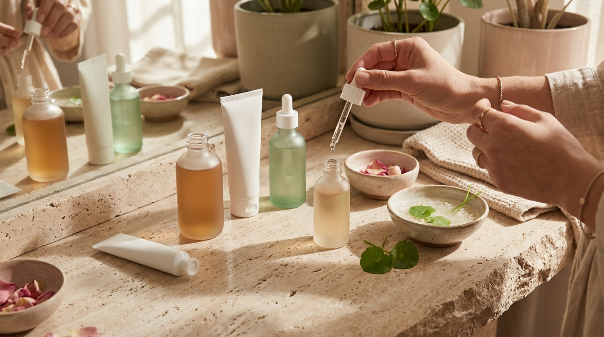
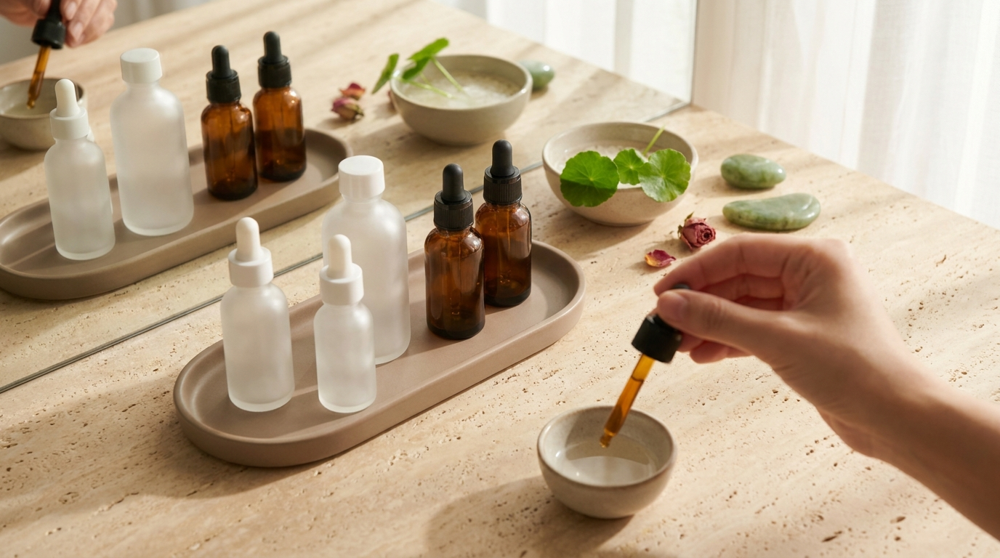

¡Hola! Soy J desde Seúl. Cuando comienzas a interesarte por la cosmética coreana —a menudo tras ver la piel impecable de los actores en algún drama o al explorar tiendas digitales—, es muy común acumular diferentes botes, frascos con gotero y envases con etiquetas en coreano. Sin embargo, tener productos de alta calidad no garantiza los mejores resultados si no se aplican en la secuencia adecuada o si se degradan por almacenarse en un lugar inapropiado.

En Corea del Sur, el tocador (*hwajangdae*, 화장대) suele ser un espacio muy ordenado. Las usuarias y usuarios prestan especial atención a las fechas impresas en los recipientes, a la compatibilidad de texturas y a las condiciones térmicas de cada formulación para garantizar que los ingredientes mantengan su estabilidad y frescura. En esta guía práctica revisaremos cómo organizar tus pasos, cómo leer los símbolos de vencimiento y qué fórmulas realmente se benefician del frío.

## Puntos clave

- **Regla de densidad**: La aplicación de capas siempre debe fluir desde la textura más acuosa hacia la más oleosa o densa para permitir una correcta absorción.
- **Fechas en coreano**: Es fundamental distinguir entre la fecha de fabricación (*Jejo*) y la fecha de expiración (*Gihan* o *Kkaji*), además de vigilar el símbolo PAO tras abrir el envase.
- **El mito del refrigerador cosmético**: No todos los productos deben ir a la nevera; los aceites y emulsiones densas pueden desestabilizarse con el frío extremo.
- **Ubicación estratégica**: Mantener tus cosméticos lejos del vapor caliente del baño prolonga la vida útil de los conservantes y previene la proliferación bacteriana.

---

## La regla de oro para aplicar las capas de skincare

Uno de los mayores dilemas al adoptar una rutina inspirada en K-Beauty es saber qué va primero. Si revisas guías como la [rutina coreana para Glass Skin](/blog/rutina-coreana-piel-de-porcelana-glass-skin/), notarás que el principio básico que rige a los formuladores en Seúl es físico-químico: **de menor a mayor viscosidad**.

Los productos de base acuosa y moléculas pequeñas no pueden penetrar a través de una película lipídica oclusiva. Si aplicas una crema pesada antes de un tónico o una esencia, estarás creando una barrera que impedirá que los activos acuosos lleguen al estrato córneo.

### Secuencia recomendada de menor a mayor densidad

1. **Limpieza**: Comenzando por un limpiador oleoso si llevas protector solar o maquillaje, seguido de un gel o espuma suave al agua, tal como explicamos en la [guía de la doble limpieza coreana](/blog/doble-limpieza-coreana-aceite-vs-balsamo/).
2. **Tónico o tónico exfoliante**: Textura prácticamente líquida, pensada para equilibrar la superficie tras el lavado y aportar la primera capa de agua.
3. **Esencia o loción ligera**: Aporta hidratación intermedia con ingredientes fermentados, extractos botánicos o mucílago.
4. **Sérum o ampolla (*ampoule*)**: Concentrados diseñados para necesidades concretas (antioxidantes, péptidos o calmantes).
5. **Contorno de ojos**: Formulación ligera pero nutritiva para una zona con menos glándulas sebáceas.
6. **Crema hidratante / emulsión / gel**: Emulsión que sella el agua aportada en los pasos previos gracias a agentes emolientes.
7. **Protector solar / bloqueador solar (de día)**: El último paso indispensable que crea el escudo frente a la radiación UV.

```
[Agua / Fluido]  Tónico  ──>  Esencia  ──>  Sérum  ──>  Crema  ──>  Protector solar  [Oclusivo / Sellado]
```

---

## Cómo leer las fechas de caducidad en cosméticos coreanos



<p class="img-cap">※ Imagen ilustrativa generada con IA</p>

Al comprar cosmética directamente desde tiendas asiáticas, un motivo de confusión frecuente son las fechas impresas en la base de las botellas o en el termosellado de los tubos. En Corea se utiliza el formato año-mes-día (`AAAA.MM.DD` o `AAAA/MM/DD`), lo opuesto a muchas regiones hispanohablantes.

Además, los productos suelen incluir caracteres coreanos (*Hangul*) que indican si la fecha corresponde al momento en que el lote salió de la fábrica o al límite para su consumo:

- **제조 (Jejo)**: Fecha de **fabricación**. Si lees `2026.04.12 제조`, significa que el producto fue envasado ese día, no que caduque en esa fecha.
- **까지 (Kkaji)**: Significa **"hasta"**. Indica la fecha límite de uso sin abrir (ejemplo: `2028.10.15 까지`).
- **기한 (Gihan)**: Significa **"período de caducidad"** o uso preferente.

### El símbolo PAO (Period After Opening)

Independientemente de la fecha impresa, una vez que rompes el sello protector o abres la tapa, el producto entra en contacto con el oxígeno, la humedad del aire y las bacterias de las manos. 

Aquí entra en juego el símbolo internacional del **tarro abierto** con un número seguido de la letra M:
- **6M**: Usar preferentemente en un plazo de 6 meses tras su apertura.
- **12M**: Usar en los siguientes 12 meses.

En productos con alta concentración de extractos naturales y conservantes suaves —muy populares en marcas de Olive Young—, el período óptimo suele oscilar entre los 6 y los 12 meses. Un truco muy común en Corea es pegar una pequeña etiqueta adhesiva en el frasco anotando la fecha exacta en que se abrió.

---

## ¿Qué productos van a la nevera y cuáles no?

La tendencia de las mini-neveras de cosmética (*skincare fridges*) se ha popularizado enormemente en redes sociales. Sin embargo, los laboratorios coreanos formulan sus cremas y lociones para que permanezcan estables a temperatura ambiente controlada (generalmente entre 15 °C y 25 °C). Someter ciertos cosméticos a bajas temperaturas puede ser contraproducente.

| Tipo de producto | ¿Guardar en frío? | Razón técnica / Beneficio |
| :--- | :--- | :--- |
| **Mascarillas de celulosa (*sheet masks*)** | Sí (opcional) | Acentúa el efecto descongestivo y antiinflamatorio en piel con calor o rojeces. |
| **Vitamina C pura (Ácido L-Ascórbico)** | Sí (recomendado) | Retrasa significativamente la oxidación prematura provocada por el calor y la luz. |
| **Geles calmantes (Aloe, Centella Asiática)** | Sí (opcional) | Aporta una sensación refrescante inmediata para piel irritada o tras exposición solar. |
| **Herramientas de masaje (Gua Sha, rodillos)** | Sí (muy útil) | Favorece la vasoconstricción temporal y el drenaje linfático matutino. |
| **Aceites faciales puros** | **No** | Las bajas temperaturas solidifican los lípidos y alteran su fluidez. |
| **Cremas densas / Emulsiones ricas** | **No** | El frío extremo puede romper la emulsión, separando la fase acuosa de la fase oleosa. |
| **Protectores solares** | **No** | Los filtros solares y agentes filmógenos pueden cristalizar o perder homogeneidad de distribución. |

> **Consejo de conservación desde Seúl:**  
> Evita guardar tus cosméticos habituales dentro del cuarto de baño si este acumula vapor constante tras ducharte. Los cambios bruscos de temperatura y la humedad persistente son el entorno ideal para la degradación de conservantes. Lo ideal es disponer de una bandeja o tocador en el dormitorio, en un rincón ventilado donde no incida la luz solar directa.

---

## Organización práctica del tocador según el momento del día



<p class="img-cap">※ Imagen ilustrativa generada con IA</p>

Tener 15 frascos sobre la mesa puede generar fatiga de decisión matutina y llevar a saltarse pasos. Para mantener la constancia sin saturar la piel, muchos especialistas en K-Beauty recomiendan separar los productos en tres bandejas o zonas bien diferenciadas:

### 1. Zona AM (Rutina de la mañana)
Enfocada en proteger e hidratar ligeramente:
- Limpiador al agua suave.
- Tónico ligero o esencia hidratante.
- Sérum antioxidante (como vitamina C o fórmulas iluminadoras; si te interesan estos activos, puedes consultar el análisis sobre el [extracto de arroz y la niacinamida](/blog/agua-de-arroz-niacinamida-iluminar-piel/)).
- Crema en gel o loción ligera.
- Protector solar de amplio espectro.

### 2. Zona PM (Rutina de la noche)
Enfocada en reparar la barrera cutánea y tratar preocupaciones específicas:
- Aceite o bálsamo desmaquillante.
- Segundo limpiador al agua.
- Tónico calmante o regenerador.
- Tratamientos intensivos (retinoides suaves, exfoliantes químicos tipo AHA/BHA/PHA, péptidos o activos regeneradores).
- Crema nutritiva reparadora con ceramidas o pantenol.

### 3. Zona semanal o de rescate
Aquí se ubican las mascarillas de tejido, los parches para el contorno de ojos, los exfoliantes físicos o enzimáticos suaves, y tratamientos puntuales como los parches de hidrocoloide para granitos.

> **Precaución con los envases de gotero:**  
> Al aplicar esencias o sérums, evita que la pipeta de vidrio toque directamente tus mejillas o dedos. Si el aplicador roza la piel y luego regresa al interior del frasco, se introducen microorganismos y sebo dentro de la fórmula, acelerando su descomposición. Deposita las gotas suspendidas a un par de centímetros sobre la palma o el rostro limpio.

---

## Preguntas frecuentes (FAQ)

### ¿Cómo sé si un producto de skincare se ha echado a perder?
Las tres señales más evidentes son el cambio en el olor (aroma rancio, agrio o metálico), el cambio en el color (típico en la vitamina C que vira de transparente/amarillo pálido a marrón oscuro) y la separación de fases (cuando el líquido se divide en agua y aceite y no se mezcla al agitar levemente). Si notas cualquiera de estos cambios, suspende su uso para evitar dermatitis por contacto.

### ¿Puedo guardar toda mi rutina en la nevera de la cocina?
No es necesario ni recomendable para la mayoría de los cosméticos. Además, si compartes el frigorífico con alimentos crudos o descubiertos, existe riesgo de contaminación cruzada o de que los envases absorban olores. Si deseas enfriar mascarillas de tejido o un gel de aloe, colócalos en una bolsa hermética limpia en el estante de la puerta.

### ¿Qué significa el código de lote impreso en los productos coreanos?
Muchas marcas coreanas imprimen un código alfanumérico que combina el número de lote de producción con la fecha. Si encuentras letras como "EXP", corresponde a la abreviatura de expiración en inglés. Para verificar la autenticidad y fechas de lotes de importación, plataformas reconocidas como las mencionadas en nuestra [guía para comprar cosmética coreana online](/blog/como-comprar-cosmetica-coreana-online-desde-casa/) suelen garantizar stocks con rotación constante y fechas de vencimiento amplias.

### ¿Los protectores solares duran de un año para otro?
Generalmente, una vez abiertos, los protectores solares tienen un PAO de 12 meses. Sin embargo, si el envase ha estado expuesto al calor directo del verano, guardado en mochilas calientes o en el coche, los filtros UV pueden perder su capacidad de cobertura homogénea mucho antes. En K-Beauty, donde el protector solar se utiliza a diario los 365 días del año, un bote habitual de 50 ml suele terminarse en un plazo de uno a dos meses de uso continuado.