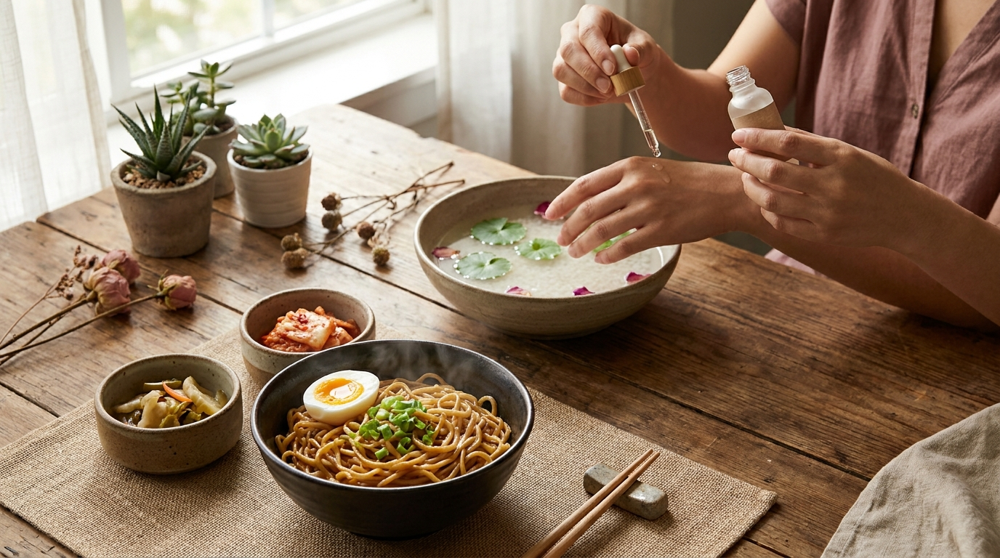
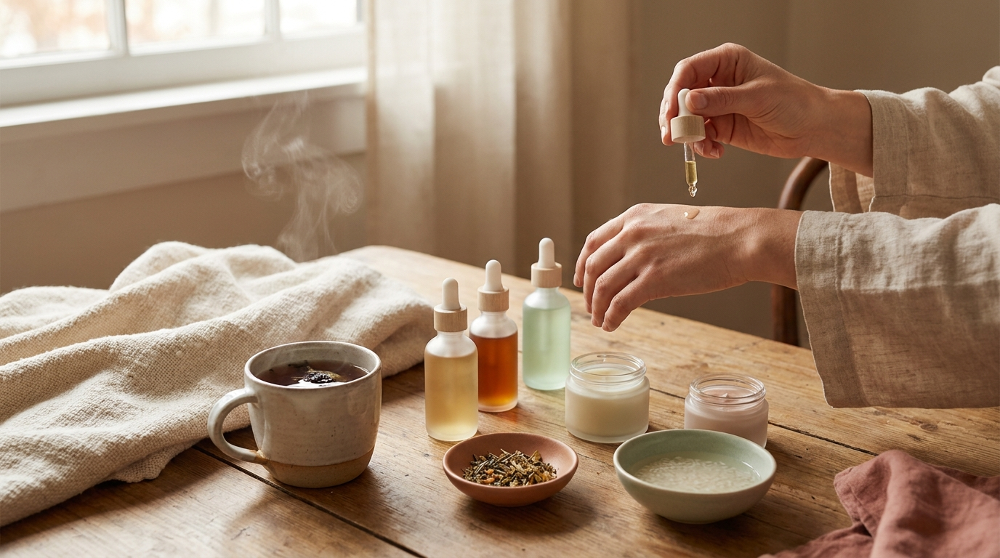

¡Hola! Soy J desde Seúl. Si alguna vez te has quedado hasta tarde viendo un K-Drama, sabrás que la experiencia casi nunca se limita a la pantalla. En Corea del Sur, ver nuestras series favoritas después de una larga jornada laboral o durante el fin de semana es casi un ritual de descanso que involucra tres pilares fundamentales: comodidad absoluta, comida reconfortante para la noche y una rutina de cuidado facial sencilla que trabaje mientras disfrutamos de la historia.

Muchas personas en Latinoamérica y España me preguntan a menudo cómo recrear esa atmósfera tan característica que se observa en producciones coreanas populares, especialmente si no tienen tiendas especializadas a la vuelta de la esquina. La buena noticia es que armar este plan hogareño no requiere ingredientes inaccesibles ni rutinas complejas de diez pasos. Con unos pocos aperitivos estratégicos, una bebida adecuada y una mascarilla facial bien formulada, puedes transformar tu sala de estar o tu habitación en un rincón auténtico de Seúl.

## Puntos clave

* **La cultura del *Yasik* (야식):** Comprender el concepto del refrigerio nocturno en Corea permite elegir los mejores alimentos para disfrutar de la serie sin complicaciones de cocina pesada.
* **Opciones accesibles:** Existen alternativas muy sencillas de conseguir en supermercados occidentales o tiendas de importación básicas, desde fideos instantáneos modificados hasta bocadillos de alga marina.
* **Maridaje reconfortante:** Aprender a preparar bebidas coreanas populares, frías o calientes, aporta el toque inmersivo a la velada.
* **Cuidado facial sin esfuerzo:** Integrar mascarillas de tejido (*sheet masks*) o mascarillas de noche (*sleeping packs*) aprovecha el tiempo frente a la pantalla para devolver hidratación y frescura a la piel.

---

## El ritual del K-Drama y el concepto de Yasik en Seúl

En la vida cotidiana coreana, el término *Yasik* (야식) se refiere literalmente a la comida que se consume a altas horas de la noche. Seúl es una metrópoli con una cultura de entrega a domicilio activa las 24 horas, donde es habitual ordenar pollo frito crujiente (*chimaek*), *tteokbokki* picante o patas de cerdo glaseadas (*jokbal*) para ver los episodios de estreno. 

Sin embargo, cuando se disfruta de un drama en solitario o en un plan relajado entre semana, la mayoría de los residentes no piden un banquete completo. El estilo de vida contemporáneo favorece combinaciones prácticas: alimentos reconfortantes de rápida preparación que se puedan comer en la mesa baja de centro mientras se viste ropa cómoda y se prepara el ambiente con luces tenues y cálidas. 

El secreto de este ritual no es únicamente la comida, sino la pausa consciente: desconectar del estrés del día, sumergirse en una trama envolvente y darle a la piel un respiro reparador con activos botánicos calmantes e hidratantes.

---

## Snacks coreanos fáciles de preparar y conseguir en casa

※ Imagen ilustrativa generada con IA

No es necesario contar con un mercado coreano tradicional en tu ciudad para replicar los sabores más populares de los K-Dramas. La mayoría de los supermercados estándar en España y América Latina ya cuentan con pasillos internacionales donde se encuentran elementos básicos muy versátiles.

### 1. El Ramyeon perfeccionado (estilo tienda de conveniencia)
Los fideos instantáneos coreanos (*ramyeon*) son el refrigerio estrella en casi cualquier serie. A diferencia de las sopas instantáneas de otros países, el fideo coreano suele ser más grueso, firme y diseñado para hervirse directamente en olla en lugar de solo agregar agua caliente.
* **Cómo elevarlo en casa:** Hierve el sobre de fideos en la cantidad exacta de agua recomendada por el empaque (habitualmente 500 a 550 ml). Cuando los fideos lleven dos minutos de cocción, añade un huevo entero sin romper la yema para que se poche suavemente con el caldo caliente.
* **El toque final:** Apaga el fuego y coloca encima una rebanada de queso procesado tipo americano o gouda suave, junto con una cucharadita de cebollín o cebolleta finamente picada. El queso suaviza el picante y crea una textura aterciopelada idéntica a la que consumen los personajes en las tiendas 24 horas coreanas (*pyeon-uijeom*).

### 2. Aperitivos crujientes ligeros
Si prefieres picar algo crujiente sin necesidad de encender la estufa, los siguientes bocadillos son opciones habituales en los hogares coreanos:
* **Láminas de alga tostada (*Gim* / 김):** Se venden en pequeños paquetes individuales en casi cualquier sección asiática. Vienen ligeramente tostadas con aceite de sésamo y sal marina. Son crujientes, bajas en calorías y muy saciantes.
* **Chips de camote (batata) o camarón:** Marcas tradicionales coreanas como Nongshim distribuyen internacionalmente sus galletas crujientes sabor a marisco o chips de batata dulce. Tienen una textura ligera que no resulta empalagosa durante maratones largos.
* **Edamame hervido con sal gruesa:** Aunque es originario del este asiático en general, en Corea se consume ampliamente como acompañamiento nocturno ligero. Solo requiere hervir las vainas de soja durante cuatro minutos en agua salada.

---

## Bebidas coreanas: opciones reconfortantes con y sin alcohol

Una buena sesión de series requiere una bebida que equilibre los sabores de los snacks y ayude a entrar en sintonía con el descanso.

### Infusiones tradicionales sin cafeína
Para maratones que se extienden hasta medianoche, las bebidas sin teína ni cafeína son la elección predilecta para no perturbar el ciclo de sueño:
* **Té de cebada tostada (*Boricha* / 보리차):** Es el agua de mesa por excelencia en Corea. Se elabora infusionando granos de cebada tostada en agua caliente o fría. Posee un sabor tostado, seco y muy digestivo, ideal para calmar el paladar tras comer alimentos salados o picantes.
* **Té de maíz (*Oksusucha* / 옥수수차):** Similar al de cebada, pero con un aroma dulce natural muy envolvente. Se encuentra fácilmente en bolsitas de infusión en tiendas de té o mercados orientales online.

### Alternativas dulces o refrescantes
* **Leche de plátano estilo coreano (*Banana uyu*):** Famosa por aparecer en innumerables dramas juveniles. Si no encuentras la versión envasada original, puedes recrearla en licuadora batiendo un plátano maduro, una taza de leche (o bebida vegetal de avena/soja), media cucharada de azúcar o miel y dos gotas de extracto de vainilla.
* **Bebidas con gas y fruta:** Mezclar agua con gas fría con una cucharada de puré de yuzu (*yuja-cheong*) o mermelada de ciruela crea una bebida burbujeante de estilo café de Seúl. Para quienes disfrutan de un toque alcohólico ligero, el clásico *Somaek* (proporción controlada de cerveza rubia y licor destilado de arroz / soju) suele acompañar platos más grasos, siempre con moderación.

---

## K-Beauty nocturno: el cuidado de la piel durante la serie

El tiempo que pasas frente a la pantalla es perfecto para realizar un tratamiento cosmético sin prisas. En lugar de limitarte a la rutina rápida de tres pasos antes de acostarte, este momento permite aprovechar la absorción pausada de activos hidratantes y calmantes.

### Elegir entre Sheet Mask y Sleeping Mask
Ambos formatos son emblemáticos de la cosmética coreana, pero responden a dinámicas diferentes:

1. **Mascarilla de tejido (*Sheet Mask*):**
   * **Dinámica:** Se coloca sobre el rostro limpio durante los primeros 15 a 20 minutos de un capítulo.
   * **Beneficio:** Crea una barrera física temporal de celulosa o hidrogel que satura el estrato córneo con suero concentrado (*essence*), favoreciendo un efecto de luminosidad y turgencia visible al retirarla.
   * **Regla de oro:** Nunca dejes la mascarilla puesta hasta que se seque por completo. Si el soporte de tela pierde su humedad mientras sigues mirando la pantalla, puede empezar a absorber el agua de la superficie cutánea, produciendo tirantez.

2. **Mascarilla de noche (*Sleeping Mask* o *Sleeping Pack*):**
   * **Dinámica:** Se aplica como paso final al terminar de ver el drama, justo antes de apagar las luces.
   * **Beneficio:** Posee una consistencia en gel o crema oclusiva ligera formulada para sellar la humedad y evitar la pérdida transepidérmica de agua (TEWL) mientras duermes.
   * **Ingredientes destacados en Seúl:** En las listas de popularidad de tiendas de belleza en Corea, las fórmulas con pantenol, ceramidas, ácido hialurónico y extracto de *Centella Asiatica* son las más buscadas por su capacidad para reforzar la barrera cutánea sin sensación pesada ni manchar la almohada.

---

## Comparativa: ¿Qué mascarilla elegir para tu maratón?

Dependiendo del estado de tu piel al final del día y del tipo de comodidad que busques, puedes optar por diferentes opciones cosméticas:

| Formato | Ingredientes clave habituales | Duración en piel | Beneficio principal | Recomendado para |
| :--- | :--- | :--- | :--- | :--- |
| **Sheet Mask calmante** | *Centella Asiatica*, Madecassoside, Houttuynia Cordata | 15 a 20 minutos | Ayuda a atenuar rojeces y calmar piel estresada | Piel sensible o expuesta a calefacción/aire |
| **Sheet Mask hidratante** | Ácido hialurónico multimolecular, Pantenol | 15 a 20 minutos | Rellena la superficie y devuelve elasticidad inmediata | Piel apagada, deshidratada o tirante |
| **Parches de hidrogel** | Cafeína, Niacinamida, Colágeno vegetal | 15 a 30 minutos | Refresca el contorno de ojos sin obstruir la visión | Miradas cansadas tras horas de pantalla |
| **Sleeping Mask en gel** | Savia de abedul, Ácido poliglutámico | Toda la noche (sin enjuague) | Mantiene el nivel hídrico continuo durante el descanso | Piel mixta a grasa que busca frescura |
| **Sleeping Mask en crema** | Ceramida NP, Escualano, Manteca de karité | Toda la noche (sin enjuague) | Nutre en profundidad y repara la barrera cutánea | Piel seca, madura o en climas fríos |

---

> **Consejo práctico desde Seúl sobre el Ramyeon y el cuidado facial:**  
> Si decides incluir fideos instantáneos salados en tu noche de K-Drama, ten en cuenta el efecto del sodio en la retención de líquidos facial nocturna (lo que en Corea llamamos *buki* o hinchazón matutina). Una costumbre muy común entre los jóvenes coreanos es beber una taza de té de maíz o leche al terminar los fideos, ya que el potasio ayuda a equilibrar el balance de sodio en el organismo. Asimismo, conservar los parches de hidrogel para ojos en el refrigerador y aplicarlos a la mañana siguiente ayuda notablemente a desinflamar la zona periocular.

---

## Cómo organizar los tiempos durante la noche

※ Imagen ilustrativa generada con IA

Para que la experiencia fluya sin interrupciones molestas, conviene estructurar el orden de los pasos:

1. **Preparación previa (10 minutos):** Lávate la cara con un limpiador suave de pH balanceado para retirar los restos de protector solar o maquillaje del día. Prepara tu bandeja con la bebida y los snacks antes de darle al botón de reproducción.
2. **Durante el primer episodio:** Aplica tu tónico o esencia habitual y coloca la mascarilla de tejido. Es el momento perfecto para disfrutar de los primeros compases del drama mientras la tela se mantiene fresca y húmeda.
3. **Pausa intermedia:** Al cumplirse los 15-20 minutos, retira la mascarilla, da suaves toques con las yemas de los dedos sobre rostro y cuello para ayudar a la absorción del exceso de suero, y ahora sí, disfruta de tus snacks calientes sin temor a manchar el producto cosmético.
4. **Cierre de la noche:** Antes de dormir, aplica una capa moderada de mascarilla nocturna (*sleeping pack*) o tu crema hidratante selladora favorita para retener todos los beneficios hasta la mañana.

---

## Preguntas frecuentes (FAQ)

### ¿Puedo quedarme dormido con una sheet mask puesta en el rostro?
No es recomendable. Las mascarillas de celulosa o algodón están diseñadas para mantenerse húmedas entre 15 y 20 minutos. Cuando el líquido se evapora por completo en el ambiente de la habitación, la tela seca puede producir fricción sobre la piel e incluso absorber la humedad superficial que acabas de aportar. Si buscas un producto para usar durante toda la noche mientras duermes, opta siempre por una *sleeping mask* en crema o gel.

### ¿Dónde puedo comprar los ingredientes y snacks si no vivo en una capital?
Hoy en día, las grandes cadenas de supermercados occidentales suelen disponer de fideos coreanos de marcas globales reconocidas en su pasillo internacional. Para opciones más variadas (como bebidas de arroz, tés de grano o marcas específicas de algas), las tiendas orientales en línea entregan en casi cualquier localidad de España, México, Colombia, Argentina, Chile y el resto de la región con envíos de pocos días.

### ¿El picante del ramyeon coreano afecta negativamente a la piel?
El consumo ocasional de comida picante en una noche de ocio no genera problemas estructurales en la piel en individuos sanos. Sin embargo, en personas con tendencia a la rosácea, piel reactiva o problemas de enrojecimiento vascular, los alimentos con capsaicina muy concentrada pueden desencadenar vasodilatación temporal y rubor facial. En esos casos, optar por versiones suaves (como caldos no picantes a base de sésamo, soja o algas) y usar mascarillas con extracto de artemisa (*mugwort*) o centella ayuda a mantener el cutis en calma.

### ¿Es necesario lavar el rostro por la mañana tras usar una sleeping mask?
Sí, en la mayoría de los casos es aconsejable limpiar el rostro al despertar con agua templada o con un limpiador suave en gel o espuma. Aunque las mascarillas nocturnas se absorben progresivamente, suelen contener agentes formadores de película que crean un escudo oclusivo sobre la epidermis. Enjuagar la piel por la mañana elimina las células desprendidas durante la noche y prepara la superficie para recibir el hidratante diario y el protector solar.