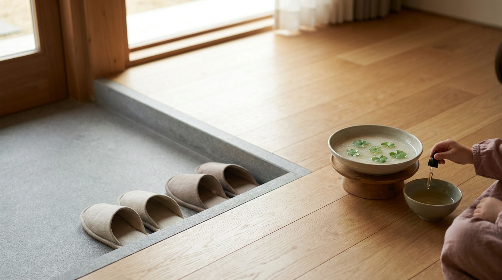
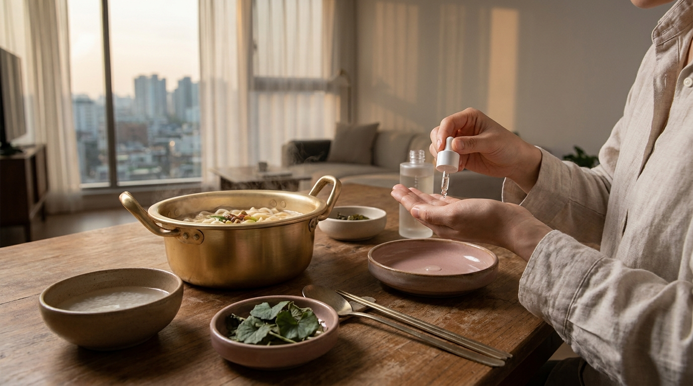

Para quienes disfrutan con frecuencia de las series coreanas, es muy probable que no pasen desapercibidas ciertas acciones repetitivas de los personajes: doblar la tapa de un vaso de fideos instantáneos para usarla como plato improvisado, girar la cabeza al beber frente a un superior o preguntar la edad a los pocos minutos de conocer a alguien.

Para quienes siguen la cultura coreana y el universo del K-Beauty desde países hispanohablantes, estas escenas a veces parecen simples recursos de comedia o exageraciones televisivas. Sin embargo, en Seúl forman parte de la vida real. A continuación, se analizan el origen, las normas sociales y la lógica práctica detrás de 10 de las costumbres más representativas que aparecen en pantalla.

## Puntos clave

- La mayoría de las costumbres vistas en pantalla responden a una estructura social basada en el respeto jerárquico y la consideración colectiva (*nunchi*).
- Hábitos como comer fideos sobre una tapa o cepillarse los dientes en la oficina nacieron de la practicidad urbana y los ritmos acelerados de Corea del Sur.
- Ciertas frases cotidianas, como preguntar si alguien ha comido, no son una invitación literal a almorzar, sino una muestra básica de afecto y preocupación por el bienestar del otro.
- Diferenciar la ficción dramática de la norma social ayuda a comprender mejor el contexto de las series y las tendencias de estilo de vida coreano.

---

## Costumbres alrededor de la comida y la bebida en Corea

### 1. Comer el ramen sobre la tapa de la olla o del vaso

En prácticamente cualquier comedia romántica o serie de misterio, se observa a los protagonistas cocinando *ramyeon* (라면) en una olla pequeña dorada de aluminio y comiendo los fideos directamente apoyados sobre la tapa invertida. Cuando se trata de fideos de vaso comprados en una tienda de conveniencia (como GS25 o CU), doblan la tapa de cartón en forma de cono o cuenco pequeño.

Esta costumbre tiene dos motivos fundamentales: la temperatura y la practicidad. Los fideos coreanos se consumen hirviendo; al sacarlos con los palillos y colocarlos unos segundos sobre la tapa, el aire los enfría lo suficiente para no quemarse la boca. Además, en los hogares unipersonales y dormitorios estudiantiles de Seúl, utilizar la tapa como plato evita ensuciar vajilla adicional y ahorra tiempo al fregar.

### 2. El protocolo al beber soju: manos, miradas y jerarquía

Las escenas de cena laboral (*hoesik*) o brindis entre amigos son habituales en los dramas. En ellas, los personajes siguen una coreografía casi milimétrica: sostener el vaso con ambas manos, girar el torso hacia un lado para beber y jamás servirse alcohol a uno mismo.

En la sociedad coreana, la jerarquía de edad y estatus laboral sigue siendo muy respetada. Al recibir una bebida de alguien mayor o de rango superior, sostener el vaso con las dos manos indica sumisión y respeto. Girar el rostro y cubrir discretamente la boca con la mano libre busca no mostrar el acto de tragar frente a una figura de autoridad. Del mismo modo, vigilar el vaso del acompañante y llenarlo cuando esté vacío es una señal de cortesía; servirse a uno mismo (*jajak*, 자작) se asocia con el aislamiento o con la falta de atención por parte de la mesa.

### 3. Preguntar «¿Has comido?» en lugar de decir simplemente «hola»

La frase *Bab meogeosseoyo?* (밥 먹었어요? o su versión formal *Siksa hasyeosseoyo?*) aparece continuamente entre familiares, parejas o compañeros de trabajo. Los subtítulos suelen traducirlo de forma literal como «¿Comiste?», lo que a veces confunde al espectador creyendo que hay una invitación formal a cenar.

Históricamente, tras la Guerra de Corea, la escasez de alimentos convirtió el hecho de poder comer tres veces al día en un indicador directo de salud y seguridad. Con el paso de las décadas, la frase evolucionó hasta transformarse en un saludo cálido. En Seúl, responder «sí, ya comí, ¿y tú?» equivale funcionalmente a decir «estoy bien, gracias por preguntar».

### 4. Tomar sopa caliente para la resaca a la mañana siguiente

Tras una noche de copas, es habitual ver al protagonista tomando un caldo hirviendo conocido como *haejangguk* (해장국) o fideos con caldo picante. En la gastronomía coreana, existe la creencia de que un caldo caliente, especiado y con verduras como brotes de soja (*kongnamul*) ayuda a activar la sudoración, calmar el estómago y eliminar toxinas del hígado. Es un ritual de recuperación profundamente arraigado en la rutina laboral de Seúl.

---

## Hábitos cotidianos en el hogar y en el espacio público

※ Imagen ilustrativa generada con IA

### 5. El «hyeon-gwan»: quitarse los zapatos en la entrada

Ningún personaje de un K-Drama camina con calzado de calle dentro de una vivienda. Toda casa o departamento en Corea cuenta con un espacio delimitado en la entrada llamado *hyeon-gwan* (현관), situado a un nivel ligeramente inferior al resto del suelo.

Esta costumbre proviene del sistema tradicional de calefacción por suelo radiante (*ondol*). Dado que gran parte de la vida doméstica tradicional transcurría sentados o durmiendo sobre el piso calefaccionado, mantener la superficie libre de polvo, humedad y suciedad exterior era indispensable. Hoy en día, cambiar los zapatos por zapatillas de casa (*silnae-hwa*) sigue siendo una norma estricta de higiene doméstica.

### 6. Cubrirse las piernas con mantas en cafés y oficinas

Es muy común ver a personajes femeninos sentadas en cafeterías, restaurantes de barbacoa o incluso en programas de televisión con una manta pequeña (*damyo*) sobre el regazo, incluso en verano con aire acondicionado.

Lejos de ser únicamente por frío, esta costumbre se relaciona con el pudor y la comodidad. En Seúl, el uso de faldas cortas o vestidos ajustados es popular en la moda urbana femenina, pero sentarse en sillas bajas o banquetas puede resultar incómodo o comprometer la postura. La manta proporciona privacidad, permitiendo sentarse de forma relajada sin preocuparse por la exposición involuntaria.

### 7. Lavarse los dientes en la oficina tras el almuerzo

En los dramas de ambiente corporativo, los baños de las oficinas suelen llenarse de empleados cepillándose los dientes enérgicamente tras comer. En las oficinas de Seúl, casi todos los escritorios cuentan con un portacepillos dental, a menudo con esterilizador ultravioleta integrado.

La dieta coreana incluye ingredientes con aromas intensos como ajo picado, cebolla, aceite de sésamo y pastas fermentadas (*gochujang* o *doenjang*). Por respeto hacia los clientes y compañeros en reuniones de tarde, la higiene bucal inmediata es una norma social tácita. Además, desde la infancia se enseña en Corea la regla conocida como «3-3-3»: lavarse los dientes tres veces al día, dentro de los tres minutos posteriores a comer, durante al menos tres minutos.

---

## Códigos sociales, bienestar y descanso a la coreana

### 8. Preguntar la edad en la primera conversación

En la cultura occidental, preguntar la edad a un recién conocido puede considerarse invasivo. En Corea del Sur, sin embargo, es casi el segundo paso después de presentarse por el nombre.

La razón es puramente lingüística y social. El idioma coreano posee un complejo sistema de niveles de formalidad y lenguaje honorífico (*jondaetmal*). Sin saber el año de nacimiento de la otra persona, resulta casi imposible determinar cómo conjugar los verbos, qué títulos utilizar (como *hyeong*, *oppa*, *noona* o *sunbae*) o qué grado de cercanía es apropiado. No se trata de curiosidad personal, sino de ubicar el registro verbal correcto para no faltar al respeto.

### 9. El uso generalizado de parches analgésicos musculares

Cuando un personaje experimenta cansancio extremo por horas extras o un disgusto familiar, suele colocarse un parche adhesivo blanco en el cuello o en la zona cervical, quejándose de dolor en el trapecio.

Estos parches, llamados popularmente *pas* (파스, término cuyo origen lingüístico proviene del alemán *Pasta*, para pasta o ungüento medicinal, aunque farmacéuticamente correspondan a emplastos o cataplasmas), contienen mentol, alcanfor o salicilato de metilo. Son artículos básicos en cualquier farmacia o tienda coreana. En una sociedad con jornadas laborales y de estudio extensas frente a pantallas, el uso de parches tópicos para aliviar la tensión muscular en hombros y espalda baja es parte de la rutina de autocuidado básico de jóvenes y adultos.

### 10. Las toallas en forma de «cabeza de cordero» en el jjimjilbang

En escenas de descanso familiar o escapadas cómicas, los personajes visitan un *jjimjilbang* (찜질방, sauna pública coreana) vestidos con camisetas holgadas y una toalla enrollada a ambos lados de la cabeza imitando cuernos de cordero (*yangmeori*).

Aunque el plegado de la toalla se popularizó masivamente a través de las comedias televisivas de principios de los años 2000, los saunas secos coreanos alcanzan temperaturas muy elevadas (entre 60 °C y 90 °C). Enrollar la toalla de esta manera evita que el cabello entre en contacto directo con el aire ardiente, previene que el sudor caiga a los ojos y mantiene la cabeza fresca de forma cómoda sin necesidad de nudos que se desarmen al tumbarse.

---

## Comparativa: Costumbres de pantalla vs. realidad en Seúl

※ Imagen ilustrativa generada con IA

Para tener una perspectiva equilibrada de cómo se viven estas costumbres en la actualidad frente a lo que muestra la televisión, conviene observar la siguiente relación:

| Costumbre | Representación en K-Dramas | Realidad cotidiana en Seúl | Función práctica o social |
| :--- | :--- | :--- | :--- |
| **Comer ramen en la tapa** | Escena romántica o cómica entre amigos/pareja. | Práctica muy común en apartamentos pequeños o tiendas. | Enfría el alimento rápido y reduce platos para lavar. |
| **Protocolo del soju** | Momento de tensión jerárquica con jefes o suegros. | Se mantiene estricto con superiores; más relajado entre pares. | Muestra de respeto y consideración social (*nunchi*). |
| **Preguntar la edad** | Punto de partida para rivalidades o romances de diferencia de edad. | Procedimiento estándar en primeros encuentros. | Define el nivel gramatical honorífico adecuado. |
| **Cepillado en el trabajo** | Encuentro casual para chismes en el baño corporativo. | Hábito generalizado en escuelas, empresas y universidades. | Neutraliza sabores fuertes como ajo o kimchi por cortesía. |
| **Mantas en el regazo** | Gestos de caballerosidad donde el protagonista cubre a la protagonista. | Accesorio disponible en casi todas las cafeterías de barrio. | Privacidad postural y protección contra el aire acondicionado. |

---

> **Anotación cultural desde Seúl**
> Gran parte del comportamiento social coreano se rige por el concepto de *nunchi* (눈치), que se traduce como la capacidad de percibir el ambiente, las necesidades de los demás y el contexto sin necesidad de palabras. Acciones como no vaciar el vaso de un compañero, quitarse el calzado sin que lo pidan o cepillarse los dientes antes de una junta de trabajo no son reglas impuestas por ley, sino manifestaciones prácticas de empatía comunitaria y convivencia fluida.

---

## Preguntas frecuentes (FAQ)

### ¿Se considera de mala educación rechazar un vaso de soju en Corea?
En contextos formales de trabajo o con personas mayores, rechazar frontalmente una primera copa puede interpretarse como un distanciamiento o rechazo hacia el grupo. Si una persona no consume alcohol por motivos de salud, religión o preferencia, la costumbre actual en Seúl es aceptar el gesto sosteniendo el vaso y pedir amablemente que lo llenen con agua, refresco o té, manteniendo el brindis sin necesidad de ingerir alcohol.

### ¿Por qué doblan las tapas de cartón de los fideos en forma de embudo?
Al comer fideos instantáneos de vaso en la calle o en mesas reducidas de tiendas de conveniencia, la tapa desprendida se dobla en cuatro partes formando un pequeño cuenco cónico. Esta pequeña estructura permite colocar una porción de fideos sin que gotee el caldo hirviendo sobre la ropa mientras caminas o comes de pie.

### ¿Siguen usando mantas en las piernas las personas jóvenes en Seúl?
Sí. Tanto en invierno como en verano, las cafeterías independientes y grandes franquicias disponen de cestas con mantas limpias dobladas junto al mostrador para uso libre de los clientes. Es un estándar de servicio al cliente muy apreciado tanto por comodidad térmica como por discreción personal al usar prendas cortas.

### ¿La pregunta «¿has comido?» compromete a invitar a la otra persona?
No necesariamente. En la gran mayoría de las ocasiones funciona como un saludo empático equivalente a «¿cómo estás?». Solo si la conversación continúa detallando planes de comida («no, todavía no he comido nada hoy») puede derivar de forma natural en una propuesta para almorzar o compartir un café juntos.