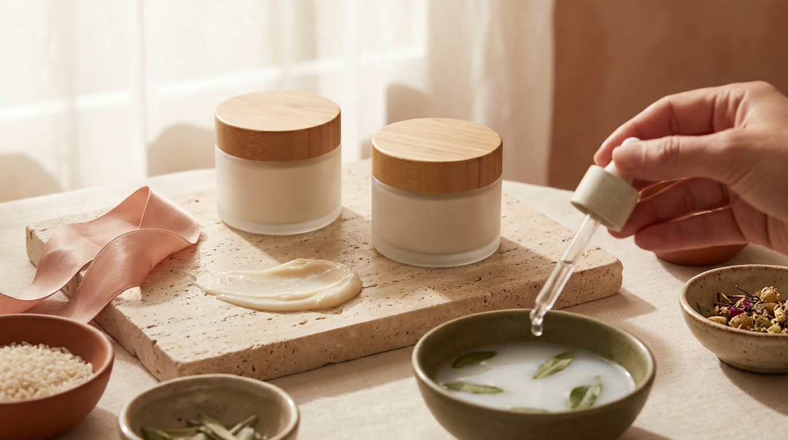
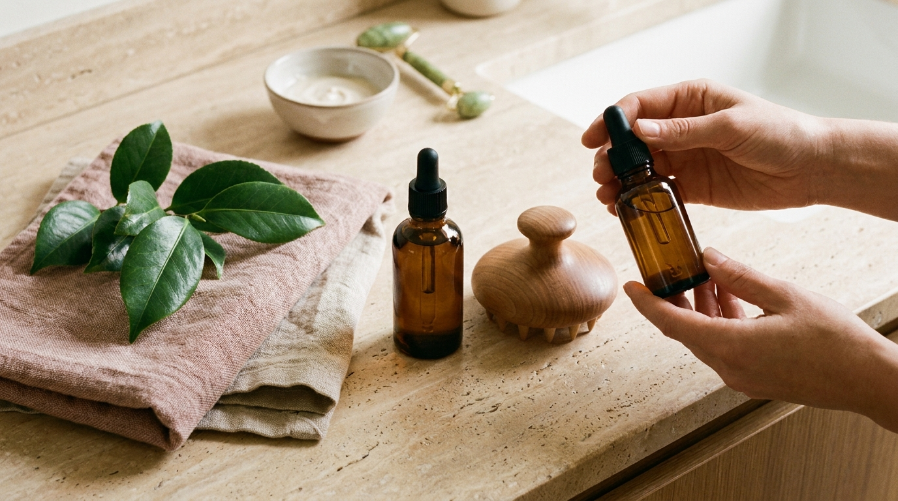

Al observar las series y producciones coreanas, una de las preguntas más recurrentes entre los espectadores internacionales gira en torno al aspecto del cabello de los actores y actrices: con frecuencia luce sedoso, con movimiento natural, brillante y sin encrespamiento visible.

En Corea del Sur, esta apariencia no es fruto del azar ni de peinados pesados. En los últimos años, el mercado cosmético de Seúl ha vivido una auténtica revolución conocida como la «pielificación del cabello» (*skinification of hair*). Esta corriente traslada los mismos principios de formulación, respeto a la barrera y cuidado preventivo del rostro directamente a las raíces y a la fibra capilar. En las tiendas de Olive Young de barrios como Myeongdong, Hongdae o Gangnam, los pasillos de cuidado capilar ocupan un lugar protagonista, compitiendo de cerca con las esencias y los sérums faciales.

El objetivo de este artículo es explicar en qué consiste este fenómeno, cómo funcionan los tres pilares del cuidado capilar coreano (mascarillas de proteínas, tónicos para cuero cabelludo y aceites de tacto seco) y cómo es posible incorporar estos pasos en casa de forma realista y equilibrada.

## Puntos clave

- **El cuero cabelludo se cuida como la piel del rostro:** En la cosmética coreana, la salud del folículo determina la calidad de la hebra; por ello, se emplean exfoliantes suaves y tónicos botánicos para regular el exceso de sebo y calmar irritaciones.
- **Las proteínas hidrolizadas reparan la cutícula:** A diferencia de las fórmulas que solo aportan siliconas densas superficiales, las mascarillas coreanas populares combinan aminoácidos y proteínas vegetales para sellar la fibra capilar sin quitar volumen.
- **Texturas ultraligeras y aceites volátiles:** Los aceites capilares de K-Beauty priorizan acabados no grasos y rápida absorción, aportando luminosidad natural (*glass hair*) en lugar de rigidez o pesadez.
- **Rutina modular y accesible desde casa:** No hace falta aplicar diez productos a diario; el método coreano se basa en alternar nutrición profunda y cuidado de raíces según las necesidades individuales.

---

## 1. La filosofía coreana: el cuero cabelludo como extensión de la piel

Durante décadas, la mayoría de las rutinas capilares tradicionales en Occidente se han enfocado de manera casi exclusiva en el tallo del cabello: champús limpiadores y acondicionadores para suavizar las puntas. Sin embargo, en Corea del Sur se parte de una premisa distinta: el cuero cabelludo (*dupi*, 두피) es piel viva con folículos, glándulas sebáceas y una barrera protectora que requiere el mismo equilibrio que el rostro.

Así como hablamos de [cómo reparar la barrera cutánea dañada con ceramidas y pantenol](/blog/reparar-barrera-cutanea-ceramidas-coreanas/) en la cara, el cuero cabelludo también puede experimentar tirantez, inflamación microbiana o exceso de grasa que debilita el nacimiento del cabello.

```
Piel del rostro (Skincare)        Cuero cabelludo (K-Haircare)
--------------------------        ----------------------------
Limpieza suave / Doble limpieza   Exfoliantes salinos / Champús clarificantes suaves
Tónico equilibrante / Bruma       Tónicos botánicos fortalecedores de raíces
Sérum de tratamiento              Ampollas anticaída / Nutrición del folículo
Crema de barrera                  Mascarillas de aminoácidos y lípidos
```

### Ingredientes activos heredados del cuidado facial

Al revisar la lista oficial de ingredientes (INCI) de los productos capilares líderes en Olive Young, se observan activos muy familiares:

- **Ácido salicílico (BHA):** Actúa disolviendo la acumulación de sebo, células muertas y residuos de productos de peinado en la entrada del folículo piloso, evitando taponamientos y picazón.
- **Pantenol (provitamina B5) y alantoína:** Calman la irritación provocada por factores externos, el calor de los secadores o la exposición al clima frío y seco.
- **Extracto de romero, mentol y árbol de té:** Muy utilizados en tónicos coreanos por su capacidad para aportar frescor inmediato, mejorar la microcirculación superficial y controlar el olor del cuero cabelludo al final de la jornada.
- **Biotina, péptidos y cafeína:** Favorecen el entorno biológico necesario para que el cabello nuevo crezca con mayor resistencia mecánica.

Las marcas coreanas más buscadas en esta categoría, como Aromatica, Labo-H o Daleaf, han basado su éxito en fórmulas con bajo potencial irritante, libres de sulfatos agresivos y con pH fisiológicamente balanceado (entre 4.5 y 5.5).

---

## 2. Mascarillas de proteínas: nutrición intensiva sin sensación pesada



<p class="img-cap">※ Imagen ilustrativa generada con IA</p>

Uno de los mayores desafíos al tratar el cabello seco, teñido o expuesto a herramientas térmicas es lograr suavidad sin dejar las hebras aplastadas o pegajosas. Aquí es donde el K-Beauty ha marcado un estándar diferenciador a través de las mascarillas de proteínas (*protein treatments*).

En las listas de ventas de [los productos más vendidos en Olive Young Corea](/blog/olive-young-mas-vendidos-corea-2026/), marcas de tratamiento intensivo como Unove (con su célebre *Deep Damage Treatment EX*) o Moremo dominan de forma constante el podio gracias a su textura envolvente y su composición química.

### ¿Por qué son tan eficaces las proteínas hidrolizadas?

La cutícula del cabello está compuesta principalmente por queratina dura. Cuando el cabello sufre daños mecánicos (cepillado agresivo) o químicos (decoloraciones, alisados), se forman pequeñas grietas en la estructura exterior de la hebra que aumentan la porosidad capilar, haciendo que el pelo pierda agua y se quiebre con facilidad.

Las mascarillas coreanas incorporan una mezcla calibrada de:

1. **Proteínas hidrolizadas de bajo peso molecular (seda, colágeno, trigo, maíz y soja):** Al estar descompuestas en fragmentos microscópicos, logran depositarse en las irregularidades de la fibra capilar, rellenando temporalmente los espacios dañados.
2. **Aminoácidos esenciales:** Actúan como bloques estructurales que devuelven la elasticidad al cabello, evitando que se parta al estirarse con el cepillado.
3. **Complejos lipídicos y aceites vegetales suaves:** Sellan la capa externa para evitar que la hidratación interna se evapore durante el secado.

### Los tratamientos líquidos «Water-to-Cream»

Otro formato viral en Corea son los tratamientos capilares líquidos (también llamados *water treatments* o tratamientos de vapor). Se aplican directamente sobre el cabello mojado tras el champú; al entrar en contacto con el agua tibia, la fórmula experimenta una reacción térmica suave y se transforma en una crema ligera en cuestión de 10 a 15 segundos. 

Este formato permite una distribución uniforme incluso en cabellos muy finos, logrando que el producto actúe en tiempo récord sin requerir esperas de 20 minutos en la ducha.

---

## 3. Tónicos capilares y aceites ligeros: el acabado pulido diario

Completar la rutina capilar coreana no termina con el enjuague en la ducha. El cuidado posterior sin aclarado (*leave-in*) es responsable directo de la elasticidad de la raíz y del efecto de brillo cristalino en las puntas.

### Tónicos para cuero cabelludo (Scalp Tonics)

El tónico para cuero cabelludo es un paso básico en la rutina de muchas personas en Corea, tanto en hombres como en mujeres. Se presenta habitualmente en frascos con pulverizador directo para aplicar en la raíz tras secar el exceso de humedad con una toalla.

- **Modo de empleo:** Se divide el cabello por secciones, se pulveriza el producto a unos centímetros de la raíz y se realiza un masaje circular suave con la yema de los dedos (nunca con las uñas) durante dos minutos.
- **Beneficio principal:** No deja residuos grasos ni apelmaza el cabello; refresca la piel, alivia la tirantez y ayuda a que las raíces mantengan volumen natural durante todo el día.

### Aceites y sérums de tacto seco: el secreto del brillo natural

A diferencia de los aceites densos y pesados tradicionales que pueden hacer que el cabello fino luzca sucio en pocas horas, los sérums y aceites capilares de K-Beauty (como las diversas variantes de *Perfect Serum* de Mise-en-scène) utilizan combinaciones inteligentes de siliconas ligeras de evaporación controlada junto con aceites nobles como el de camelia japonesa (*tsubaki*), argán, jojoba y semilla de albaricoque.

Estas fórmulas tienen dos funciones esenciales:

1. **Protección térmica moderada:** Crean una película delgada que protege la cutícula del aire caliente del secador.
2. **Refracción de la luz:** Alisan la superficie de las escamas de la cutícula, lo que permite que la luz natural se refleje de manera homogénea, creando ese brillo saludable característico de las producciones coreanas.

---

## Comparativa de productos capilares en el mercado coreano

Para ayudar a estructurar una rutina según el tipo de cabello y sus necesidades concretas, la siguiente tabla resume los productos más representativos disponibles en Olive Young:

| Tipo de producto | Ingredientes destacados | Textura / Formato | Tipo de cabello ideal | Paso en la rutina |
| :--- | :--- | :--- | :--- | :--- |
| **Tónico para cuero cabelludo** (*Scalp Tonic*) | Extracto de romero, mentol, biotina, pantenol | Líquido acuoso en bruma ligera | Raíces grasas, cuero cabelludo irritado o con caída | Sobre raíces húmedas o secas (sin enjuague) |
| **Exfoliante capilar** (*Scalp Scaler*) | Sal marina, BHA (ácido salicílico), aceite de árbol de té | Gel o pasta exfoliante con microgránulos | Cuero cabelludo graso o con acumulación de residuos | 1 o 2 veces por semana, antes o en lugar del champú |
| **Tratamiento líquido** (*Water Treatment*) | Aminoácidos de seda, queratina líquida, glicerina | Líquido que pasa a crema con el agua | Cabello fino, quebradizo o dañado que pierde volumen | Tras el champú; masajear 10 segundos y aclarar |
| **Mascarilla de proteínas** (*Deep Damage Mask*) | Más de 30 aminoácidos y proteínas hidrolizadas, ceramidas | Crema densa y sedosa | Cabello muy seco, decolorado o tratado químicamente | 1 o 2 veces por semana; dejar actuar de 3 a 5 minutos |
| **Sérum/Aceite capilar** (*Hair Serum Oil*) | Aceite de camelia, argán ligero, siliconas volátiles | Aceite ligero de tacto seco | Medios y puntas secas, opacas o con tendencia al frizz | Puntas húmedas antes del secado o en seco |

---

## Cómo estructurar una rutina capilar coreana en casa



<p class="img-cap">※ Imagen ilustrativa generada con IA</p>

Para comenzar a cuidar el cabello con este enfoque, no es necesario adquirir una decena de productos de golpe. Se puede construir una rutina eficiente adaptada al ritmo diario mediante estos pasos:

```
[Limpieza / Exfoliación]
        │
        ▼
[Aporte de Proteínas] ──> Mascarilla intensiva o Water treatment (según grosor)
        │
        ▼
[Cuidado de Raíces]   ──> Tónico calmante para cuero cabelludo (sin enjuague)
        │
        ▼
[Protección de Puntas]─> 1 a 2 gotas de aceite ligero (secado y peinado)
```

1. **Limpieza y exfoliación regular:** Utilizar el champú habitual y, una vez por semana, alternarlo con un exfoliante para cuero cabelludo (*scalp scaler*). Esto retira las impurezas acumuladas y permite que los folículos respiren libremente.
2. **Tratamiento de nutrición proteica:** Tras retirar el exceso de agua con las manos, aplicar la mascarilla de proteínas de medios a puntas. Desenredar suavemente con los dedos y dejar actuar durante 3 a 5 minutos antes de enjuagar con agua tibia.
3. **Tonificación de raíces:** Tras secar el cabello con toalla (con toques suaves, sin frotar), pulverizar el tónico directamente en el cuero cabelludo. Realizar un masaje suave con las yemas de los dedos.
4. **Sellado de puntas:** Distribuir de una a dos gotas de sérum o aceite capilar en la palma de las manos, frotarlas para calentar el producto y aplicarlo de medios a puntas antes de usar el secador o dejar secar al aire.

Si se desea adquirir estos productos originales desde cualquier país hispanohablante, se puede consultar nuestra [guía para comprar cosmética coreana online desde casa en tiendas oficiales](/blog/como-comprar-cosmetica-coreana-online-desde-casa/), donde se detalla el funcionamiento de los envíos internacionales directos desde Seúl.

> **Recomendaciones prácticas sobre el cuidado capilar:**
> 
> - **Regula la temperatura del agua:** Lavar el cabello con agua excesivamente caliente reseca el cuero cabelludo, estimula la sobreproducción reactiva de sebo y abre las cutículas del cabello, provocando encrespamiento. Es preferible optar siempre por agua tibia y terminar con un aclarado fresco en las puntas.
> - **Realiza una prueba de parche con tónicos herbales:** Muchos tónicos para cuero cabelludo contienen extractos botánicos concentrados (como romero, menta o árbol de té). Si se tiene la piel sensible o antecedentes de dermatitis, es aconsejable aplicar una pequeña cantidad detrás de la oreja 24 horas antes de usarlo en toda la cabeza.
> - **Dosificación del aceite:** Para cabellos finos o lisos, media gota suele ser suficiente para sellar las puntas sin restar volumen. Se recomienda comenzar siempre de menos a más.

---

## Preguntas frecuentes (FAQ)

### ¿Las mascarillas de proteínas pueden dejar el cabello duro o rígido?
El exceso de proteínas sin un balance adecuado de hidratación puede generar cierta rigidez en cabellos que tienen baja porosidad o que no están dañados químicamente. Las mascarillas coreanas populares suelen formularse con un equilibrio entre proteínas hidrolizadas y agentes humectantes (como glicerina y extractos botánicos), lo que minimiza este riesgo. Si el cabello no presenta tintes ni daños por calor, usar la mascarilla una vez cada diez días suele ser suficiente.

### ¿El tónico para cuero cabelludo ensucia el pelo o dura menos tiempo limpio?
No, siempre que se elija un tónico acuoso de buena calidad. Las formulaciones coreanas están diseñadas específicamente para no contener aceites pesados en la fase de raíz. Al absorberse con rapidez y aportar activos como ácido salicílico o mentol, en las reseñas de usuarios en Olive Young se destaca que muchas veces ayuda a que las raíces permanezcan frescas y con volumen durante más tiempo.

### ¿Se debe aplicar el aceite capilar sobre el cabello mojado o seco?
Ambas opciones son válidas y cumplen propósitos complementarios. Aplicado sobre cabello húmedo (secado previamente con toalla), el aceite ayuda a distribuir la hidratación y protege la fibra del calor del secador. En seco, una microgota extendida en las palmas sirve para pulir los cabellos rebeldes y aportar un extra de luminosidad superficial.

### ¿Es imprescindible tener un exfoliante para cuero cabelludo (*scalp scaler*)?
No es un producto estrictamente obligatorio para todo el mundo, pero resulta de gran ayuda si se utilizan productos fijadores con frecuencia (lacas, geles, champú seco) o si se reside en ciudades con niveles altos de contaminación ambiental y se percibe picazón o acumulación persistente en las raíces tras el lavado convencional.