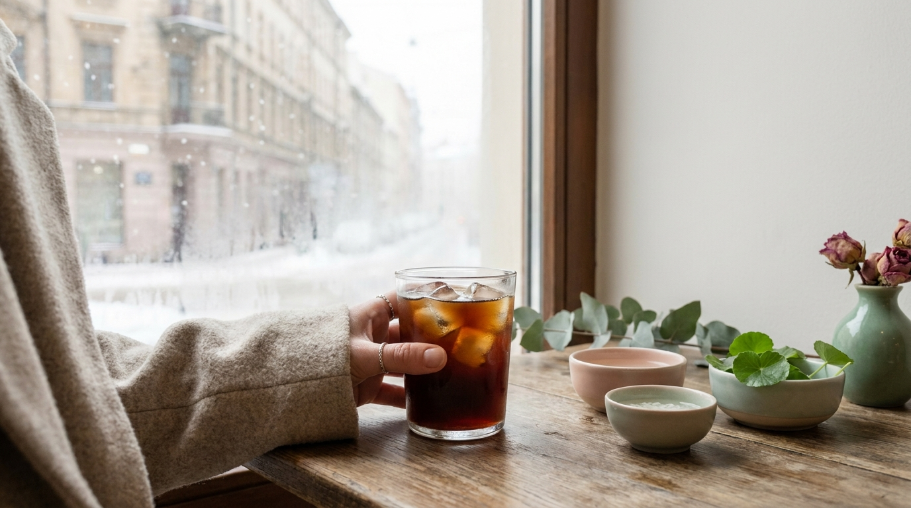

Si sueles ver series coreanas, es muy probable que hayas notado una escena recurrente: el termómetro marca varios grados bajo cero, las calles de Seúl están cubiertas de nieve, los personajes van abrigados de pies a cabeza con enormes abrigos acolchados (*long padding*) y, sin embargo, llevan en la mano un vaso de plástico transparente lleno de hielo y café negro.

Para muchos espectadores en Latinoamérica y España, ver a los protagonistas sostener una bebida helada mientras les sale vaho por la boca parece casi una exageración cómica o un simple patrocinio de marcas comerciales. Sin embargo, no se trata de una ficción televisiva. En Corea del Sur, el café helado en pleno invierno es un hábito social masivo con nombre propio, fundamentos culturales y explicaciones prácticas que forman parte del ritmo diario de esta ciudad.

## Puntos clave

- El término coreano *Eoljuk-a* (얼죽아) resume una filosofía extendida: «morir congelado antes que renunciar al café americano helado».
- No es una pose para los K-Dramas; los datos de las principales cadenas de cafeterías en Seúl confirman que más del 70 % de los cafés vendidos durante los meses de invierno son fríos.
- La rapidez de consumo vinculada a la cultura *Ppalli-ppalli* (prisa), las comidas calientes y especiadas, y la intensa calefacción interior explican esta costumbre.
- Preparar un auténtico *Ah-Ah* (abreviación de Iced Americano) en casa requiere proporciones específicas de agua, hielo compacto y espresso concentrado.

## El fenómeno Eoljuka: congelarse antes de renunciar al café helado

En Seúl existe una expresión que todo el mundo conoce y que resume a la perfección este comportamiento: **Eoljuk-a** (얼죽아). Se trata de una abreviatura popular de la frase *Eoreo jugeodo a-i-seu a-me-ri-ka-no* (얼어 죽어도 아이스 아메리카노), que se traduce literalmente como: «Aunque me muera de frío / congelado, elijo café americano helado».

Este concepto no es un simple meme de redes sociales; es una verdadera declaración de principios generacional. Quienes pertenecen al movimiento *Eoljuka* sienten que pedir un café caliente equivale a perder frescura mental, agilidad y sabor, sin importar que la temperatura exterior sea de 10 grados bajo cero. Si te interesa conocer más términos y expresiones coloquiales que nacen en las calles de Seúl y saltan a la televisión, puedes revisar nuestro [Diccionario de K-Dramas con el significado real de palabras coreanas](/blog/expresiones-coreanas-kdramas-significado-real/).

### Las estadísticas reales del café en Seúl

Para entender la magnitud del fenómeno, basta con observar los balances anuales de las cafeterías comerciales en Corea del Sur. Cadenas gigantes como Starbucks Corea, Ediya Coffee, Mega Coffee y Compose Coffee han revelado en repetidas ocasiones que las ventas de café frío superan con creces a las de bebidas calientes durante todo el año. 

Incluso en los meses más gélidos (diciembre, enero y febrero), la venta de café helado suele mantenerse entre el 60 % y el 75 % del total. Starbucks Corea acuñó formalmente datos que demuestran que el «Iced Caffe Americano» es el producto número uno en ventas de manera ininterrumpida desde hace más de una década. En el lenguaje cotidiano, pedirlo es tan simple como pronunciar dos sílabas: **«Ah-Ah» (아아)**.

## Las 4 razones reales detrás del Iced Americano en pleno invierno

※ Imagen ilustrativa generada con IA

¿Por qué en Corea se prefiere una bebida con hielo cuando el viento del norte congela las avenidas de Seúl? Lejos de ser un capricho inexplicable, existen motivos culturales, biológicos y laborales muy claros.

### 1. La cultura de la prisa y el ritmo 'Ppalli-ppalli'

La sociedad coreana se mueve a una velocidad extraordinaria bajo el principio del *Ppalli-ppalli* (rápido, rápido). Los descansos para el almuerzo de los oficinistas (*jikjang-in*) suelen durar exactamente una hora, durante la cual deben desplazarse al restaurante, hacer fila, comer y regresar a su puesto de trabajo.

Un café caliente requiere sorbos pequeños, paciencia y esperar varios minutos hasta que la temperatura baje para no quemarse la lengua o el paladar. Por el contrario, un Iced Americano permite ingerir una dosis elevada de cafeína en apenas dos minutos a través de una pajita (popote o sorbete). Se bebe rápido, refresca de golpe y permite volver al escritorio sin demoras. Es una herramienta de eficiencia laboral. Para comprender mejor cómo estos hábitos definen la rutina en Corea, te recomendamos leer nuestro artículo sobre [10 costumbres de los K-Dramas explicadas desde Seúl](/blog/costumbres-curiosas-kdramas-explicadas-por-coreano/).

### 2. El contraste con la calefacción extrema en interiores

El invierno en Corea del Sur es severo y seco, pero la infraestructura del país está diseñada para combatirlo de forma implacable. En oficinas, vagones de metro, autobuses y tiendas, la calefacción funciona a niveles muy altos, a menudo rondando entre los 23 °C y los 26 °C. Además, las viviendas cuentan con el tradicional sistema *Ondol* (calefacción por suelo radiante).

Al entrar a un edificio cargando pesados abrigos térmicos, la sensación de sofoco es inmediata. La combinación de aire caliente, ambiente seco y capas de ropa genera sed y pesadez. El Iced Americano funciona en ese momento como un equilibrador térmico: mientras el cuerpo se aclimata al calor sofocante del interior, la bebida fría despierta los sentidos y alivia la sensación de sequedad.

### 3. Digestión post-almuerzo y el menú tradicional coreano

La gastronomía coreana de diario se caracteriza por sabores intensos: sopas calientes (*jjigae*), platos con abundante ajo, fermentados como el kimchi, guisos con pasta de chile (*gochujang*) y carnes a la parrilla. 

Tras ingerir una comida abundante, caliente y con alto contenido de sodio o especias, el cuerpo no suele pedir otro líquido caliente ni bebidas densas con leche. El Iced Americano ofrece un trago limpio, amargo, helado y astringente que actúa prácticamente como un digestivo o «limpiador de paladar». Corta la pesadez de la comida y ayuda a vencer el sopor posterior al almuerzo (*siggonjeung* o somnolencia postprandial).

### 4. Estética visual, comodidad y lenguaje corporal en los K-Dramas

En las producciones audiovisuales, los directores cuidan cada detalle visual. Un vaso de papel blanco opaco para café caliente oculta el contenido, luce plano ante la cámara y puede desmoronarse si se humedece. En cambio, el vaso de plástico transparente del Iced Americano ofrece:

- Movimiento del hielo y sonido sutil al agitarse.
- El contraste del color oscuro del café frente a la ropa invernal de tonos neutros.
- La posibilidad de beber con pajita sin que los actores tengan que inclinar la cabeza hacia atrás, lo que permite mantener el contacto visual con la cámara o con su contraparte en la escena.

> **Nota cultural desde Seúl:** Sostener un vaso helado en la calle puede congelar los dedos en segundos. Por eso, en las cafeterías coreanas es habitual pedir un *cup sleeve* (funda de cartón) doble o simplemente meter la mano enguantada mientras se sostiene la bebida, manteniendo la pajita lista para beber en movimiento.

## Anatomía de las cafeterías en Seúl: del 'Take-out' rápido a los cafés de autor

El mapa de cafeterías en Corea del Sur se divide principalmente en dos grandes formatos que conviven en perfecta armonía en distritos como Gangnam, Hongdae, Seongsu o Yeouido.

Por un lado están las cadenas de bajo coste orientadas al consumo exprés (*take-out*). Marcas como Mega MGC Coffee, Compose Coffee o Paik's Dabang ofrecen vasos gigantes de Iced Americano (a menudo de casi un litro) por precios que oscilan entre los 1.500 y los 2.000 wones (alrededor de 1,10 a 1,50 dólares estadounidenses). Son los locales donde los trabajadores y estudiantes compran su café diario en menos de 60 segundos antes de subir a la oficina o a la biblioteca.

Por otro lado, Seúl alberga una de las concentraciones de cafeterías de especialidad más sofisticadas del mundo. En barrios como Seongsu-dong (conocido como el Brooklyn de Seúl) o Hannam-dong, las cafeterías funcionan como espacios de exhibición arquitectónica y diseño interior, donde el café se extrae con granos de orígenes únicos y métodos artesanales, manteniendo igualmente la opción helada como la más solicitada.

A continuación, se detalla cómo se estructuran las diferentes opciones de café según las necesidades del día a día en Seúl:

| Formato de cafetería | Bebida más pedida | Perfil de usuario | Precio orientativo (KRW) | Objetivo principal |
| :--- | :--- | :--- | :--- | :--- |
| **Cadenas Low-Cost** (Mega, Compose) | Iced Americano tamaño grande (24 oz) | Oficinistas, estudiantes universitarios | 1.500 - 2.000 ₩ | Cafeína rápida, económica y funcional |
| **Cadenas Globales / Locales** (Starbucks, Twosome) | Iced Americano / Cold Brew | Encuentros de trabajo, estudio con portátil | 4.500 - 5.500 ₩ | Espacio cómodo, reuniones informales |
| **Cafés de Especialidad** (Seongsu, Hannam) | Filter Coffee helado / Flat White | Aficionados al café, salidas de fin de semana | 6.000 - 8.500 ₩ | Experiencia sensorial, fotografía y estética |
| **Tiendas de Conveniencia** (CU, GS25) | Vaso de hielo + Pouch de café negro | Transeúntes con prisa, conductores | 1.200 - 1.800 ₩ | Disponibilidad 24 horas y rapidez inmediata |

## Cómo recrear un auténtico 'Ah-Ah' de K-Drama en casa

Preparar un café americano helado al estilo coreano no consiste simplemente en dejar enfriar una taza de café solo. Las cafeterías en Corea siguen proporciones exactas para que la bebida no quede aguada a medida que los cubitos se derriten.

Si te gusta crear una atmósfera auténtica para tus tardes de series en casa, puedes acompañar tu bebida con alguna de las ideas que compartimos en nuestra guía para organizar una [noche de K-Drama en casa con snacks y mascarillas coreanas](/blog/como-organizar-maraton-kdrama-en-casa-snacks/).

### La fórmula del Iced Americano coreano

1. **El tipo de café:** Se requiere un espresso doble concentrado (unos 50 a 60 ml) extraído con cafetera espresso, cafetera italiana (moka) o, en su defecto, café instantáneo liofilizado de alta intensidad disuelto en muy poca agua caliente.
2. **El orden de los ingredientes:** En Seúl, el método estándar consiste en llenar primero el vaso con cubos de hielo compactos hasta el tope.
3. **El agua fría:** Se añade agua fría purificada hasta cubrir aproximadamente el 60-70 % de la capacidad del vaso (unos 120-150 ml).
4. **La extracción sobre el hielo:** Finalmente, se vierte el espresso caliente directamente sobre la parte superior. Al hacerlo de este modo, el café se enfría al instante sin fundir todo el hielo de golpe, creando un ligero degradado visual antes de mezclarse con la pajita.

> **Consejo práctico para el hogar:** Conviene evitar el uso de cubitos de hielo pequeños o huecos, ya que se deshacen en pocos minutos y diluyen el sabor. Los cubos de hielo macizos y transparentes mantienen la temperatura baja durante mucho más tiempo sin alterar la fuerza del café.

## El bando opuesto: el pequeño grupo 'Eoljuk-dda'

※ Imagen ilustrativa generada con IA

Aunque los devotos del frío son mayoría, también existe en Corea el bando rival: los **Eoljuk-dda** (얼죽따). Esta contracción proviene de *Eoreo jugeodo ttatteut-han amrikano* («Aunque muera congelado, tomo americano caliente»).

Este grupo suele estar compuesto por personas sensibles al frío estomacal, personas mayores o quienes priorizan percibir las notas aromáticas sutiles de granos tostados con perfiles florales o frutales, las cuales se aprecian con mayor claridad a temperaturas cálidas. Sin embargo, en las conversaciones cotidianas entre amigos o compañeros de oficina, admitir la preferencia por el café caliente suele generar bromas cariñosas, ya que en el imaginario popular contemporáneo de Seúl, el frío se combate con más frío.

La cultura del Iced Americano invernal es un reflejo de la sociedad surcoreana contemporánea: un equilibrio singular entre la búsqueda de productividad, la adaptación a infraestructuras modernas de climatización y un estilo estético muy definido que ha trascendido fronteras gracias al auge de los K-Dramas en todo el mundo.

## Preguntas frecuentes (FAQ)

### ¿Por qué toman el café casi siempre con pajita (popote) en lugar de beber del borde del vaso?
El uso de pajita en bebidas heladas es el estándar universal en las cafeterías coreanas por varias razones: evita el contacto directo del hielo con los labios o dientes sensibles al frío, previene que se arruine el maquillaje labial (muy cuidado en la rutina diaria coreana) y permite beber cómodamente mientras se camina por la calle sin riesgo de salpicaduras sobre la ropa de abrigo.

### ¿Por qué prefieren Iced Americano antes que café con leche o latte?
El café con leche contiene grasas y lácteos que pueden resultar pesados en el estómago, especialmente después de almuerzos copiosos o condimentados. El Iced Americano es una bebida con prácticamente cero calorías, refrescante, ligera y que quita la sed de inmediato, funcionando más como agua saborizada energizante que como un postre lácteo.

### ¿Qué opinan los médicos o la medicina tradicional coreana (Hanbang) sobre esta costumbre?
Los especialistas en medicina tradicional coreana suelen desaconsejar el consumo frecuente de bebidas heladas durante el invierno, argumentando que enfriar el tracto digestivo de golpe debilita la energía interna (*Qi*) y afecta la circulación. No obstante, a pesar de las recomendaciones médicas habituales sobre moderar las temperaturas extremas, la costumbre social urbana del *Eoljuka* sigue pesando mucho más en el día a día de las nuevas generaciones.

### ¿Se puede comprar café helado en las tiendas de conveniencia de Corea?
Sí, es uno de los productos más populares. En cualquier tienda de conveniencia (como GS25, CU o 7-Eleven) se venden vasos sellados llenos de cubos de hielo en los congeladores por menos de 1.000 wones, junto a bolsas individuales (*pouches*) de café líquido que se abren y se vierten directamente en el vaso de hielo, ofreciendo un *Ah-Ah* instantáneo a cualquier hora del día o de la noche.