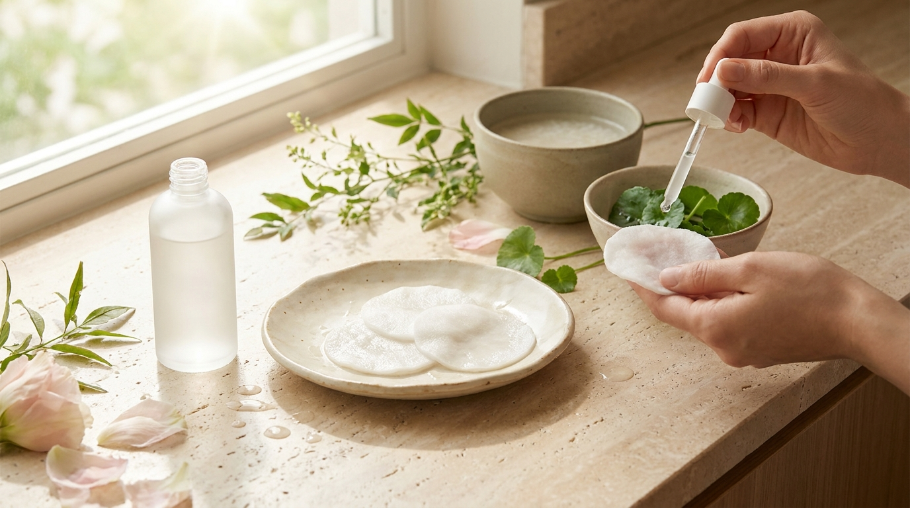
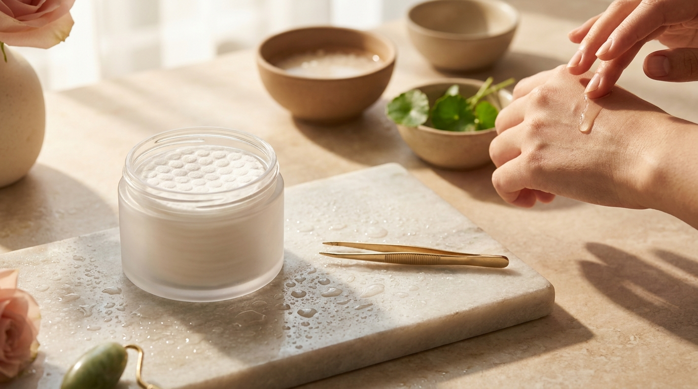

¡Hola! Soy J desde Seúl. Si sueles ver vlogs de belleza coreana, vídeos entre bastidores de K-Dramas o listas de novedades cosméticas en Corea, es muy probable que hayas visto a actrices y creadores colocándose unos pequeños discos empapados sobre las mejillas y la frente antes de maquillarse. Se trata de los *toner pads* (토너패드), uno de los formatos más populares y consolidados en el cuidado facial coreano contemporáneo.

Aunque a primera vista puedan parecer simples discos de algodón sumergidos en tónico facial tradicional, su diseño, la ingeniería de sus tejidos y la concentración de sus fórmulas van mucho más allá. Para quienes disfrutan del K-Beauty desde Latinoamérica o España, este producto resuelve dos problemas habituales: la falta de tiempo para aplicar una mascarilla de tela (*sheet mask*) completa por las mañanas y la necesidad de calmar o exfoliar zonas específicas del rostro sin complicar la rutina.

En esta guía detallada analizaremos en qué consisten exactamente, cómo aplicar la famosa técnica coreana del *Skin Pack* en solo 5 minutos y qué ingredientes debes buscar según las necesidades específicas de tu barrera cutánea.

## Puntos clave

- **Doble función inteligente**: la mayoría de los discos combinan un lado texturizado (para suavizar suavemente las células muertas superficiales) y un lado liso (diseñado para transferir hidratación profunda).
- **Técnica del *Skin Pack***: usarlos como mini mascarillas durante 3 a 5 minutos ayuda a reducir la temperatura superficial del rostro y prepara la piel para un maquillaje más uniforme.
- **Variedad según el tejido**: existen pads de gasa médica, algodón puro sin blanquear y fibras elásticas ultrafinas que se adaptan al contorno facial sin desprenderse.
- **Elección por ingredientes (INCI)**: desde fórmulas calmantes con centella asiática para piel sensible hasta opciones con gluconolactona (PHA) para textura irregular.

---

## Qué son los toner pads y por qué transformaron las rutinas en Seúl

En la cosmética tradicional, el tónico facial suele verterse en las palmas de las manos para presionarlo sobre el rostro o aplicarse con un algodón desechable. Sin embargo, en el acelerado ritmo de vida de Seúl, este paso evolucionó hacia un formato «todo en uno» listo para usar.

Un *toner pad* es un disco de tejido técnico previamente humedecido en una esencia o tónico concentrado, envasado en un tarro hermético con pinzas higiénicas integradas. No se trata únicamente de comodidad; la verdadera innovación radica en la interacción entre el material textil y la formulación química del líquido.

En los rankings de tiendas de Seúl, como se analiza al repasar [los productos de skincare más vendidos en Olive Young Corea](/blog/olive-young-mas-vendidos-corea-2026/), los discos tónicos ocupan secciones enteras debido a su versatilidad. Los fabricantes diseñan el tejido con densidades específicas para que retenga una gran cantidad de líquido sin gotear, liberando los activos de manera gradual cuando entra en contacto con la temperatura de la piel.

### Anatomía de un disco tónico coreano

La mayoría de los modelos disponibles en el mercado presentan dos caras claramente diferenciadas:

1. **Lado con relieve o gofrado (*embossed side*)**: presenta pequeñas protuberancias que facilitan una exfoliación física sumamente suave. Ayuda a retirar restos de polución, impurezas residuales de la limpieza y queratina acumulada en zonas como las aletas de la nariz o la barbilla.
2. **Lado liso (*smooth side*)**: una superficie plana y sedosa pensada para deslizarse suavemente por las mejillas y el contorno del rostro, maximizando la absorción de los humectantes sin causar fricción innecesaria.
3. **Pads elásticos de microfibra o hidrogel**: formulaciones más recientes emplean telas semielásticas que pueden estirarse suavemente antes de colocarse, adaptándose con precisión milimétrica al puente nasal, la zona de las ojeras o la línea de la mandíbula.

---

## La técnica del Skin Pack: mascarilla rápida en 5 minutos paso a paso



<p class="img-cap">※ Imagen ilustrativa generada con IA</p>

En Corea del Sur, una de las aplicaciones más apreciadas de estos discos es el denominado *Skin Pack* (스킨팩) o *Toner Pack*. Consiste en utilizar de dos a cuatro discos directamente sobre áreas localizadas del rostro a modo de mascarilla exprés antes de aplicar la base de maquillaje o continuar con el resto de sérums y cremas.

Esta técnica es especialmente útil por la mañana, cuando no hay tiempo para una mascarilla de 20 minutos, o por la noche para refrescar mejillas irritadas por el sol o el aire acondicionado. Para quienes siguen los pasos de una [rutina coreana para Glass Skin](/blog/rutina-coreana-piel-de-porcelana-glass-skin/), este método aporta una saturación de agua inmediata que mejora visiblemente la elasticidad dérmica superficial.

```
[Limpieza facial] 
       ↓
[Toner Pad: 3-5 minutos en mejillas y frente (Skin Pack)]
       ↓
[Deslizado suave con el lado liso hacia el exterior]
       ↓
[Sérum / Ampoule] 
       ↓
[Crema hidratante y Protector solar]
```

### Paso a paso para realizar el Skin Pack en casa

1. **Limpia suavemente el rostro**: retira cualquier resto de grasa o impurezas con tu limpiador habitual de base acuosa. La piel debe quedar limpia y ligeramente seca o húmeda antes de aplicar los discos.
2. **Extrae los discos con las pinzas**: utiliza siempre la pinza incluida en la tapa del envase. Evita introducir los dedos directamente en el frasco para prevenir la proliferación de bacterias en la solución acuosa restante.
3. **Coloca los discos en puntos estratégicos**: adhiere un disco en cada mejilla y otro en la frente (y un cuarto en la barbilla si lo consideras necesario). Gracias a la capilaridad del tejido húmedo, el pad se quedará pegado sin caerse mientras continúas con tus tareas matutinas.
4. **Respeta el tiempo límite (3 a 5 minutos)**: este punto es fundamental. No dejes secar los discos sobre la piel. Si un algodón húmedo se deshidrata por completo al aire, comenzará a absorber la humedad de la propia epidermis, generando el efecto contrario al deseado.
5. **Retira y desliza con delicadeza**: quita los discos y, usando el lado liso (o el gofrado solo en la zona T), deslízalos suavemente desde el centro del rostro hacia afuera, siguiendo las líneas de drenaje natural.
6. **Sella con suaves toques (*patting*)**: con las yemas de los dedos limpias, da toquecitos ligeros hasta que el remanente de esencia se absorba antes de pasar a tu sérum o crema.

---

## Cómo elegir el toner pad adecuado según tu tipo de piel e ingredientes (INCI)

No todos los discos cumplen la misma función. La elección acertada depende de si tu piel necesita refuerzo de barrera, control de sebo o luminosidad. Al revisar la lista de ingredientes (INCI), conviene identificar los activos principales que determinan el efecto final.

### 1. Piel sensible, reactiva o con tendencia a rojeces
Para este perfil, el objetivo principal es bajar la temperatura de la piel y mitigar la sensación de ardor o tirantez sin utilizar fragancias sintéticas ni alcohol secante.
- **Ingredientes recomendados**: centella asiática, madecassoside, extracto de artemisia (mugwort), pantenol (provitamina B5) y alantoína.
- Puedes profundizar en cómo actúa este botánico analizando la [centella asiática (Cica) en K-Beauty](/blog/centella-asiatica-cica-beneficios-piel-sensible/).
- **Tipo de disco ideal**: gasa médica suave de algodón hipoalergénico o tejido gelatinoso (*jelly pad*) que no ejerza fricción mecánica al retirarlo.

### 2. Piel grasa, mixta o propensa a poros congestionados
Si buscas controlar el exceso de brillo y prevenir puntos negros, conviene optar por discos formulados con hidroxiácidos de acción progresiva que no comprometan la barrera hidrolipídica.
- **Ingredientes recomendados**: gluconolactona (PHA), ácido capriloil salicílico (LHA), extracto de árbol de té (*tea tree*) y extracto de corteza de sauce blanco. El PHA y el LHA tienen un peso molecular mayor que el ácido glicólico tradicional, por lo que exfolian de forma más lenta y superficial, reduciendo el riesgo de irritación.
- **Tipo de disco ideal**: diseño de doble cara con relieve marcado para trabajar con suavidad las aletas nasales, la frente y el mentón.

### 3. Piel seca, apagada o deshidratada
Cuando la piel se siente acartonada y carece de brillo natural, los discos enriquecidos con humectantes pesados y nutrientes botánicos ayudan a reponer los niveles hídricos de inmediato.
- **Ingredientes recomendados**: múltiples pesos moleculares de ácido hialurónico, betaglucano, ectoína, extracto de arroz fermentado y ceramidas en suspensión fluida.
- **Tipo de disco ideal**: almohadillas gruesas de varias capas que contengan una gran densidad de esencia lechosa o de textura semi-gel.

---

## Tabla comparativa: tipos de toner pads según su función cosmética

Para orientarte al explorar catálogos coreanos desde casa, esta tabla resume las categorías principales que encontrarás en el mercado y su uso más aconsejable:

| Categoría de Pad | Objetivo principal | Ingredientes clave habituales | Tipo de tejido habitual | Frecuencia de uso recomendada |
| :--- | :--- | :--- | :--- | :--- |
| **Calmante / Soothing** | Mitigar rojeces y bajar temperatura facial | Centella Asiática, Artemisia, Pantenol | Algodón suave o tencel elástico | Diario (mañana y noche) |
| **Hidratante / Barrier** | Restaurar agua y flexibilidad dérmica | Ácido Hialurónico, Ceramidas, Ectoína | Almohadilla multicapa esponjosa | Diario (mañana y noche) |
| **Clarificante / Peeling** | Refinar textura y desobstruir poros | PHA, LHA, Árbol de té, BHA suave | Disco con relieve gofrado (*embossed*) | 2 a 4 veces por semana |
| **Iluminador / Tono** | Unificar textura y dar vitalidad | Niacinamida, Vitamina C derivada, Arroz | Fibras ultrafinas o semigel | Diario o en días alternos |

---

## Consejos prácticos de uso y conservación desde Seúl



<p class="img-cap">※ Imagen ilustrativa generada con IA</p>

El uso incorrecto de los discos tónicos puede mermar su efectividad e incluso generar microirritaciones si se aplica demasiada fuerza física. Los siguientes factores marcan una diferencia notable en los resultados:

> **Consejo práctico desde Seúl**:  
> Guarda el tarro en un lugar fresco y alejado de la luz solar directa. En épocas calurosas o si tu piel tiende a ruborizarse con facilidad, puedes conservar el envase en la puerta del refrigerador (a una temperatura no menor a 8–10 °C). La sensación fría al colocarlos durante 3 minutos potencia el alivio térmico en las mejillas. Asegúrate siempre de cerrar la tapa herméticamente con un clic firme para evitar que la esencia se evapore con el paso de las semanas.

### Errores comunes que debes evitar

- **Frotar con vigor**: el disco no debe emplearse como una toallita exfoliante agresiva. La fricción repetida sobre la misma zona puede dañar el estrato córneo, provocando enrojecimiento innecesario. El movimiento debe ser tan suave como si deslizaras una pluma.
- **Reutilizar los discos**: una vez retirados del rostro, deséchalos en el contenedor correspondiente. Nunca los vuelvas a introducir en el tarro para intentar aprovecharlos al día siguiente, ya que contaminarías el resto de las almohadillas limpias.
- **Omitir la prueba de parche previa**: si eliges pads con ácidos exfoliantes (como PHA, BHA o extractos cítricos) y tu piel es reactiva, realiza primero una prueba colocando un disco durante 3 minutos en el lateral interior de la mandíbula o en el antebrazo antes de aplicarlo en el centro del rostro.

---

## Preguntas frecuentes (FAQ)

### ¿Los toner pads reemplazan por completo al tónico líquido convencional?
Sí, pueden sustituirlo perfectamente en tu rutina habitual, ya que contienen la misma base de activos y humectantes que un tónico o una esencia líquida. No obstante, muchas personas eligen alternar: usan tónico líquido vertido con las manos en las rutinas nocturnas más pausadas y reservan los *toner pads* para la mañana o para momentos en que necesitan el beneficio localizado del *Skin Pack*.

### ¿Se pueden usar todos los días?
Depende exclusivamente de su composición. Los discos centrados en la hidratación y el alivio (con centella asiática, pantenol o ácido hialurónico) son perfectamente aptos para uso diario, tanto por la mañana como por la noche. Por el contrario, los discos formulados con activos exfoliantes (PHA, LHA o extracto de corteza de sauce) suelen tolerarse mejor si se emplean de dos a tres veces por semana, adaptando la frecuencia según la respuesta de tu barrera cutánea.

### ¿Es necesario aclarar con agua después de retirar los discos?
No. La fórmula que impregna los discos tónicos está concebida como un paso de tratamiento que debe permanecer en la piel. Al retirar el disco, solo debes dar suaves toques con las yemas de los dedos para favorecer la absorción completa del producto residual y continuar inmediatamente con tu sérum, crema hidratante y protector solar (o bloqueador).

### ¿Puedo cortar los discos si me resultan demasiado grandes para ciertas zonas?
Por supuesto. Muchas usuarias en Corea cortan algunos discos por la mitad con tijeras previamente desinfectadas con alcohol para adaptarlos a áreas más estrechas, como la zona inferior de los ojos, la nariz o el entrecejo. Además, en el mercado actual existen pads fabricados con tejidos elásticos que pueden expandirse suavemente con los dedos antes de aplicarlos, adaptándose a cualquier fisionomía facial.