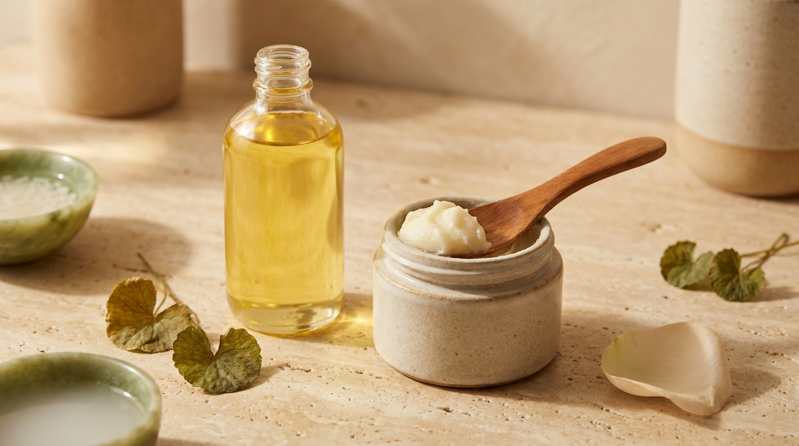
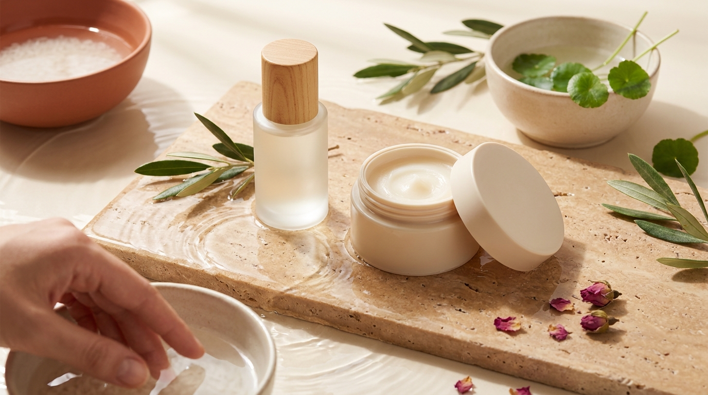

¡Hola! Soy J desde Seúl. Si sueles ver K-Dramas o seguir las tendencias de belleza que surgen en Corea, es muy probable que te hayas preguntado cómo logran los actores y el público coreano mantener una piel con apariencia tan limpia, uniforme y luminosa. Aunque en pantalla intervienen la iluminación y el maquillaje profesional, en la vida cotidiana de Seúl el verdadero punto de partida no es una crema costosa, sino la higiene facial nocturna.

En la rutina coreana, el concepto más fundamental para cuidar los poros y prevenir la congestión cutánea es la **doble limpieza** (*yijung sean* o 이중 세안 en coreano). Sin embargo, al buscar productos desde casa en tiendas online internacionales, surge de inmediato una duda habitual: ¿es mejor optar por un limpiador en aceite fluido o por un bálsamo limpiador de textura sólida? 

En esta guía analizaremos la ciencia detrás de este método, revisaremos el listado de ingredientes (INCI), compararemos ambas texturas y aprenderemos a realizar el proceso paso a paso para cuidar la barrera cutánea sin irritaciones.

## Puntos clave

- La doble limpieza utiliza el principio químico de afinidad: el producto oleoso disuelve las impurezas con base grasa (sebo, protector solar resistente y maquillaje), mientras que el limpiador acuoso retira el sudor y los residuos solubles en agua.
- Los aceites limpiadores suelen ser más ligeros y prácticos para dispensar a diario, mientras que los bálsamos ofrecen una textura untuosa tipo sorbete, ideal para no gotear y para llevar de viaje.
- El paso determinante para que un limpiador en aceite no deje residuos grasos ni tape los poros es la **emulsión**: añadir un poco de agua tibia para transformar el aceite en una leche fluida antes de aclarar.
- Ambos formatos pueden formularse para cualquier tipo de piel, pero revisar los ingredientes activos (como aceites no comedogénicos, centella asiática o ceramidas) permite elegir la opción más afín a tus necesidades.

---

## ¿Qué es la doble limpieza y cuál es su origen en Corea?

La doble limpieza consiste en utilizar dos tipos de limpiadores con mecanismos de acción complementarios durante la rutina de noche:

1. **Primer paso (base oleosa):** Un aceite o bálsamo limpiador diseñado con emulsionantes.
2. **Segundo paso (base acuosa):** Un gel o espuma limpiadora, idealmente formulado con un pH ligeramente ácido (cercano a 5.5).

En Seúl, la popularidad de este método creció debido a factores ambientales y culturales muy específicos. Por un lado, la vida urbana en Corea del Sur implica una exposición constante al polvo fino (*fine dust* o 미세먼지), partículas microscópicas que se adhieren con facilidad a la película lipídica del rostro. Por otro lado, la gran mayoría de las personas utiliza a diario protectores solares de alta adherencia y bases de maquillaje tipo *cushion*, formuladas con polímeros y siliconas que resisten el sudor y la humedad.

Un limpiador espumoso tradicional a base de agua tiene dificultades para disolver por completo las siliconas, los filtros solares resistentes al agua y el exceso de sebo acumulado en el interior del poro. El principio básico de la química establece que «lo semejante disuelve a lo semejante». Por ello, un producto con fase grasa disuelve suavemente las sustancias oleosas sin necesidad de frotar con discos de algodón o toallitas desmaquillantes, elementos que suelen causar fricción mecánica y enrojecimiento.

---

## Aceite limpiador vs. bálsamo limpiador: composición y diferencias

※ Imagen ilustrativa generada con IA

Tanto los aceites como los bálsamos cumplen exactamente la misma función cosmética y logran el mismo resultado final si están bien formulados. No obstante, su estructura química, su comportamiento sensorial y su presentación en el envase presentan distinciones claras que conviene conocer antes de comprar.

### 1. Aceite limpiador (Cleansing Oil)

El aceite limpiador es un líquido fluido que generalmente se comercializa en botellas con dosificador de bomba (*pump*). 

- **Estructura y fórmula:** Suele componerse de una combinación de aceites vegetales (como aceite de jojoba, salvado de arroz, semilla de girasol o macadamia) o ésteres sintéticos ligeros (como el *ethylhexyl palmitate* o *cetyl ethylhexanoate*), acompañados de tensioactivos no iónicos emulsionantes (por ejemplo, *PEG-20 glyceryl triisostearate* o derivados de poliglicerilo).
- **Sensación de uso:** Al ser completamente líquido, se distribuye con extrema rapidez sobre la piel seca y ofrece un deslizamiento suave que reduce al mínimo el roce de los dedos sobre el rostro.
- **Ventajas prácticas:** Su envase hermético con bomba es muy higiénico, ya que no requiere introducir los dedos ni espátulas para extraer el producto.
- **Puntos a considerar:** Puede escurrirse entre los dedos si no se aplica con cuidado y, en caso de viajes en avión, existe riesgo de fugas si el dispensador no cuenta con bloqueo de seguridad.

### 2. Bálsamo limpiador (Cleansing Balm)

El bálsamo limpiador es una fórmula semisólida que recuerda a una cera suave o a un sorbete helado (*sherbet texture*). Al entrar en contacto con el calor natural de la piel, la estructura sólida se funde instantáneamente y se transforma en un aceite sedoso.

- **Estructura y fórmula:** Para lograr su consistencia sólida a temperatura ambiente, los bálsamos emplean ceras sintéticas (como *synthetic wax*) o ceras vegetales (como cera de candelilla o carnauba), combinadas con los mismos tipos de aceites y emulsionantes presentes en las fórmulas líquidas. En las tiendas de Seúl suelen encontrarse versiones enriquecidas con extractos botánicos calmantes (como *Centella Asiatica*, té verde o árbol de té).
- **Sensación de uso:** Aporta una textura rica y mullida que amortigua la fricción. Muchas personas con piel sensible o seca aprecian la sensación reconfortante de masajear una textura densa que no gotea hacia el cuello ni los ojos.
- **Ventajas prácticas:** Es el formato idóneo para viajar o llevar al gimnasio, ya que no se derrama en el neceser y no computa como líquido estricto en muchos controles de equipaje de mano.
- **Puntos a considerar:** Exige utilizar una espátula limpia para extraer el producto y evitar la contaminación del frasco con restos de agua o bacterias de las manos.

---

## Tabla comparativa: Aceite vs. Bálsamo limpiador

Para ayudarte a visualizar qué formato se adapta mejor a tu rutina y hábitos de uso, resumimos sus principales características en la siguiente tabla:

| Criterio | Aceite limpiador (*Cleansing Oil*) | Bálsamo limpiador (*Cleansing Balm*) |
| :--- | :--- | :--- |
| **Textura inicial** | Líquida, fluida y ligera. | Sólida (tipo cera o sorbete suave). |
| **Transformación** | Se mantiene líquido hasta añadir agua. | Se funde de sólido a aceite con el calor del rostro. |
| **Envase habitual** | Frasco con dosificador de bomba (*pump*). | Tarro con tapa de rosca y espátula aplicadora. |
| **Practicidad para viajar** | Riesgo ocasional de goteo o fugas. | Muy seguro para traslados; no se derrama. |
| **Rendimiento con maquillaje pesado** | Excelente; penetra con rapidez en pliegues y poros. | Excelente; su densidad disuelve máscaras de pestañas resistentes con gran suavidad. |
| **Comodidad de aplicación** | Muy rápido de aplicar; puede escurrir por los brazos si se usa en exceso. | Control total de la cantidad; no gotea durante el masaje. |
| **Perfil de usuario habitual en Corea** | Quienes buscan rapidez diaria en el lavabo o prefieren texturas ultra livianas. | Quienes viajan a menudo, disfrutan de masajes faciales pausados o tienen piel seca/deshidratada. |

---

## La técnica correcta paso a paso: el secreto está en la emulsión

El fracaso más común entre quienes prueban la doble limpieza por primera vez es la aparición de granitos o sensación de pesadez. En la inmensa mayoría de los casos analizados por dermatólogos y educadores de cosmética en Seúl, esto no se debe al producto en sí, sino a una técnica de aclarado incorrecta. 

A continuación detallamos el protocolo estándar de aplicación recomendado por los laboratorios cosméticos coreanos:

### Paso 1: Aplicación en seco

Asegúrate de que tanto tus manos como tu rostro estén **completamente secos**. Si aplicas el producto sobre la piel húmeda, los emulsionantes se activarán antes de tiempo y el aceite perderá su capacidad para disolver el sebo y el maquillaje. 

Toma de 2 a 3 pulsaciones de aceite (o una cantidad del tamaño de una almendra de bálsamo) y caliéntalo brevemente entre las palmas. Distribúyelo por todo el rostro realizando movimientos circulares suaves con las yemas de los dedos. Presta especial atención a la zona T (frente, nariz y barbilla), donde suele acumularse mayor cantidad de sebo oxidado.

### Paso 2: El proceso de emulsión (*Yu-hwa* / 유화)

Este es el paso fundamental de la cosmética coreana. Humedece ligeramente las manos con agua templada y vuelve a masajear el rostro. En contacto con esa pequeña cantidad de agua, el aceite transparente o el bálsamo fundido reaccionará químicamente volviéndose de un color blanco lechoso. 

Durante este proceso de emulsión, los tensioactivos encapsulan las impurezas disueltas para que puedan desprenderse fácilmente de la superficie cutánea. Masajea esta mezcla lechosa durante unos 15 o 20 segundos.

### Paso 3: Aclarado exhaustivo

Enjuaga el rostro abundantemente con agua templada hasta que no quede ningún rastro visible de leche limpiadora. Evita el agua excesivamente caliente, ya que puede debilitar los lípidos intercelulares de la barrera cutánea y provocar deshidratación reactiva.

### Paso 4: Segundo limpiador de base acuosa

Con la piel todavía húmeda, aplica un gel o espuma limpiadora suave de pH bajo (5.0 a 6.0). Trabaja la espuma en las manos antes de llevarla al rostro y limpia con suavidad durante 30 a 60 segundos para retirar residuos solubles en agua, restos de sudor y partículas ambientales. Aclara nuevamente con agua templada y seca el rostro a toquecitos con una toalla limpia exclusiva para la cara o dejando que se absorba al aire.

> **Consejo práctico desde Seúl sobre el tiempo de masaje:**  
> En redes sociales se ha popularizado la tendencia de masajear el aceite limpiador durante 10 o 15 minutos para «extraer filamentos sebáceos». En Corea, los especialistas desaconsejan enérgicamente esta práctica: masajear la piel con aceites desmaquillantes durante más de 60 o 90 segundos puede provocar sobreestimulación mecánica, alterar la función barrera y desencadenar brotes de dermatitis por fricción. Un minuto de masaje suave es más que suficiente. Si vas a incorporar un producto nuevo comprado online, realiza siempre una prueba de parche en la mandíbula o detrás de la oreja durante 24 horas.

---

## Cómo elegir la fórmula ideal según tu tipo de piel

※ Imagen ilustrativa generada con IA

No todos los aceites ni todos los bálsamos están formulados de la misma manera. Al revisar la lista de ingredientes (INCI) de las marcas coreanas más populares en los rankings de Olive Young, se observan diferencias claras según el objetivo de cada línea:

### Piel grasa o con tendencia a imperfecciones

Existe el mito de que la piel grasa no debe usar aceites. Sin embargo, el sebo humano se disuelve de manera óptima con lípidos de peso molecular similar. 
- **Qué buscar en el INCI:** Fórmulas con ésteres sintéticos ultraligeros, aceite de jojoba (*Simmondsia Chinensis Seed Oil*, que imita la estructura del sebo natural sin saturar el poro), aceite de árbol de té (*Melaleuca Alternifolia*) o ácido salicílico / lipohidroxiácido (BHA o LHA) en bajas concentraciones para favorecer la limpieza de los poros.
- **Formato recomendado:** Aceites limpiadores de textura fluida o bálsamos transparentes formulados específicamente como *pore clearing* o no comedogénicos.

### Piel seca o deshidratada

La piel seca carece de suficientes lípidos y tiende a sentir tirantez después del lavado si el limpiador es muy astringente.
- **Qué buscar en el INCI:** Aceites nutritivos como el de salvado de arroz (*Oryza Sativa Bran Oil*), aceite de semilla de camelia (*Camellia Japonica*) o extractos ricos en antioxidantes. También fórmulas con ceramidas añadidas, pantenol y glicerina que previenen la pérdida transepidérmica de agua (*TEWL*) durante el aclarado.
- **Formato recomendado:** Bálsamos limpiadores densos o aceites enriquecidos que dejen una película de confort y suavidad inmediata tras el lavado.

### Piel sensible, reactiva o con rojez

Para cutis que se irritan con facilidad, el objetivo primordial es la ausencia de alérgenos conocidos.
- **Qué buscar en el INCI:** Listas de ingredientes cortas, ausencia de aceites esenciales cítricos o florales añadidos para dar aroma (como limoneno, linalool o aceite de bergamota), y presencia de activos reparadores como extracto de *Centella Asiatica*, madecassoside, alantoína o extracto de artemisia (*Mugwort*).
- **Formato recomendado:** Tanto aceites como bálsamos etiquetados como *hipoalergénicos* y testeados dermatológicamente para piel sensible.

---

## Preguntas frecuentes (FAQ)

### ¿Debo realizar la doble limpieza por la mañana y por la noche?
No es necesario realizar la doble limpieza por la mañana. Durante la noche la piel no está expuesta a protectores solares resistentes, maquillaje ni contaminación exterior. Por la mañana suele ser suficiente utilizar únicamente el limpiador acuoso suave o, en pieles muy secas, simplemente aclarar el rostro con agua templada. La doble limpieza está concebida principalmente como el primer paso de la rutina nocturna.

### Si no uso maquillaje, ¿hace falta hacer doble limpieza?
Sí, especialmente si utilizas protector solar (bloqueador solar) resistente al agua o con filtros minerales (óxido de zinc y dióxido de titanio). Estos filtros están diseñados para adherirse firmemente a la piel y resistir el sudor, por lo que un limpiador en gel acuoso convencional a menudo deja residuos microscópicos que pueden obstruir los poros con el paso de los días.

### ¿El agua micelar puede sustituir al aceite o al bálsamo?
El agua micelar contiene micelas (tensioactivos) que pueden atrapar grasa y maquillaje, pero requiere el uso de discos de algodón. El roce repetido del algodón contra el rostro genera microfricción mecánica que puede sensibilizar la piel a largo plazo. Además, los bálsamos y aceites limpiadores que se aclaran con agua disuelven las impurezas de los poros de forma mucho más homogénea y sin necesidad de frotar.

### ¿Qué temperatura de agua es la más adecuada para enjuagar?
Se debe utilizar siempre agua templada (ni fría ni muy caliente). El agua fría no permite que los emulsionantes del aceite se disuelvan adecuadamente, lo que puede dejar una película grasa en la piel. Por su parte, el agua excesivamente caliente dilata los capilares sanguíneos, despoja a la piel de sus lípidos protectores naturales y favorece la sequedad y la rojez.