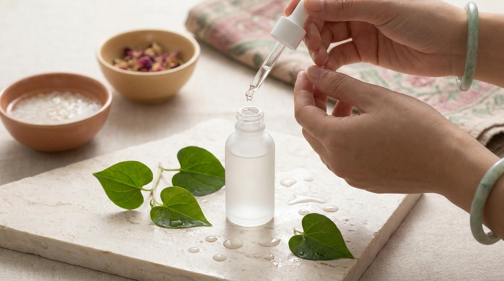

En las tendencias actuales de cosmética coreana, el estándar del cuidado facial prioriza la calma y el equilibrio cutáneo por encima de los tratamientos agresivos. Cuando la barrera de la piel se altera por cambios de temperatura, estrés ambiental o exceso de grasa, en los principales puntos de venta de Seúl como Olive Young destaca un ingrediente botánico en los estantes de tónicos y mascarillas: el **Heartleaf** (*Houttuynia cordata*).

Durante años, la Centella Asiática dominó las conversaciones sobre piel sensible. Sin embargo, en las rutinas coreanas actuales, el Heartleaf se ha posicionado como un recurso predilecto para quienes buscan aliviar rojeces sin saturar los poros, especialmente en pieles mixtas, grasas o propensas a imperfecciones puntuales. A continuación, se analiza qué aporta la ciencia cosmética sobre este extracto, cómo actúa en el rostro y de qué manera puede incorporarse en la rutina diaria.

## Puntos clave

- **Origen botánico tradicional**: Conocido en Corea como *Eoseongcho* (어성초), es una planta valorada por su riqueza en flavonoides antioxidantes como la quercitrina, que ayudan a calmar la irritación visible.
- **Acción dual (calmante y purificante)**: A diferencia de otros activos calmantes más emolientes, el Heartleaf destaca por equilibrar la apariencia de exceso de sebo y favorecer un aspecto limpio en los poros.
- **Fórmulas acuosas y ligeras**: La mayoría de las formulaciones en K-Beauty presentan texturas ultraligeras de rápida absorción, ideales para climas templados o húmedos y rutinas de varias capas.
- **Compatibilidad amplia**: Es un ingrediente dermoafín que combina con facilidad con activos renovadores como el BHA o hidratantes como el ácido hialurónico.

---

## ¿Qué es el Heartleaf y por qué es un pilar botánico en Corea?

El Heartleaf, cuyo nombre botánico internacional es *Houttuynia cordata*, debe su denominación popular a la peculiar forma de corazón de sus hojas verdes. En Corea del Sur forma parte del recetario botánico tradicional conocido como *Hanbang*, donde históricamente se valoraban sus propiedades purificantes y refrescantes para reconfortar la piel ante sensaciones de calor o incomodidad superficial.

### De la tradición al fenómeno cosmético actual

En la cosmética contemporánea, los laboratorios coreanos rescataron este extracto ancestral para responder a una necesidad muy concreta del consumidor urbano: calmar la piel sensibilizada por el uso continuo de maquillaje, la polución y el roce diario, sin aportar pesadez ni grasa extra. 

En los pasillos de tiendas especializadas en Seúl, las líneas completas formuladas con *Houttuynia cordata* ocupan con frecuencia los primeros puestos de preferencia en la categoría de cuidado para pieles con imperfecciones (*trouble care*). Mientras que en otros mercados muchas fórmulas para imperfecciones apuestan por fórmulas secantes mediante alcoholes o exfoliantes intensos, el enfoque coreano busca reducir la reactividad devolviendo el confort y la hidratación al cutis.

### Cómo actúa en el INCI: identificación y fitoquímica

Cuando se revisa la lista de ingredientes (INCI) de un producto coreano, este activo suele aparecer registrado como **Houttuynia Cordata Extract**. 

Su interés cosmético reside en su perfil fitoquímico:
- **Quercitrina e isoquercitrina**: Flavonoides con notable capacidad antioxidante que protegen las células frente a los radicales libres y ayudan a atenuar la apariencia de rojeces en la superficie de la piel.
- **Hiperósido**: Compuesto polifenólico que contribuye a reforzar la resistencia natural de la piel frente a factores ambientales adversos.
- **Polisacáridos vegetales**: Azúcares complejos que retienen moléculas de agua en la capa córnea, aportando una hidratación ligera y no oclusiva.

Muchas marcas coreanas destacan porcentajes elevados en sus envases (como 70%, 77% o incluso 80%). Es importante señalar que estas cifras suelen referirse a un extracto acuoso preparado donde la planta ha sido infusionada o extraída a baja temperatura para preservar sus activos, lo que permite crear bases ligeras en lugar de recurrir exclusivamente a agua purificada convencional.

---

## Beneficios clave: control de sebo, poros limpios y alivio de rojeces

※ Imagen ilustrativa generada con IA

Integrar el Heartleaf dentro de una rutina orientada a [calmar rojeces y proteger la piel sensible](/blog/centella-asiatica-cica-beneficios-piel-sensible/) aporta ventajas muy específicas que lo diferencian de otros botánicos populares.

### 1. Regulación del exceso de brillo sin alterar la barrera

Uno de los mayores retos en las pieles mixtas o grasas es encontrar cosméticos que equilibren la zona T sin deshidratar las mejillas. Los taninos presentes de forma natural en el Heartleaf ejercen un suave efecto astringente cosmético. Esto significa que contribuyen a que los poros luzcan más compactos y afinados de manera temporal, reduciendo el aspecto brillante a lo largo de las horas sin comprometer la función barrera.

### 2. Disminución de rojeces y descongestión epidérmica

Cuando un poro se obstruye o la piel reacciona a un cambio brusco de clima, la zona suele enrojecerse y experimentar sensación de calor. El extracto de *Houttuynia cordata* ejerce una acción refrescante apreciable. En las reseñas de usuarios en Corea se destaca con frecuencia que su aplicación constante favorece un tono más uniforme tras episodios de sensibilidad y alivia la tirantez superficial.

---

## Heartleaf vs. Centella Asiática y Árbol de Té: ¿cuál elegir?

A menudo surge la duda sobre cuándo conviene elegir Heartleaf en lugar de otros referentes del K-Beauty como la Centella Asiática (Cica) o el Árbol de Té (Tea Tree). Aunque los tres son extractos vegetales calmantes, su campo de acción prioritario es distinto:

| Criterio | Heartleaf (*Houttuynia Cordata*) | Centella Asiática (*Cica*) | Árbol de Té (*Tea Tree*) |
| :--- | :--- | :--- | :--- |
| **Objetivo principal** | Calmar rojeces y equilibrar poros y sebo | Reparar barrera dañada y reconfortar | Purificar y secar imperfecciones puntuales |
| **Sensación en piel** | Acuosa, refrescante, ultrafluida | Emoliente, reconfortante, nutritiva | Purificante, astringente, algo secante |
| **Tipo de piel ideal** | Grasa, mixta, propensa a imperfecciones | Seca, irritada, sensibilizada o descamada | Grasa con tendencia a brillo y brotes puntuales |
| **Tolerancia en piel reactiva** | Muy alta (bajo potencial irritante) | Muy alta (reparadora) | Media a moderada (puede suscitar reactividad) |
| **Paso habitual en K-Beauty** | Tónicos acuosos y discos de algodón | Cremas reparadoras y bálsamos | Sueros localizados (*spot treatments*) |

Como muestra la tabla, si la piel tiende a deshidratarse con facilidad o presenta descamación, la Centella suele ser la opción predilecta. Si, en cambio, la prioridad es atender poros visibles, exceso de brillo y rojeces difusas, el Heartleaf ofrece un balance adecuado de ligereza y acción purificante.

---

## Formatos más populares en Seúl y cómo integrarlos en tu rutina

En el diseño habitual de rutinas en Corea, el extracto de Heartleaf no suele reservarse para cremas densas de noche, sino para los primeros pasos de hidratación y acondicionamiento cutáneo.

### Tónicos acuosos y la técnica del Skin Pack

El tónico de Heartleaf es el formato más extendido. Gracias a su textura similar al agua, permite aplicar varias capas sucesivas sin dejar residuo pegajoso. Una de las costumbres más habituales en el cuidado facial coreano es el llamado *Skin Pack*: empapar varios discos de algodón finos en tónico de Heartleaf y dejarlos reposar sobre las mejillas y la frente durante 5 a 10 minutos antes del maquillaje o antes de dormir. Este método ayuda a refrescar el cutis y atenuar visiblemente las rojeces.

Si se busca simplificar la rutina, una alternativa ampliamente adoptada son los [toner pads listos para usar en 5 minutos](/blog/discos-tonicos-coreanos-toner-pads-guia/), que vienen preimpregnados con esencia de Heartleaf para suavizar la textura con una cara y reconfortar la piel con la otra.

### Sueros y ampollas calmantes

Para períodos de mayor estrés cutáneo o cambios estacionales intensos, las ampollas concentradas de Heartleaf funcionan como un refuerzo eficaz. Suelen combinar el extracto botánico con pantenol o alantoína para potenciar el alivio. Es habitual recomendar su aplicación tras el tónico, distribuyendo tres o cuatro gotas con toques suaves sobre el rostro antes de sellar la hidratación con una loción o gel ligero.

Para estructurar adecuadamente estos pasos dentro de un régimen completo, resulta útil revisar pautas para una [rutina coreana pensada para piel grasa o con tendencia al acné](/blog/rutina-coreana-piel-grasa-acne-clima-humedo/), donde la levedad de cada capa es clave para prevenir la congestión de los poros.

> **Consejo de aplicación**: Aunque el extracto de Heartleaf destaca por su alta tolerancia en pieles reactivas, cada fórmula incorpora conservantes botánicos y agentes humectantes propios. Antes de estrenar un nuevo producto, conviene realizar una prueba de parche en la parte lateral de la mandíbula o detrás de la oreja durante 24 horas para verificar la compatibilidad individual.

---

## Cómo combinar el Heartleaf con otros activos cosméticos

※ Imagen ilustrativa generada con IA

Una de las principales ventajas del Heartleaf es su versatilidad para convivir con ingredientes activos más intensos:

1. **Con BHA (Ácido Salicílico)**: El ácido salicílico limpia en profundidad el interior de los poros. Utilizar un tónico o esencia de Heartleaf a continuación contribuye a calmar la piel y minimizar el enrojecimiento transitorio que a veces provocan los exfoliantes químicos.
2. **Con Retinol o Retinoides**: Al introducir derivados de la vitamina A en la rutina nocturna, la piel puede experimentar resequedad o sensibilidad temporal. Intercalar Heartleaf o aplicarlo previamente ayuda a amortiguar la sensación de incomodidad.
3. **Con Niacinamida**: Constituyen una combinación clásica en la cosmética coreana. La niacinamida colabora en emparejar el tono y mejorar la luminosidad, mientras el Heartleaf ayuda a controlar los brillos y calmar la superficie cutánea.

---

## Preguntas frecuentes (FAQ)

### ¿El Heartleaf ayuda con las imperfecciones o sustituye a un tratamiento dermatológico?
El Heartleaf es un ingrediente cosmético diseñado para calmar, hidratar y contribuir al equilibrio visible de la piel propensa a brillos y rojeces. No es un medicamento ni sustituye a tratamientos dermatológicos pautados por un especialista para afecciones como el acné severo o la rosácea. Su función es la de un apoyo cosmético diario para mantener la piel confortable y equilibrada.

### ¿Se puede utilizar el tónico de Heartleaf tanto de día como de noche?
Sí. Al no ser un ingrediente fotosensibilizante, es habitual recomendarlo por la mañana para regular los brillos a lo largo del día y aportar una base fresca antes del protector solar, así como por la noche para reconfortar la piel tras la limpieza facial.

### ¿El Heartleaf tiene un olor fuerte o herbal?
En su forma botánica cruda, la *Houttuynia cordata* desprende un aroma característico. No obstante, en las formulaciones cosméticas actuales ese olor se neutraliza mediante los procesos de extracción y purificación. La gran mayoría de tónicos y sueros coreanos de Heartleaf carecen de aroma perceptible o se formulan sin fragancias añadidas.

### ¿Es adecuado el Heartleaf para una piel muy seca?
Una piel seca puede aprovechar la acción calmante del Heartleaf ante posibles rojeces, pero este activo aporta una hidratación fundamentalmente acuosa y ligera. Por tanto, en pieles secas es imprescindible complementar su aplicación con una crema nutritiva con ceramidas o lípidos que retenga adecuadamente la hidratación.