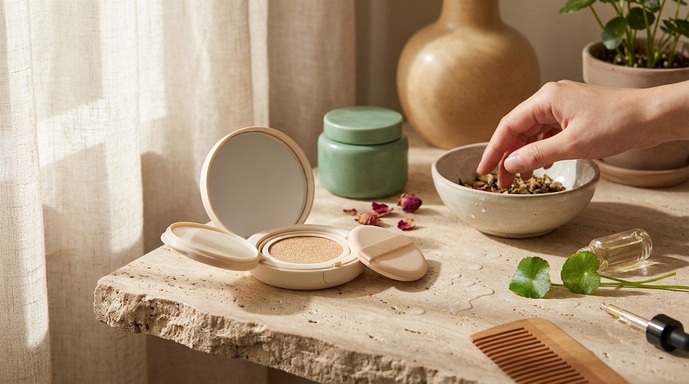
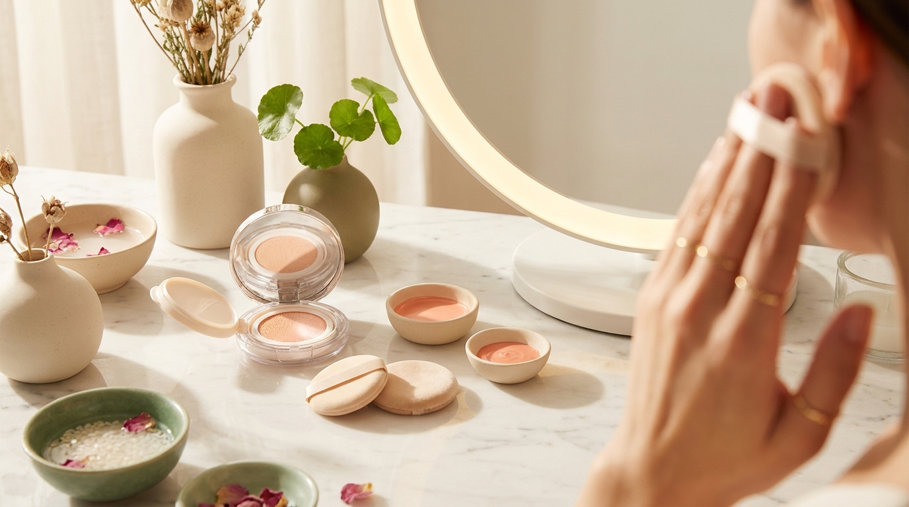

¡Hola! Soy J desde Seúl. Al ver series coreanas en televisión o plataformas de streaming, una de las preguntas más recurrentes entre quienes admiran la cultura coreana desde Latinoamérica y España es: ¿cómo logran las actrices verse tan radiantes, frescas y luminosas sin que parezca que llevan capas densas de maquillaje?

En Corea del Sur, este concepto se conoce popularmente como *kku-an-kku* (꾸안꾸), una abreviación de la frase «parece arreglado pero no arreglado» (*kku-min deut an kku-min deut*). Lejos de los acabados pesados o mates acartonados, el maquillaje de K-Drama busca resaltar la belleza individual de cada persona, priorizando la salud de la piel, los tonos suaves y las transiciones difuminadas. A continuación, desglosamos los pilares de este estilo para que puedas recrearlo en casa paso a paso con cosméticos accesibles a nivel internacional.

## Puntos clave

- La preparación de la piel (*skin prep*) constituye más del 70% del éxito del look: sin una barrera cutánea hidratada, ningún fondo de maquillaje lucirá transparente.
- Las bases compactas en formato *cushion* con acabados semimate o satinados se prefieren frente a las bases fluidas de alta cobertura completa.
- Las cejas se diseñan ligeramente rectas, con bordes esfumados y en tonos más claros que el cabello para suavizar las facciones.
- Los labios degradados (*gradient lips*) simulan una concentración de color juvenil en el centro de la boca mediante tintas labiales fluidas o de textura aterciopelada.

---

## El secreto del 'Kku-An-Kku': la piel como protagonista absoluta

En los sets de grabación de K-Dramas en Seúl, los maquilladores profesionales dedican la mayor parte del tiempo a preparar el rostro antes de tocar una sola gota de pigmento. La premisa coreana es clara: el maquillaje no está diseñado para ocultar una piel descuidada, sino para acompañar una piel equilibrada.

### La regla de las capas ligeras de hidratación

Para conseguir ese brillo traslúcido característico (*chok-chok*), la piel no se satura con cremas excesivamente untuosas, ya que podrían hacer que los cosméticos se deslicen o formen grumos con las horas. En su lugar, se trabaja con varias capas de fórmulas ligeras:

1. **Tónico o esencia calmante**: Fórmulas con centella asiática, extracto de artemisa (*mugwort*) o pantenol aplicadas a toques suaves con las manos. Esto reduce rojeces temporales y restablece el pH tras la limpieza facial.
2. **Suero hidratante**: Sueros acuosos basados en ácido hialurónico de múltiples pesos moleculares o beta-glucano. Ayudan a que las capas superiores de la epidermis retengan agua, creando un efecto de tersura visual sin sensación grasa.
3. **Emulsión o loción ligera**: Aporta lípidos esenciales para sellar la humedad. En Seúl, los maquilladores suelen insistir en masajear la zona de las mejillas y el contorno del rostro con movimientos ascendentes para estimular la microcirculación superficial.
4. **Protector solar o bloqueador solar fluido**: Imprescindible para el día. Se seleccionan filtros solares de textura química o híbrida con acabado hidratante que no dejen residuo blanco (*white cast*), sirviendo a la vez como prebase iluminadora.

---

## La base: técnica cushion y acabado segunda piel

※ Imagen ilustrativa generada con IA

El objetivo de las actrices coreanas no es unificar el rostro como si fuera un lienzo plano, sino preservar las sombras y luces naturales del rostro corrigiendo únicamente las irregularidades de tono.

### El reinado de los cojines compactos (Cushion Foundation)

En las tiendas Olive Young de Seúl, los expositores de maquillaje están dominados por las bases *cushion*. A diferencia de las bases occidentales convencionales de cobertura total, el *cushion* coreano contiene microesponjas impregnadas con fórmulas fluidas ricas en agentes acondicionadores como la niacinamida y el agua de abedul.

Las tendencias actuales en K-Dramas han evolucionado: ya no se busca un brillo excesivo o aceitoso (*glass skin* llevado al extremo), sino un acabado conocido como **semimate aterciopelado** (*velvet semi-matte*). Este acabado ofrece un centro del rostro pulido y aterciopelado, pero conserva un reflejo natural en los pómulos y el arco de la ceja.

### La técnica del 'tapping' (toques repetidos)

Para aplicar la base con precisión:
- Presiona la borla (*puff*) suavemente en la esponja con producto.
- Descarga el exceso presionando la borla en la parte interior de la tapa del envase.
- Aplica en el rostro únicamente mediante toques repetidos y firmes (*patting*), nunca arrastrando la esponja.
- Comienza siempre desde el centro de las mejillas (donde suele haber mayor necesidad de emparejar el tono) y difumina hacia los bordes exteriores del rostro con lo que quede en la borla.

Si quedan manchas localizadas u ojeras marcadas, no se añade más base a todo el rostro. Se utiliza un corrector cremoso aplicado puntualmente con un pincel plano milimétrico, difuminando solo los bordes de la imperfección.

---

## Cejas rectas y ojos despejados: la arquitectura de la juventud

Uno de los rasgos más distintivos del estilo coreano es el diseño de las cejas. En lugar del arco marcado y anguloso habitual en el maquillaje occidental, en Corea predomina la ceja suave y horizontal.

### Por qué cejas rectas (*Straight Brows*)

Culturalmente, una ceja recta y poblada evoca la apariencia natural de la juventud y confiere una expresión dulce, abierta y relajada, perfecta para los primeros planos dramáticos o románticos en televisión.

Para recrearlas de manera natural:
- Cepilla los vellos hacia abajo para observar las zonas despobladas.
- Con un lápiz de cejas de punta fina y fórmula dura (estilo mina de grafito, muy popular en la cosmética coreana), traza una línea recta en la parte inferior de la ceja, desde el inicio hasta el arco.
- Rellena los huecos con trazos que imiten el vello de manera sutil, evitando sobrecargar la cabecera (el inicio junto a la nariz).
- Elige siempre un lápiz medio tono o un tono entero más claro que el color de tu cabello, preferiblemente con subtonos cenizos o marrón frío (*ash brown*), para que el trazo no endurezca las facciones.
- Pasa un cepillo tipo *spoolie* repetidamente para difuminar cualquier línea evidente.

### La mirada 'Aegyo-sal' y sombras neutras

En los párpados, el maquillaje de K-Drama es minimalista:
- **Sombras**: Tonos melocotón suave, beige rosado o topo claro aplicados con brocha suave sobre todo el párpado móvil para unificarlo.
- **Aegyo-sal (애교살)**: Es el pequeño volumen o almohadilla de grasa situada justo debajo de las pestañas inferiores que se marca naturalmente al sonreír. Las actrices coreanas acentúan suavemente esta zona con una sombra satinada clara o champán en el centro del volumen, y una sombra topo mate muy tenue justo debajo para crear una sombra dimensional. Esto hace que los ojos parezcan más grandes, redondos y alegres.
- **Delineador**: Se prefieren delineadores en gel o lápiz marrón oscuro aplicados entre las raíces de las pestañas (*tightlining*), terminando con una cola corta que sigue la caída natural del ojo en lugar de elevarse de forma dramática.

---

## Labios degradados (Gradient Lips): el toque final

El degradado labial (*gradient lip* o *petal lips*) es quizás la técnica más emblemática de la cosmética coreana moderna. Simula el rubor natural de haber comido frutos rojos o la frescura de los pétalos de una flor, concentrando el color en el interior de la boca y desvaneciéndolo hacia los bordes.

### Texturas: acuosas frente a aterciopeladas

En el mercado coreano existen principalmente dos categorías de tintas labiales (*lip tints*):

1. **Water Tint / Dewy Tint**: Fórmulas líquidas de base acuosa o brillante que tiñen la piel del labio y aportan un brillo jugoso inmediato. Ideales para personajes jóvenes o tramas de comedia romántica veraniega.
2. **Velvet Tint / Chiffon Tint**: Texturas híbridas de silicona y polvos que se deslizan de forma cremosa y se asientan con un tacto de terciopelo difuminado. Son las más utilizadas en K-Dramas de oficina, misterio o romance maduro, ya que apenas transfieren y no se resecan visualmente.

### Paso a paso para el degradado perfecto

1. **Acondicionamiento**: Aplica un bálsamo labial hidratante al inicio de tu rutina y retira el exceso con un pañuelo antes de comenzar con el color.
2. **Neutralización del borde**: Con la borla de tu base *cushion* (usando solo el residuo restante), da pequeños toques sobre la línea exterior de los labios para atenuar su borde natural.
3. **Aplicación del punto de color**: Coloca la tinta o barra de labios en el tercio central de los labios (donde ambos labios se juntan).
4. **Difuminado**: Con la yema del dedo anular, un hisopo de algodón (*cotton swab*) o un pincel pequeño para labios de corte redondeado, difumina el color hacia afuera sin llegar a tocar el contorno extremo.
5. **Opcional (efecto jugoso)**: Si deseas un acabado brillante, aplica una capa fina de aceite labial transparente o brillo sin partículas purpurinas únicamente en el centro.

---

## Comparativa: Técnicas del maquillaje coreano de K-Drama

※ Imagen ilustrativa generada con IA

La siguiente tabla resume los contrastes clave entre el estilo coreano utilizado en producciones audiovisuales y otros enfoques de maquillaje habituales:

| Elemento | Enfoque K-Drama (Kku-An-Kku) | Enfoque de alta cobertura convencional | Beneficio principal en cámara / día a día |
| :--- | :--- | :--- | :--- |
| **Preparación** | Múltiples capas ligeras acuosas y protector solar satinado | Prebase matificante o de silicona pesada | Piel flexible que refleja la luz sin agrietarse |
| **Fondo de maquillaje** | Cushion semimate aplicado con toques por zonas | Base líquida de alta cobertura con brocha densa | Aspecto natural de «segunda piel» imperceptible |
| **Cejas** | Rectas, bordes difuminados, tonos cenizos claros | Arco marcado, bordes definidos con corrector | Expresión facial dulce, relajada y juvenil |
| **Ojos** | Sombras neutras cálidas, delineado marrón discreto, acento *aegyo-sal* | Sombras oscuras intensas, delineado alado grueso | Ojos visualmente más amplios y descansados |
| **Labios** | Degradado desde el centro hacia bordes difusos | Contorno delineado nítido con color uniforme | Efecto de frescura natural sin rigidez |

---

> **Consejo desde Seúl para tus compras internacionales:**
> Si compras productos de K-Beauty por internet desde Latinoamérica o España, presta atención a la numeración de los *cushions* coreanos: el tono 21 (*Light Beige*) y el tono 23 (*Natural Beige*) son los más comunes en Corea, pero suelen ser notablemente claros en comparación con las escalas de tonos internacionales. Revisa siempre los subtonos (Warm/Yellow frente a Cool/Pink) en las especificaciones del fabricante y realiza siempre una prueba de parche en el cuello antes de usar nuevas fórmulas para descartar sensibilidades.

---

## Preguntas frecuentes (FAQ)

### ¿Se puede recrear este maquillaje en pieles grasas o mixtas?
Sí, totalmente. Para pieles grasas, el secreto radica en seleccionar sueros calmantes con niacinamida o árbol de té (*tea tree*) que regulen el exceso de sebo sin deshidratar. En lugar de un *cushion* con acabado luminoso (*glow*), se debe optar por fórmulas etiquetadas como *matte* o *semi-matte*, y sellar únicamente la zona T (frente, nariz y barbilla) con polvos translúcidos sueltos ultrafinos a toques muy ligeros.

### ¿Qué hago si la forma natural de mis cejas tiene mucho arco?
No es necesario depilar ni modificar drásticamente la estructura de tus cejas. Para adaptar la técnica a un arco natural, basta con no acentuar el punto alto con el lápiz y rellenar sutilmente el espacio vacío inferior entre la cabecera y el arco. El objetivo no es una línea geométrica perfecta, sino evitar un ángulo excesivamente pronunciado que endurezca la mirada.

### ¿Por qué mi degradado labial se borra rápidamente?
Las tintas acuosas tradicionales pueden desvanecerse si los labios están secos o si se frotan de manera constante. Para una mayor duración, asegúrate de exfoliar suavemente los labios la noche anterior y prefiere las tintas de textura terciopelo (*velvet tint*), cuyas partículas de fijación se adhieren a la piel sin evaporarse con la misma rapidez que el agua.

### ¿Es imprescindible comprar productos de marcas coreanas para lograr este look?
No es obligatorio, aunque las marcas coreanas formulan específicamente sus texturas pensando en este acabado difuminado y translúcido. Puedes recrear el estilo con productos disponibles en tu país siempre que elijas bases de cobertura baja o media con acabado satinado, lápices de cejas de trazo fino y barras o tintas labiales aplicadas con brocha de difuminar en lugar de trazos directos y marcados.