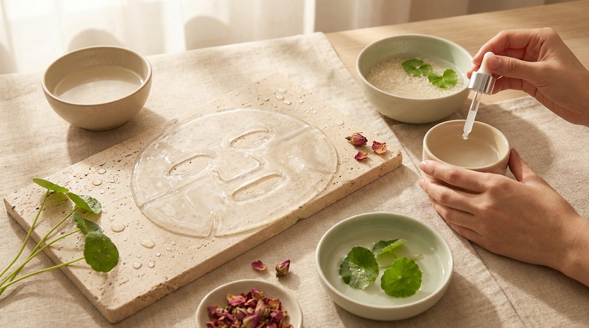
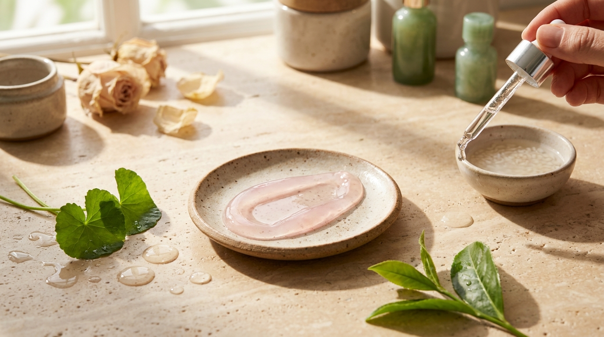

Si alguna vez has visto un K-Drama o has seguido las rutinas de belleza coreanas en redes sociales, es muy probable que hayas visto a las protagonistas relajándose en el sofá con una lámina blanca en el rostro. Durante más de una década, la clásica mascarilla de tela (o *sheet mask*) ha sido el símbolo indiscutible del cuidado facial coreano.

Sin embargo, al recorrer los pasillos de Olive Young en barrios como Myeongdong, Hongdae o Gangnam, el panorama ha evolucionado de forma notable. En los últimos años, las mascarillas de hidrogel —especialmente aquellas enriquecidas con colágeno que se vuelven transparentes con las horas— han capturado las primeras posiciones de ventas. Muchas personas que disfrutan de la cosmética coreana desde Latinoamérica o España se preguntan: ¿cuál es la diferencia real entre ambos formatos? ¿Realmente vale la pena dejar una mascarilla puesta durante tres horas o dormir con ella?

En este artículo analizaremos cómo funcionan ambos soportes a nivel de formulación, qué ingredientes destacan en el mercado coreano y cómo elegir la opción adecuada según las necesidades de tu piel y tu tiempo disponible.

## Puntos clave

- **Estructura y soporte:** Las mascarillas de tela están hechas de fibras vegetales o celulosa empapadas en esencia líquida, mientras que las de hidrogel están compuestas por una matriz de suero gelificado que se funde ligeramente con la temperatura de la piel.
- **Tiempo de exposición:** Una mascarilla de tela debe retirarse estrictamente tras 15 a 20 minutos para evitar la pérdida de hidratación por evaporación; las de hidrogel están diseñadas para sesiones de 1 a 3 horas o incluso uso nocturno.
- **Efecto oclusivo:** El hidrogel ofrece una adherencia superior y un sellado casi hermético que minimiza la evaporación de activos como el colágeno de bajo peso molecular y los péptidos.
- **Uso estratégico:** La tela sigue reinando para hidratación rápida matutina o rescate diario, mientras que el hidrogel se ha consolidado en Corea como el tratamiento intensivo de fin de semana.

## Qué es una mascarilla de tela tradicional y cómo actúa

La *sheet mask* de celulosa o algodón es el formato que popularizó el concepto de cuidado exprés en la rutina asiática. Su objetivo técnico es sencillo: crear una barrera física temporal sobre la piel para que el suero no se evapore al instante en contacto con el aire, facilitando que el estrato córneo absorba una dosis concentrada de humedad en poco tiempo.

### Tipos de tejidos en el mercado coreano

No todas las mascarillas de tela son iguales. La industria de Seúl invierte constantemente en tecnologías de fibra para mejorar la retención de líquido y la suavidad al tacto:

1. **Algodón puro y microfibra:** Son suaves y retienen gran volumen de esencia, aunque pueden ser algo pesadas y despegarse en los bordes del rostro.
2. **Tencel y celulosa de bambú:** Fibras ultrafinas derivadas de pulpa vegetal que se adhieren casi como una segunda piel y resultan sumamente biodegradables.
3. **Bio-celulosa:** Obtenida mediante la fermentación de agua de coco o bacterias beneficiosas. Es la gama más avanzada dentro de las fibras, con una textura gelatinosa que se adapta a cada curva del rostro, sirviendo de puente entre la tela clásica y el hidrogel.

### La regla de oro: por qué no debes dejar secar la tela

Un error muy común fuera de Corea es pensar que, cuanto más tiempo se deje la mascarilla en el rostro, mayor será el beneficio. Con las mascarillas de tela convencionales, esto produce el efecto contrario. 

Cuando la tela pierde su humedad por la evaporación ambiental, el tejido deshidratado actúa por capilaridad y diferencia osmótica, comenzando a absorber el agua superficial de la piel recién hidratada. Por ello, las marcas coreanas siempre indican un tiempo límite de 15 a 20 minutos. Si la mascarilla aún se siente húmeda al retirarla, esa esencia sobrante se aprovecha en el cuello, el escote y los brazos, pero nunca se deja secar pegada al rostro.

## Qué es una mascarilla de hidrogel y la revolución del colágeno

※ Imagen ilustrativa generada con IA

A diferencia de las láminas de fibra que absorben líquido, el hidrogel es una masa compacta constituida por polímeros hidrofílicos capaces de retener hasta un 99% de agua o suero activo en su propia estructura molecular. No hay un trozo de tela sosteniendo el cosmético: **el cosmético mismo es la mascarilla**.

En Corea, este formato ha ganado una tracción enorme gracias al auge de las mascarillas de colágeno de bajo peso molecular. Al sacarlas del sobre, suelen ser piezas blancas, opacas y densas, divididas en dos partes (mitad superior e inferior) para amoldarse a la anatomía facial.

### El fenómeno de volverse transparente: ¿cómo funciona?

Una de las experiencias más comentadas en los foros de belleza coreanos es el cambio visual de estas mascarillas. A medida que pasan los minutos y las horas, la lámina blanca se vuelve progresivamente translúcida hasta quedar casi invisible sobre el rostro.

Este fenómeno no es magia, sino termodinámica y entrega controlada de activos:
- **Respuesta a la temperatura dérmica:** Al entrar en contacto con el calor natural de la piel (alrededor de 36 °C), la matriz de gel se ablanda gradualmente.
- **Absorción de la fase activa:** La piel va absorbiendo los componentes solubles en agua (ácido hialurónico, colágeno hidrolizado, galactomyces o ceramidas). Al vaciarse la emulsión interna del gel, la estructura colapsa y adelgaza, perdiendo su opacidad original.
- **Oclusión prolongada:** Al no haber fibras secas de algodón, el hidrogel puede permanecer sobre la piel durante 2, 3 o hasta 4 horas sin peligro de deshidratar la superficie. Por esta razón, muchas personas las utilizan mientras descansan o ven series durante una [noche de K-Drama en casa con snacks y mascarilla nocturna](/blog/como-organizar-maraton-kdrama-en-casa-snacks/).

> **Nota técnica:** Las mascarillas de hidrogel suelen venir protegidas entre dos láminas plásticas transparentes. Al aplicarlas, conviene retirar primero el film plástico más grueso, acomodar la mitad inferior de la mascarilla alrededor de la boca, y luego colocar la mitad superior ajustándola a los ojos y la frente. Las piezas sobrantes de los orificios de los ojos y la boca suelen aplicarse en las líneas de expresión de la sonrisa o el cuello.

## Tabla comparativa: Hidrogel frente a Sheet Mask de tela

Para entender cuál conviene incorporar en cada momento, esta tabla resume las diferencias operativas y cosméticas más relevantes observadas en los productos disponibles en las tiendas de Seúl:

| Característica | Mascarilla de tela (Sheet Mask) | Mascarilla de hidrogel |
| :--- | :--- | :--- |
| **Material base** | Celulosa, bambú, algodón o microfibra | Polímeros acuosos gelificados (suero solidificado) |
| **Tiempo de uso** | 10 a 20 minutos | 1 a 3 horas (o nocturna) |
| **Sensación térmica** | Frescor inmediato al evaporarse la esencia | Efecto refrescante continuo y calmante prolongado |
| **Nivel de adherencia** | Variable según el corte y grosor del tejido | Muy alta; se sella al rostro sin resbalar al asentarse |
| **Riesgo si se olvida puesta** | Puede resecar la superficie al secarse | Se vuelve una película fina transparente sin robar agua |
| **Objetivo principal** | Calmar rojeces, aportar luminosidad e hidratación exprés | Oclusión profunda, elasticidad y efecto tensor transitorio |
| **Momento ideal** | Antes del maquillaje o en rutinas diarias rápidas | Tratamiento intensivo nocturno o tardes de autocuidado |
| **Costo por unidad** | Económico (accesible para uso frecuente) | Medio a elevado (debido al proceso de manufactura) |

## Cuáles dominan en Olive Young y las preferencias en Corea

Para comprender el éxito de cada formato, basta con observar las secciones destacadas en Olive Young, la cadena de belleza más representativa de Corea del Sur. Dentro de las listas de [los productos de skincare más vendidos en Olive Young Corea](/blog/olive-young-mas-vendidos-corea-2026/), la categoría de mascarillas se reparte claramente en dos momentos de consumo.

### 1. El trono de la tela: rescate rápido y calmante
Las mascarillas de tela siguen vendiéndose por millones cada mes, lideradas por firmas como Mediheal, Abib, Torriden y Round Lab. En Seúl, este tipo de mascarilla se consume como un producto de mantenimiento funcional:
- **Centella asiática y árbol de té:** Muy demandadas en verano o durante cambios de estación para aliviar brotes y piel irritada por factores ambientales.
- **Ácido hialurónico multimolecular:** Elegidas por personas de oficina que pasan muchas horas bajo el aire acondicionado o la calefacción y necesitan reponer agua antes de dormir en solo 15 minutos.
- **Cuidado matutino pre-maquillaje:** La ligereza de su esencia acuosa prepara la textura de la piel para que la base de maquillaje o el *cushion* se fijen de manera uniforme sin dejar residuos pesados.

### 2. El fenómeno del hidrogel de colágeno: el cuidado especial de fin de semana
En los últimos rankings de Olive Young, marcas como Biodance, Medicube y Sungboon Editor han encabezado las ventas gracias a sus mascarillas de hidrogel con formulaciones ricas en colágeno de bajo peso molecular, fermentos y péptidos.

En Corea, este tipo de producto no se concibe para usar todos los días debido a su costo y al tiempo que requiere. Se ha adoptado ampliamente como un ritual de fin de semana (el llamado *Special Care*). Los usuarios suelen aplicarlo un domingo por la tarde o antes de dormir para despertar al lunes con la piel visiblemente descansada, flexible y con ese brillo característico del cuidado coreano.

> **Consejo de conservación y compras:** Si compras tus mascarillas a través de plataformas internacionales autorizadas —como explicamos en la [guía para comprar cosmética coreana online desde casa](/blog/como-comprar-cosmetica-coreana-online-desde-casa/)—, recuerda que las mascarillas de hidrogel son sensibles a cambios extremos de temperatura. Guárdalas siempre en posición horizontal y en un lugar fresco y seco; si las guardas en vertical, el gel puede deslizarse dentro del paquete y deformarse antes de abrirlo.

## Cómo integrar cada mascarilla en tu rutina en casa

Saber qué producto comprar es solo la mitad del camino; la forma de introducirlo en los pasos de tu rutina determina el resultado final.

### Pasos para usar una mascarilla de tela
1. **Limpieza completa:** Asegúrate de retirar impurezas con tu limpiador habitual.
2. **Tónico equilibrante:** Aplica unas gotas de tónico facial con las manos para equilibrar el pH y preparar la permeabilidad de la piel.
3. **Colocación:** Despliega la mascarilla con suavidad y ajústala desde el centro del rostro hacia los extremos.
4. **Tiempo de espera:** Déjala actuar exactamente entre 15 y 20 minutos.
5. **Sellado:** Retira la lámina, da suaves toques con las palmas de las manos para absorber el suero remanente y aplica tu crema hidratante habitual para crear una capa que retenga la hidratación en el rostro.

### Pasos para usar una mascarilla de hidrogel
1. **Limpieza y tonificación:** Al igual que con la tela, la superficie debe estar limpia y tonificada.
2. **Suero previo (opcional):** Si buscas potenciar el efecto, en Corea suele aplicarse antes una ampolla ligera de ácido hialurónico o niacinamida.
3. **Ajuste en dos secciones:** Coloca primero la parte inferior (alrededor de la boca) y después la parte superior (cubriendo ojos y frente). La textura resbalosa inicial tarda entre 5 y 10 minutos en asentarse firmemente.
4. **Tiempo prolongado:** Déjala actuar durante al menos 2 horas, o hasta que notes que el color blanco se ha vuelto completamente transparente.
5. **Retiro:** Desprende la película fina con suavidad. Notarás que casi no queda residuo pegajoso en la superficie, ya que la mayor parte del agua del gel se ha absorbido o evaporado lentamente. No es necesario enjuagar; si tienes la piel seca, puedes finalizar con una pequeña cantidad de crema barrera.

## Precauciones y prueba de tolerancia

※ Imagen ilustrativa generada con IA

Aunque las mascarillas faciales son de uso tópico y seguro, la alta concentración de principios activos y la fuerte oclusión del hidrogel requieren ciertas precauciones:

- **Pieles con tendencia a la congestión o acné activo:** La oclusión total durante tres o cuatro horas puede aumentar la temperatura local de la piel y no siempre resulta favorable para poros propensos a comedones cerrados. En este caso, las mascarillas de tela ligeras con extracto de árbol de té o centella asiática suelen ser más recomendables.
- **Prueba de parche previa:** Si tu piel reacciona fácilmente a nuevos cosméticos, abre ligeramente la esquina del sobre, extrae unas gotas de la esencia y aplícalas en el interior de la muñeca o detrás de la oreja 24 horas antes de colocar la mascarilla completa en el rostro.
- **Uso único e individual:** Bajo ninguna circunstancia intentes guardar una mascarilla de hidrogel o de tela usada dentro del sobre para reutilizarla al día siguiente. Una vez expuesto al aire y al contacto cutáneo, el soporte pierde su esterilidad y se convierte en un medio favorable para la proliferación bacteriana.

## Preguntas frecuentes (FAQ)

### ¿Se puede dormir toda la noche con una mascarilla de tela normal?
No se recomienda en absoluto. Las mascarillas de tela de celulosa o algodón se secan en aproximadamente 30 a 40 minutos en un ambiente cerrado. Si te duermes con ella puesta, la tela seca absorberá la humedad de las capas externas de tu piel durante el resto de la noche, lo que puede provocar tirantez e irritación al despertar.

### ¿Por qué las mascarillas de hidrogel de colágeno se vuelven transparentes?
Se vuelven transparentes porque están formuladas a base de un suero gelificado sin soporte de tela. Al colocarse sobre la piel, los activos hidrosolubles y el colágeno son absorbidos gradualmente con la ayuda del calor corporal. Al vaciarse la emulsión interna, la matriz de polímeros se compacta y pierde la refracción de luz que le daba su color blanco original.

### ¿Cuál de los dos formatos es mejor para calmar rojeces rápidamente?
Para un alivio rápido de rojeces causadas por exposición solar o sensibilidad puntual, las mascarillas de tela con ingredientes calmantes (como centella asiática, pantenol o artemisa) suelen ser la opción más práctica y efectiva. Su textura ligera y el frescor inmediato de la evaporación controlada proporcionan alivio en apenas 15 minutos sin generar peso sobre la piel.

### ¿Con qué frecuencia se recomienda usar las mascarillas de hidrogel?
En Corea se suelen utilizar entre una y dos veces por semana como tratamiento intensivo o paso de cuidado especial. A diferencia de las mascarillas de tela ligeras, que muchas personas usan cada dos o tres días, el hidrogel tiene una mayor capacidad de oclusión y un coste más elevado, por lo que reservarlo para ocasiones específicas o descanso de fin de semana es la costumbre más habitual en Seúl.