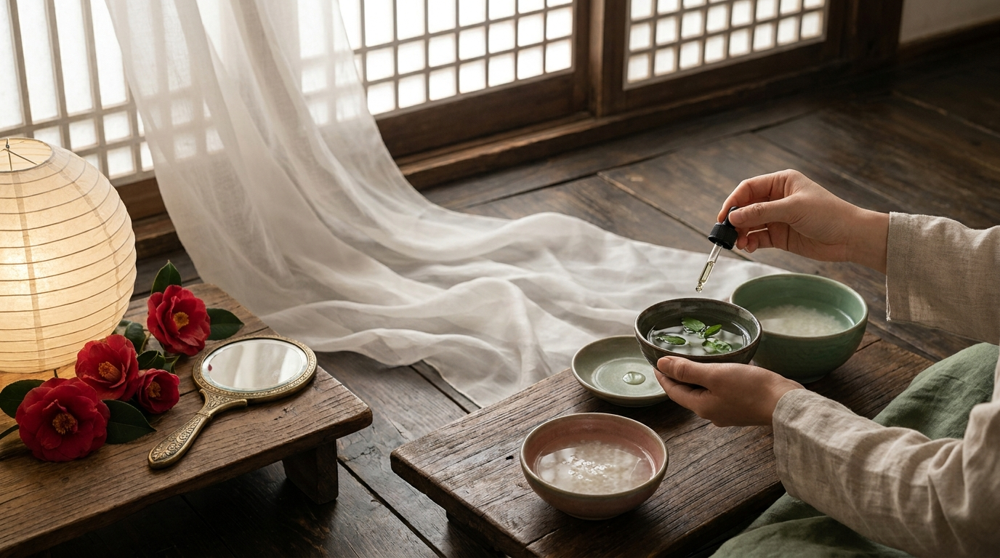

Para quienes disfrutan de las series coreanas, es muy común encontrar historias donde seres inmortales conviven con humanos en cafeterías modernas de Gangnam o estaciones de metro de Seúl. Títulos memorables de fantasía han presentado figuras magnéticas: un duende milenario que controla el clima, un zorro de nueve colas con una elegancia impecable o un mensajero de la muerte vestido con traje oscuro de oficina.

Sin embargo, detrás de la estética cuidada, los efectos visuales y los romances épicos de la pantalla chica, existe un trasfondo folclórico centenario que difiere bastante de lo que vemos en la ficción contemporánea. Las leyendas transmitidas de forma oral en la península coreana durante las dinastías Goryeo y Joseon no hablaban de modelos de pasarela con poderes mágicos, sino de espíritus vinculados a la naturaleza, las herramientas cotidianas y la cosmovisión chamánica del más allá. 

Comprender la raíz histórica y cultural de estos seres no solo enriquece cada maratón de series, sino que permite apreciar cómo la narrativa surcoreana actual reinterpreta su propia identidad tradicional.

## Puntos clave

- El Dokkaebi tradicional no es un demonio ni un dios de la muerte, sino un espíritu travieso nacido de objetos viejos usados por humanos, aficionado a la lucha tradicional (*ssireum*) y a los acertijos.
- El Gumiho es un zorro que alcanza los mil años tras acumular energía espiritual; su retrato histórico en el folclore era mucho más temible y oscuro que la figura romántica y entrañable que domina las pantallas modernas.
- La Parca coreana (*Jeoseung Saja*) funciona como un funcionario público estricto del inframundo dentro del sincretismo budista y chamánico, encargado de guiar las almas sin emitir juicios morales.
- Muchos de los atributos visuales actuales, como el traje oscuro contemporáneo o la confusión entre el Dokkaebi y el *Oni* japonés, provienen de adaptaciones teatrales del siglo XX y de la ocupación colonial, no de los textos antiguos de Corea.

---

## El Dokkaebi (도깨비): de espíritu juguetón de objetos antiguos al ser sofisticado de la televisión

Para el público internacional, la palabra *dokkaebi* suele asociarse de inmediato con una figura alta, vestida con abrigos de diseñador y atormentada por una espada invisible en el pecho. No obstante, en los cuentos tradicionales coreanos recopilados en textos antiguos como el *Samguk Yusa* (Memorias de los Tres Reinos), la naturaleza de este ser es completamente distinta.

### El origen folclórico: espíritus nacidos de la vida cotidiana

A diferencia de los fantasmas humanos (*gwisin*), los dokkaebi tradicionales rara vez son personas fallecidas. Según las leyendas de las aldeas agrícolas, nacían cuando un objeto inanimado de uso diario —como una escoba desgastada, un triturador de mortero, un atizador de chimenea o un zapato de paja empapado con sangre o sudor humano— pasaba muchos años acumulando energía vital (*gi*). Al cabo del tiempo, ese objeto cobraba vida propia durante la noche.

Los dokkaebi del folclore rural tenían un aspecto peculiar: a menudo se les describía con una sola pierna central (lo que dificultaba su equilibrio), rostros rústicos, peludos y cubiertos con pieles de animales. No eran seres malvados dedicados a castigar a la humanidad, sino entes caprichosos y con un sentido del humor muy marcado:

- **La pasión por el ssireum:** Les encantaba retar a los viajeros solitarios a una partida de lucha tradicional coreana (*ssireum*). Para vencer a un dokkaebi, la sabiduría popular marcaba atacar obligatoriamente su lado o pierna izquierda para poder derribarlo, ya que por el flanco derecho resultaba completamente inamovible gracias a su fuerza sobrehumana.
- **El Dokkaebi Bangmangi (도깨비 방망이):** Su mazo mágico no creaba riquezas de la nada; funcionaba más bien como un transportador. En los cuentos, el dokkaebi cantaba rimas para hacer aparecer oro, pero la leyenda advertía que ese oro solía ser tomado del granero de un vecino avaro en el pueblo contiguo.
- **La confusión histórica con el Oni:** Durante el periodo de ocupación japonesa a inicios del siglo XX, las ilustraciones de los libros de texto escolares coreanos fusionaron erróneamente la imagen del dokkaebi con la del *Oni* japonés (gigantes con dos cuernos afilados, piel roja o azul y taparrabos de tigre). En los últimos años, historiadores e ilustradores en Corea han trabajado activamente para rescatar la estética auténtica del dokkaebi autóctono, desprovisto de esos cuernos demoníacos externos.

### La transformación moderna en las series de televisión

Los guionistas contemporáneos de K-Dramas transformaron a este ente rústico en una criatura casi omnipotente. La soledad de la inmortalidad, la capacidad de influir en los fenómenos meteorológicos mediante sus emociones (hacer llover cuando está triste o florecer los árboles cuando está feliz) y la vulnerabilidad ante una «novia humana» son licencias poéticas modernas. Esta evolución refleja una constante de la industria del entretenimiento en Seúl: tomar un elemento folclórico profundamente arraigado en la memoria colectiva y adaptarlo a un formato emocional universal.

Si te gusta profundizar en las pequeñas costumbres cotidianas que aparecen en estas producciones, puedes consultar nuestro artículo sobre [10 costumbres de los K-Dramas explicadas desde Seúl](/blog/costumbres-curiosas-kdramas-explicadas-por-coreano/), donde revisamos varios hábitos culturales que complementan estas historias.

---

## El Gumiho (구미호): el zorro de nueve colas entre la seducción y la redención



<p class="img-cap">※ Imagen ilustrativa generada con IA</p>

Pocas criaturas mitológicas han experimentado una evolución tan drástica en los medios visuales como el *Gumiho* (구미호), el zorro de nueve colas presente en las tradiciones de Asia Oriental con variantes locales en China (*Huli jing*) y Japón (*Kitsune*).

### La leyenda tradicional: el anhelo de convertirse en humano

En la tradición oral coreana, un zorro común que lograba vivir mil años acumulaba la suficiente energía espiritual (*yeonggi*) para transformarse a voluntad. Su forma predilecta era la de una mujer joven de asombrosa belleza, utilizada para acercarse a los seres humanos.

Sin embargo, a diferencia de sus versiones en países vecinos donde a veces actuaba como mensajero celestial benévolo, el Gumiho del folclore coreano tradicional tenía un matiz predominantemente siniestro:

1. **La búsqueda de la humanidad:** El deseo central del Gumiho era desprenderse de su condición animal para transformarse en un ser humano completo de carne y hueso.
2. **Los requisitos extremos:** Dependiendo de la región, los relatos orales señalaban que el zorro debía consumir cien hígados o corazones humanos sin ser descubierto, o bien vivir junto a un esposo humano durante cien o mil días sin que este revelara jamás su verdadera identidad.
3. **La perla del zorro (*Yeowu guseul*):** Se decía que el Gumiho albergaba en su boca una esfera luminosa de sabiduría y energía. Si un humano lograba arrebatarle esa perla durante un beso y tragarla mirando hacia el cielo, adquiría un conocimiento infinito sobre los secretos del universo.

```
       [ Zorro salvaje centenario ]
                   │
                   ▼ (Acumulación de 'gi' durante 1.000 años)
         [ Aparición de las 9 colas ]
                   │
         ┌─────────┴─────────┐
         ▼                   ▼
[ Folclore Tradicional ]    [ K-Dramas Modernos ]
• Engaño a humanos          • Guardián de montañas o deidades
• Consumo de hígados        • Amor verdadero y sacrificio
• Terror en los pueblos     • Humor cotidiano (amor por la carne)
```

### De monstruo aterrador a protagonista carismático

Durante las décadas de 1970 y 1980, la televisión pública coreana emitía el clásico programa antológico *Hometown Legends* (*Jeonseol-ui Gohyang*), donde el Gumiho aparecía invariablemente en noches de verano como una criatura terrorífica de ojos brillantes, manos ensangrentadas y colmillos expuestos, diseñada para asustar a la audiencia.

La ruptura total de este estereotipo llegó en los años 2010 con comedias románticas como *Mi novia es un Gumiho*, donde la criatura fue retratada como un ser inocente, fascinado por la carne de res coreana (*hanwoo*) y el refresco de sidra. Más adelante, producciones como *Tale of the Nine Tailed* invirtieron los roles de género al presentar a Gumihos masculinos (*Cheonho* o zorros celestiales) que actúan como protectores de las fronteras espirituales entre el mundo mortal y el inframundo.

---

## El Jeoseung Saja (저승사자): la Parca coreana y la burocracia del más allá

En Occidente, la personificación de la muerte suele representarse como un esqueleto con túnica andrajosa y una guadaña oxidada. En Corea, el concepto del *Jeoseung Saja* (저승사자) es radicalmente diferente: es un mensajero neutral, sumamente formal y respetuoso de las reglas administrativas del universo.

### El enviado del inframundo en el chamanismo y el budismo

El término se compone de *Jeoseung* (저승, «el otro mundo» o el inframundo) y *Saja* (사자, «emisario» o «enviado»). En las tradiciones del chamanismo coreano (*Muism*) y las ceremonias funerarias (*Jinogigut*), el Jeoseung Saja no decide quién muere ni le quita la vida a nadie de manera violenta. Su única función es presentarse en el instante exacto designado por el destino, verificar la identidad del difunto y escoltar su alma a través de los diez tribunales del inframundo (*Sipwang*), presididos por el Rey Yeomna.

El mensajero lleva consigo el *Jeoseung Myeongbu* (저승명부), un libro de registro oficial donde figuran con absoluta precisión el nombre, la edad, el lugar de nacimiento y la hora límite de cada persona. Si el nombre no está en la lista, el emisario no puede llevarse el alma, lo que en los relatos populares daba pie a que personas astutas intentaran negociar o sobornar al enviado con comida y licores preparados junto a la puerta principal de la casa.

### El origen del sombrero tradicional (*Gat*) y el traje negro

En las representaciones históricas de las pinturas budistas y los rituales chamánicos, los mensajeros vestían uniformes oficiales de oficiales de la corte de Joseon, a menudo de colores variados. La imagen popularizada del Jeoseung Saja con un traje enteramente negro y el sombrero cilíndrico de crin de caballo (*gat*) se consolidó principalmente a través del teatro y la televisión de finales del siglo XX, buscando un impacto visual austero y solemne.

En los K-Dramas contemporáneos, este uniforme tradicional se actualizó mediante abrigos largos negros, sombreros fedora y portafolios de cuero. La narrativa moderna suele retratar a los heraldos de la muerte como individuos que cometieron faltas graves en sus vidas pasadas (a menudo el suicidio o la traición) y que deben purgar su deuda sirviendo durante siglos en una división burocrática del más allá sin recordar su propio nombre original.

Para comprender mejor los diálogos y términos tradicionales de respeto que estos personajes usan al interactuar con humanos y deidades, te resultará útil explorar nuestro [diccionario de expresiones frecuentes en K-Dramas](/blog/expresiones-coreanas-kdramas-significado-real/).

---

## Comparativa: Folclore tradicional vs. Ficción en los K-Dramas

Para visualizar con claridad las diferencias entre las leyendas orales recopiladas por los eruditos coreanos y las adaptaciones que vemos hoy en plataformas de streaming, presentamos el siguiente cuadro resumen:

| Criatura / Figura | Nombre en coreano | Naturaleza en el folclore oral | Representación en K-Dramas | Objeto o rasgo característico |
| :--- | :--- | :--- | :--- | :--- |
| **Dokkaebi** | 도깨비 | Espíritu nacido de herramientas domésticas viejas; rústico, con fuerza hercúlea y amor por los retos de lucha. | Ser casi divino, apuesto, inmortal, que viste ropa elegante y controla elementos climáticos. | El mazo mágico (*bangmangi*) tradicionalmente; espadas invisibles o llamas azules en dramas. |
| **Gumiho** | 구미호 | Zorro milenario de instintos peligrosos; devorador de vísceras para lograr encarnar como humano. | Entidad mágica refinada, protectora de montañas o heroína inocente enamorada de un mortal. | La perla del zorro (*yeowu guseul*), encanto seductor y gusto obsesivo por la carne vacuna. |
| **Jeoseung Saja** | 저승사자 | Emisario público de los reyes del inframundo; neutral, sin apego ni maldad, guía del alma. | Burócrata moderno con traje sastre oscuro, amnesia sobre su pasado humano y dilemas morales. | El registro oficial de almas (*myeongbu*), el sombrero tradicional (*gat*) o fedora contemporáneo. |
| **Cheonyeo Gwisin** | 처녀귀신 | Fantasma de mujer soltera fallecida con resentimiento (*han*); viste ropa blanca de luto (*sobok*). | Personaje cómico que busca resolver sus asuntos pendientes o espíritu vengativo en historias de misterio. | Cabello largo suelto sobre el rostro y túnica blanca de cáñamo sin adornos. |

---

## Cómo enriquecer tu experiencia con las series de fantasía desde casa


<p class="img-cap">※ Imagen ilustrativa generada con IA</p>

Apreciar la mitología coreana te permite captar pequeños detalles visuales y de guion que suelen pasar inadvertidos fuera de Asia Oriental. Por ejemplo, cuando veas a un personaje esparcir frijoles rojos (*pat*) o harina alrededor de una habitación, sabrás que está realizando un antiguo método chamánico para ahuyentar malas energías o repeler a un espíritu travieso.

> **Apunte cultural:**  
> Al seguir estas series de ficción, prestar atención a los objetos cotidianos que rodean a los personajes de fantasía suele revelar pistas argumentales antes de que ocurran los giros de guion. En los hogares tradicionales coreanos, los espejos de bronce, los paravientos pintados con grullas o pinos y los cántaros de barro (*onggi*) suelen asociarse a sellos espirituales. Si quieres transformar tus tardes de maratón en un momento completo de relajación personal, puedes inspirarte en nuestra guía para [organizar una noche de K-Drama en casa con snacks y cuidado facial](/blog/como-organizar-maraton-kdrama-en-casa-snacks/).

---

## Preguntas frecuentes (FAQ)

### ¿El Dokkaebi tiene relación con los demonios o el diablo de la tradición occidental?
No. En la cosmovisión coreana tradicional no existía un concepto idéntico al demonio cristiano o al mal absoluto. El Dokkaebi representa la energía vital de la naturaleza y de la materia creada por el hombre. Puede premiar la piedad filial y la honestidad con riquezas, o castigar a los codiciosos con bromas pesadas, pero carece de un propósito destructivo universal.

### ¿Existen versiones masculinas del Gumiho en las leyendas antiguas?
En la inmensa mayoría de los relatos orales de Joseon, el Gumiho adoptaba casi exclusivamente la forma de mujeres jóvenes o ancianas. La introducción protagónica de zorros de nueve colas masculinos es una innovación moderna de los guionistas de K-Dramas para balancear los roles románticos y crear héroes de acción sobrenatural con una estética visual atractiva.

### ¿Por qué la Parca viste de negro si en los funerales tradicionales coreanos se viste de blanco?
La ropa de luto tradicional confeccionada en cáñamo, conocida como *sambe-ot* (o la vestimenta de luto *sangbok*), es la que llevan los familiares vivos para expresar pureza y respeto hacia el difunto. El Jeoseung Saja, en cambio, no está de luto: viste de negro porque personifica la oscuridad del tránsito hacia el inframundo y el rol formal de un ejecutor administrativo de órdenes celestiales.

### ¿Qué significa el resentimiento o «Han» en las criaturas fantásticas coreanas?
El concepto de *Han* (한) alude a una mezcla de dolor profundo, tristeza acumulada e injusticia no resuelta en vida. Muchas entidades espirituales del folclore coreano, especialmente los fantasmas errantes, permanecen atadas a este mundo no por maldad intrínseca, sino porque necesitan que alguien reconozca su sufrimiento y disuelva ese nudo emocional antes de cruzar al descanso definitivo.