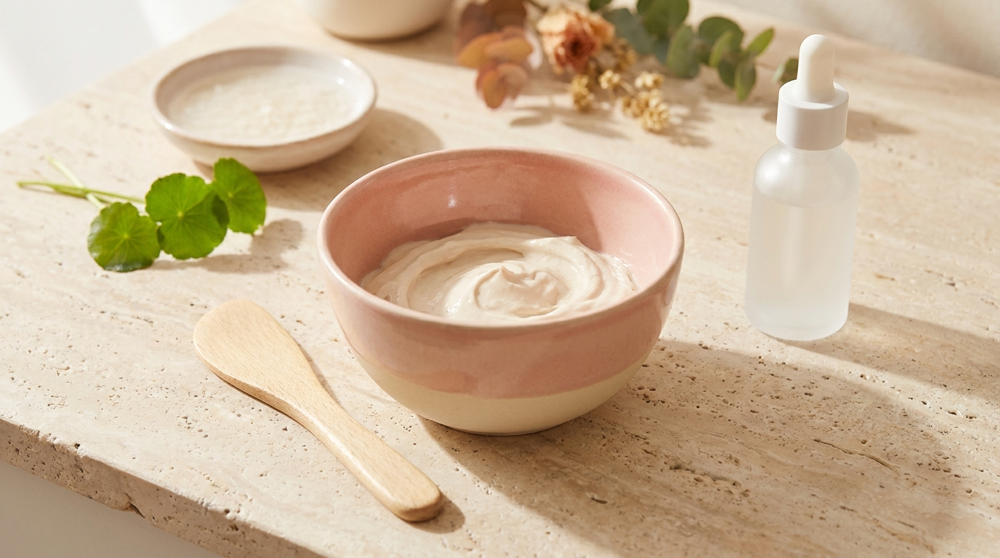
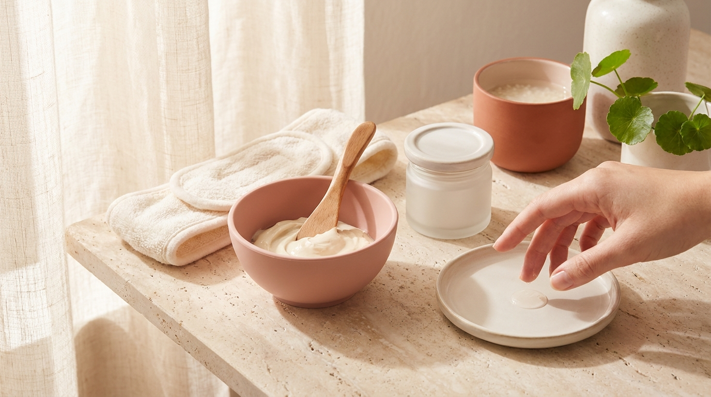

Si alguna vez has visto vlogs coreanos de cuidado facial o escenas de spas estéticos en K-Dramas, es muy probable que te hayas fijado en esas mascarillas espesas y coloridas que se mezclan como una pasta, se aplican sobre todo el rostro con una espátula y, al cabo de unos minutos, se despegan limpiamente como si fueran una capa de goma suave.

En Corea del Sur, este tratamiento se conoce como *modeling pack* o *modeling mask* (모델링팩), y durante décadas fue un secreto reservado a los centros de estética profesional (*pi-bu-gwan-li-sil*). Sin embargo, en los últimos años, marcas como Lindsay democratizaron este formato lanzando tarrinas individuales en las tiendas Olive Young de Seúl. Hoy en día, es uno de los pasos favoritos para quienes buscan replicar un tratamiento de cabina desde su propio tocador. A diferencia de las tradicionales mascarillas de tela, la mascarilla de alginato para casa ofrece un efecto oclusivo superior y una sensación refrescante única. En esta guía se detalla cómo funcionan, cómo prepararlas sin cometer los típicos errores iniciales y cuál elegir según las necesidades cosméticas de cada tipo de piel.

## Puntos clave

- **Oclusión física total:** El alginato crea una barrera hermética que ayuda a retener la hidratación y favorece la penetración de los sueros aplicados previamente.
- **Efecto frío sin alcohol:** La evaporación controlada del agua atrapada en el gel proporciona un alivio térmico inmediato, ideal para pieles acaloradas o tras una jornada intensa.
- **La técnica del mezclado rápido:** La masa empieza a gelificar en menos de tres minutos; el secreto está en la proporción exacta de líquido y en la velocidad de la espátula.
- **Bordes gruesos para despegar fácil:** Mantener el contorno de la mascarilla más grueso que el centro permite retirarla de una sola pieza sin dejar residuos pegados al rostro.

---

## ¿Qué es exactamente una modeling mask coreana y por qué triunfa en Seúl?

Para entender el éxito continuo de estos productos dentro de [los productos de skincare más vendidos en Olive Young Corea y por qué triunfan en Seúl](/blog/olive-young-mas-vendidos-corea-2026/), es necesario observar su funcionamiento químico y su practicidad cosmética. Aunque a menudo se comparan con las opciones de celulosa o biocelulosa, presentan diferencias marcadas respecto a las [mascarillas de hidrogel vs mascarillas de tela](/blog/mascarillas-coreanas-hidrogel-colageno-guia/).

### El secreto de los centros estéticos llevado al formato tarrina

En las clínicas estéticas de Seúl, tras realizar limpiezas profundas o tratamientos faciales, los profesionales aplican habitualmente una capa de mascarilla modelante. Su función principal no es solo aportar sus propios activos, sino calmar la temperatura de la superficie de la piel de forma mecánica y sellar los productos aplicados con anterioridad.

Durante mucho tiempo, estas mascarillas solo se comercializaban en sacos profesionales de un kilo de polvo soluble, lo que dificultaba su uso doméstico. El cambio radical ocurrió cuando Lindsay introdujo su *Cup Pack*: un envase monodosis que incluye la cantidad exacta de polvo y una pequeña espátula medidora. Desde entonces, se ha mantenido durante años en los primeros puestos de ventas de las secciones de mascarillas de Olive Young.

### Alginato y tierra de diatomeas: la base científica de la textura de goma

Al revisar la lista de ingredientes (INCI) de una *modeling mask* coreana típica, los primeros componentes son casi siempre:

1. **Diatomaceous Earth (Tierra de diatomeas):** Un mineral sedimentario natural que absorbe el exceso de sebo superficial, limpia suavemente impurezas y da cuerpo a la mezcla.
2. **Algin (Alginato de sodio):** Un polisacárido natural extraído de algas marinas pardas. Cuando entra en contacto con sales de calcio (como el *Calcium Sulfate* presente en la fórmula), experimenta un proceso de reticulación (gelificación cruzada), transformando el líquido viscoso en una masa flexible y elástica similar al caucho.
3. **Glucosa:** Aporta suavidad a la película y ayuda a evitar que la pasta se reseque en exceso sobre la epidermis durante los veinte minutos de reposo.

Esta masa gomosa impide el intercambio de aire con el exterior, creando un microclima húmedo que disminuye la evaporación transepidérmica mientras dure la aplicación.

---

## Guía paso a paso: cómo preparar y aplicar tu mascarilla de alginato en casa



<p class="img-cap">※ Imagen ilustrativa generada con IA</p>

El mayor reto para quienes prueban una *olive young lindsay mask* por primera vez no es la piel, sino el tiempo de fraguado de la mezcla. Si transcurre demasiado tiempo sin manipularla, la pasta se solidificará dentro del cuenco antes de llegar al rostro. Siguiendo estos cuatro pasos metódicos, la aplicación resulta fluida y eficaz.

```
[Paso 1: Ampolla / Suero] ──> [Paso 2: Mezcla polvo + agua] ──> [Paso 3: Aplicación rápida] ──> [Paso 4: Retirada de una pieza]
```

### Paso 1: Preparación de la piel y el truco de la ampolla

La mascarilla modelante actúa como un escudo oclusivo. Aunque la propia pasta contiene ingredientes hidratantes o calmantes, su mayor beneficio se potencia cuando aprovechas esa oclusión para sellar activos específicos.
- Conviene limpiar la piel en profundidad y equilibrarla con un tónico suave.
- Aplicar generosamente una esencia o suero hidratante. Si la piel tiende a manifestar rojeces transitorias, los extractos de [Centella Asiática (Cica) en K-Beauty](/blog/centella-asiatica-cica-beneficios-piel-sensible/) funcionan especialmente bien bajo esta capa.
- No es necesario esperar a que el suero se absorba por completo; la mascarilla debe colocarse sobre la piel húmeda y cargada de activos.

### Paso 2: La proporción exacta de líquido y mezclado enérgico

Si utilizas las tarrinas individuales disponibles en Olive Young:
- Abre la tapa y saca la espátula que viene dentro.
- Observa la espátula: la parte cóncava superior sirve habitualmente como cuchara medidora de agua (suele requerir unas 7 a 8 cucharaditas de agua fresca, o verter agua hasta la línea guía marcada en el interior de la copa).
- **Consejo de temperatura:** Es preferible utilizar agua fría o a temperatura ambiente fresca. El agua tibia acelera la reacción química del alginato y hace que la pasta cuaje mucho más rápido, reduciendo el margen de tiempo para extenderla.
- Remueve con energía con la espátula plana durante unos 30 a 45 segundos, aplastando los grumos contra las paredes de la tarrina hasta lograr una textura cremosa y homogénea, parecida a la de un yogur griego o una papilla suave.

### Paso 3: Aplicación en zonas estratégicas y bordes engrosados

Se cuenta con aproximadamente dos minutos antes de que el gel comience a perder elasticidad. 
- Empieza por las zonas más amplias: mejillas, frente y barbilla, terminando por la nariz.
- **La regla de oro del borde:** Extiende una capa gruesa y uniforme en todo el rostro (aproximadamente de 2 a 3 milímetros de espesor). En el perímetro (mandíbula, línea del nacimiento del cabello y laterales), es clave asegurarse de que el borde quede aún más grueso. Si el contorno queda translúcido o muy fino como papel, se secará en polvo blanco y costará despegarlo.
- Se pueden cubrir los labios si se sienten deshidratados, dejando siempre despejada la zona de las fosas nasales para respirar con total normalidad.

### Paso 4: Reposo y retirada limpia

Deja reposar la mascarilla entre 15 y 20 minutos. Se observará cómo la superficie exterior se vuelve seca y satinada al tacto, mientras la cara interna permanece húmeda y fresca contra la piel.
- Para retirarla, basta con gesticular ligeramente con el rostro o sonreír para despegar con suavidad los bordes.
- Despega la máscara de abajo hacia arriba en un solo movimiento continuo.
- No es adecuado enjuagar el rostro con limpiador espumoso tras su uso. Si queda algún resto de polvo en los bordes, puede retirarse pasando un disco de algodón humedecido con el tónico habitual. A continuación, finaliza la rutina con una crema hidratante para consolidar el sellado de la barrera.

---

## Comparativa de las principales Modeling Masks en Olive Young

En las tiendas coreanas existen distintas versiones codificadas por colores. Cada una complementa la base de alginato con extractos específicos orientados a necesidades cosméticas concretas. En la línea Cup Pack de Lindsay destacan sus variantes botánicas, mientras que para activos específicos como Madecassoside o ácido hialurónico concentrado también sobresalen opciones en taza de firmas como Mediheal o Torriden:

| Versión / Marca | Ingredientes clave destacados | Objetivo cosmético principal | Sensación térmica | Perfil de usuario ideal |
| :--- | :--- | :--- | :--- | :--- |
| **Cool Tea Tree (Lindsay - Verde menta)** | Aceite de árbol del té, extracto de menta | Refrescar intensamente y purificar poros | Sensación de frío muy notorio | Piel con exceso de sebo, tendencia a impurezas o sensación de calor |
| **Calming Herb (Lindsay - Verde)** | Artemisa, centella asiática, houttuynia cordata | Alivio calmante, descongestión y bienestar cutáneo | Frescor suave y relajante | Piel sensible, reactiva o expuesta al estrés ambiental *(para Madecassoside puro destaca Mediheal)* |
| **Collagen (Lindsay - Naranja)** | Colágeno hidrolizado, adenosina | Promover elasticidad y tersura superficial | Frescor moderado | Piel apagada, con signos de fatiga o falta de turgencia |
| **Pearl (Lindsay - Blanco)** | Polvo de perla, extractos botánicos iluminadores | Aportar luminosidad, nutrición y revitalizar el tono | Frescor suave | Piel con tono opaco o falta de brillo *(para ácido hialurónico puro destacan Torriden o Mediheal)* |
| **Vitamin (Lindsay - Amarillo)** | Ácido ascórbico (Vitamina C), niacinamida | Aportar luminosidad y revitalizar el tono | Frescor suave | Piel con tono desigual o aspecto cansado |

---

## Consejos prácticos y precauciones de uso



<p class="img-cap">※ Imagen ilustrativa generada con IA</p>

> **Consejo práctico de aplicación:** Para evitar que pequeños residuos de alginato caigan sobre la línea del pelo o las cejas, se puede aplicar una fina capa de vaselina cosmética o crema hidratante densa sobre el contorno del cuero cabelludo antes de colocar la mascarilla. Además, nunca se deben desechar los restos de la pasta por el desagüe del lavabo, ya que al gelificar por completo podría obstruir las tuberías; es imprescindible depositar siempre los restos sobrantes en la basura común.

> **Precaución con los ingredientes activos potentes:** Si bien las modeling masks favorecen la absorción de los productos que se aplican debajo, conviene evitar colocar bajo ellas ácidos exfoliantes de alta concentración (como AHA o BHA puros en porcentajes elevados) o retinoides potentes. El nivel de oclusión que ejerce el alginato puede intensificar la penetración de estos activos de forma imprevista y generar irritación. Es más prudente reservar este paso para sueros con péptidos, centella asiática, pantenol o ácido hialurónico.

Si te encuentras fuera de Corea y deseas conseguir estas tarrinas o los formatos profesionales en bolsa grande, puedes consultar las opciones oficiales y recomendaciones de envío internacional en nuestra [guía para comprar cosmética coreana online desde casa](/blog/como-comprar-cosmetica-coreana-online-desde-casa/).

---

## Preguntas frecuentes (FAQ)

### ¿Es necesario lavar la cara con agua después de quitar la mascarilla?
No es necesario ni recomendable usar agua y jabón tras retirar una *modeling mask*. El propósito del tratamiento es que los principios activos y la hidratación absorbida permanezcan en la piel. Lo idóneo es retirar los pequeños restos de los bordes con un algodón empapado en tónico hidratante y aplicar de inmediato la crema habitual para sellar la humedad.

### ¿Se puede mezclar el polvo con tónico en lugar de agua?
Sí, en las rutinas de belleza coreanas es habitual sustituir el agua por un tónico calmante líquido, agua termal o té verde frío para potenciar los beneficios antioxidantes o descongestivos. No obstante, conviene asegurarse de utilizar tónicos de consistencia totalmente acuosa; las esencias espesas o con fase oleosa pueden interferir con la gelificación del alginato e impedir que la pasta fragüe de forma óptima.

### ¿Con qué frecuencia se recomienda usar este tipo de mascarilla?
En los protocolos de cuidado en Seúl, suele utilizarse una o dos veces por semana como tratamiento de refuerzo, especialmente durante el fin de semana o antes de un evento relevante. Al tratarse de una mascarilla física sin agentes exfoliantes agresivos, no sobrecarga la barrera cutánea cuando se formula con ingredientes calmantes o hidratantes.

### ¿Qué hacer si la mezcla se endurece durante la aplicación?
Si la masa empieza a generar grumos elásticos y ya no se deja extender con la espátula, significa que ha concluido el margen de reticulación y no se puede revertir añadiendo más agua. En ese caso, conviene retirar lo que no se haya podido aplicar y aprovechar la parte ya colocada en la piel. Para usos posteriores, se recomienda reducir unos segundos el tiempo de batido y emplear agua bien fría para retrasar ligeramente el fraguado.