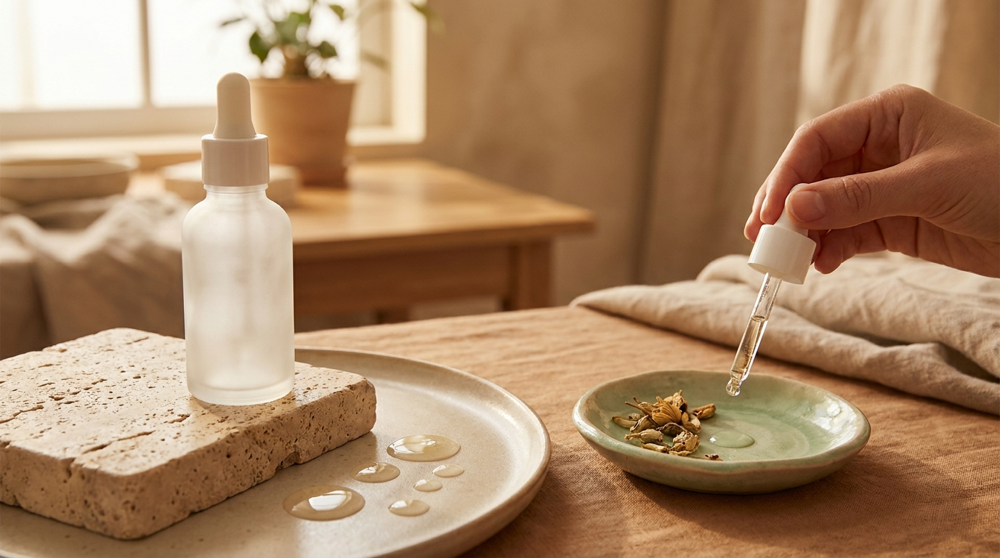
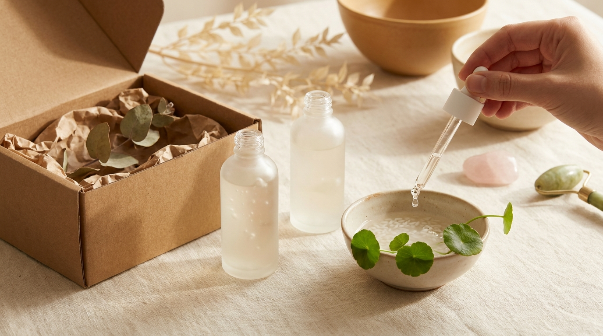

En las principales tiendas de belleza de barrios como Myeongdong o Seongsu, así como en los estantes más consultados de Olive Young en Corea del Sur, hay un componente que permanece de forma ininterrumpida entre los más buscados: la mucina de caracol. Quienes siguen el cuidado facial coreano y las tendencias que se observan en los K-Dramas suelen asociar este producto al codiciado efecto *chok chok* (esa apariencia de piel profundamente hidratada, fresca y con brillo natural).

Sin embargo, para muchas personas en Latinoamérica y España, su textura elástica y ligeramente viscosa todavía genera interrogantes legítimas: ¿qué hace exactamente este ingrediente en la piel?, ¿por qué tantas rutinas coreanas insisten en aplicarlo sobre el rostro húmedo?, y ¿con qué otros cosméticos conviene mezclarlo? 

En este artículo analizamos su ficha técnica, su función dentro de la rutina de belleza coreana y los métodos prácticos para sacarle el máximo partido desde casa.

## Puntos clave

- La mucina de caracol (*Snail Secretion Filtrate*) es un complejo humectante y calmante rico en glicoproteínas, alantoína, ácido hialurónico y péptidos.
- Su mayor beneficio cosmético reside en favorecer la retención de agua, suavizar la textura irregular y apoyar la recuperación de la barrera cutánea.
- La técnica coreana recomienda aplicarla siempre sobre la piel húmeda (inmediatamente después del tónico o bruma) para evitar sensación pegajosa y sellar la humedad.
- Es un ingrediente amortiguador extraordinariamente versátil: combina de forma segura y eficaz con retinol, niacinamida, vitamina C y exfoliantes químicos.

---

## Qué es realmente la mucina de caracol y cuál es su perfil cosmético

En la nomenclatura internacional de ingredientes cosméticos (INCI), este activo figura como **Snail Secretion Filtrate**. Lejos de ser un simple componente denso, se trata de una matriz biológica compleja secretada por el caracol (*generalmente Cryptomphalus aspersa* o *Helix aspersa*) para proteger su propio cuerpo frente al roce mecánico, la deshidratación y las agresiones ambientales.

En los laboratorios cosméticos de Corea del Sur, este filtrado se purifica exhaustivamente mediante procesos estandarizados para garantizar su estabilidad, pureza microbiológica y tolerancia dérmica. 

### Composición activa natural

A diferencia de los activos sintéticos formulados con una única molécula aislada, el filtrado de caracol contiene de forma natural una combinación de nutrientes dérmicos:

1. **Alantoína:** agente calmante ampliamente documentado que ayuda a mitigar la irritación, el enrojecimiento superficial y la sensación de tirantez.
2. **Glicosaminoglicanos y Ácido Hialurónico:** polímeros naturales con alta capacidad hidrófila, capaces de atraer y fijar cientos de veces su peso en agua en las capas superficiales de la epidermis.
3. **Péptidos de cobre y oligoelementos:** cadenas de aminoácidos que contribuyen a mantener la firmeza y respaldan los procesos naturales de regeneración cutánea.
4. **Trazas de ácido glicólico:** presente en concentraciones muy suaves que favorecen una microexfoliación no irritante, ayudando a suavizar asperezas y mejorar la luminosidad.

> **Sobre la obtención ética en Corea del Sur:**  
> Las marcas coreanas de referencia procesan la mucina en entornos controlados y oscuros donde los caracoles se desplazan libremente sobre mallas especiales sin recibir descargas ni estrés nocivo. La legislación de cosmética animal en Corea del Sur y las exigencias de exportación internacional priorizan métodos respetuosos que recolectan el fluido sin dañar a los animales.

---

## Beneficios reales: qué esperar y qué mitos descartar



<p class="img-cap">※ Imagen ilustrativa generada con IA</p>

Dentro de la cosmética coreana, el filtrado de caracol se cataloga primordialmente como un tratamiento restaurador y de confort, no como un medicamento dermatológico. Conocer sus alcances reales evita falsas expectativas.

### Lo que sí aporta a la piel

- **Aporte sostenido de hidratación:** al actuar como un humectante de alta densidad, ayuda a reponer los niveles de agua de pieles secas, deshidratadas o castigadas por cambios bruscos de temperatura.
- **Calma post-brote o post-irritación:** las personas que lidian con marcas residuales rojizas tras la aparición de granitos encuentran en la mucina un apoyo cosmético para calmar la zona y homogeneizar visualmente el tono superficial.
- **Sensación de mayor elasticidad y turgencia:** la hidratación profunda rellena temporalmente las líneas finas de deshidratación, otorgando un aspecto descansado y elástico.
- **Suavizado de la textura rugosa:** su uso continuado favorece una superficie dérmica más lisa al tacto, ideal como base previa al protector solar o bloqueador solar y al maquillaje.

### Lo que no puede hacer

- No sustituye los tratamientos dermatológicos clínicos para cicatrices atróficas o queloides.
- No es un medicamento para el acné ni un tratamiento despigmentante para hiperpigmentaciones melánicas profundas.
- No reemplaza la protección solar: ningún ingrediente reparador sustituye el uso diario de un buen bloqueador frente a la radiación UV.

---

## La técnica coreana: por qué y cómo aplicarla sobre la piel húmeda

Uno de los errores más comunes al incorporar una esencia o suero de mucina de caracol es depositar el producto sobre la piel completamente seca. Al tratarse de un cosmético cargado de ingredientes humectantes (que capturan agua del entorno), aplicarlo en un rostro seco en ambientes áridos puede generar dos problemas: sensación de tirantez superficial y una película residual pegajosa que tarda en absorberse.

### El principio de la retención de agua

En el ritual diario de cuidado en Corea, la clave de cualquier textura en gel o baba es actuar como un puente entre la humedad acuosa del tónico y la nutrición densa de la crema hidratante o humectante. 

Al aplicarla sobre una base húmeda, la mucina diluye de manera instantánea su tensión viscosa, facilitando que los glicosaminoglicanos atrapen esas microgotas y las distribuyan de forma homogénea en la epidermis.

```
Paso 1: Limpieza suave
       ↓
Paso 2: Tónico o bruma hidratante (dejar la piel húmeda, no empapada)
       ↓
Paso 3: Esencia / Sérum de mucina de caracol (técnica de palmoteo)
       ↓
Paso 4: Suero complementario específico (opcional)
       ↓
Paso 5: Crema hidratante / humectante (sellado)
       ↓
Paso 6: Protector solar / bloqueador solar (solo rutina de día)
```

### La técnica del «patting» (palmaditas suaves)

En lugar de friccionar enérgicamente el producto en círculos (lo que genera una película blancuzca momentánea debido a la naturaleza de las proteínas de la mucina), el método coreano utiliza pequeñas palmaditas con las yemas de los dedos:

1. Dispensa una o dos pulsaciones del producto en las palmas de las manos limpias.
2. Presiona suavemente las palmas sobre las mejillas, la frente y el mentón mientras la piel aún conserva el rocío del tónico.
3. Realiza toques ligeros y constantes con las yemas de los dedos durante 20 a 30 segundos. En las reseñas de usuarios en Corea se destaca con frecuencia cómo la textura filamentosa se transforma rápidamente en un velo acuoso fresco que se absorbe sin dejar rastro pegajoso.

---

## Combinaciones de activos: sinergias seguras y efectivas

Una de las grandes ventajas de la mucina de caracol en comparación con activos exfoliantes o despigmentantes puros es su extraordinaria compatibilidad biológica. Funciona como un «amortiguador cutáneo», reduciendo la posibilidad de que otros ingredientes más potentes generen incomodidad o descamación.

| Ingrediente combinado | Beneficio principal de la unión | Tipo de piel recomendada | Momento sugerido de la rutina |
| :--- | :--- | :--- | :--- |
| **Niacinamida (2% a 5%)** | Luminosidad, balance de sebo y refuerzo conjunto de la barrera cutánea. | Piel mixta, grasa o con tono irregular | Mañana y noche |
| **Retinol / Retinoides** | La mucina amortigua la sequedad y la descamación típica del retinoide. | Piel con signos de la edad o textura irregular | Noche |
| **Centella Asiática (Cica)** | Máximo poder calmante para pieles estresadas, enrojecidas o con roces. | Piel sensible, reactiva o con tendencia al enrojecimiento | Mañana y noche |
| **Ácido Hialurónico** | Doble nivel de hidratación: retención superficial y elasticidad duradera. | Piel seca, apagada o deshidratada | Mañana y noche |
| **Vitamina C (Ácido L-Ascórbico)** | La mucina mitiga el posible picor de la vitamina C pura y aporta efecto jugoso. | Piel apagada o con manchas solares leves | Mañana (bajo bloqueador solar) |
| **AHA / BHA** | Evita la deshidratación posterior a la exfoliación química semanal. | Piel con poros congestionados o textura rugosa | Noche (días alternos) |

### Tres rutinas prácticas según tu objetivo

#### 1. Dúo calmante y reparador (Mucina + Centella Asiática o Pantenol)
Es habitual recomendarlo para quienes tienen la barrera cutánea debilitada por el uso excesivo de exfoliantes o por el viento frío. Aplica primero un tónico de centella asiática, seguido de la esencia de mucina de caracol, y finaliza con una crema rica en ceramidas o pantenol. Esta secuencia ayuda a restaurar la sensación de confort en pocos días.

#### 2. Dúo antimanchas y luminosidad (Mucina + Niacinamida)
La niacinamida trabaja regulando la transferencia de melanina a las células superficiales, mientras que la mucina hidrata y suaviza la textura. Es una de las combinaciones más populares en el skincare asiático para mejorar visualmente las marcas residuales después de brotes ocasionales.

#### 3. El método «sándwich» suave con Retinol
Si el retinol suele causar descamación o tirantez, una pauta común es aplicar una capa fina de esencia de mucina sobre la piel húmeda, esperar a que se asiente durante dos minutos, aplicar la dosis de retinol y luego sellar con la crema de noche habitual. La matriz humectante del caracol reduce la velocidad de penetración del retinoide sin anular su eficacia cosmética a largo plazo.

---

## Consejos de compra internacional y precauciones de uso



<p class="img-cap">※ Imagen ilustrativa generada con IA</p>

Dado que los productos con mucina de caracol se encuentran entre los más imitados en plataformas globales de comercio electrónico, conviene prestar atención al adquirir este tipo de cosméticos desde fuera de Corea:

> **Recomendaciones prácticas para tus pedidos online:**  
> - **Verifica el listado INCI:** según la formulación oficial de los productos de calidad, el *Snail Secretion Filtrate* suele situarse en los primeros lugares de la lista (habitualmente por encima del 70% u 80% de concentración en esencias). Conviene desconfiar de fórmulas donde figure al final de la lista precedido por espesantes artificiales.  
> - **Prueba de parche obligatoria:** aunque la mucina es muy bien tolerada por la gran mayoría de usuarios, existe reactividad cruzada documentada en personas con alergia severa a los ácaros del polvo o a los moluscos marinos. Antes de aplicarla en todo el rostro, se aconseja colocar una gota en el antebrazo o detrás de la oreja durante 24 horas para descartar cualquier reacción.  
> - **Tiendas autorizadas:** adquiere tus productos a través de distribuidores autorizados de K-Beauty o comercios con trazabilidad directa desde Corea del Sur para evitar copias no reguladas.

---

## Preguntas frecuentes (FAQ)

### ¿La mucina de caracol es comedogénica o puede obstruir los poros?
En su estado puro y en fórmulas de calidad formuladas a base de agua, la mucina de caracol tiene un perfil no comedogénico. Su densidad proviene de polisacáridos e hidrocoloides, no de grasas o aceites pesados. No obstante, siempre se debe revisar el resto de la fórmula: si la esencia o crema contiene aceites comedogénicos añadidos, el producto final podría no ser idóneo para pieles muy grasas.

### ¿Se puede utilizar todos los días por la mañana y por la noche?
Sí. Al no tratarse de un activo exfoliante fotosensible ni de un ácido concentrado, la mucina de caracol es apta para uso diario continuo, tanto en la rutina de la mañana (antes del protector o bloqueador solar) como en la noche (antes de la crema nutritiva o aceite facial).

### ¿En qué paso de la rutina se debe colocar?
La regla general del skincare coreano es aplicar los productos de menor a mayor consistencia: limpieza, tónico, esencia de mucina de caracol, sueros concentrados (si los usas), crema hidratante o humectante y, por último, protector solar de día. Si tu mucina viene en formato de crema en lugar de esencia, se utiliza en el paso final de hidratación.

### ¿Qué diferencia hay entre la mucina de caracol y el ácido hialurónico?
El ácido hialurónico es un humectante puro que retiene humedad de forma altamente eficaz. La mucina de caracol, además de contener ácido hialurónico y glicosaminoglicanos, aporta componentes adicionales como alantoína, péptidos y trazas de micronutrientes, ofreciendo una acción multifuncional orientada tanto a la hidratación como a calmar la piel y apoyar su recuperación superficial.