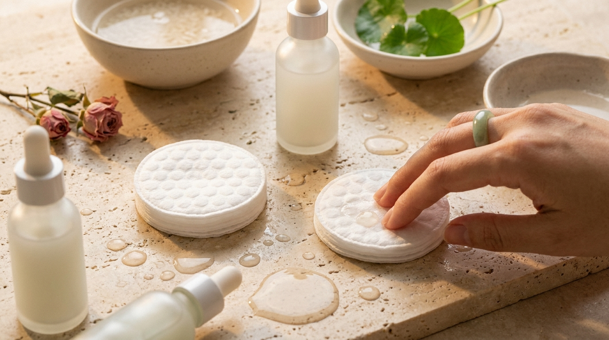
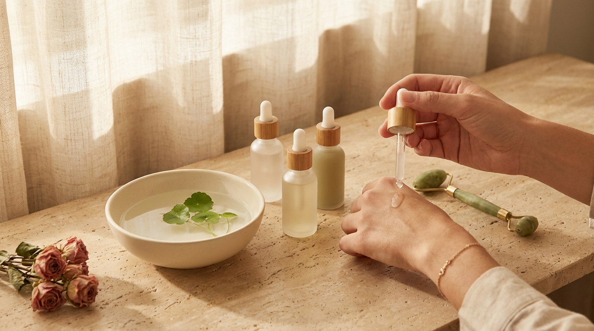

¡Hola! Soy J desde Seúl. Si alguna vez has visto un K-Drama o sigues las novedades del cuidado facial coreano, es muy probable que hayas escuchado hablar de Olive Young. En Corea del Sur, esta cadena de tiendas es el epicentro indiscutible de las tendencias de belleza: prácticamente cualquier cosmético que se vuelve viral o que se corona entre los favoritos de la sociedad coreana pasa por sus estantes.

Muchos amantes de la cosmética coreana en Latinoamérica y España se preguntan con frecuencia qué compran realmente las personas en Seúl cuando entran a una tienda física, más allá del ruido publicitario de las redes sociales. En este artículo analizamos los productos de *skincare* que lideran los rankings de ventas en Olive Young, desglosando sus fórmulas (INCI), sus texturas y el contexto cultural y climático que explica su enorme éxito.

## Puntos clave

* **Liderazgo de la barrera cutánea:** Los productos más vendidos en Seúl no buscan efectos abrasivos inmediatos, sino reforzar y calmar la función barrera de la piel con ingredientes como ceramidas, pantenol y centella asiática.
* **Formatos funcionales y rápidos:** Los discos de tóner (*toner pads*) y los sérums de absorción ultraligera dominan las listas de ventas gracias al estilo de vida dinámico de Seúl, donde se valora la eficacia sin pasos innecesarios.
* **Protección solar de textura imperceptible:** Los protectores solares / bloqueadores solares coreanos más populares destacan por actuar como sueros hidratantes sin dejar rastro blanco ni sensación grasa.
* **Información basada en datos:** Los rankings de Olive Young reflejan millones de compras reales y reseñas verificadas, lo que permite elegir productos con base en formulaciones contrastadas y no solo en modas pasajeras.

---

## El pulso del consumidor en Seúl: Cómo funcionan los rankings de Olive Young

Olive Young cuenta con más de 1.300 tiendas repartidas por toda Corea del Sur, desde distritos icónicos como Myeongdong y Hongdae hasta áreas residenciales en Seúl y otras provincias. Para los consumidores coreanos, su aplicación móvil y sus tiendas físicas son la principal referencia para consultar reseñas transparentes antes de comprar.

El sistema de clasificación de Olive Young es especialmente riguroso. A diferencia de las listas basadas únicamente en impresiones o campañas publicitarias, su ranking general combina tres factores determinantes:

1. **Volumen de ventas en tiempo real:** Cuántas unidades se adquieren en tiendas físicas y en la plataforma en línea.
2. **Índice de recompras:** Si un usuario vuelve a comprar el mismo artículo tras terminarlo, lo que refleja fidelidad y satisfacción real con la fórmula.
3. **Reseñas verificadas:** Solo los compradores confirmados pueden calificar el producto, evaluar su tolerancia y detallar su tipo de piel (grasa, seca, mixta o sensible).

Por esta razón, observar qué productos se mantienen en el top de Olive Young ofrece una radiografía exacta de las necesidades cosméticas reales en Seúl.

---

## Las categorías estrella y los productos que dominan los rankings

※ Imagen ilustrativa generada con IA

Las tendencias actuales en Seúl demuestran una clara inclinación por el concepto de *Slow Aging* (envejecimiento paulatino y saludable) y la restauración dérmica. A continuación, desglosamos las cuatro categorías que concentran el mayor volumen de ventas y los motivos detrás de su popularidad.

### 1. Discos de tóner (Toner Pads) calmantes y exfoliantes suaves

Los *toner pads* han pasado de ser un producto accesorio a convertirse en un paso fundamental de la rutina matutina y nocturna en Corea. Se trata de almohadillas de algodón empapadas en esencias concentradas con doble función: equilibrar la piel y ofrecer un suave alisado mecánico o químico sin irritar.

* **Por qué triunfan en Seúl:** En una ciudad con inviernos fríos y veranos húmedos, los cambios bruscos de temperatura resecan y congestionan la piel. Los consumidores utilizan estos discos no solo para limpiar suavemente el rostro con pasadas delicadas, sino como mini-mascarillas locales (*pad-packing*), dejándolos reposar de tres a cinco minutos sobre mejillas y frente antes del maquillaje.
* **Fórmulas destacadas:** En los rankings sobresalen aquellos formulados con derivados de centella asiática (madecasósido), árbol de té y extracto de corazón de hoja (*Houttuynia cordata*). Un ejemplo constante en los primeros puestos son los discos de **Mediheal Madecassoside Blemish Pad** y los de la línea de **Torriden Dive-In**, muy demandados por su aporte de humedad sin pesadez.

### 2. Sérums de ácido hialurónico de bajo peso molecular y agentes calmantes

En la categoría de esencias y sueros, los consumidores coreanos priorizan formulaciones limpias, de rápida absorción y compatibles con pieles sensibilizadas por la polución urbana.

* **Por qué triunfan en Seúl:** El acabado deseado en el maquillaje coreano actual no es excesivamente oleoso ni mate acartonado, sino una hidratación traslúcida que proviene desde el interior de la piel. Para lograrlo sin saturar los poros, se buscan sueros con moléculas de hidratación fragmentadas capaces de penetrar eficazmente en el estrato córneo.
* **Ingredientes clave (INCI):** Complejos de ácido hialurónico de múltiples pesos moleculares (desde alto hasta micromolecular), combinados con alantoína, ectoína o pantenol. El **Torriden Dive-In Low Molecule Hyaluronic Acid Serum** es un claro referente en los primeros puestos anuales debido a su textura en gel acuoso, ideal para climas cálidos o para aplicar en varias capas finas.

### 3. Cremas reparadoras de la barrera cutánea con lípidos biomiméticos

Atrás quedaron las épocas en las que las cremas hidratantes / humectantes solo buscaban sellar la piel con ceras densas. En Olive Young, las cremas más vendidas son aquellas especializadas en emular la estructura natural de la piel mediante la combinación de ceramidas, colesterol y ácidos grasos.

* **Por qué triunfan en Seúl:** El uso frecuente de calefacciones interiores durante el invierno seco de Corea y el aire acondicionado en verano debilitan con facilidad la barrera cutánea. Quienes buscan mantener la elasticidad facial recurren a cremas con tecnología de microcápsulas lipídicas que se funden al contacto con la temperatura corporal.
* **Fórmulas destacadas:** Productos como la **Aestura Atobarrier 365 Cream** se mantienen de forma continua entre los hidratantes más recomendados tanto por dermatólogos locales como por reseñas de usuarios, destacando por calmar la tirantez y la descamación sin provocar brotes ni obstrucción de poros.

### 4. Protectores solares / Bloqueadores solares con textura acuosa (*Sun Serums*)

En Corea del Sur, la protección solar no es negociable; se aplica los 365 días del año. Por ello, las marcas han perfeccionado las formulaciones hasta lograr texturas que se asemejan más a un suero hidratante que a una crema solar tradicional.

* **Por qué triunfan en Seúl:** Para que una persona en Seúl utilice protector solar a diario, el producto debe ser compatible con bases de maquillaje fluidas o cojines (*cushions*), sin crear grumos (*pilling*) ni alterar el tono natural de la piel con halos blanquecinos indeseados.
* **Fórmulas destacadas:** El protector **Round Lab Birch Juice Moisturizing Sun Cream** y el **Skin1004 Madagascar Centella Hyalu-Cica Water-Fit Sun Serum** lideran con frecuencia esta categoría. Ambos incorporan filtros químicos orgánicos de última generación autorizados en Asia y Europa, enriquecidos con savia de abedul o agua de centella asiática para una aplicación suave y refrescante.

---

## Comparativa de superventas en Olive Young

Para comprender mejor cómo se distribuyen las preferencias según la necesidad dérmica, a continuación presentamos una tabla comparativa con las principales categorías de superventas y sus perfiles de formulación:

| Categoría | Enfoque principal de fórmula | Ingredientes clave frecuentes (INCI) | Tipo de piel idóneo | Sensación al tacto |
| :--- | :--- | :--- | :--- | :--- |
| **Discos de tóner (*Pads*)** | Calmar rojeces y suavizar textura | Madecassoside, Houttuynia Cordata, PHA | Mixta, con tendencia a rojeces o imperfecciones | Refrescante, acuosa y no pegajosa |
| **Sérum hidratante** | Reposición hídrica en capas profundas | Ácido hialurónico 5D, Pantenol, Malaquita | Todo tipo de piel, especialmente deshidratada | Gel fluido de absorción instantánea |
| **Crema de barrera** | Reparación y prevención de deshidratación | Ceramida NP, Colesterol, Ácidos grasos | Seca, sensible o sensibilizada | Emulsión enriquecida que se funde con la piel |
| **Protector solar / Bloqueador** | Fotoprotección diaria de amplio espectro | Filtros UV avanzados, Savia de abedul, Niacinamida | Normal, mixta, seca o grasa | Similar a una loción hidratante ligera |

---

## Qué nos enseñan las tendencias de Seúl sobre el cuidado de la piel

※ Imagen ilustrativa generada con IA

Analizar los cosméticos más comprados en Seúl permite extraer varias conclusiones útiles para quienes siguen la cosmética coreana desde sus hogares en cualquier parte del mundo:

1. **La consistencia supera a la agresividad:** En lugar de peelings químicos intensos de uso doméstico, en Seúl se prefieren exfoliaciones diarias o semanales sumamente suaves (como el ácido polihidroxilado o PHA, y enzimas suaves), manteniendo la barrera lipídica intacta.
2. **Capas finas (*Layering*) inteligentes:** En vez de aplicar productos densos que tardan en absorberse, la rutina coreana moderna prefiere superponer capas finas de texturas ligeras (tóner, esencia, suero) para lograr una hidratación homogénea sin saturar los poros.
3. **Atención a la temperatura de la piel:** Gran parte de los productos más vendidos incorporan activos botánicos con propiedades refrescantes inmediatas. En la estética coreana se considera que reducir la temperatura de la piel congestionada ayuda a minimizar la pérdida de agua transepidérmica y previene la inflamación.

> **Consejo práctico desde Seúl:**  
> Aunque un producto sea el número uno en los rankings de Olive Young, es fundamental recordar que el clima de Seúl presenta variaciones extremas entre estaciones (un invierno muy seco y gélido frente a un verano caluroso y muy húmedo). Si vives en un país con clima templado o tropical, evalúa si tu piel requiere una crema rica en ceramidas o si te beneficiarás más adoptando únicamente las emulsiones ligeras o los protectores solares de base acuosa. Asimismo, siempre se recomienda realizar una prueba de parche en el antebrazo antes de incorporar cualquier fórmula nueva a la rutina.

---

## Preguntas frecuentes (FAQ)

### ¿Por qué cambian tanto los rankings de Olive Young a lo largo del año?
El clima de Corea del Sur está muy marcado por cuatro estaciones bien diferenciadas. Durante el otoño y el invierno, los puestos más altos los ocupan cremas densas de barrera, aceites de limpieza y bálsamos labiales nutritivos. En primavera y verano, el ranking se inclina masivamente hacia geles calmantes, protectores solares ligeros, limpiadores purificantes y parches para el acné.

### ¿Los productos más vendidos en Olive Young son aptos para todo tipo de piel?
No necesariamente. Aunque las fórmulas coreanas más vendidas suelen someterse a pruebas de hipoalergenicidad para pieles sensibles, cada piel reacciona de manera única. Un hidratante pensado para reparar una piel muy seca en el invierno coreano puede resultar excesivamente pesado para una piel grasa que vive en una zona de alta humedad. Conviene revisar siempre la lista de ingredientes (INCI) y la textura recomendada.

### ¿Cómo comprar estos productos desde Latinoamérica o España sin intermediarios dudosos?
Olive Young cuenta con su plataforma internacional oficial (*Olive Young Global*), la cual envía pedidos a diversos países de habla hispana. Asimismo, existen distribuidores autorizados de cosmética coreana en España y Latinoamérica que importan legalmente estas marcas. Al adquirir productos en línea, es aconsejable verificar que el envase cuente con sellos de autenticidad, fecha de caducidad clara y etiquetado conforme a las regulaciones locales.

### ¿Es necesario realizar los 10 pasos de la rutina coreana para ver resultados con estos productos?
No. La rutina coreana contemporánea en Seúl es mucho más minimalista y funcional de lo que se solía creer en el pasado. Hoy en día, la mayoría de las personas en Corea siguen una rutina básica compuesta por: limpieza suave, un producto hidratante o calmante (como un tóner o suero) y protección solar durante el día, o una crema de barrera por la noche. Usar bien tres o cuatro productos adaptados a las necesidades reales de tu piel suele ser mucho más eficaz que acumular múltiples pasos.