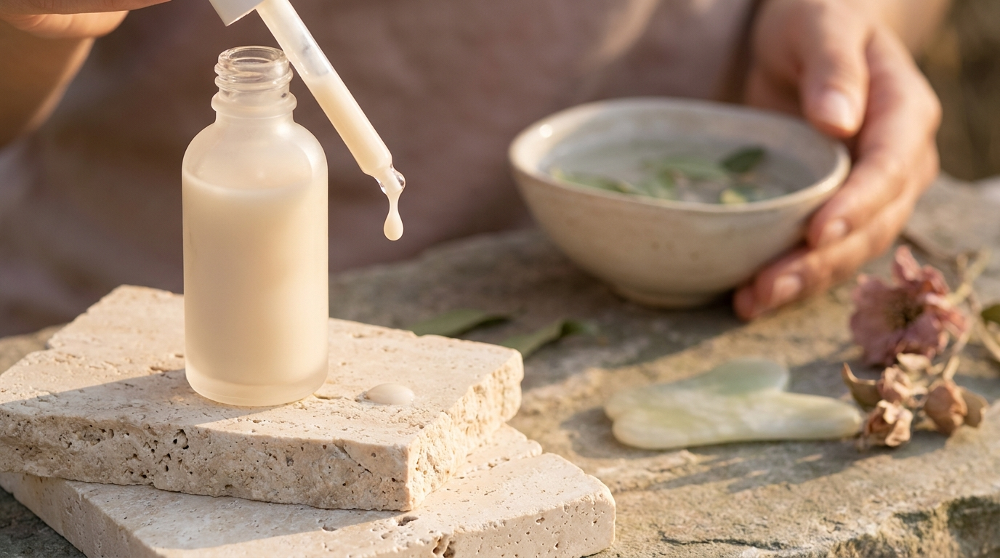
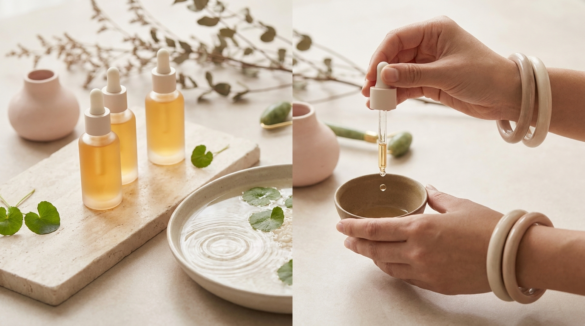

Si se siguen de cerca las tendencias de belleza en Corea o se observa la piel luminosa y firme de los protagonistas de los K-Dramas, resulta fácil notar un cambio importante en la conversación del cuidado facial. Durante años, el objetivo principal en Seúl fue conseguir un brillo jugoso inmediato; sin embargo, en las farmacias y tiendas de cosmética de barrios como Gangnam o Myeongdong, la verdadera preferencia actual gira en torno al concepto de *slow-aging* o envejecimiento pausado.

Dentro de este enfoque, dos ingredientes han tomado el liderazgo absoluto en las formulaciones de alta gama y de consumo diario: el **PDRN** y los **complejos de péptidos**. Lo que antes pertenecía casi con exclusividad al ámbito clínico especializado hoy se formula en sueros ligeros, seguros y altamente tolerables para aplicar cómodamente frente al espejo del hogar. A continuación, se analiza a fondo la ciencia detrás de estos activos, su lista INCI y cómo integrarlos en la rutina diaria para cuidar la elasticidad de la piel sin recurrir a agujas.

## Puntos clave

- **Qué es el PDRN cosmético**: Fragmentos de ADN purificado (obtenidos tradicionalmente del salmón o sintetizados a partir de fuentes vegetales como el ginseng) diseñados para respaldar la recuperación cutánea, la densidad y la hidratación profunda.
- **La sinergia con los péptidos**: Mientras el PDRN ayuda a calmar y revitalizar el entorno celular, los péptidos actúan como mensajeros que incentivan la producción natural de colágeno y elastina.
- **Alternativa tópica sin agujas**: A diferencia de los tratamientos inyectables de uso clínico, los sueros cosméticos buscan fortalecer la barrera cutánea y mejorar la textura de forma progresiva y no invasiva.
- **Compatibilidad universal**: Son ingredientes con una tolerancia excelente, aptos para pieles sensibles, secas, mixtas e incluso tras exposiciones intensas al sol o cambios estacionales.

---

## ¿Qué es el PDRN y por qué lidera las tendencias en Seúl?

El término **PDRN** corresponde a *polidesoxirribonucleótido*. En el ámbito médico y biotecnológico surcoreano, esta sustancia se investigó durante décadas por su capacidad para favorecer la regeneración de tejidos y la cicatrización. Su estructura molecular básica está compuesta por cadenas lineales de nucleótidos que guardan una notable similitud con el ADN humano.

Tradicionalmente, el PDRN de uso profesional se extrae del esperma del salmón salvaje (*Oncorhynchus mykiss* u *Oncorhynchus keta*), un material biológico que se purifica minuciosamente a temperaturas elevadas para eliminar cualquier residuo proteico o antigénico, asegurando una biocompatibilidad superior al 95%.

```
[Estructura de nucleótidos del PDRN]
            ↓
Reconocimiento por los receptores de adenosina (A2A)
            ↓
Estímulo del entorno dérmico y reducción de señales de estrés
            ↓
Apoyo a la regeneración celular y síntesis de matriz extracelular
```

En la cosmética tópica coreana, los laboratorios han adaptado este ingrediente para que sea capaz de penetrar los estratos superficiales de la epidermis. Al revisar los envases en las tiendas coreanas, es común encontrar nombres como *Sodium DNA* o formulaciones de bajo peso molecular diseñadas mediante liposomas microscópicos.

### El auge del Phyto-PDRN (PDRN vegetal)
En los últimos meses, el mercado en Corea ha incorporado con fuerza el **Phyto-PDRN**, extraído de plantas como el ginseng silvestre, el loto o las algas marinas. Las marcas coreanas han desarrollado estas alternativas botánicas para ofrecer opciones veganas certificadas que presentan cadenas de nucleótidos con un mecanismo cosmético muy similar al marino, aportando una acción calmante y reafirmante excepcional para quienes prefieren evitar ingredientes de origen animal.

Al observar [los productos de skincare más vendidos en Olive Young Corea y por qué triunfan en Seúl](/blog/olive-young-mas-vendidos-corea-2026/), se comprueba que las esencias y sueros con PDRN (tanto marino como vegetal) ocupan posiciones privilegiadas dentro del sector antiedad, desplazando en muchos casos a activos tradicionalmente más irritantes.

---

## Los péptidos: arquitectos de la firmeza y la densidad cutánea



<p class="img-cap">※ Imagen ilustrativa generada con IA</p>

Si el PDRN prepara el terreno y favorece la reparación del tejido, los **péptidos** son los capataces de la obra. Químicamente, los péptidos son cadenas cortas de aminoácidos unidos por enlaces peptídicos. Son las piezas fundamentales con las que el cuerpo construye proteínas estructurales indispensables como el colágeno, la elastina y la queratina.

Con el paso del tiempo y factores ambientales como la radiación ultravioleta, la comunicación celular disminuye y la piel reduce su síntesis proteica natural. Los péptidos en cosmética actúan enviando señales moleculares precisas para estimular respuestas biológicas concretas.

### Tipos de péptidos más comunes en el K-Beauty

1. **Péptidos de señal (Signal Peptides)**:
   - *Ejemplos comunes en INCI*: *Palmitoyl Tripeptide-1*, *Palmitoyl Pentapeptide-4* (Matrixyl).
   - *Función*: Imitan fragmentos de colágeno degradado para "engañar" a los fibroblastos, haciéndoles creer que el colágeno se ha roto y estimulando la producción de nuevas fibras dérmicas.

2. **Péptidos inhibidores de neurotransmisores**:
   - *Ejemplo común*: *Acetyl Hexapeptide-8* (conocido popularmente en publicaciones cosméticas como péptido efecto tensor o símil bótox).
   - *Función*: Ayuda a relajar la tensión de las microcontracciones faciales superficiales, contribuyendo a suavizar visiblemente las líneas de expresión en el contorno de ojos y frente.

3. **Péptidos transportadores (Carrier Peptides)**:
   - *Ejemplo común*: *Copper Tripeptide-1* (tripéptido de cobre).
   - *Función*: Transporta oligoelementos esenciales como el cobre a las enzimas celulares, acelerando la recuperación de la barrera cutánea y mejorando la elasticidad general.

---

## La sinergia PDRN + Péptidos: ¿por qué funcionan mejor juntos?

Muchos usuarios en España y Latinoamérica se preguntan por qué las marcas coreanas combinan habitualmente ambos ingredientes en una sola botella. La respuesta radica en la complementariedad biológica:

- El **PDRN** actúa principalmente como un protector y optimizador del entorno celular. Reduce el estrés oxidativo superficial, mejora la retención de agua en las capas profundas de la epidermis y calma los procesos inflamatorios silenciosos (*inflammaging*) que degradan las fibras de soporte.
- Los **péptidos**, introducidos en este entorno calmado e hidratado, tienen una eficacia notablemente mayor para interactuar con las células epidérmicas y promover la síntesis de soporte estructural.

El resultado visible a nivel cosmético no es un cambio drástico de la noche a la mañana, sino lo que en Corea se describe como *tang-tang* (탱탱): una piel que recupera su rebote al tacto, se siente más densa y refleja la luz de manera uniforme gracias a una textura refinada.

---

## Comparativa de activos reafirmantes en la cosmética coreana

Para entender en qué lugar se sitúan el PDRN y los péptidos frente a otros ingredientes clásicos del cuidado antiedad, se presenta esta comparativa práctica:

| Activo cosmético | Beneficio principal | Nivel de tolerancia | Momento de uso | Perfil de piel recomendado |
| :--- | :--- | :--- | :--- | :--- |
| **PDRN (Marino / Vegetal)** | Apoyo reparador, elasticidad y mejora del rebote cutáneo | Muy alto (no fotosensibilizante) | Mañana y noche | Piel fatigada, apagada o tras agresiones climáticas |
| **Complejo de Péptidos** | Firmeza dérmica y suavizado de líneas de expresión | Muy alto | Mañana y noche | Piel con pérdida de densidad o primeras arrugas |
| **Retinol / Retinoides** | Renovación celular acelerada y alisado de textura | Medio a bajo (requiere retinización) | Exclusivo de noche | Piel resistente con textura irregular o fotoenvejecimiento |
| **Colágeno hidrolizado** | Hidratación superficial y efecto rellenador temporal | Muy alto | Mañana y noche | Piel deshidratada que busca confort inmediato |

A diferencia de los retinoides puros, que suelen exigir periodos de adaptación con descamación o enrojecimiento, la combinación de PDRN y péptidos destaca por su extraordinaria amabilidad con la barrera de la piel. Es una opción idónea para quienes no toleran la vitamina A ácida o buscan mantener la firmeza cutánea durante los meses de mayor radiación solar.

---

## Cómo aplicar tu suero de PDRN y péptidos paso a paso

Integrar este tipo de producto en casa es sencillo, pero el orden de aplicación resulta crucial para maximizar la absorción de las moléculas peptídicas y los fragmentos de nucleótidos.

```
Doble Limpieza ➔ Tónico Hidratante ➔ Suero PDRN + Péptidos ➔ Crema Selladora ➔ Protector Solar (Día)
```

1. **Limpieza respetuosa**: Se recomienda comenzar con un limpiador acuoso de pH ligeramente ácido (5.5) o realizar una doble limpieza suave si se lleva maquillaje o bloqueador solar.
2. **Humectación previa**: Aplicar un tónico o esencia acuosa para humedecer la piel. Los activos de bajo peso molecular se absorben con mayor facilidad en un estrato córneo previamente hidratado.
3. **Aplicación del suero**: Dispensar de 3 a 4 gotas del suero de PDRN y péptidos sobre el rostro. Distribuirlo mediante presiones suaves con las palmas de las manos, sin frotar con fuerza.
4. **Sellado oclusivo**: Aplicar la crema hidratante habitual. Contener lípidos (como ceramidas o escualano) en este paso es fundamental para retener los activos en la piel y evitar la pérdida transepidérmica de agua.

Para dominar la secuencia completa de los productos y asegurar que ningún activo pierda efectividad con el tiempo, se puede consultar la guía sobre [cómo organizar y conservar tu skincare coreano: orden de capas y caducidad](/blog/como-ordenar-y-conservar-tu-skincare-coreano/).

> **Recomendación práctica del sector cosmético coreano**:
> En las tendencias de cuidado facial en Corea es habitual combinar los sueros de PDRN con tratamientos de microagujas cosméticas tópicas como el *Reedle Shot* para facilitar la penetración de los péptidos. Si se opta por esta combinación en casa, se sugiere hacerlo de forma gradual: aplicar primero el producto de microagujas en concentraciones bajas y añadir inmediatamente después el suero de PDRN para calmar la piel. Se pueden consultar todos los detalles sobre este método en el análisis sobre [qué son las espículas y el Reedle Shot: niveles 100 vs 300, usos y precauciones](/blog/reedle-shot-espiculas-cosmetica-coreana-guia/).

---

## Precauciones y qué evitar al usar péptidos y PDRN



<p class="img-cap">※ Imagen ilustrativa generada con IA</p>

Aunque son ingredientes sumamente seguros, existen ciertas directrices que conviene tener en cuenta para no alterar la estabilidad de las fórmulas:

- **Evitar mezclar directamente con ácidos fuertes**: Los alfahidroxiácidos (AHA como el ácido glicólico a concentraciones superiores al 7%) o el ácido ascórbico puro (vitamina C pura con pH muy ácido) pueden desnaturalizar ciertas cadenas de péptidos si se mezclan en la misma capa. Si se usan exfoliantes químicos, es habitual reservarlos para noches alternas o aplicar la vitamina C por la mañana y el suero de péptidos y PDRN por la noche.
- **Prueba de parche previa**: Aunque el Sodium DNA de salmón está altamente purificado y es hipoalergénico, en personas con antecedentes de alergias graves a pescados se aconseja realizar una prueba de tolerancia en el antebrazo durante 24 horas antes de la primera aplicación facial, u optar por fórmulas con Phyto-PDRN vegetal.
- **La constancia supera a la cantidad**: La estimulación del colágeno requiere tiempo fisiológico. No se obtienen mejores resultados aplicando un exceso de producto en una sola sesión; la clave reside en la continuidad diaria durante al menos 6 a 8 semanas.

---

## Preguntas frecuentes (FAQ)

### ¿Un suero con PDRN sustituye a las inyecciones de las clínicas de Seúl?
No. Los tratamientos inyectables de uso clínico introducen activos directamente en capas profundas mediante agujas bajo supervisión médica. Los sueros cosméticos de uso en casa están regulados para actuar a nivel epidérmico y en la unión dermoepidérmica: no reemplazan un procedimiento invasivo, pero proporcionan una mejora notable en elasticidad, luminosidad, recuperación de barrera y tersura sin dolor, agujas ni tiempo de recuperación.

### ¿Se pueden utilizar sueros con péptidos y PDRN durante el día?
Sí, totalmente. A diferencia del retinol o los exfoliantes químicos intensos, ni los péptidos ni el PDRN son fotosensibilizantes. De hecho, gracias a sus propiedades antioxidantes y protectoras de la barrera cutánea, resultan excelentes como escudo matutino bajo el protector o bloqueador solar.

### ¿A partir de qué edad se recomienda empezar con estos ingredientes?
El cuidado de la firmeza y la elasticidad es preventivo. En Seúl, muchas personas comienzan a incorporar péptidos ligeros a partir de los 25 años, momento en el que la síntesis natural de colágeno empieza a decrecer de manera paulatina. No obstante, en pieles maduras de más de 40 o 50 años, estos sueros son igualmente valiosos para devolver confort, hidratación profunda y densidad.

### ¿Es adecuado el PDRN si se tiene piel grasa o tendencia al acné?
Sí. El PDRN posee una contrastada acción calmante que ayuda a moderar las rojeces superficiales y favorece la recuperación tras las marcas de brotes pasados. Al formularse en texturas de suero o ampolla acuosa de rápida absorción, no aporta pesadez ni grasa comedogénica al rostro. Solo se debe verificar que el resto de los emolientes de la fórmula sean compatibles con el tipo de piel.