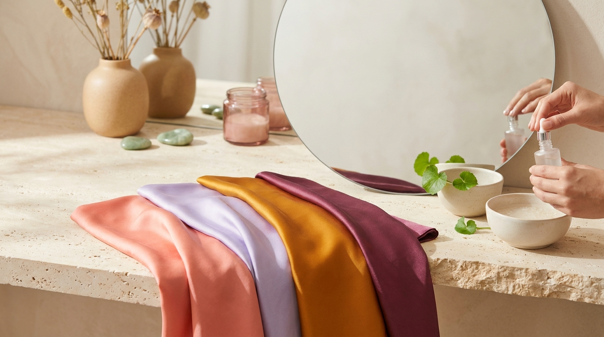
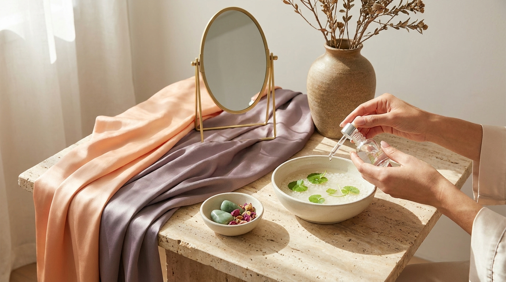

¡Hola! Soy J desde Seúl. Si sigues los lanzamientos de cosmética coreana, miras reseñas de creadores en Corea o disfrutas de los K-Dramas, probablemente te habrás topado con dos términos omnipresentes: *Warm Tone* (웜톤, tono cálido) y *Cool Tone* (쿨톤, tono frío). En las tiendas de belleza de Seúl como Olive Young, prácticamente todos los tintes de labios, paletas de sombras y rubores vienen etiquetados según esta clasificación.

En Corea del Sur, acudir a un estudio profesional de *Personal Color* (colorimetría personalizada) en barrios como Gangnam o Hongdae se ha convertido en un auténtico ritual. Durante estas sesiones, consultores expertos colocan decenas de telas de distintos tonos bajo la barbilla del cliente para descubrir qué gama cromática ilumina su rostro de forma natural y cuál acentúa las ojeras o apaga la piel. Sin embargo, no hace falta viajar a Seúl ni invertir cientos de dólares para entender los principios básicos de este sistema. 

A continuación, te explico cómo funciona este concepto en la cultura coreana y cómo puedes realizar un test de colorimetría casero, con pasos prácticos y herramientas que ya tienes en tu habitación.

## Puntos clave

- El *Personal Color* coreano clasifica la armonía cromática de cada persona en dos grandes familias (*Warm* y *Cool*), subdivididas a su vez en cuatro estaciones (Primavera, Otoño, Verano e Invierno).
- Saber tu tono no busca limitarte, sino ayudarte a elegir bases, rubores y labiales que armonicen con tu subtono para lograr un aspecto descansado y luminoso sin sobrecargar la piel.
- Puedes realizar una evaluación bastante precisa en casa utilizando luz natural matutina, un espejo y telas o accesorios de colores contrastantes.
- En el K-Beauty actual, las marcas formulan sus colecciones pensando específicamente en estas categorías, lo que facilita enormemente comprar maquillaje online sin equivocarse.

---

## El auge del Personal Color en Corea: mucho más que una tendencia

En Corea, la búsqueda de una imagen cuidada y armónica ha llevado la teoría del color al consumo cotidiano. Lo que en Occidente suele conocerse como análisis estacional de colorimetría, en el mercado surcoreano se transformó en un estándar de compra. Si una marca lanza una nueva línea de tintes labiales, casi con total seguridad presentará números pares para subtonos cálidos y números impares para subtonos fríos (o viceversa), facilitando la decisión de los compradores.

La razón de este éxito radica en la filosofía del maquillaje coreano, que prioriza una piel traslúcida, fresca y con aspecto saludable. Cuando utilizas un color que choca con tu subtono natural, la piel suele verse cetrina, grisácea o visualmente cansada. Por el contrario, cuando los pigmentos armonizan con tu coloración subyacente, las imperfecciones se disimulan visualmente y el rostro adquiere luminosidad inmediata.

Para entender el sistema, primero debemos dividir los tonos en sus dos grandes ramas:

1. **Warm Tone (Cálido):** Predominan las bases amarillas, doradas, melocotón o anaranjadas. En la piel suele percibirse calidez visual, independientemente de si el tono de piel es claro, medio u oscuro.
2. **Cool Tone (Frío):** Predominan las bases azuladas, rosadas, rojizas frías o cenizas. La piel proyecta una sensación más fresca o traslúcida.

A partir de esta división básica, el sistema coreano profundiza en cuatro estaciones principales, asociadas al brillo (*brightness*) y la saturación (*saturation*) del color.

---

## Las cuatro estaciones del sistema coreano



<p class="img-cap">※ Imagen ilustrativa generada con IA</p>

Para identificar con precisión qué colores te favorecen, la clasificación tradicional coreana distribuye los tonos cálidos y fríos en cuatro perfiles estacionales:

### 1. Spring Warm (Primavera Cálida - 봄 웜톤)
Representa la vitalidad y la luz de la primavera. Las personas que encajan en esta categoría suelen verse favorecidas por colores luminosos, cálidos y vibrantes.
- **Colores afines:** Coral brillante, melocotón, amarillo pastel cálido, verde manzana y beige marfil.
- **En maquillaje:** Labiales jugosos en tono naranja suave o coral, rubor durazno y sombras en tonos tierra claros con destellos dorados. Si buscas recrear el acabado fresco de las actrices de series coreanas, muchas de ellas recurren a esta paleta en el [maquillaje de K-Drama al detalle](/blog/maquillaje-natural-actrices-kdrama-paso-a-paso/).

### 2. Autumn Warm (Otoño Cálido - 가을 웜톤)
Evoca la riqueza, profundidad y madurez de los paisajes otoñales. Son colores cálidos, pero más apagados, profundos y terrosos.
- **Colores afines:** Teja, terracota, mostaza, verde oliva, café chocolate y beige tostado.
- **En maquillaje:** Labiales mate o aterciopelados en tonos ladrillo, marrón rojizo (*chili*) y sombras en tonos bronce o canela.

### 3. Summer Cool (Verano Frío - 여름 쿨톤)
Transmite frescura, suavidad y delicadeza. A diferencia de lo que sugiere la palabra «verano», en colorimetría se refiere a tonos fríos, pasteles, lechosos y ligeramente grisáceos (*mute*). Es uno de los perfiles más comunes y populares en los productos de K-Beauty.
- **Colores afines:** Rosa pastel, lila, azul cielo, lavanda, gris perla y blanco puro.
- **En maquillaje:** Tintes labiales en tono rosa empolvado, fresa claro, malva suave y rubores rosados fríos que aportan un efecto de mejillas limpias y juveniles.

### 4. Winter Cool (Invierno Frío - 겨울 쿨톤)
Se define por el contraste alto, la intensidad y la frialdad cromática. Son colores nítidos, saturados y sin matices amarillos.
- **Colores afines:** Fucsia intenso, rojo carmín frío, borgoña, azul marino oscuro, negro puro y blanco radiante.
- **En maquillaje:** Labios en rojo cereza intenso, moras o ciruela, combinados con una piel muy despejada y delineados precisos.

---

## Test casero paso a paso: descubre tu subtono en 4 etapas

Para realizar tu propio análisis en casa sin necesidad de instrumental especializado, solo necesitas un espejo de buen tamaño, luz natural y un par de prendas o toallas de colores concretos. Sigue estos cuatro pasos:

```
Paso 1: Preparación (Luz diurna neutral + Piel limpia)
               │
               ▼
Paso 2: Prueba del Oro vs. Plata (Metales / Accesorios)
               │
               ▼
Paso 3: Prueba de Telas (Naranja/Coral vs. Fucsia/Magenta)
               │
               ▼
Paso 4: Contraste y lectura de venas periféricas
```

### Paso 1: Prepara el entorno adecuado
La iluminación es el factor más determinante. Si utilizas luces amarillas o fluorescentes artificiales, el resultado se distorsionará por completo.
- Colócate frente a una ventana durante la mañana o primera hora de la tarde, recibiendo **luz natural indirecta** (evita el sol directo que genere sombras marcadas).
- Retira todo el maquillaje de tu rostro, incluyendo protectores solares con color o tintes residuales.
- Si tu cabello está teñido, cúbrelo con una toalla o banda blanca o gris neutra para que los reflejos del tinte no engañen al ojo.

### Paso 2: La prueba de los accesorios (Oro vs. Plata)
Coloca cerca de tu cuello y mandíbula una pieza de metal dorado brillante y otra de metal plateado (pueden ser pendientes, collares o incluso trozos de papel de envolver metalizado):
- Si el **dorado** hace que tu piel se vea viva, uniforme y saludable, tu base apunta hacia el perfil **Warm Tone**.
- Si el **plateado** hace que tu mirada destaque y la piel se perciba limpia, mientras el dorado te hace lucir con un tono amarillento o apagado, apuntas a **Cool Tone**.

### Paso 3: La prueba de contraste textil (La clave coreana)
En los estudios de Seúl, este es el paso principal. Busca en tu armario prendas lisas con tonos opuestos:
- **Prueba A (Coral vs. Rosa fucsia):** Coloca bajo tu mentón una prenda naranja o coral cálido. Luego cámbiala de inmediato por una de color fucsia o rosa frío. 
  - Si el naranja hace que tus ojeras se suavicen y tus mejillas adquieran color, eres *Warm*. Si resalta manchas o te hace ver cansada, descártalo.
  - Si el fucsia unifica tu piel y aporta luz limpia, eres *Cool*.
- **Prueba B (Blanco puro vs. Blanco marfil / hueso):**
  - Si una camiseta blanca brillante resalta tus facciones, encajas mejor en tonos fríos (*Cool*).
  - Si el blanco roto, crema o marfil te sienta mucho más natural, perteneces al espectro cálido (*Warm*).

### Paso 4: Observación de venas y pigmento natural
Mira la cara interna de tus muñecas bajo la luz natural:
- Venas con matices predominantemente **verdosos o aceitunados**: tendencia cálida.
- Venas con matices **azulados o morados**: tendencia fría.
- Venas mixtas (azules y verdes en proporciones similares): podrías tener un subtono neutro, aunque casi siempre se suele inclinar ligeramente hacia una estación concreta.

---

## Tabla comparativa: El sistema de color coreano de un vistazo

| Estación | Subtono base | Saturación / Brillo | Color de labios ideal | Tonalidad de rubor | Mejor elección de joyería |
| :--- | :--- | :--- | :--- | :--- | :--- |
| **Spring Warm** | Cálido (amarillo/durazno) | Alta luminosidad, brillante | Coral vivo, melocotón jugoso, rojo anaranjado | Melocotón claro, albaricoque | Oro amarillo brillante, oro rosa |
| **Autumn Warm** | Cálido (dorado/marrón) | Media/baja, profundo y mate | Terracota, ladrillo, nude canela, calabaza | Bronce suave, teja apagado | Oro envejecido, bronce, cobre |
| **Summer Cool** | Frío (rosado/azulado) | Media/alta, suave y lechoso | Rosa pastel, lavanda suave, frambuesa lechosa | Rosa bebé frío, malva pastel | Plata brillante, platino |
| **Winter Cool** | Frío (azulado/magenta) | Alta intensidad o muy oscuro | Fucsia vibrante, cereza intenso, vino profundo | Ciruela frío, rosa magenta sutil | Plata pulida, titanio |

---

## Cómo aplicar tu Personal Color al elegir maquillaje coreano

Una vez identificado tu subtono dominante, comprar cosméticos a través de tiendas digitales resulta mucho más sencillo, ya que el mercado coreano clasifica la formulación cromática con gran exactitud.

### 1. La elección de la base o Cushion
En la cosmética occidental es común hablar de subtonos neutros, cálidos o fríos sin mayor diferenciación de luminosidad. En cambio, en Corea, los fabricantes suelen catalogar sus almohadillas con letras y números muy específicos:
- Las bases con la letra **C (Cool / Rosy)** aportan un toque ligeramente sonrosado que neutraliza la palidez ceniza en pieles frías.
- Las bases con la letra **N (Neutral)** o **W (Warm / Yellow)** contienen pigmentos beige y dorados suaves, pensados para no desentonar con pieles cálidas.
Para comprender la numeración coreana habitual y cómo evitar el indeseado efecto máscara, puedes consultar nuestra guía sobre [bases Cushion coreanas y cómo elegir tu tono](/blog/bases-cushion-coreanas-como-elegir-tono/).

### 2. Tintes y labiales coreanos
El tinte labial (*lip tint*) es el producto estrella donde más se aprecia el subtono. Si compras un labial clasificado como *Autumn Warm* y tienes subtono *Summer Cool*, el producto se verá demasiado anaranjado o amarronado en tu boca, perdiendo frescura.

Para no fallar:
- Si eres **Warm Tone**, busca nombres comerciales que incluyan palabras como *Coral*, *Peach*, *Brick*, *Chili* o *Warm wood*.
- Si eres **Cool Tone**, opta por descripciones con términos como *Berry*, *Plum*, *Mauve*, *Pink*, *Cherry* o *Dewy rose*. Encontrarás una selección de fórmulas y texturas populares en nuestro artículo sobre [tintes labiales coreanos de Olive Young](/blog/tintes-labiales-coreanos-populares-seul/).

> **Consejo práctico desde Seúl:**  
> Cuando revises tiendas coreanas o reseñas de usuarias locales, fíjate en los *hashtags* que incluyen en las fotografías de prueba (*swatches*). Las consumidoras coreanas siempre añaden términos como `#봄웜` (Spring Warm), `#여쿨` (Summer Cool), `#가을웜` (Autumn Warm) o `#겨쿨` (Winter Cool). Buscar estos términos te permitirá ver cómo queda el producto en personas con tu mismo subtono antes de comprarlo online.

---

## Precauciones: El subtono de tu piel no es tu tipo de piel



<p class="img-cap">※ Imagen ilustrativa generada con IA</p>

Es importante no confundir el **subtono de la piel** (la temperatura cromática que analizamos con el Personal Color) con el **tono superficial** o el **estado de la piel**:
- Una persona de tez muy clara puede ser totalmente *Warm Tone* si su matiz subyacente es durazno o dorado.
- Una persona de tez morena o bronceada puede ser *Cool Tone* si su trasfondo es azulado, rojizo frío o ébano.
- Las rojeces temporales (por sensibilidad, rosácea o acné) no significan que seas de subtono frío. La rojez es una alteración de la superficie cutánea, no el subtono genético de tu piel. Para evaluar el color real, siempre se debe observar la zona de la mandíbula o la clavícula, donde suele haber menos inflamación.

---

## Preguntas frecuentes (FAQ)

### ¿Mi Personal Color puede cambiar con el tiempo o con el bronceado?
Tu subtono base (Warm o Cool) permanece constante durante toda la vida porque depende de tu genética y de la proporción natural de melanina, hemoglobina y caroteno. Sin embargo, si te bronceas intensamente en verano o tu cabello encanece de forma natural, tu estación secundaria puede variar ligeramente (por ejemplo, pasar de necesitar tonos más luminosos de *Spring* a tolerar tonos más profundos de *Autumn*).

### ¿Qué pasa si me gustan colores que no corresponden a mi Personal Color?
El Personal Color no es una regla restrictiva ni una prohibición; es una guía de armonía visual. Si eres *Cool Tone* pero te encanta un labial coral cálido, puedes equilibrarlo usándolo con un delineador neutro o combinándolo con ropa que sí favorezca tu subtono cerca del rostro. La colorimetría es una herramienta para sentirte con mayor seguridad, no para limitar tu libertad creativa.

### ¿Cómo sé si una sombra de ojos coreana es neutra o tiene subtono?
En las paletas coreanas, las sombras neutras suelen presentarse con nombres como *Taupe*, *Soft Beige* o *Ash Brown*. Si los marrones tienen un destello cobrizo, dorado o rojizo cálido, son para *Warm Tone*. Si los marrones parecen ligeramente grisáceos, violáceos o color café frío (ceniza), están pensados para *Cool Tone*.

### ¿Por qué una base Cushion de mi número exacto me deja la cara grisácea?
Esto suele ocurrir cuando utilizas una base con subtono frío o excesivamente rosado sobre una piel que tiene un subtono cálido marcado (o viceversa). Cuando la temperatura del pigmento de la base choca con la temperatura de tu piel, la mezcla óptica resultante adquiere un reflejo ceniciento o apagado, incluso si la claridad del tono (número 21 o 23) es la correcta.