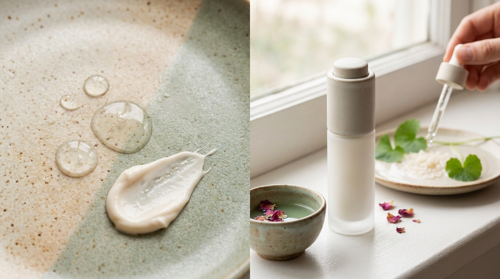
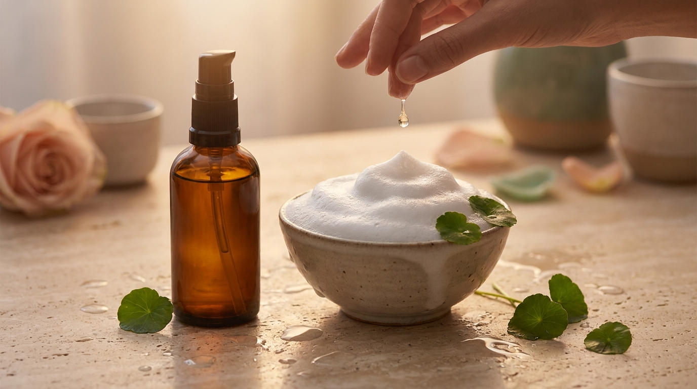

En Corea del Sur, la protección frente a la radiación ultravioleta no se considera un complemento ocasional para el verano: es la base indiscutible de todo el cuidado facial. En las calles de Seúl, el uso diario de protector solar es un hábito arraigado en personas de todas las edades a lo largo de los doce meses del año.

Sin embargo, para quienes tienen piel grasa o mixta en Latinoamérica y España, encontrar el producto adecuado suele ser una fuente constante de frustración. Muchas personas abandonan el protector solar tradicional porque deja una capa blanca visible (el temido *white cast*), satura los poros o genera brillos indeseados a las pocas horas de la aplicación. En la cosmética coreana (*K-Beauty*), los laboratorios han dedicado años de investigación a resolver este dilema formulando protectores solares ultraligeros con filtros de última generación.

En esta guía se analiza la ciencia detrás de los filtros, cómo interpretar el INCI (la lista oficial de ingredientes) y qué texturas se adaptan mejor a las necesidades de las pieles con tendencia a la secreción sebácea.

## Puntos clave

- Los filtros químicos modernos utilizados en Corea no dejan rastro blanco y permiten texturas acuosas o tipo gel que se absorben sin pesadez.
- Los filtros físicos o minerales (óxido de zinc y dióxido de titanio) ofrecen alta tolerancia en pieles reactivas, pero requieren fórmulas micronizadas para minimizar el efecto blanquecino.
- Para pieles grasas o mixtas, las presentaciones en *sun gel*, *sun essence* o fluidos matificantes son las más recomendadas según las tendencias del mercado coreano.
- La combinación de agentes seborreguladores (como la niacinamida o la sílice) ayuda a mantener un acabado satinado o semi-mate sin deshidratar la barrera cutánea.

---

## Filtros solares: físicos, químicos e híbridos

Para entender por qué algunos productos dejan el rostro blanquecino y otros son completamente transparentes, el primer paso es conocer el tipo de filtro utilizado en la formulación.

### Filtros físicos o minerales (inorgánicos)

Los protectores solares físicos emplean principalmente dos minerales autorizados a nivel global: el **óxido de zinc** (*Zinc Oxide*) y el **dióxido de titanio** (*Titanium Dioxide*). 

Estos compuestos actúan formando una barrera física sobre la superficie de la piel que refleja y dispersa la radiación UV. Su principal ventaja cosmética es su excelente tolerancia: no suelen irritar los ojos ni la piel muy sensibilizada, por lo que en Corea se recomiendan frecuentemente para pieles atópicas o después de tratamientos dermatológicos.

No obstante, su estructura mineral opaca es la causante directa del rastro blanco. Aunque las marcas coreanas han avanzado notablemente mediante la micronización de estas partículas minerales, en tonos de piel medios a oscuros sigue existiendo el riesgo de que la fórmula altere el tono natural o deje un acabado cenizo. Además, las fórmulas puramente minerales tienden a sentirse algo más densas al tacto.

### Filtros químicos (orgánicos) de nueva generación

Los filtros químicos absorben la radiación ultravioleta y la transforman en calor inocuo antes de que pueda penetrar en los tejidos cutáneos. En Europa y Asia, las agencias reguladoras han aprobado filtros solares orgánicos avanzados que aún no están disponibles en otros mercados como Estados Unidos.

Entre los filtros de alta tecnología más recurrentes en los laboratorios de Corea destacan:

- **Uvinul A Plus** (*Diethylamino Hydroxybenzoyl Hexyl Benzoate*): ofrece una protección muy estable frente a la radiación UVA.
- **Tinosorb S** (*Bis-Ethylhexyloxyphenol Methoxyphenyl Triazine*): filtro de amplio espectro (UVA y UVB) sumamente fotoestable.
- **Uvinul T 150** (*Ethylhexyl Triazone*): uno de los filtros UVB más eficientes del mercado actual.
- **Mexoryl SX y XL**: tecnologías fotoestables de amplio espectro.

La enorme ventaja de estos ingredientes es que son moléculas transparentes y liposolubles. No dejan residuo blanco, lo que permite crear emulsiones fluidas con una sensación similar a la de un sérum hidratante o una loción ligera de rápida absorción.

### Protectores solares híbridos

Combinan filtros minerales y orgánicos en una misma fórmula. El objetivo técnico de este enfoque en los laboratorios coreanos es sumar la estabilidad y suavidad de los minerales con la cosmética ligera e invisible de los filtros químicos. Si bien minimizan el rastro blanco respecto a un protector mineral puro, en pieles de tonos más oscuros aún puede percibirse una sutil tonalidad clara al aplicarse en la cantidad adecuada.

---

## Texturas ideales para piel grasa y mixta



<p class="img-cap">※ Imagen ilustrativa generada con IA</p>

Uno de los mayores logros del cuidado de la piel en Corea ha sido transformar la experiencia sensorial de aplicar protector solar. Para la piel grasa o mixta, la textura del producto determina si la persona continuará usándolo a diario o si abandonará el hábito.

```
Densidad y acabado cosmético habitual:

[Crema tradicional]  --> Mayor pesadez, acabado luminoso o graso
[Sun Essence]        --> Hidratación acuosa, acabado natural / glow suave
[Sun Gel / Fluido]   --> Absorción rápida, sin residuo, acabado satinado
```

### Sun Gel (Gel solar)
Las fórmulas en gel suelen tener una base acuosa enriquecida con polímeros ligeros. Al entrar en contacto con la piel, el producto rompe en una textura fluida similar al agua, facilitando una absorción inmediata sin dejar película oclusiva. Son formulaciones muy demandadas en Seúl durante los meses de verano, cuando la humedad ambiental es elevada y el exceso de sebo se intensifica.

### Sun Essence (Esencia solar)
Diseñada para cumplir una doble función: hidratar como un tratamiento diario y proteger con un factor elevado. Suelen incorporar ingredientes calmantes como el extracto de té verde o derivados botánicos. En pieles mixtas que presentan zonas deshidratadas junto a una zona T grasa, una esencia solar suele permitir omitir la crema hidratante matutina, aligerando los pasos de la rutina.

Para pieles que además presentan irritación frecuente o imperfecciones ocasionales, las fórmulas enriquecidas con [Centella Asiática (Cica) en K-Beauty: guía para calmar rojeces y leer su INCI](/blog/centella-asiatica-cica-beneficios-piel-sensible/) son de las más valoradas por su capacidad para confortar la piel sin añadir grasitud.

### Acabados mate y polvos de sílice (*Silica*)
Si la principal preocupación son los brillos a mediodía, conviene revisar si la fórmula incluye agentes absorbentes de sebo como la **sílice** (*Silica*), el talco cosmético o almidones modificados. Estos polímeros microscópicos absorben el exceso de lípidos a medida que la piel los produce, proporcionando un acabado que en Corea se conoce como *soft matte* o aterciopelado, muy alejado de la sensación reseca o acartonada de los polvos fijadores tradicionales.

---

## Tabla comparativa: tipos de protector solar según filtros y piel

| Tipo de fórmula | Filtros principales | Rastro blanco | Textura habitual | Recomendado para |
| :--- | :--- | :--- | :--- | :--- |
| **Químico / Orgánico** | Uvinul A Plus, Tinosorb S, Uvinul T 150 | Nulo (transparente) | Gel acuoso, loción fluida, esencia | Piel grasa, piel mixta, tonos oscuros |
| **Físico / Mineral** | Zinc Oxide, Titanium Dioxide | Moderado a alto (según tono) | Crema ligera, loción matificante | Piel muy sensible, reactiva o tras peelings |
| **Híbrido** | Mezcla de minerales y orgánicos | Mínimo a casi nulo | Crema fluida, emulsión | Piel mixta que busca balance y alta protección |
| **En barra (*Sun Stick*)** | Mayormente químicos o híbridos | Nulo o ligero | Bálsamo sólido con acabado polvo | Reaplicación rápida en exteriores |

---

## Cómo leer las etiquetas del protector solar coreano

Al explorar catálogos de cosmética coreana, es común encontrar ciertas siglas y certificaciones en los envases. Conocer su significado técnico ayuda a tomar una decisión informada.

### SPF y el sistema PA

- **SPF (Sun Protection Factor)**: mide la protección frente a los rayos UVB, responsables de las quemaduras solares y el daño directo en el ADN celular. En Corea, la designación oficial máxima en etiquetado para productos de uso diario suele ser **SPF50+**, lo que certifica un factor igual o superior a 50 en las pruebas de laboratorio bajo la regulación del Ministerio de Seguridad de Alimentos y Medicamentos de Corea (MFDS).
- **PA (Protection Grade of UVA)**: es el sistema de origen japonés y adoptado en Corea para cuantificar la defensa contra los rayos UVA, que penetran más profundamente y aceleran el envejecimiento prematuro de la piel. El nivel se clasifica de uno a cuatro signos positivos: **PA++++** es el estándar más alto disponible, indicando un factor de protección UVA (PPD) superior a 16.

Muchas de las fórmulas que lideran habitualmente las listas de ventas, como se puede observar al analizar [los productos de skincare más vendidos en Olive Young Corea y por qué triunfan en Seúl](/blog/olive-young-mas-vendidos-corea-2026/), cuentan invariablemente con la doble certificación SPF50+ y PA++++.

### Ingredientes clave para buscar en pieles mixtas o grasas

Al revisar la lista INCI de un protector solar coreano, vale la pena identificar ingredientes funcionales que aporten beneficios adicionales:

1. **Niacinamida**: contribuye a regular la síntesis de sebo, calma el enrojecimiento y favorece un tono uniforme.
2. **Adenosina**: ingrediente funcional aprobado en Corea para apoyar la elasticidad cutánea.
3. **Pantenol y Ácido Hialurónico en bajo peso molecular**: hidratan las capas superficiales sin aportar aceites comedogénicos.
4. **Extractos botánicos astringentes**: como el extracto de corteza de sauce blanco (*Salix Alba*) o el árbol de té (*Melaleuca Alternifolia*), que ayudan a mantener los poros despejados.

> **Pauta de aplicación recomendada:**  
> Para alcanzar el nivel real de protección indicado en el envase (SPF50+ PA++++), los laboratorios calculan una dosis de 2 mg por centímetro cuadrado de piel. En la práctica cotidiana, esto equivale aproximadamente a la regla de los **dos dedos de producto** (dos líneas continuas extendidas a lo largo de los dedos índice y corazón) para cubrir rostro y cuello.  
> En pieles grasas o en climas cálidos y húmedos, una técnica recomendada por dermatólogos y cosmetólogos es aplicar una primera capa fina, esperar de 30 a 60 segundos a que asiente, y extender después el resto. Esto garantiza una fijación uniforme sin sobrecargar la piel.

---

## La importancia de la limpieza al final del día



<p class="img-cap">※ Imagen ilustrativa generada con IA</p>

Un error frecuente entre personas con piel grasa es atribuir la aparición de imperfecciones o poros obstruidos al protector solar en sí, cuando con frecuencia el inconveniente se debe a una retirada incompleta al terminar la jornada.

Los filtros modernos y los polímeros fijadores están diseñados para resistir el sudor, la fricción y el sebo natural. Un limpiador acuoso suave en gel o espuma a menudo no disuelve estas sustancias por completo. Para retirar todo residuo sin alterar la barrera cutánea, es habitual recurrir a la [guía de la doble limpieza coreana: aceite vs. bálsamo según tu piel](/blog/doble-limpieza-coreana-aceite-vs-balsamo/), donde un primer paso en base oleosa descompone los filtros antes de la limpieza acuosa habitual.

---

## Preguntas frecuentes (FAQ)

### ¿Los protectores solares químicos coreanos causan ardor en los ojos?
La tolerancia ocular depende de la sensibilidad individual y de los filtros específicos. Los filtros químicos tradicionales de generaciones anteriores (como la oxibenzona o el octocrileno) tenían mayor probabilidad de migrar e irritar los ojos con el sudor. Las formulaciones coreanas modernas utilizan ampliamente filtros como Tinosorb S y Uvinul A Plus, cuyas moléculas de mayor tamaño reducen sensiblemente el potencial de ardor ocular, aunque se recomienda tener precaución en el área inmediata del contorno de ojos si se tiene extrema sensibilidad.

### Si tengo piel grasa, ¿puedo usar el protector solar en lugar de mi crema hidratante?
Sí. En la cosmética coreana, la mayoría de los protectores solares con textura *sun essence* o *sun gel* incluyen bases humectantes ricas en ácido hialurónico, glicerina y extractos botánicos. En pieles grasas o mixtas, prescindir de la crema matutina y aplicar directamente el protector solar sobre un tónico o sérum ligero es una práctica habitual para evitar la sobrecarga de producto y controlar el exceso de brillo durante el día.

### ¿Cómo retocar el protector solar sobre el maquillaje sin que aparezcan brillos?
Para reaplicar a lo largo del día sin alterar el maquillaje ni generar pesadez, en Corea se emplean principalmente dos formatos: los protectores solares en barra (*sun sticks*) con acabado aterciopelado, que se deslizan con suaves toques, o los formatos *cushion* solares transparentes. Si la piel ya presenta brillos por el sebo natural acumulado, es conveniente retirar el exceso presionando suavemente un papel absorbente antes de la reaplicación.

### ¿Un protector solar etiquetado como "para todo tipo de piel" funcionará en piel mixta?
Suele ofrecer buen rendimiento si la fórmula tiene base química y textura fluida. No obstante, las pieles con una zona T marcada o propensas a la obstrucción de poros obtienen mejores resultados buscando términos específicos en las fichas del producto, como *sebum control*, *oil-free*, *matte finish* o *pore-blurring*, los cuales indican la presencia de polímeros o activos reguladores del brillo.