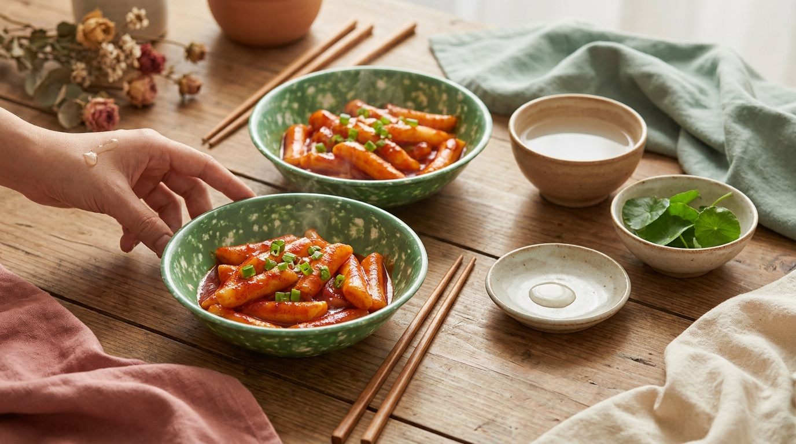
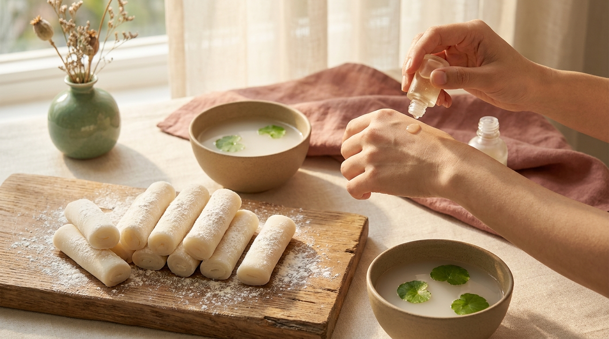

En las series coreanas, es habitual encontrar una escena nocturna recurrente: cae una lluvia suave sobre la ciudad, las luces de neón se reflejan en el asfalto y los protagonistas se refugian bajo una gran carpa de lona naranja o roja. Sentados en bancos de plástico, piden una botella verde y comparten platos humeantes mientras conversan sobre sus problemas, se enamoran o superan una intensa jornada laboral.

Ese espacio tan icónico es el *pojangmacha* (포장마차), el epicentro de la comida callejera nocturna en Corea del Sur. A menudo surge la duda de si resulta factible recrear esos sabores en casa sin disponer de un supermercado asiático a la vuelta de la esquina. En la práctica, es totalmente posible. En esta guía se explica qué hace tan singular a esta cultura gastronómica y cómo preparar cuatro de sus recetas más representativas con ingredientes accesibles o fáciles de sustituir.

## Puntos clave

- El *pojangmacha* no es solo un puesto de comida rápida; en la cultura coreana representa un refugio emocional y el espacio por excelencia para los *anju* (platillos para compartir).
- Se pueden preparar las cuatro recetas insignia (tteokbokki, pajeon crujiente, brochetas de eomuk y pollo glaseado) adaptando el nivel de picante al gusto personal.
- La clave del auténtico perfil callejero de Seúl radica en tres elementos de despensa: pasta de chile fermentada (*gochujang*), copos de chile (*gochugaru*) y un buen caldo base reconfortante.
- No se requieren sartenes profesionales ni técnicas complejas; estas recetas fueron diseñadas para cocinarse con rapidez en espacios reducidos y fuegos sencillos.

---

## Qué es un pojangmacha y por qué fascina en las series coreanas

El término *pojangmacha* significa literalmente «carreta cubierta con lona». Tradicionalmente eran pequeños carros móviles protegidos del viento y la nieve con lonas impermeables, donde vendedores ambulantes servían comida caliente y bebidas alcohólicas a precios populares al caer la noche. Aunque en la actualidad conviven con locales modernos bajo techo conocidos como *silnae pojangmacha*, la esencia sigue intacta: disfrutar de comida reconfortante sin formalismos.

En la narrativa de las producciones televisivas coreanas, este espacio cumple una función muy concreta. En la sociedad surcoreana, la vida laboral suele ser intensa y altamente jerárquica. La carpa roja actúa como un espacio neutral donde las barreras sociales se desdibujan. Para profundizar en el significado de estos rituales sociales, es recomendable consultar nuestro análisis sobre [10 costumbres de los K-Dramas explicadas desde Seúl](/blog/costumbres-curiosas-kdramas-explicadas-por-coreano/).

Los platillos que se sirven en estos puestos se denominan *anju* (안주), término coreano para la comida concebida específicamente para acompañar bebidas como el soju o el makgeolli (vino de arroz turbio). Son platos con sabores muy definidos: intensamente salados, ligeramente dulces o marcadamente picantes, idóneos para mitigar las bajas temperaturas del otoño y el invierno.

---

## 4 recetas callejeras de pojangmacha para preparar en tu cocina



<p class="img-cap">※ Imagen ilustrativa generada con IA</p>

A continuación, se detalla el paso a paso de las cuatro preparaciones que nunca faltan en el menú de un puesto tradicional en Seúl.

### 1. Tteokbokki clásico: pastelillos de arroz en salsa agridulce y picante

El tteokbokki (떡볶이) es la preparación estrella de la comida callejera coreana. Consiste en barras cilíndricas de arroz de textura elástica y masticable (*tteok*) cocinadas a fuego lento en una salsa espesa de color rojo brillante.

```
Ingredientes principales (2 porciones):
- 300 g de tteok (cilindros de arroz coreanos; si están congelados o secos, remojar 15 minutos en agua tibia)
- 1 lámina de eomuk (pastel de pescado coreano) cortada en triángulos
- 2 tazas de agua o caldo ligero (idealmente con alga kelp/dashima)
- 2 cucharadas de gochujang (pasta de chile coreano)
- 1 cucharada de gochugaru (chile coreano en polvo; ajustar según tolerancia)
- 1 cucharada de salsa de soja tradicional
- 1,5 cucharadas de azúcar o jarabe de maíz
- 1 tallo de cebollín o cebolleta verde cortado en tiras
- 1 cucharadita de semillas de sésamo tostadas
```

#### Preparación paso a paso:
1. En una sartén amplia o cazuela poco profunda, vierte las 2 tazas de agua o caldo a fuego medio.
2. Añade el gochujang, el gochugaru, la salsa de soja y el azúcar. Remueve bien con una espátula de madera hasta que la pasta se disuelva por completo y el líquido comience a hervir.
3. Agrega los cilindros de arroz (*tteok*) escurridos y los triángulos de pastel de pescado.
4. Reduce a fuego medio-bajo y deja hervir suavemente durante 8 a 10 minutos, removiendo ocasionalmente para evitar que el arroz se adhiera al fondo.
5. El propio almidón de los pastelillos espesará la salsa. Cuando adquiera una consistencia sedosa y brillante, incorpora el cebollín picado y retira del fuego tras un minuto.
6. Sirve de inmediato decorando con semillas de sésamo tostadas por encima.

---

### 2. Haemul Pajeon: panqueque coreano crujiente con cebollín y mariscos

El chisporroteo del pajeon (파전) dorándose en una plancha caliente suele asociarse en la cultura culinaria coreana con las tardes lluviosas. La combinación de cebollino fresco con mariscos y un rebozado crujiente lo convierte en una opción idónea para compartir.

```
Ingredientes para el panqueque:
- 1 taza de harina de trigo común
- 2 cucharadas de fécula de maíz (maicena) o harina de arroz (para aportar crujiente)
- 1 taza de agua helada (el contraste térmico es determinante para la textura)
- 1 pizca de sal y una pizca de ajo en polvo
- 1 manojo generoso de cebollín o cebolletas enteras, lavadas y cortadas al largo de la sartén
- 150 g de mariscos mixtos limpios (calamares en aros, gambas o camarones pelados)
- 1 huevo ligeramente batido
- Aceite vegetal suficiente para freír

Ingredientes para la salsa de acompañamiento (Choganjang):
- 2 cucharadas de salsa de soja
- 1 cucharada de vinagre blanco o de manzana
- 1 cucharadita de agua
- 1/2 cucharadita de semillas de sésamo tostadas y una pizca de chile picado
```

#### Preparación paso a paso:
1. En un cuenco, mezcla la harina, la fécula de maíz, la sal, el ajo en polvo y el agua helada. Remueve con un tenedor solo hasta integrar; conviene no batir en exceso para no desarrollar gluten.
2. Calienta 2 a 3 cucharadas de aceite en una sartén antiadherente amplia a fuego medio-alto.
3. Coloca una capa paralela de tallos de cebollín directamente sobre la superficie caliente.
4. Vierte la mitad de la masa líquida sobre los cebollines para unirlos. Encima distribuye los mariscos troceados.
5. Vierte el resto de la masa y corona extendiendo el huevo batido por la superficie.
6. Cocina durante 4 a 5 minutos hasta que la base esté firme y dorada. Con la ayuda de una tapa o espátula grande, voltea el panqueque con cuidado.
7. Añade un chorrito extra de aceite por los bordes para garantizar que la segunda cara quede crujiente (unos 3 a 4 minutos adicionales).
8. Corta en porciones cuadradas y sirve junto con la salsa *choganjang*.

---

### 3. Eomuk-tang: brochetas de pastel de pescado en caldo caliente reconfortante

Durante el invierno en Corea, una de las costumbres más arraigadas al acudir a un puesto callejero consiste en tomar un vaso del caldo humeante donde se cuecen las brochetas de eomuk (어묵탕). En los puestos es habitual ofrecer este caldo reconfortante como cortesía a los comensales.

```
Ingredientes principales (2 porciones):
- 4 a 6 láminas de eomuk (pastel de pescado rectangular)
- Brochetas de madera largas
- 4 tazas de agua
- 1 trozo de rábano blanco (daikon) de unos 5 cm cortado en rodajas finas
- 1 lámina pequeña de alga kelp seca (dashima / kombu)
- 1 cucharada de salsa de soja clara (guk-ganjang) o salsa de soja tradicional
- 1 diente de ajo machacado
- 1 tallo de cebollín picado
- Sal y pimienta negra al gusto
```

#### Preparación paso a paso:
1. Para montar las brochetas: pliega cada lámina de pastel de pescado en zigzag (a modo de acordeón) y atraviésala con una brocheta de madera asegurando que quede firme.
2. En una olla mediana, vierte el agua, las rodajas de rábano y el alga kelp. Lleva a ebullición a fuego medio.
3. Al romper el hervor, retira el alga kelp (para evitar que transmita notas amargas o textura viscosa) y añade el ajo machacado y la salsa de soja. Mantén a fuego bajo durante 10 minutos hasta que el rábano quede tierno y translúcido.
4. Introduce las brochetas de eomuk en el caldo y cocina a fuego suave durante 5 a 7 minutos. Las láminas aumentarán ligeramente de volumen al absorber el fondo.
5. Ajusta el punto de sal y pimienta. Agrega el cebollín picado al final y sirve las brochetas directamente en cuencos hondos con abundante caldo caliente.

---

### 4. Pollo frito agridulce estilo callejero (Dakgangjeong rápido)

A diferencia del pollo frito de restaurante, el dakgangjeong (닭강정) de mercado callejero suele servirse en vasos de cartón para degustar al paso, bañado en un glaseado brillante de salsa de soja, ajo y azúcar moreno formulado para mantenerse crujiente.

```
Ingredientes para el pollo:
- 350 g de pechuga o muslo de pollo deshuesado, cortado en cubos de bocado (2-3 cm)
- 1 cucharada de vino blanco de cocina o mirin
- Sal y pimienta negra al gusto
- 1/2 taza de fécula de patata o maicena (para el rebozado)
- Aceite abundante para freír

Ingredientes para el glaseado:
- 2 cucharadas de salsa de soja
- 2 cucharadas de miel o jarabe de maíz
- 1 cucharada de azúcar moreno
- 1 cucharada de kétchup o concentrado de tomate (aporta acidez y brillo)
- 1 diente de ajo picado finamente
- 1/2 cucharadita de jengibre rallado
- Cacahuetes (maní) tostados y picados para decorar
```

#### Preparación paso a paso:
1. Sazona los trozos de pollo con el vino de cocina, sal y pimienta. Deja reposar durante 10 minutos.
2. Pasa los cubos de pollo por la fécula de patata o maicena, sacudiendo el exceso para obtener una capa delgada y uniforme.
3. Calienta el aceite a 170-180 °C en una sartén honda. Fríe el pollo durante 4 a 5 minutos hasta que flote y muestre un tono dorado muy pálido. Escurre sobre papel absorbente.
4. Para conseguir el crujiente coreano característico, aplica la técnica de la **doble fritura**: vuelve a sumergir el pollo en el aceite bien caliente durante solo 1 o 2 minutos adicionales hasta lograr un acabado dorado y crocante. Reserva.
5. En una sartén amplia, mezcla todos los ingredientes del glaseado a fuego medio-bajo. Deja que rompa a hervir durante 1 minuto hasta que tome cuerpo.
6. Apaga el fuego, incorpora inmediatamente el pollo frito y remueve con rapidez para que cada trozo quede barnizado uniformemente sin reblandecer la corteza.
7. Decora con el cacahuete picado y sirve caliente.

---

## Comparativa de las 4 recetas callejeras

Para planificar el menú según los tiempos y los ingredientes disponibles en la despensa, la siguiente tabla resume los aspectos clave de cada plato:

| Plato callejero | Dificultad | Nivel de picante | Tiempo total | Ingrediente clave | Momento típico de K-Drama |
| :--- | :--- | :--- | :--- | :--- | :--- |
| **Tteokbokki** | Fácil | Medio / Alto | 20 minutos | Pastelillos de arroz (*tteok*) y *gochujang* | Merienda estudiantil o confesiones nocturnas entre amigos |
| **Haemul Pajeon** | Media | Nulo (salvo la salsa) | 25 minutos | Cebolleta fresca y fécula de maíz | Cenas en días lluviosos acompañadas de vino de arroz (*makgeolli*) |
| **Eomuk-tang** | Muy fácil | Nulo | 20 minutos | Láminas de pescado (*eomuk*) y rábano | Salida del trabajo con abrigo largo en pleno invierno |
| **Dakgangjeong** | Media | Muy bajo (dulce/salado) | 30 minutos | Fécula de patata y doble fritura | Encuentros casuales de fin de semana o citas informales |

---

## Cómo adaptar los ingredientes coreanos fuera de Asia



<p class="img-cap">※ Imagen ilustrativa generada con IA</p>

La falta de algún ingrediente importado no impide elaborar estas recetas. Es muy común adaptar las fórmulas según los productos al alcance:

- **Sustituto para los pastelillos de arroz (*tteok*):** El *garaetteok* tradicional se elabora con harina de arroz común (no glutinoso) de grano corto (*mepssalgaru*). Si no se dispone del producto comercial, es posible preparar una versión casera rápida mezclando harina de arroz común (no glutinoso) de grano corto con agua tibia y una pizca de sal, cociéndola al vapor durante 15 a 20 minutos y amasándola en caliente con un poco de aceite de sésamo antes de cortar los cilindros. Es fundamental **evitar la harina de arroz glutinoso (*chapssalgaru*)**: esta produce una textura excesivamente chiclosa y pegajosa (similar a un mochi o *injeolmi*) que se derrite y se desintegra por completo al hervir dentro de la salsa del tteokbokki. Si se busca una opción rápida, también es habitual recurrir a [5 combinaciones de ramen coreano viral que puedes preparar en casa](/blog/recetas-ramen-coreano-tiendas-conveniencia-en-casa/).
- **Sustituto para el pastel de pescado (*eomuk*):** Si no se hallan láminas de pescado coreanas, se pueden emplear buñuelos o albóndigas de pescado asiáticas cortadas en trozos, surimi japonés (*kamaboko*) o tiras de tofu prensado frito para una alternativa vegetariana.
- **Caldo base exprés:** El fondo clásico de pojangmacha se realiza con anchoas secas (*myeolchi*) y alga kombu (*dashima*). En su defecto, un caldo claro de verduras con un chorrito de salsa de soja suave y un toque de cebolla en polvo cumple la misma función gustativa.

> **Consejo práctico:** Para emular con fidelidad el ambiente de los puestos coreanos, suele utilizarse vajilla de melamina verde con motas blancas (el diseño clásico de la comida callejera en Seúl) o cuencos metálicos sencillos. Para quienes disfrutan de estas experiencias temáticas, puede consultarse la guía sobre cómo organizar una [noche de K-Drama en casa con snacks y mascarilla nocturna](/blog/como-organizar-maraton-kdrama-en-casa-snacks/).

---

## Preguntas frecuentes (FAQ)

### ¿Dónde se pueden adquirir los ingredientes coreanos fuera de Corea?
En la mayoría de las capitales y ciudades principales existen supermercados de alimentación asiática que disponen de *gochujang*, *gochugaru* y paquetes de *tteok* en su sección de congelados o refrigerados. Asimismo, existen tiendas especializadas en línea con envíos a España y diversos países de Latinoamérica (como México, Colombia, Chile o Argentina) que distribuyen salsas, pastas fermentadas y alimentos deshidratados.

### ¿Se puede preparar tteokbokki sin picante?
Sí. En la tradición culinaria coreana existe una variante histórica previa a la popularización del chile: el *Gungjung Tteokbokki* (tteokbokki de la corte real). Consiste en saltear los cilindros de arroz con carne picada o fileteada de ternera, verduras (como setas shiitake, zanahoria y cebolla) y una salsa a base de salsa de soja, aceite de sésamo, ajo y azúcar. Posee un sabor dulce y salado, apto para personas sensibles al picante o niños.

### ¿Cuál es la clave para que el pajeon quede crujiente?
Las reseñas y recomendaciones de cocineros coreanos coinciden en tres factores técnicos: utilizar agua casi helada al mezclar la masa, no batir en exceso (los pequeños grumos de harina favorecen la textura aireada) y asegurar una temperatura media-alta con abundante aceite en la sartén para lograr un fritura perimetral rápida y dorada.

### ¿Es recomendable congelar las preparaciones sobrantes?
El caldo del *eomuk-tang* tolera bien la congelación durante un par de meses (retirando previamente el cebollín fresco). Por el contrario, el *tteokbokki* y el *pajeon* deben consumirse recién hechos; al refrigerar o congelar los pastelillos de arroz ya cocidos, el almidón se retrograda, endureciendo su textura y perdiendo la elasticidad gomosa (*chewy*) tan valorada en el plato. Si quedan sobras de tteokbokki, lo más efectivo es recalentarlas en sartén con un chorrito de agua adicional para devolver la fluidez a la salsa.