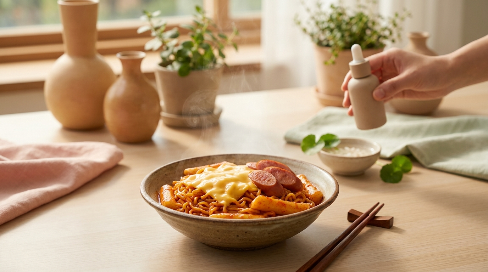

Quienes siguen K-Dramas o contenidos de creadores surcoreanos habrán notado una escena recurrente: personas sentadas frente a los ventanales de una tienda de conveniencia (como CU, GS25 o 7-Eleven) a altas horas de la noche, mezclando fideos instantáneos con diversos ingredientes listos para consumir.

En Corea del Sur, este fenómeno se conoce como *pyeon-ui-jeom kkul-johap* (편의점 꿀조합), que se traduce literalmente como «combinaciones de miel de las tiendas de conveniencia». Consiste en crear platos completos y sabrosos fusionando productos económicos y accesibles. Para recrear esta experiencia y disfrutar de los sabores característicos de Seúl en casa, a continuación se presentan cinco de las recetas más populares y representativas, detallando sus ingredientes y preparación paso a paso.

## Puntos clave

- **Fusión de texturas:** La clave de las recetas de tienda de conveniencia radica en contrastar el masticado elástico del ramen con elementos cremosos (queso, leche) o suaves (pasteles de arroz, salchichas).
- **Control del picante:** Las combinaciones virales suelen incorporar lácteos para suavizar el fuego característico de marcas como Buldak o Shin Ramyun, haciéndolas accesibles para paladares menos habituados al picante intenso.
- **Preparación rápida:** Ninguna de estas recetas toma más de diez minutos, utilizando utensilios básicos de cocina o microondas.
- **Ingredientes fáciles de sustituir:** Aunque se basan en marcas específicas de fideos coreanos, existen alternativas comunes en supermercados asiáticos locales o tiendas online internacionales.

---

## La cultura del ramen en las tiendas de conveniencia de Seúl

Las tiendas de conveniencia en Corea del Sur son centros comunitarios abiertos las 24 horas. Cuentan con dispensadores de agua hirviendo, microondas de alta potencia y mesas comunitarias. Los estudiantes y oficinistas las utilizan habitualmente para cenar rápido o disfrutar de un aperitivo nocturno (*yasik*).

El ramen instantáneo (*ramyeon*, 라면) no se consume casi nunca solo. Los consumidores coreanos acostumbran personalizarlo agregando queso en tiras (*string cheese*), embutidos, pasteles de arroz (*tteokbokki*) y huevos cocidos. A continuación, se detallan las cinco mezclas que han conquistado las redes sociales surcoreanas.

---

## 1. Mark Jeongsik: El rey de las combinaciones virales

※ Imagen ilustrativa generada con IA

Esta receta nació en internet cuando una seguidora del grupo de K-Pop GOT7 decidió bautizar su creación con el nombre del cantante Mark para aumentar las búsquedas de su artista favorito. La fórmula fue tan exitosa que se convirtió en un estándar de los menús no oficiales de las tiendas de conveniencia en Seúl.

### Ingredientes necesarios
- 1 taza de ramen instantáneo ligeramente picante o agridulce (el tradicional usa fideos estilo spaghetti coreano o ramen Buldak).
- 1 taza de *tteokbokki* instantáneo comercial (pastel de arroz en salsa roja).
- 1 salchicha pequeña cocida (tipo frankfurt o salchicha de pollo).
- 1 o 2 barritas de queso mozzarella en hebras (*string cheese*).

### Preparación paso a paso
1. Prepara el *tteokbokki* instantáneo según las instrucciones del envase, reduciendo el agua sugerida en un 10% para que la salsa quede espesa. Llévalo al microondas.
2. En paralelo, hidrata los fideos de ramen con agua hirviendo durante 3 minutos, cuela casi toda el agua y mézclalos con su sobre de condimento.
3. Vierte los fideos cocidos directamente dentro del recipiente del *tteokbokki* caliente e integra ambas salsas.
4. Corta la salchicha en rodajas delgadas y colócala encima.
5. Deshebra el queso mozzarella cubriendo toda la superficie.
6. Calienta en el microondas durante 40 a 60 segundos hasta que el queso se derrita por completo. Mezcla bien antes de comer para que cada bocado tenga fideos elásticos y queso fundido.

---

## 2. Chapaguri (Ram-don): El clásico del cine coreano

Popularizado a nivel mundial por la película *Parásitos* (2019), el *Chapaguri* ya era una leyenda en los hogares coreanos desde hacía más de una década. Combina dos marcas emblemáticas de la empresa Nongshim: Chapagetti (fideos con salsa de frijol negro dulce y salada, *chajang*) y Neoguri (fideos gruesos de marisco picante con algas).

### Ingredientes necesarios
- 1 paquete de Chapagetti.
- 1 paquete de Neoguri.
- Opcional (estilo película): 150 gramos de carne de res (lomo o solomillo) cortada en cubos, salpimentada y sellada en sartén con una gota de aceite.

### Preparación paso a paso
1. Pon a hervir 800 ml de agua en una olla mediana.
2. Agrega los fideos de ambos paquetes junto con los copos de vegetales deshidratados (incluyendo el alga *kombu* de Neoguri).
3. Cocina a fuego medio durante 4 minutos, removiendo ocasionalmente para separar las hebras.
4. Retira la olla del fuego y escurre el agua, reservando aproximadamente 6 a 8 cucharadas de líquido de cocción.
5. Vuelve a colocar la olla a fuego bajo. Añade todo el sobre de condimento de Chapagetti, el aceite aromático que incluye, y entre la mitad y dos tercios del sobre de condimento de Neoguri (si agregas el sobre completo, el sabor salado y picante puede opacar la salsa de frijol negro).
6. Incorpora el agua reservada y saltea vigorosamente durante 1 minuto hasta que la salsa cubra los fideos de manera uniforme y brillante. Sirve con la carne sellada por encima.

---

## 3. Shin Ramyun Toomba: La versión cremosa estilo pasta

Inspirada en la famosa pasta "Toowoomba" muy popular en cadenas de restaurantes occidentales en Seúl, esta receta transforma el tradicional y picante Shin Ramyun en un plato de textura cremosa que recuerda a una salsa Alfredo especiada.

### Ingredientes necesarios
- 1 paquete de Shin Ramyun tradicional.
- 200 ml de leche entera (o leche evaporada / bebida de soja sin azúcar).
- 1 diente de ajo picado finamente.
- 1 cucharada de mantequilla o aceite de cocina.
- 1 loncha de queso tipo cheddar o americano.
- Opcional: tiras de panceta o tocino salteado.

### Preparación paso a paso
1. Hierve únicamente los fideos de Shin Ramyun en agua durante solo 2 minutos y medio (deben quedar al dente). Escúrrelos y reserva.
2. En una sartén a fuego medio, derrite la mantequilla y sofríe el ajo picado (y el tocino si decides usarlo) hasta que esté fragante, sin dejar que se dore en exceso.
3. Vierte la leche en la sartén y caliéntala a fuego medio-bajo sin que llegue a hervir con fuerza.
4. Añade medio sobre del polvo picante de Shin Ramyun y los copos de vegetales. Remueve con una espátula hasta que el polvo se disuelva por completo en la leche, adquiriendo un tono rosado cremoso.
5. Agrega los fideos precocidos y coloca la loncha de queso sobre ellos.
6. Cocina durante 1 o 2 minutos mientras mezclas continuamente. El almidón del ramen y la grasa del queso espesarán la salsa rápidamente, logrando una consistencia untuosa.

---

## 4. Buldak Carbonara Deluxe: El truco para suavizar el picante extremo

La serie Buldak (fideos de pollo picante) es célebre por su nivel de pungencia. Aunque la versión comercial "Buldak Carbonara" (paquete rosa) ya es más suave que la original, en las reseñas y tutoriales de cocina en Corea es habitual recomendar un método especial para intensificar la cremosidad y suavizar el impacto del picante.

### Ingredientes necesarios
- 1 paquete de Buldak Carbonara (o Buldak original si prefieres más picante).
- 50 ml de leche entera o crema ligera de cocina.
- 1 yema de huevo fresco.
- 2 cucharadas de queso parmesano rallado o mozzarella.
- Cebollino picado para decorar.

### Preparación paso a paso
1. Cocina los fideos en agua hirviendo durante 4 minutos.
2. Cuela los fideos dejando solo unas 3 cucharadas de agua en el fondo.
3. Baja el fuego al mínimo y añade la leche, el sobre de salsa picante líquida y el sobre de polvo sabor carbonara que viene en el paquete.
4. Mezcla durante 30 segundos hasta que la salsa burbujee suavemente.
5. Apaga el fuego por completo. Agrega la yema de huevo inmediatamente en el centro y remueve con energía; el calor residual cocinará la yema sin cortarla, aportando una textura aterciopelada idéntica a la auténtica pasta carbonara.
6. Corona con el queso y el cebollino picado antes de servir.

---

## 5. Sari Gomtang Mandu: Reconfortante y sin picante

No todo el ramen coreano tiene que ser rojo y picante. El *Sari Gomtang* se basa en el caldo tradicional de huesos de ternera (*seolleongtang* o *gomtang*), caracterizado por un color blanco lechoso, sabor profundo y reconfortante. En Corea suele ser la opción predilecta para los días fríos o cuando se busca un plato digestivo y suave.

### Ingredientes necesarios
- 1 paquete de Sari Gomtang ramyun.
- 3 a 4 empanadillas coreanas congeladas (*mandu* o gyozas).
- 1 huevo crudo.
- 1 cucharadita de aceite de sésamo tostado.
- Abundante cebolleta o cebollín verde cortado en rodajas finas.
- Pizca de pimienta negra molida.

### Preparación paso a paso
1. Pon a calentar 550 ml de agua en una olla. Añade el polvo de caldo de Sari Gomtang desde el inicio para que el agua tome sabor.
2. Cuando rompa el hervor, coloca las empanadillas congeladas (*mandu*) directamente en el caldo. Cocina durante 2 minutos.
3. Incorpora los fideos finos del ramen y cocina durante otros 3 minutos.
4. Rompe el huevo sobre la sopa. Si prefieres un caldo transparente con trozos de clara, déjalo caer sin batir; si buscas un caldo más espeso y suave, bátelo ligeramente en círculos durante los últimos 30 segundos.
5. Apaga el fuego, rocía la cucharadita de aceite de sésamo tostado, añade una pizca generosa de pimienta negra y cubre con el cebollín fresco.

---

## Comparativa de combinaciones virales de ramen coreano

| Receta | Fideos base | Nivel de picante | Perfil de sabor principal | Tiempo estimado |
| :--- | :--- | :--- | :--- | :--- |
| **Mark Jeongsik** | Ramen picante o Spaghetti | Medio-Alto | Agridulce, especiado, muy quesoso | 7 minutos |
| **Chapaguri** | Chapagetti + Neoguri | Medio-Bajo | Umami profundo, frijol negro y marisco | 8 minutos |
| **Shin Toomba** | Shin Ramyun | Medio-Bajo | Cremoso lácteo, ajo y especias | 6 minutos |
| **Buldak Carbonara Deluxe** | Buldak Rosa | Medio-Alto | Dulce, cremoso, picante residual | 6 minutos |
| **Sari Gomtang Mandu** | Sari Gomtang | Nulo | Caldo de carne casero, suave, herbal | 7 minutos |

---

> **Consejo práctico:**  
> Según la formulación oficial de la mayoría de marcas, el ramen instantáneo coreano suele tener un contenido de sodio elevado (entre 1.200 mg y 1.800 mg por porción). Al preparar combinaciones donde se mezclan dos paquetes (como el Chapaguri) o donde se añaden lácteos y queso, es habitual recomendar el uso de entre el 50% y el 70% del sobre de condimento en polvo. De este modo, el plato conserva su sabor característico sin sobrecargar de sal la preparación.

---

## Cómo conseguir los ingredientes desde casa

※ Imagen ilustrativa generada con IA

La mayoría de los fideos mencionados cuentan con amplia distribución internacional:

1. **Supermercados asiáticos locales:** Tiendas especializadas en productos de Corea, China o Japón suelen contar con pasillos enteros dedicados al ramen coreano de marcas como Nongshim, Samyang y Paldo.
2. **Plataformas de comercio electrónico:** Sitios como Amazon, Mercado Libre o tiendas web de importación asiática ofrecen paquetes combinados (*multi-packs*) que facilitan adquirir variedades difíciles de encontrar en supermercados convencionales.
3. **Sustituciones sencillas:** Si no consigues *tteokbokki* comercial para el Mark Jeongsik, puedes usar salchichas adicionales o pasta corta cocida; si no encuentras Sari Gomtang, un ramen de caldo de pollo o cerdo blanco sin picante con unas gotas de aceite de sésamo funcionará como una alternativa adecuada.

---

## Preguntas frecuentes (FAQ)

### ¿Cuál es la diferencia entre el ramen coreano (ramyeon) y el ramen japonés?
El término japonés *ramen* suele asociarse a platos elaborados con fideos frescos y caldos artesanales cocinados durante horas, mientras que en Corea, la palabra *ramyeon* se refiere casi exclusivamente a los fideos instantáneos deshidratados o fritos. Los fideos coreanos son generalmente más gruesos, elásticos y resistentes a la cocción prolongada, diseñados para absorber caldos densos y salsas picantes.

### ¿Se pueden adaptar estas recetas para dietas vegetarianas?
Sí, aunque requiere revisar con atención el listado de ingredientes. Variedades clásicas como Shin Ramyun suelen contener extractos de carne o hueso en su base de sopa, pero la marca comercializa versiones certificadas veganas (como Shin Green o Soon Veggie Ramyun). Puedes aplicar las técnicas de preparación (como la salsa Toomba con leche o el agregado de queso y huevo) utilizando estas bases vegetales.

### ¿Por qué los coreanos comen el ramen usando la tapa de la olla?
En muchos K-Dramas se observa a los personajes doblando la tapa de papel del ramen en forma de cono o usando la tapa metálica de la olla tradicional dorada de aluminio (*yang-eun naembi*) a modo de plato. En Corea esto se hace por practicidad: ayuda a enfriar los fideos calientes antes de llevarlos a la boca y evita ensuciar vajilla adicional.

### ¿Qué acompañamiento tradicional no puede faltar con estas recetas?
El acompañamiento universal e indispensable es el *kimchi* bien fermentado, especialmente el elaborado a base de col china (*baechu kimchi*) o de rábano (*kkakdugi*), así como el rábano encurtido amarillo (*danmuji*). La acidez crujiente de estos complementos equilibra el paladar frente a la grasa del queso y la intensidad del caldo.