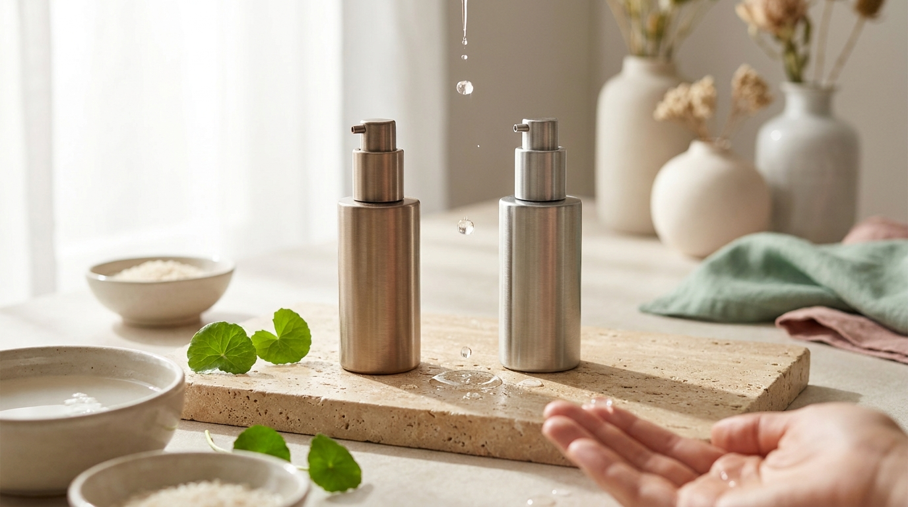
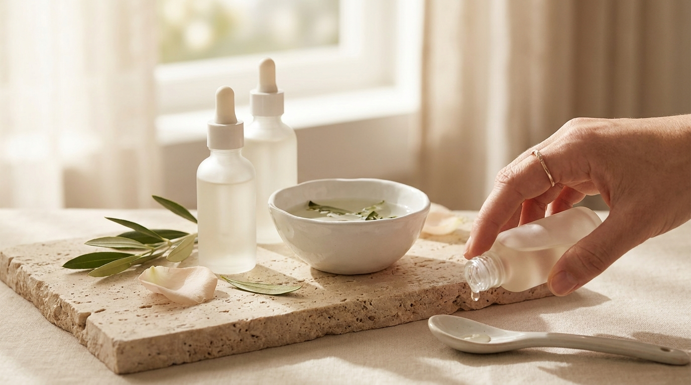

¡Hola! Soy J desde Seúl. Si sigues las tendencias de belleza coreana o ves contenidos sobre rutinas nocturnas en redes sociales, es muy probable que hayas visto unos envases grises metalizados que causaron un auténtico furor en las tiendas Olive Young de Corea: la línea Reedle Shot de VT Cosmetics. 

Muchos aficionados al K-Beauty fuera de Corea se preguntan de qué se trata exactamente este producto, por qué produce un característico cosquilleo en el rostro y qué diferencia real existe entre cifras como 100, 300 o incluso números más altos. En este artículo analizamos la ciencia detrás de las espículas, qué ingredientes las acompañan, cómo ayudan a mejorar la textura de la piel y los poros, y cuáles son las precauciones necesarias para integrarlas en casa sin irritar tu barrera cutánea.

## Puntos clave

- **Qué son las espículas (Cica Reedle™)**: son microestructuras microscópicas de origen mineral o marino purificadas, diseñadas para crear microcanales transitorios que facilitan la absorción de los cosméticos posteriores.
- **Diferencia entre 100 y 300**: el número indica la concentración y densidad de espículas en la fórmula. El nivel 100 está pensado para uso diario o principiantes, mientras que el 300 tiene mayor intensidad y se usa cada tres días.
- **Objetivo principal**: no sustituyen a un exfoliante químico tradicional; su función primordial es actuar como vehículo de absorción para mejorar la apariencia de poros dilatados, marcas residuales y textura irregular.
- **Cuidado con la barrera**: requieren hidratación profunda posterior y el uso riguroso de protector solar al día siguiente. No deben combinarse con ácidos fuertes ni retinoides en la misma sesión.

---

## ¿Qué son las espículas en la cosmética coreana?

El término «espícula» proviene de estructuras microscópicas naturales presentes en esponjas marinas u organismos similares. En la industria cosmética coreana, estas microagujas se someten a un proceso biotecnológico intensivo de refinamiento y purificación para eliminar impurezas orgánicas, dejando microestructuras compuestas principalmente de sílice purificado.

En el caso del popular Reedle Shot, la marca coreana VT Cosmetics patentó una tecnología que recubre estas microespículas con extracto purificado de Centella Asiática, denominándola *Cica Reedle™*. Si quieres profundizar en el poder regenerador de esta planta medicinal, puedes revisar nuestra guía sobre la [Centella Asiática (Cica) en K-Beauty](/blog/centella-asiatica-cica-beneficios-piel-sensible/).

### ¿Cómo funcionan al aplicarse en el rostro?

Al masajear el producto sobre la piel limpia, las microagujas microscópicas:

1. **Crean microcanales indoloros en el estrato córneo**: permiten que los activos aplicados a continuación (humectantes, péptidos o antioxidantes) penetren con mayor facilidad en lugar de quedarse en la superficie.
2. **Estimulan la renovación natural**: la presencia temporal de estas microestructuras promueve la regeneración celular propia de la piel.
3. **Se desprenden de forma natural**: las espículas no penetran en la dermis ni permanecen en el cuerpo; el estrato córneo las expulsa de manera gradual a lo largo de un ciclo de 48 a 72 horas mediante la descamación natural de la piel.

El resultado que buscan las formulaciones en Seúl es afinar el relieve irregular, ayudar a que los poros dilatados parezcan más compactos y potenciar la eficacia de los sérums hidratantes habituales.

---

## Reedle Shot 100 vs. Reedle Shot 300: ¿En qué se diferencian?



<p class="img-cap">※ Imagen ilustrativa generada con IA</p>

Uno de los aspectos que más confunde a los usuarios al explorar [los productos de skincare más vendidos en Olive Young Corea](/blog/olive-young-mas-vendidos-corea-2026/) es la numeración que acompaña a estos frascos. Estos números corresponden a la densidad de espículas por mililitro de producto.

```
Nivel de intensidad:
Reedle Shot 50  ──► Uso diario muy suave (pieles reactivas)
Reedle Shot 100 ──► Uso diario habitual (textura fluida)
Reedle Shot 300 ──► Uso cada 3 días (intensivo para poros y textura)
Reedle Shot 700 ──► Uso semanal focalizado (solo usuarios experimentados)
```

### Reedle Shot 100: el punto de partida equilibrado

El nivel 100 contiene aproximadamente 95.000 microespículas por envase. Tiene una textura de emulsión acuosa muy ligera que se absorbe con rapidez.

- **Frecuencia recomendada**: formulado para uso nocturno diario.
- **Sensación al tacto**: se percibe un cosquilleo leve o sensación de arena fina al presionar con las palmas.
- **Perfil ideal**: personas que nunca han probado espículas, pieles con textura irregular leve o quienes buscan mejorar la penetración de sus cremas de noche sin sobrecargar la barrera cutánea.

### Reedle Shot 300: enfoque intensivo para poros y marcas

El nivel 300 contiene cerca de 237.500 microespículas. Su fórmula es ligeramente más densa y la sensación de hormigueo es notablemente más marcada al tacto.

- **Frecuencia recomendada**: una vez cada tres días (aproximadamente 2 veces por semana), exclusivamente de noche.
- **Sensación al tacto**: pinchazos evidentes durante la aplicación y una ligera sensibilidad al presionar el rostro durante las 24 horas siguientes (por ejemplo, al lavarse la cara a la mañana siguiente).
- **Perfil ideal**: pieles resistentes, con poros visibles marcados, textura áspera o pequeñas marcas posteriores a brotes que no han mejorado con exfoliantes químicos suaves.

---

## Comparativa técnica: Reedle Shot 100 frente a 300

Para visualizar con claridad cuál se adapta mejor a tu rutina actual, revisemos sus diferencias principales:

| Característica | Reedle Shot 100 | Reedle Shot 300 |
| :--- | :--- | :--- |
| **Densidad de espículas** | ~95.000 unidades | ~237.500 unidades |
| **Frecuencia de aplicación** | Noche (a diario) | Noche (cada 3 días) |
| **Intensidad del cosquilleo** | Leve / Moderado bajo | Moderado / Notable |
| **Textura cosmética** | Esencia fluida lechosa | Emulsión cremosa ligera |
| **Paso de la rutina** | Paso cero (primer paso tras limpiar) | Paso cero (primer paso tras limpiar) |
| **Objetivo prioritario** | Mantenimiento diario y absorción | Textura persistente y poros visibles |
| **Nivel de experiencia** | Apto para principiantes en espículas | Pieles acostumbradas al nivel 100 |

---

## Cómo aplicar correctamente un producto con espículas paso a paso

El éxito de este tipo de cosméticos radica en cómo se aplican. A diferencia de un sérum común, las microagujas requieren una técnica de contacto directo con la piel limpia.

### Paso 1: Limpieza meticulosa
Empieza siempre sobre un rostro completamente limpio y seco. Es fundamental realizar una limpieza previa eficaz para que las microagujas no arrastren restos de maquillaje, grasa oxidada o protector solar hacia el interior del estrato córneo. Para preparar la piel de forma suave, una excelente base es la [guía de la doble limpieza coreana: aceite vs. bálsamo según tu piel](/blog/doble-limpieza-coreana-aceite-vs-balsamo/).

### Paso 2: Aplicación del Reedle Shot (Paso Cero)
Aplica de 1 a 2 pulsaciones directamente sobre la piel seca, antes de cualquier tónico o esencia líquida. 
- Distribuye el producto suavemente con las yemas de los dedos.
- En lugar de frotar en círculos rápidos, **presiona suavemente con las palmas de las manos**. Esta presión ayuda a que las espículas se asienten de manera uniforme sin generar fricción innecesaria.
- Notarás una sensación de pequeños pinchazos o cosquilleo; es la reacción física esperada y no una irritación química.

### Paso 3: Capa calmante e hidratante inmediata
Inmediatamente después de asentar las espículas, aprovecha los microcanales abiertos aplicando productos ricos en hidratación y activos reparadores:
- Fórmulas con pantenol, ácido hialurónico, ceramidas o extractos calmantes.
- Una excelente alternativa para sellar la humedad tras el Reedle Shot es la [mucina de caracol en el skincare](/blog/mucina-de-caracol-beneficios-como-usarla/), cuyas propiedades elásticas y humectantes complementan la acción del tratamiento.

### Paso 4: Sellado con crema hidratante
Finaliza siempre con una crema nutritiva para crear una barrera protectora sobre la piel tratada durante las horas de sueño.

> **Consejo práctico desde Seúl:**  
> Si adquieres cosmética coreana a través de plataformas internacionales (como explicamos en nuestra [guía para comprar cosmética coreana online desde casa](/blog/como-comprar-cosmetica-coreana-online-desde-casa/)), nunca comiences directamente por el Reedle Shot 300 o 700. En Corea, las farmacias y asesoras de belleza siempre recomiendan terminar al menos un frasco del nivel 100 para evaluar la tolerancia cutánea antes de subir de graduación.

---

## Precauciones indispensables y combinaciones que debes evitar



<p class="img-cap">※ Imagen ilustrativa generada con IA</p>

Dado que las espículas aumentan de forma considerable la permeabilidad de la piel, su uso inadecuado puede comprometer la barrera cutánea. Ten presentes las siguientes advertencias formuladas por dermatólogos y fabricantes coreanos:

### 1. No combinar con exfoliantes químicos fuertes ni retinol el mismo día
Evita utilizar tónicos con altas concentraciones de AHA (ácido glicólico), BHA (ácido salicílico) o tratamientos con retinoides en la misma rutina en la que apliques Reedle Shot. La penetración profunda de estos activos en piel microestimulada puede desencadenar enrojecimiento severo, ardor o descamación indeseada. Alterna su uso en noches diferentes.

### 2. No utilizar dispositivos de belleza electrónicos
No uses cepillos faciales oscilantes, espátulas ultrasónicas ni dispositivos de microcorrientes o LED con calor directamente encima del Reedle Shot, ya que la fricción mecánica excesiva con espículas en la superficie puede generar irritación mecánica.

### 3. Protección solar estricta a la mañana siguiente
Al estimular la renovación de la capa córnea, la piel queda más vulnerable a la radiación ultravioleta. Aplica una cantidad generosa de protector solar de amplio espectro (SPF 50+ PA++++) cada mañana sin excepción.

### 4. No usar sobre piel lesionada o con acné inflamatorio activo
Las espículas están indicadas para textura irregular, poros y marcas pigmentadas ya cerradas. Si presentas heridas abiertas, dermatitis activa, brotes quísticos inflamados o eczema, abstente de utilizar microagujas hasta que la piel se encuentre completamente sana.

---

## Preguntas frecuentes (FAQ)

### ¿El cosquilleo duele o desaparece con el tiempo?
No suele ser un dolor agudo, sino una sensación de hormigueo o pinchazos diminutos que se percibe especialmente al masajear el producto o al tocarse la cara después. Es una sensación normal provocada por el contacto de las microestructuras de sílice con las terminaciones nerviosas superficiales. El cosquilleo disminuye gradualmente y desaparece por completo a medida que la piel descama las microagujas de forma natural en 1 a 3 días.

### ¿Puedo usar Reedle Shot 100 y 300 al mismo tiempo?
No se deben aplicar simultáneamente en la misma noche. Lo que suelen hacer los aficionados al skincare en Corea es mantener una pauta escalonada: utilizan Reedle Shot 100 cuatro o cinco noches por semana, y reservan una o dos noches alternas para el Reedle Shot 300 como tratamiento intensivo, suspendiendo el 100 ese día.

### ¿Se puede aplicar en el contorno de ojos o los labios?
No. La piel alrededor de los ojos es extremadamente delgada y carece de glándulas sebáceas protectoras, mientras que los labios tienen una mucosa delicada. Mantén una distancia prudencial de al menos dos centímetros del borde ocular y evita la zona peribucal inmediata.

### ¿Cuánto tiempo tarda en notarse una mejoría en los poros?
Los fabricantes e informes de paneles de consumidores en Corea indican que la suavidad al tacto suele apreciarse tras la primera o segunda semana de uso continuado, ya que los cosméticos hidratantes posteriores penetran mejor. Para percibir un cambio visual en la apariencia de poros dilatados y relieve irregular, se aconseja un uso constante de entre 4 y 6 semanas.