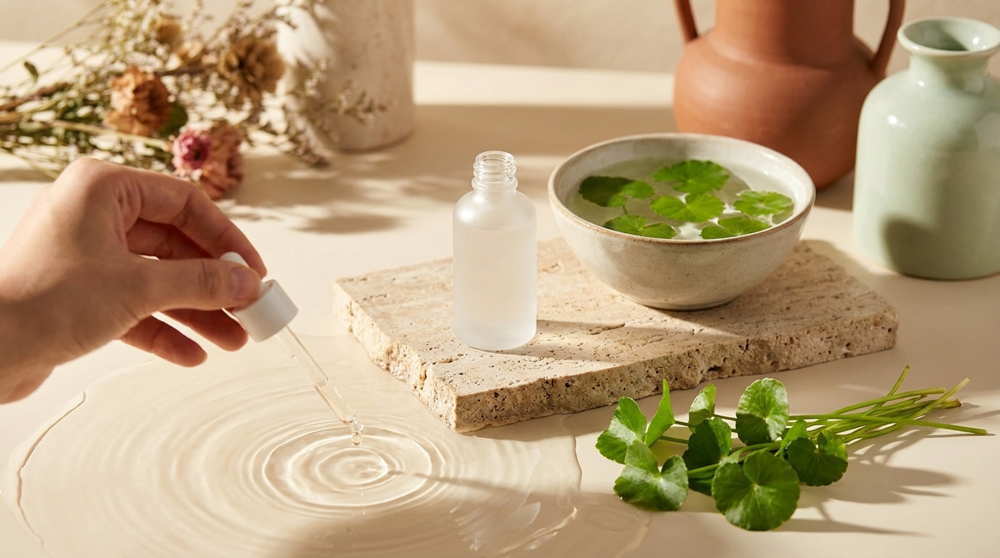
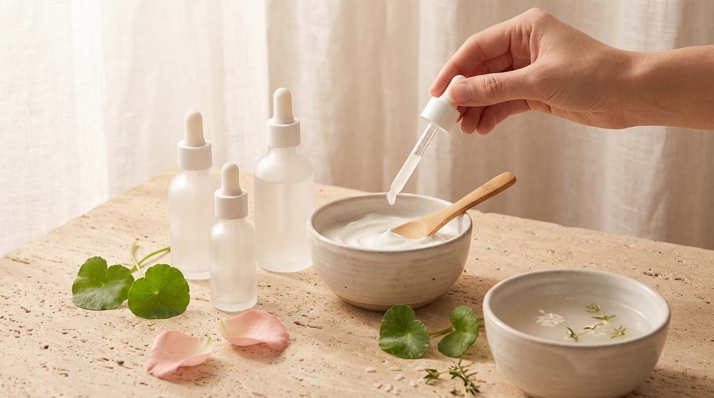

Cuando nos adentramos en el mundo de la cosmética coreana y el cuidado facial, es muy común querer probarlo todo: esencias iluminadoras, sueros con concentraciones elevadas de ácidos exfoliantes, retinoides nocturnos y múltiples pasos inspirados en la famosa rutina de diez etapas. Sin embargo, en ese entusiasmo por lograr un acabado luminoso o *glass skin*, muchas personas terminan sobrecargando su rostro sin darse cuenta.

De repente, una crema hidratante que antes resultaba agradable comienza a arder. Aparecen zonas enrojecidas, la piel se siente tirante incluso después de humectarla y la textura se vuelve áspera o irregular. Si experimentas estas señales, es muy probable que tu estrato córneo esté debilitado. En la cultura de cuidado facial en Seúl, cuando esto ocurre, la consigna no es aplicar más cosméticos activos ni buscar soluciones agresivas, sino detenerse por completo e iniciar lo que suele denominarse una rutina de rescate o dieta para la piel (*skin diet*).

En este artículo analizaremos qué ocurre exactamente a nivel celular cuando la barrera se altera, cuáles son los ingredientes respaldados por la formulación coreana para recuperarla —con especial protagonismo de las ceramidas y el pantenol— y qué sustancias conviene pausar de inmediato para devolver el confort al rostro.

## Puntos clave

- La barrera cutánea es una estructura lipídica que retiene el agua e impide el paso de irritantes externos; cuando se fractura, la piel pierde hidratación y reacciona con ardor, tirantez o rojeces.
- El primer paso para su recuperación no es añadir productos nuevos y potentes, sino pausar exfoliantes químicos (AHA, BHA), retinoides, vitamina C pura y exfoliaciones mecánicas.
- Las ceramidas reconstituyen los lípidos intercelulares esenciales, mientras que el pantenol (provitamina B5) actúa como humectante profundo y calmante para apoyar la regeneración natural del tejido.
- Una rutina de rescate minimalista de tres o cuatro pasos, mantenida de dos a cuatro semanas, suele ser suficiente para restaurar el equilibrio antes de reintroducir activos transformadores.

---

## Qué es la barrera cutánea y por qué se deteriora

Para comprender cómo repararla, resulta útil visualizar la capa más externa de la piel (el estrato córneo) como una pared protectora. En la literatura dermatológica y cosmética, esta analogía es un estándar: los queratinocitos (células cutáneas) son los ladrillos, mientras que los lípidos intercelulares actúan como el cemento o mortero que los mantiene unidos y sellados.

Este cemento lipídico está compuesto principalmente por tres elementos en proporciones precisas:

1. **Ceramidas (aproximadamente el 50%):** lípidos esenciales que evitan la pérdida transepidérmica de agua (TEWL).
2. **Colesterol (alrededor del 25%):** estabiliza la membrana y aporta flexibilidad a la capa protectora.
3. **Ácidos grasos libres (cerca del 15%):** mantienen el manto ácido natural de la superficie cutánea (pH ligeramente ácido, entre 4.5 y 5.5).

```
[ Ladrillos: Queratinocitos ] + [ Cemento: Ceramidas + Colesterol + Ácidos Grasos ]
                                      │
                                      ▼
             Barrera íntegra = Hidratación retenida + Protección exterior
```

Cuando este mortero se degrada, el agua se evapora a un ritmo acelerado y los factores externos (microorganismos, polución, partículas de polvo fino o fragancias) penetran con facilidad en capas más profundas, activando respuestas de defensa como inflamación, calor y enrojecimiento.

### Causas habituales del daño en la piel

En las consultas estéticas de Seúl y en las tendencias observadas en los foros de belleza coreanos, el daño en la barrera no suele deberse a la falta de higiene, sino más bien a un exceso de celo en el cuidado diario:

- **Sobreexfoliación química:** el uso simultáneo o diario de tónicos con ácido glicólico, salicílico o láctico en concentraciones no toleradas por la piel.
- **Introducción apresurada de retinoides:** aplicar retinol o retinal sin un proceso adecuado de adaptación previa (retinización) o sin una base hidratante suficiente.
- **Limpieza facial excesivamente desengrasante:** utilizar limpiadores con sulfatos fuertes o un pH alcalino que barre los lípidos fisiológicos naturales. Si bien la técnica coreana de limpieza es ampliamente conocida, aplicarla de forma errónea puede comprometer la piel; en nuestra [guía de la doble limpieza coreana: aceite vs. bálsamo según tu piel](/blog/doble-limpieza-coreana-aceite-vs-balsamo/) explicamos cómo limpiar el rostro a diario sin despojarlo de su manto protector.
- **Factores climáticos extremos:** la transición entre el frío seco del invierno con calefacción intensa (*ondol*) y el verano húmedo desgasta notablemente la resistencia del rostro si no se ajusta la textura de las cremas protectoras.

---

## La pausa estratégica: qué ingredientes detener de inmediato



<p class="img-cap">※ Imagen ilustrativa generada con IA</p>

Cuando la barrera cutánea presenta signos evidentes de fractura —ardor al aplicar agua o productos básicos, tacto áspero y brotes reactivos—, el error más habitual es intentar solucionar el problema de inmediato aplicando capas adicionales de productos o buscando resultados instantáneos. En la formulación K-Beauty, el consenso profesional es el opuesto: retirar estímulos agresivos para permitir que el mecanismo de regeneración natural trabaje sin interferencias.

> **Pauta habitual en el cuidado coreano:** Ante el ardor persistente, pon en pausa cualquier activo cuyo objetivo principal sea renovar, despigmentar o exfoliar. La piel dañada necesita calma e hidratación reparadora, no estímulos de renovación celular acelerada.

### Ingredientes que debes suspender temporalmente

1. **Ácidos exfoliantes (AHA, BHA, PHA y LHA):** aunque los PHA y LHA son más suaves, cualquier ácido que baje el pH cutáneo o debilite la cohesión de los queratinocitos debe quedar guardado durante la fase de recuperación.
2. **Retinoides en todas sus formas:** retinol, retinaldehído, adapaleno y ésteres de retinilo incrementan la renovación celular, un proceso que la piel comprometida no puede gestionar adecuadamente.
3. **Ácido ascórbico puro (Vitamina C a concentraciones superiores al 10%):** su pH bajo (usualmente inferior a 3.5 para ser estable) suele provocar quemazón intensa en pieles con microfisuras lipídicas.
4. **Exfoliantes mecánicos y esponjas abrasivas:** geles tipo *peeling gommage*, cepillos faciales oscilantes y toallas ásperas generan fricción mecánica que agrava la pérdida de lípidos.
5. **Cosméticos con fragancias intensas o aceites esenciales puros:** ingredientes aromáticos como el linalool, limoneno, aceite de árbol de té o lavanda pueden desencadenar dermatitis por contacto cuando el estrato córneo ha perdido su integridad.

Para saber cómo reintegrar estos pasos más adelante y mantener tus productos en buen estado durante la pausa, puedes consultar nuestro artículo sobre [cómo organizar y conservar tu skincare coreano: orden de capas y caducidad](/blog/como-ordenar-y-conservar-tu-skincare-coreano/).

---

## Los dos pilares de rescate en K-Beauty: Ceramidas y Pantenol

En la cosmética coreana moderna, los laboratorios han perfeccionado fórmulas diseñadas específicamente para mimetizar la estructura lipídica natural. Entre todos los activos analizados en las fichas técnicas de los productos más populares en Corea, dos ingredientes destacan como la columna vertebral de cualquier protocolo de recuperación: las ceramidas y el pantenol.

```
┌────────────────────────────────────────────────────────┐
│             DÚO REPARADOR EN LA COSMÉTICA COREANA      │
├────────────────────────────┬───────────────────────────┤
│         CERAMIDAS          │         PANTENOL          │
│   (Ceramide NP, AP, EOP)   │      (Provitamina B5)     │
│  • Restaura el mortero     │  • Calma el ardor agudo   │
│  • Reduce la pérdida TEWL  │  • Atrae y retiene agua   │
│  • Devuelve elasticidad    │  • Apoya la epitelización │
└────────────────────────────┴───────────────────────────┘
```

### 1. Ceramidas: el cemento reestructurador

En las listas de ingredientes (INCI) de la cosmética coreana, es común encontrar diversas variantes de este lípido: `Ceramide NP`, `Ceramide AP`, `Ceramide EOP` y fitosfingosina (`Phytosphingosine`). Cada una cumple un papel complementario:

- **Ceramide NP:** es la más abundante y la encargada principal de reforzar la función de barrera frente a la pérdida de agua transepidérmica.
- **Ceramide AP y EOP:** ayudan a regular la descamación natural y aportan cohesión elástica a la superficie.
- **Fitosfingosina:** un precursor lipídico que, además de incentivar la producción endógena de ceramidas, posee propiedades complementarias muy útiles para evitar brotes secundarios en pieles irritadas.

En las formulaciones coreanas más avanzadas, es habitual encontrar emulsiones multilamelares (tecnología MLE). Esta formulación imita la disposición natural en capas del estrato córneo humano, facilitando que los lípidos tópicos se integren de forma homogénea en las zonas donde la barrera presenta fisuras.

### 2. Pantenol (Provitamina B5): el bálsamo calmante

Si las ceramidas constituyen la estructura sólida, el pantenol representa el alivio inmediato. Cuando se aplica de forma tópica, el pantenol se convierte en ácido pantoténico, un componente indispensable en los procesos metabólicos celulares.

Sus virtudes cosméticas en pieles sensibilizadas son notables:
- **Acción higroscópica:** retiene el agua en las capas intermedias de la epidermis, combatiendo la sensación de piel tirante o acartonada.
- **Alivio de la irritación:** contribuye a reducir la respuesta eritematosa (el enrojecimiento visible) y atenúa el picor o escozor característico de la piel reactiva.
- **Favorece la regeneración cutánea:** apoya los procesos naturales de recuperación celular, permitiendo que la superficie cutánea recupere su textura suave de manera progresiva.

Muchas fórmulas coreanas combinan concentraciones de entre el 2% y el 10% de pantenol con extractos botánicos calmantes. Entre ellos, el extracto de *Centella Asiatica* y sus componentes puros (madecasósido y asiaticósido) son los acompañantes predilectos para desinflamar; puedes profundizar en sus aplicaciones en nuestra guía sobre [Centella Asiática (Cica) en K-Beauty: guía para calmar rojeces y leer su INCI](/blog/centella-asiatica-cica-beneficios-piel-sensible/).

---

## Comparativa de activos reparadores en el cuidado facial coreano

Para seleccionar los productos más adecuados según las necesidades y el tipo de piel de cada persona, la siguiente tabla resume los ingredientes más utilizados en las fórmulas de rescate de K-Beauty:

| Ingrediente (INCI habitual) | Función primordial en la barrera | Textura típica en K-Beauty | Tipo de piel más beneficiada |
| :--- | :--- | :--- | :--- |
| **Ceramidas** (`Ceramide NP, AP, EOP`) | Reponer el cemento lipídico y frenar la evaporación de agua (TEWL) | Cremas ricas, bálsamos ligeros y lociones densas | Piel seca, deshidratada, con descamación visible |
| **Pantenol** (`Panthenol / D-Panthenol`) | Calmar el ardor, aportar hidratación profunda y apoyar la cicatrización | Esencias acuosas, geles calmantes y fluidos hidratantes | Piel reactiva, enrojecida o irritada por activos |
| **Centella Asiática / Madecasósido** (`Centella Asiatica Extract, Madecassoside`) | Modular la respuesta inflamatoria y mitigar rojeces difusas | Ampollas fluidas, tónicos en bruma y cremas tipo gel | Piel mixta a grasa con brotes reactivos o eritema |
| **Ectoína** (`Ectoin`) | Proteger las membranas celulares frente a estrés térmico y ambiental | Sueros sedosos y cremas barrera avanzadas | Piel madura o muy expuesta a agresores urbanos |
| **Beta-glucano** (`Beta-Glucan`) | Humectación biocompatible de larga duración (superior al ácido hialurónico) | Sueros de textura ligeramente viscosa sin aceites | Piel deshidratada intolerante a texturas pesadas |

---

## El protocolo coreano de rescate paso a paso

Durante un periodo de crisis cutánea, menos es decididamente más. A diferencia de las rutinas complejas destinadas a potenciar la luminosidad como las descritas en nuestra [rutina coreana para Glass Skin: 5 pasos esenciales según tu tipo de piel](/blog/rutina-coreana-piel-de-porcelana-glass-skin/), la rutina de rescate busca estabilidad y reposo celular.

```
RUTINA MATUTINA:
Limpieza suave (o agua templada) ➔ Tónico o esencia de Pantenol ➔ Crema con Ceramidas ➔ Protector solar suave

RUTINA NOCTURNA:
Limpiador en leche o gel hidratante ➔ Esencia calmante ➔ Crema reparadora en capa uniforme
```

### Rutina de la mañana

1. **Limpieza minimalista:** Si la piel amanece extremadamente seca o tirante, suele recomendarse enjuagar el rostro únicamente con agua templada. Si necesitas retirar sebo o sudor, opta por un gel limpiador syndet (sin jabón tradicional) con pH cercano a 5.5.
2. **Hidratación y calma (Pantenol o Cica):** Aplica con las palmas de las manos limpias (evitando discos de algodón para reducir la fricción) un tónico lechoso o una esencia que contenga pantenol o beta-glucano. Da toques suaves sin frotar.
3. **Sellado lipídico (Ceramidas):** Aplica una cantidad moderada de crema con ceramidas. Masajea suavemente con la yema de los dedos hasta que se funda con la piel.
4. **Protección solar indispensable:** El sol debilita aún más una barrera fracturada. Elige un protector solar (bloqueador solar) de fórmula calmante, idealmente con filtros minerales (óxido de zinc) si los químicos generan picor transitorio, o protectores solares coreanos formulados para pieles sensibles sin fragancia ni alcohol secante.

### Rutina de la noche

1. **Limpieza suave:** Si utilizaste protector solar o maquillaje muy ligero, emplea un aceite limpiador emulsionable muy fluido o una leche limpiadora reconfortante. Enjuaga con agua tibia, nunca caliente.
2. **Capa base humectante:** Vuelve a aplicar la esencia o tónico reparador sobre la piel ligeramente húmeda para optimizar la hidratación.
3. **Cura nocturna con crema barrera:** Utiliza una crema rica en ceramidas y colesterol. En Corea es habitual aplicar una capa ligeramente más densa en las zonas más afectadas (mejillas o contorno de la nariz) a modo de mascarilla de rescate para que actúe durante las horas de sueño.

> **Consejo práctico habitual:** Evita lavar tu rostro bajo el chorro directo de la ducha. La presión del agua y la temperatura elevada son factores determinantes en la degradación de los lípidos cutáneos. Lava siempre tu cara en el lavabo con agua tibia o templada y seca con toques suaves usando una toalla limpia exclusiva para el rostro, sin arrastrar.

---

## Cómo reintroducir los activos sin recaer



<p class="img-cap">※ Imagen ilustrativa generada con IA</p>

La fase de recuperación suele requerir entre dos y cuatro semanas, dependiendo del nivel de daño inicial y de la edad biológica de la persona (el recambio celular natural toma entre 28 y 40 días). 

Sabrás que tu barrera se ha estabilizado cuando:
- Tu crema hidratante habitual ya no cause ninguna sensación de escozor al aplicarla.
- La piel retenga la suavidad y el confort durante varias horas sin necesidad de reaplicar producto constantemente.
- Desaparezca el enrojecimiento espontáneo ante cambios suaves de temperatura.

Una vez alcanzado este punto, **no reintroduzcas todos tus activos al mismo tiempo**. El método más seguro consiste en elegir un solo ingrediente activo (por ejemplo, un exfoliante BHA suave o un retinoide) y aplicarlo **una sola noche a la semana** durante los primeros quince días. Si el rostro tolera el estímulo sin manifestar tirantez ni ardor, puedes aumentar gradualmente la frecuencia a dos veces por semana, manteniendo siempre la crema de ceramidas como base de soporte continuo.

---

## Preguntas frecuentes (FAQ)

### ¿Cuánto tiempo tarda en sanar una barrera cutánea dañada?
En general, una recuperación básica del estrato córneo suele completarse entre 14 y 28 días si se suspenden todos los irritantes y se aplican lípidos fisiológicos a diario. Sin embargo, en casos de daño más severo o sensibilización prolongada, el tejido puede requerir hasta seis u ocho semanas para restablecer completamente su función de defensa ante agresores ambientales.

### ¿Puedo seguir utilizando ácido hialurónico o niacinamida mientras recupero mi barrera?
El ácido hialurónico de alto y medio peso molecular es generalmente bien tolerado porque actúa como humectante en la superficie cutánea. Respecto a la niacinamida, concentraciones bajas (entre el 2% y el 4%) pueden ayudar a estimular la producción propia de ceramidas; no obstante, si el producto contiene concentraciones muy altas (del 10% o superiores), es preferible pausarlo, ya que puede resultar estimulante o irritante para una piel con microfisuras activas.

### ¿Es imprescindible suspender el protector solar si me causa ardor?
No debes prescindir de la protección frente a la radiación ultravioleta, ya que los rayos UVA y UVB dañan directamente las membranas celulares y retrasan la recuperación. Si tu protector solar habitual (con filtros químicos) te provoca escozor, cambia temporalmente a un protector solar mineral basado en óxido de zinc, un ingrediente que por su propia naturaleza física resulta inerte y posee propiedades calmantes para pieles sensibilizadas.

### ¿Es normal experimentar pequeños brotes de granitos al usar cremas con ceramidas?
Si la piel está muy inflamada, a veces confunde la oclusión de una crema densa con congestión de poros. Si tienes tendencia al acné o piel mixta, asegúrate de elegir cremas con ceramidas formuladas en texturas ligeras (lociones fluidas o geles crema no comedogénicos) y evita texturas excesivamente pesadas formuladas con mantecas espesas o aceites minerales oclusivos en exceso. Las fórmulas coreanas modernas suelen ofrecer opciones muy ligeras que protegen la barrera sin saturar el poro.