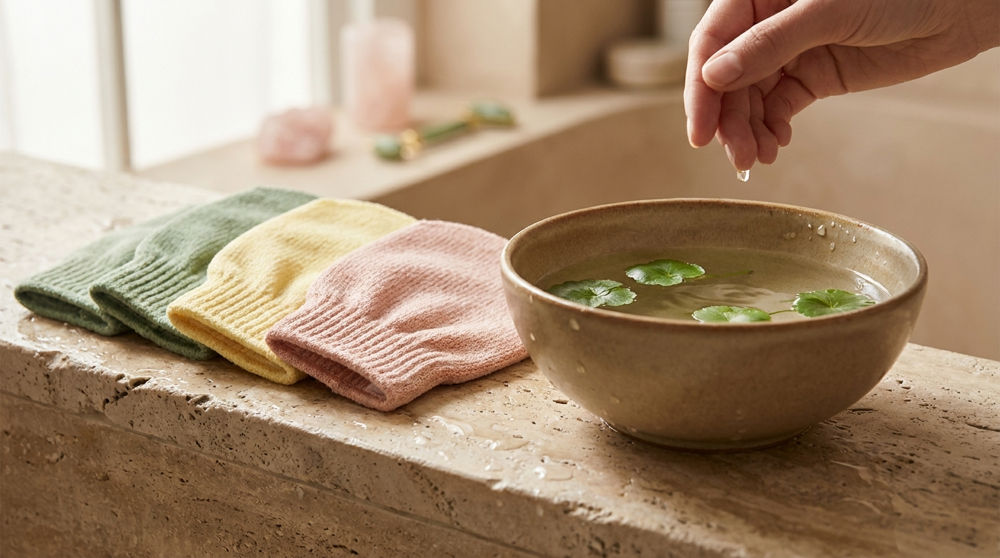
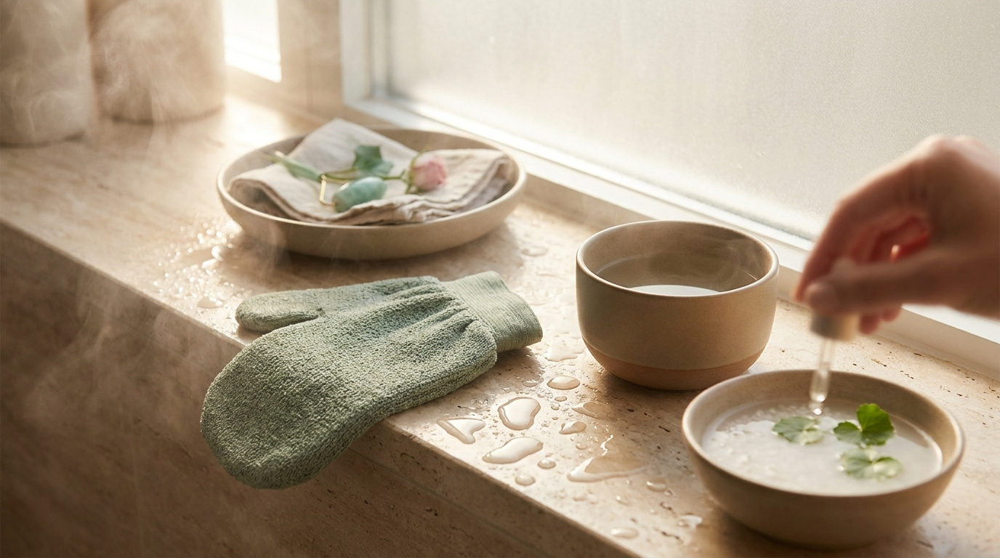

¡Hola! Soy J desde Seúl. Si sueles ver producciones coreanas, es muy probable que hayas visto escenas ambientadas en baños públicos (*mokyoktang*) o saunas tradicionales (*jjimjilbang*), donde los personajes visten camisetas anchas, descansan en salas térmicas y, sobre todo, se frotan el cuerpo con una pequeña tela de color verde o amarillo. 

Ese pequeño accesorio de apariencia modesta es conocido universalmente como la **Italy Towel coreana** (*itaeri tawol*, 이태리 타월). Aunque su nombre sugiere un origen europeo, se trata de uno de los elementos más emblemáticos de la higiene y el cuidado corporal en Corea del Sur. Muchas personas en Latinoamérica y España sienten curiosidad por probar este método en casa para conseguir una textura suave y renovada, pero al usarla de forma incorrecta surgen problemas frecuentes como ardor, enrojecimiento o daño en la barrera lipídica. 

En esta guía revisaremos el origen cultural de este accesorio, cómo elegir el nivel adecuado según tu tipo de piel, el paso a paso exacto para recrear este baño tradicional en tu propia bañera o ducha y cómo mantener la piel hidratada sin comprometer su equilibrio natural.

## Puntos clave

- **El secreto reside en el remojo previo**: la Italy Towel nunca debe aplicarse en seco ni con jabón previo; la piel necesita ablandarse exclusivamente con agua templada durante al menos 15 minutos.
- **Código de colores según la textura**: el clásico modelo verde es de abrasión media, mientras que las versiones amarillas o rosadas ofrecen una fricción mucho más suave para pieles sensibles.
- **Frecuencia moderada**: no se trata de una rutina diaria; en los hogares coreanos suele realizarse cada dos o cuatro semanas para respetar el ciclo natural de renovación celular.
- **Restauración inmediata**: tras retirar las células muertas superficiales, es imprescindible aplicar emulsiones o cremas ricas en ceramidas o agentes humectantes para sellar la humedad.

---

## Origen cultural: ¿por qué se llama Italy Towel en Corea?

A pesar de su nombre, la Italy Towel no se diseñó en Italia. Fue creada a finales de la década de 1960 en Busan, la segunda ciudad más grande de Corea del Sur, por un empresario textil llamado Kim Pil-gon. En aquel periodo, el material utilizado para fabricarla —una tela de rayón o viscosa con una textura estriada particular— era importado desde Italia. De ahí surgió el nombre comercial con el que se popularizó en todo el país.

El éxito de esta tela transformó la experiencia de los baños públicos coreanos. Tradicionalmente, la higiene corporal profunda incluía la figura del *seshisa* (세신사), profesionales dedicados exclusivamente al servicio de exfoliación corporal profunda (*seshin*) en los *mokyoktang*. Con la llegada de este tejido de viscosa, el proceso se volvió accesible y sencillo para que cualquier persona pudiera retirar la acumulación de queratina y sudor de manera independiente.

Con el tiempo, este accesorio se convirtió en un elemento básico en prácticamente todos los hogares coreanos. Para quienes desean experimentar este aspecto del bienestar coreano sin necesidad de viajar a Seúl, es perfectamente posible adaptar el concepto a un cuarto de baño convencional, siempre que se comprenda la fisiología básica de la capa córnea.

---

## El código de colores: cómo elegir la manopla adecuada



<p class="img-cap">※ Imagen ilustrativa generada con IA</p>

En tiendas de cosmética coreana o supermercados especializados, es habitual encontrar estas manoplas en distintos tonos. Cada color indica tradicionalmente una densidad o aspereza de tejido diferente, pensada para distintas zonas del cuerpo o tolerancias cutáneas.

```
+------------------+---------------------+-------------------------+
| Color de toalla  | Nivel de fricción   | Zona recomendada        |
+------------------+---------------------+-------------------------+
| Rosa / Rojo      | Muy suave           | Brazos, pecho, sensible |
| Amarillo         | Suave a medio       | Todo el cuerpo habitual |
| Verde (clásico)  | Medio a fuerte      | Espalda, codos, piernas |
| Azul             | Muy intenso         | Talones y plantas       |
+------------------+---------------------+-------------------------+
```

A continuación se detalla una comparativa práctica para orientar la elección según las necesidades individuales:

| Color de manopla | Nivel de aspereza | Tipo de piel idóneo | Uso corporal sugerido |
| :--- | :--- | :--- | :--- |
| **Rosa / Rojo** | Baja | Piel fina, seca o sensible | Brazos, escote y zonas con menor grosor cutáneo |
| **Amarillo** | Media-Baja | Piel normal a sensible | Uso general para principiantes en exfoliación física |
| **Verde (Estándar)** | Media-Alta | Piel normal, mixta o resistente | Piernas, espalda, hombros y extremidades |
| **Azul** | Alta | Piel engrosada o muy resistente | Exclusivo para talones, rodillas o callosidades |

Para quienes nunca han utilizado este tejido, la recomendación habitual en Corea es comenzar siempre con la versión rosa o amarilla. Si adquieres tus productos a través de distribuidores en línea, tal como explicamos en nuestra [guía para comprar cosmética coreana online desde casa](/blog/como-comprar-cosmetica-coreana-online-desde-casa/), conviene revisar la descripción del fabricante para confirmar el nivel de textura antes de comprar el paquete clásico de color verde.

---

## Paso a paso: el ritual de exfoliación corporal coreano en casa

Para obtener un resultado óptimo sin provocar microlesiones, el proceso debe seguir una secuencia estricta. El error más común entre usuarios internacionales es utilizar la toalla como si fuera una esponja de ducha tradicional con gel limpiador, lo cual anula su mecanismo de acción o genera una fricción excesiva.

### 1. Preparación y remojo térmico (15 a 20 minutos)
El paso fundamental para que la toalla cumpla su función sin lastimar es el ablandamiento de la queratina. En un baño coreano, las personas pasan un tiempo considerable sumergidas en piscinas de agua caliente antes de cualquier fricción.

- **En bañera**: llena la tina con agua tibia a caliente (a una temperatura confortable, entre 38 °C y 40 °C) y permanece sumergido durante al menos 15 a 20 minutos. No agregues sales de baño densas, burbujas ni aceites corporales en esta etapa, ya que crearían una película resbaladiza sobre la piel.
- **En cabina de ducha**: si no dispones de bañera, puedes tomar una ducha tibia prolongada de unos 15 minutos, manteniendo la puerta cerrada para generar vapor abundante en el espacio.

> **Regla de oro de los baños coreanos:** durante el remojo no se debe aplicar gel de ducha ni jabón. La Italy Towel necesita que la piel esté limpia pero sin lubricantes artificiales; de lo contrario, la tela resbalará sobre la superficie sin poder arrastrar las células muertas desprendidas.

### 2. La técnica de frotado: control de presión y movimiento
Una vez que la piel esté bien ablandada, humedece la Italy Towel con agua tibia y escurre el exceso. Introduce la mano en la manopla.

1. **Evita movimientos circulares rápidos**: la fricción debe realizarse con movimientos lineales, largos y continuos, de abajo hacia arriba (en dirección hacia el torso o el corazón).
2. **Presión suave y progresiva**: no es necesario apretar con fuerza. La textura del rayón está diseñada para crear la tracción necesaria mediante el contacto superficial.
3. **El fenómeno del *ttae* (때)**: al pasar la toalla suavemente sobre la piel tibia, es común observar la aparición de pequeños residuos grisáceos o blanquecinos. En Corea esto se denomina *ttae*, y consiste en una mezcla natural de corneocitos desprendidos, sebo y restos de transpiración. Si no aparecen de inmediato, no aumentes la presión de forma agresiva; la ausencia de residuos visibles no significa que no se esté produciendo la renovación superficial.
4. **Zonas a evitar**: nunca utilices la Italy Towel convencional en el rostro, el cuello, el pecho interior ni en zonas con heridas activas, quemaduras solares o brotes inflamatorios.

### 3. Enjuague y limpieza suave final
Tras completar las extremidades y la espalda, enjuaga todo el cuerpo con abundante agua tibia para retirar los restos desprendidos. En este punto, la piel se encuentra especialmente receptiva. Puedes utilizar un limpiador corporal de pH neutro (ligeramente ácido, cercano a 5.5) y sin sulfatos agresivos para asegurar una sensación de frescura completa sin alterar el manto ácido.

---

## Restauración y nutrición post-baño

La exfoliación física profunda remueve la capa superficial de queratina vieja, pero también disminuye temporalmente los lípidos que retienen el agua transepidérmica. Por esta razón, el cuidado posterior es tan relevante como la exfoliación misma.

En la cultura de bienestar coreana, este tipo de cuidados suele integrarse en un contexto de relajación general al final de la jornada, de forma muy similar a lo que describimos en nuestro artículo sobre el [ritual nocturno coreano con masaje y cuidado personal](/blog/ritual-nocturno-coreano-cuidado-facial-relajacion/).

Para proteger la superficie recién renovada, se recomienda seguir dos principios:

1. **Aplicación en los primeros 3 minutos**: seca el cuerpo dando toques suaves con una toalla de algodón, dejando una ligera película de humedad sobre la piel. Aplica de inmediato una loción o crema hidratante densa para sellar esa agua.
2. **Fórmulas reparadoras**: opta por lociones corporales formuladas con ingredientes que refuercen la barrera lipídica, tales como ceramidas, manteca de karité, escualano o pantenol. Comprender la función de estos activos es clave; puedes profundizar en este tema revisando nuestra guía sobre [cómo reparar la barrera cutánea dañada con ceramidas y pantenol](/blog/reparar-barrera-cutanea-ceramidas-coreanas/).

> **Recomendación desde Seúl:** tras realizar este ritual corporal, evita la exposición directa al sol durante las siguientes 24 horas y procura no aplicar exfoliantes químicos corporales (como lociones con ácido glicólico, láctico o salicílico) durante al menos cuatro a cinco días para prevenir irritaciones por sobreexfoliación.

---

## Errores habituales al usar la manopla verde coreana



<p class="img-cap">※ Imagen ilustrativa generada con IA</p>

Para disfrutar de una piel suave y elástica sin contratiempos, conviene tener presentes los fallos más repetidos fuera de Corea:

- **Usar jabón junto con la toalla**: aplicar jabón directamente sobre la manopla produce espuma, lo que reduce la fricción mecánica necesaria y hace que el usuario tienda a presionar mucho más fuerte para compensar, terminando con rasguños o enrojecimiento.
- **Frecuencia excesiva**: usar este método cada semana o varias veces por semana desgasta el estrato córneo sano, provocando sequedad crónica, picor o tirantez.
- **Frotar sobre la piel seca**: frotar una toalla de rayón sobre piel que no ha pasado por un remojo térmico previo causa una abrasión directa muy similar a una quemadura por fricción.
- **Insistir en áreas sensibles**: la piel de los muslos internos o de la zona clavicular es considerablemente más fina que la de las pantorrillas o los codos; requiere un toque extremadamente leve o el uso exclusivo de manoplas de grado suave (rosadas).

---

## Preguntas frecuentes (FAQ)

### ¿Se puede usar la Italy Towel en el rostro?
No. La Italy Towel tradicional está confeccionada con tejido de viscosa de alta fricción, diseñado exclusivamente para la piel del cuerpo, que es sustancialmente más gruesa. Usarla en el rostro puede causar microroturas capilares, eritema persistente e hiperreactividad. Para el cuidado facial, el K-Beauty prioriza exfoliantes enzimáticos suaves, geles de tipo *peeling* suave o tónicos con ácidos de baja concentración.

### ¿Por qué a veces no sale piel muerta visible al frotar?
La cantidad de residuo visible (*ttae*) depende de múltiples factores: el tiempo y temperatura del remojo, el nivel de humedad ambiental, la frecuencia con la que te exfolias y tu tasa de descamación celular. Si no ves formarse rollitos de piel, no debes frotar con más fuerza. La toalla cumple su función retirando células desprendidas microscópicas; forzar la fricción solo irritará el tejido sano.

### ¿Con qué frecuencia se recomienda este ritual en casa?
En Corea, la pauta estándar para un baño profundo con manopla suele ser una vez cada dos a cuatro semanas. En personas con tendencia a la piel seca o sensible, realizarlo una vez al mes durante las épocas cálidas es suficiente para mantener la textura suave sin comprometer la barrera cutánea.

### ¿Es recomendable si tengo queratosis pilaris ("piel de gallina")?
La queratosis pilaris se debe a una acumulación de queratina en los folículos pilosos. Aunque una exfoliación muy suave y ocasional puede ayudar a alisar la superficie, frotar intensamente con una Italy Towel verde puede inflamar los folículos y empeorar la apariencia rojiza. Si tienes esta condición, es preferible utilizar la manopla rosa con mínima presión y complementar en días posteriores con hidratantes que contengan urea o ácido láctico en bajas concentraciones.