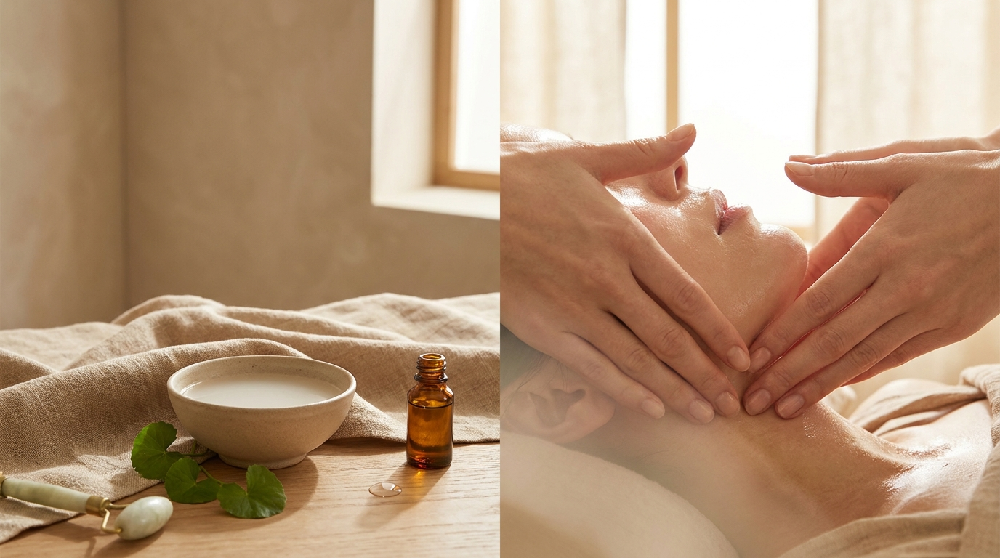
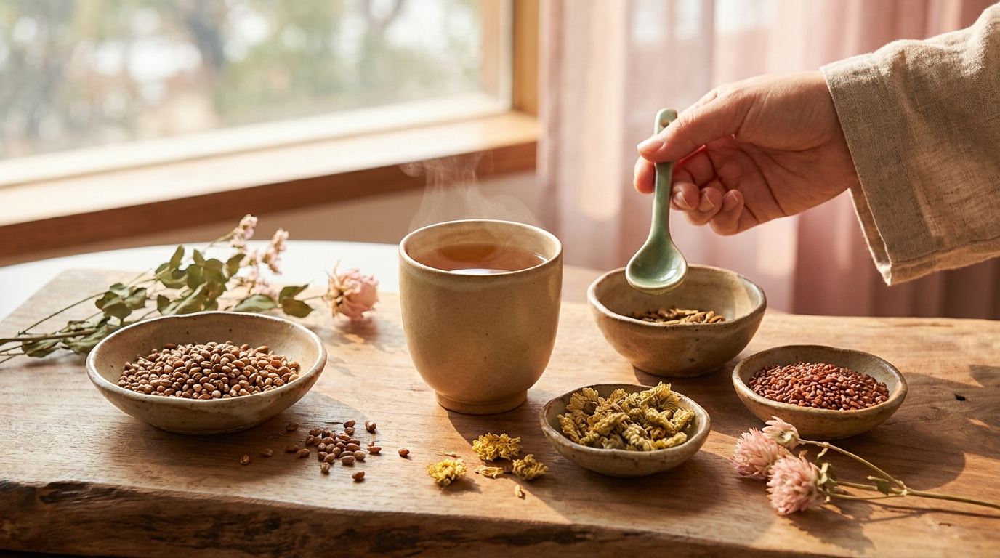

¡Hola! Soy J desde Seúl. En Corea del Sur existe una preocupación casi universal cada mañana: el *buki* (붓기), término que describe la hinchazón o retención de líquidos en el rostro y los párpados. Ya sea por haber cenado algo con alto contenido de sodio, por pasar horas frente a una pantalla o simplemente por acumular estrés y mala postura, levantarse con facciones congestionadas es algo que en Seúl se intenta prevenir desde la noche anterior.

El cuidado de la piel en la cultura coreana no termina al aplicar el último tónico o crema hidratante. Muchas familias y jóvenes integran pequeños hábitos de bienestar corporal que preparan al organismo para un sueño reparador, promueven el retorno venoso y estimulan el sistema linfático. Incorporar estos tres pilares —el drenaje facial manual, el baño de pies tradicional y las infusiones botánicas— permite recrear un auténtico momento de calma coreana en casa, sin necesidad de recurrir a herramientas complejas ni tratamientos costosos.

## Puntos clave

- **Drenaje estratégico**: el masaje linfático nocturno busca descongestionar los ganglios del cuello y la mandíbula mediante movimientos suaves y siempre sobre una piel bien lubricada.
- **Termorregulación para el sueño**: el baño de pies o *jokyok* (족욕) ayuda a relajar los vasos sanguíneos periféricos, facilitando la bajada natural de temperatura corporal necesaria para descansar en profundidad.
- **Infusiones botánicas sin teína**: bebidas tradicionales como el té de barba de maíz (*oksusu-suyeom-cha*) o el té de calabaza (*hobak-cha*) son consumidas habitualmente en Corea por su suave apoyo diurético.
- **Continuidad y suavidad**: la clave de este ritual no reside en la fuerza del masaje ni en temperaturas extremas, sino en la constancia y la delicadeza con la barrera cutánea.

---

## 1. El concepto de «buki» y el enfoque holístico del descanso en Corea

En el día a día coreano, la palabra *buki* aparece constantemente en conversaciones entre amigos, en programas de televisión e incluso en los pasillos de las farmacias y tiendas de conveniencia de Seúl. Para entender por qué este concepto ocupa tanto espacio, conviene observar el estilo de vida urbano: jornadas laborales extensas, consumo habitual de caldos concentrados en sodio y cenas tardías. En [10 costumbres de los K-Dramas explicadas desde Seúl: realidad y significado](/blog/costumbres-curiosas-kdramas-explicadas-por-coreano/) explicamos cómo ciertos hábitos cotidianos reflejan fielmente esta búsqueda constante de equilibrio entre el ritmo acelerado y los momentos de autocuidado.

Desde la perspectiva del bienestar tradicional (*hanbang*), la retención de líquidos en la zona superior del cuerpo no se considera un problema puramente estético, sino una señal de circulación enlentecida y tensión acumulada en hombros, cuello y mandíbula. Cuando los músculos del trapecio y el cuello permanecen contraídos durante horas frente a la computadora, el drenaje natural de la linfa se dificulta. Por esta razón, el ritual nocturno en Corea busca «abrir las vías de salida» antes de ir a dormir, permitiendo que los fluidos corporales circulen con mayor libertad durante las horas de reposo horizontal.

---

## 2. Masaje linfático facial paso a paso: técnica suave sin aparatología



<p class="img-cap">※ Imagen ilustrativa generada con IA</p>

A diferencia de técnicas occidentales que a veces emplean presiones profundas para remodelar o trabajar la fascia muscular, el drenaje linfático facial coreano se caracteriza por su extrema suavidad. Los capilares linfáticos se encuentran inmediatamente debajo de la epidermis, por lo que una presión excesiva puede colapsarlos en lugar de estimular el flujo, además de causar fricción innecesaria que compromete la barrera cutánea.

### Preparación de la piel y lubricación adecuada

Nunca debe realizarse un masaje facial sobre la piel seca. La fricción constante debilita los lípidos intercelulares y puede desencadenar rojeces o reactividad. Para este paso, existen dos momentos ideales en la rutina nocturna:

1. **Durante el primer paso de limpieza**: al utilizar un aceite o bálsamo desmaquillante. Puedes consultar la [guía de la doble limpieza coreana: aceite vs. bálsamo según tu piel](/blog/doble-limpieza-coreana-aceite-vs-balsamo/) para seleccionar la textura idónea que proporcione suficiente deslizamiento sin dejar sensación pesada.
2. **Tras la hidratación**: aplicando unas gotas de aceite facial apto para tu tipo de piel o una crema enriquecida con activos calmantes como la [Centella Asiática (Cica) en K-Beauty](/blog/centella-asiatica-cica-beneficios-piel-sensible/), que previene la irritación durante las manipulaciones.

```
       [ Frente: centro hacia sienes ]
                      ↓
       [ Pómulos: aletas nasales hacia orejas ]
                      ↓
       [ Mandíbula: barbilla hacia lóbulos ]
                      ↓
  [ Cuello: detrás de orejas hacia clavículas (vía final) ]
```

### Secuencia de 4 pasos para descongestionar el rostro

1. **Apertura de la fosa supraclavicular**: apoya las yemas de los dedos índice y corazón en el hueco superior de las clavículas. Realiza de 5 a 8 pulsaciones muy suaves, con ritmo lento, como si bombearas agua con una esponja. Este punto es la desembocadura principal del sistema linfático facial y torácico.
2. **Definición de la mandíbula (línea en V)**: forma una pinza suave con los dedos índice y corazón flexionados (o con las yemas abiertas). Desliza desde el centro del mentón a lo largo de la línea mandibular hasta llegar a la base de las orejas. Repite el movimiento 5 veces por cada lado de forma continua.
3. **Descongestión de pómulos y mejillas**: apoya las palmas de las manos o las yemas planas junto a las aletas de la nariz. Desliza suavemente en dirección horizontal hacia las sienes, evitando presionar el globo ocular. Desde las sienes, continúa el trazo hacia abajo, pasando por delante de la oreja.
4. **Barrido descendente por el cuello**: desde el punto detrás de las orejas (ganglios retroauriculares), desliza las palmas hacia abajo a lo largo del músculo esternocleidomastoideo hasta alcanzar nuevamente las clavículas. Este paso final es imprescindible para canalizar los fluidos drenados hacia el torrente circulatorio general.

> **Consejo práctico desde Seúl**: si prefieres utilizar herramientas como gua sha de porcelana o rodillos faciales, mantén el instrumento prácticamente plano contra la piel (con una inclinación de unos 15 a 20 grados, nunca en ángulo recto) y no ejerzas más presión que el propio peso de la pieza.

---

## 3. «Jokyok» (족욕): el baño de pies nocturno para inducir el sueño profundo

El *jokyok* (족욕, pediluvio o baño caliente de pies) es una práctica profundamente arraigada en la vida familiar y en las saunas tradicionales coreanas (*jjimjilbang*). Aunque parece un gesto sencillo, cuenta con una sólida base fisiológica relacionada con la arquitectura del sueño.

Para que el cerebro humano inicie las fases de sueño profundo (*NREM*), el núcleo del cuerpo necesita disminuir su temperatura aproximadamente entre 0,5 y 1 °C. Al sumergir los pies en agua tibia, se produce una vasodilatación periférica rápida: los vasos sanguíneos de las extremidades inferiores se dilatan, disipando el calor corporal hacia el exterior. Este descenso térmico central posterior actúa como una señal biológica que favorece la secreción natural de melatonina.

### Cómo organizar un *jokyok* reparador en casa

- **Temperatura del agua**: debe situarse entre 38 °C y 40 °C. Un agua excesivamente caliente activa el sistema nervioso simpático, aumentando el ritmo cardíaco e interfiriendo con el descanso.
- **Duración óptima**: entre 15 y 20 minutos son suficientes. Si se prolonga demasiado tiempo, la piel puede deshidratarse.
- **Adiciones tradicionales**: en los hogares coreanos es muy habitual añadir un puñado de sal marina gruesa, hojas de té verde o extracto de artemisa coreana (*ssuk*), conocida por sus notas herbales aromaterapéuticas que ayudan a despejar la mente al final de la jornada.
- **Cierre del ritual**: tras secar los pies con suavidad, se recomienda aplicar una loción humectante y cubrir los pies con calcetines de algodón ligeros para retener una temperatura confortable durante la lectura o el reposo previo a apagar las luces.

---

## 4. Infusiones tradicionales coreanas para la noche (sin cafeína)



<p class="img-cap">※ Imagen ilustrativa generada con IA</p>

En Seúl es común encontrar lineales enteros dedicados a tés líquidos y bolsitas de hierbas pensadas específicamente para reducir la sensación de pesadez corporal. A diferencia del té verde o el té negro, las opciones nocturnas más populares se basan en semillas, barbas botánicas y vegetales tostados, completamente libres de cafeína.

### Comparativa de infusiones nocturnas coreanas

| Infusión tradicional | Nombre coreano | Propiedad principal observada | Perfil de sabor | Momento recomendado |
| :--- | :--- | :--- | :--- | :--- |
| **Té de barba de maíz** | *Oksusu-suyeom-cha* (옥수수수염차) | Tradicionalmente valorado por su suave apoyo al balance de líquidos | Tostado, ligeramente dulce, con notas a grano | 1 hora antes de acostarse |
| **Té de calabaza coreana** | *Hobak-cha* (호박차) | Muy consumido en Corea tras comidas saladas o procesos de recuperación | Dulce natural, redondo, terroso suave | Postcena o media tarde |
| **Té de cebada tostada** | *Bori-cha* (보리차) | Hidratación neutra, digestivo y calmante estomacal | Sabor a cereal tostado, similar a una infusión de malta | Con o después de la cena |
| **Té de flor de crisantemo** | *Gukhwa-cha* (국화차) | Alivia la fatiga visual tras jornadas largas frente a pantallas | Floral ligero, fresco, ligeramente amargo | Justo antes de desconectar pantallas |

El té de barba de maíz y el de calabaza son los indiscutibles favoritos para quienes buscan despertar con una sensación más ligera en párpados y pómulos. Se pueden adquirir fácilmente en tiendas de alimentación asiática o comercios en línea especializados en presentaciones de bolsitas piramidales diseñadas para infundir en agua caliente durante 3 a 5 minutos.

> **Precaución sobre la ingesta nocturna de líquidos**: para evitar interrupciones del sueño por la necesidad de ir al baño a medianoche, procura limitar el volumen de la infusión a una taza pequeña (unos 150-200 ml) y tómala al menos 60 minutos antes de acostarte.

---

## Preguntas frecuentes (FAQ)

### ¿Es imprescindible usar gua sha o rodillo para que el masaje funcione?
No. Las manos limpias son una de las mejores herramientas disponibles, ya que permiten sentir con precisión la cantidad de presión y la temperatura de la piel, evitando tirones accidentales. Las herramientas de cerámica, jade o madera son complementos agradables por su sensación táctil o fresca, pero no son obligatorias para obtener los beneficios del drenaje.

### ¿Por qué el té de calabaza (*hobak-cha*) es tan popular para la hinchazón en Corea?
En la fitoterapia coreana, la calabaza vieja madura (*neolgeun hobak*) se ha empleado históricamente para favorecer la diuresis y recuperar el equilibrio tras situaciones de edema. Hoy en día, los extractos y tés de calabaza tostada se venden de forma masiva en tiendas de conveniencia y plataformas coreanas como un recurso accesible para quienes buscan contrarrestar cenas ricas en sodio.

### ¿Puedo realizar el masaje linfático si tengo acné activo o brotes inflamatorios?
Si presentas pústulas o brotes inflamados en mejillas o barbilla, evita masajear directamente sobre esas zonas para no diseminar bacterias ni empeorar la irritación cutánea. En su lugar, puedes concentrarte únicamente en las suaves presiones supraclaviculares y en el barrido descendente por los laterales del cuello, lo cual favorece la circulación general sin friccionar las lesiones activas.

### ¿A qué temperatura debe estar el agua para el baño de pies?
La temperatura aconsejable ronda los 38 °C a 40 °C. Si el agua quema o supera los 42 °C, el cuerpo reacciona activando mecanismos de defensa y vasoconstricción inicial, lo que aumenta la presión arterial y genera un estado de alerta contrario a la relajación que buscamos antes de dormir.