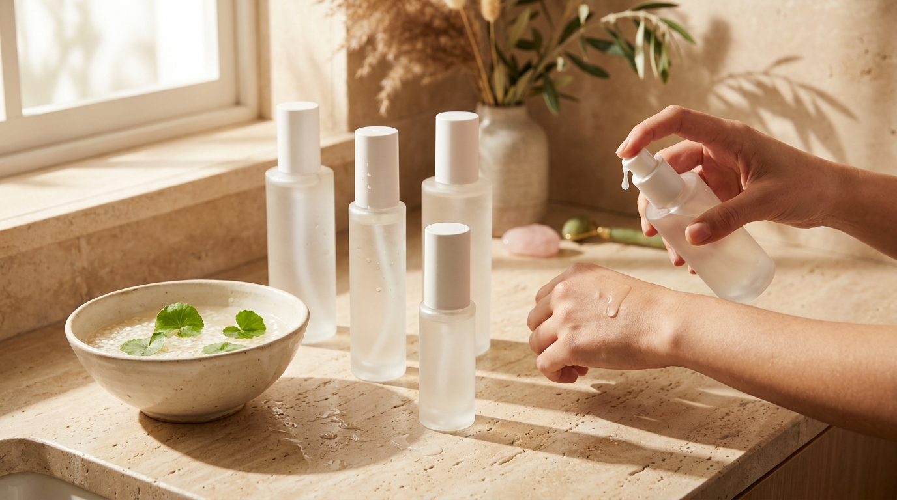
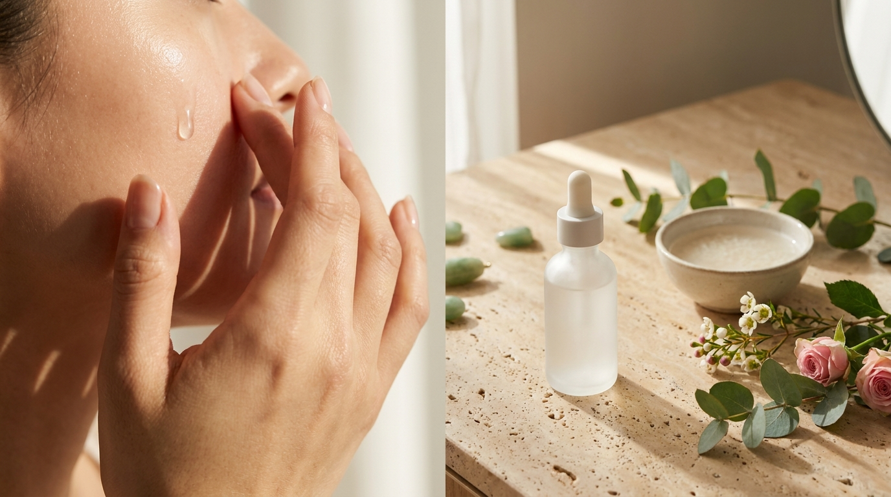

Si alguna vez has visto un K-Drama o seguido a creadores de contenido coreanos, es muy probable que te haya llamado la atención el aspecto impecable, translúcido y luminoso de su piel. En la comunidad internacional se suele denominar a este acabado *glass skin* o «piel de cristal». Aunque esta expresión se popularizó en Occidente a finales de la década de 2010, se inspira directamente en conceptos arraigados en la estética coreana como *mulgwang* (물광, acabado acuoso luminoso) o *dojagi pibu* (도자기 피부, piel de porcelana). En el lenguaje cosmético coreano actual, para evocar esa transparencia cristalina se recurre con frecuencia al término *yurial pibu* (유리알 피부, literalmente «piel de canica de cristal») o simplemente a rutinas orientadas a la hidratación *mulgwang*.

Existe una idea equivocada común: pensar que para lograr este brillo saludable es obligatorio seguir una rutina exhaustiva de diez o doce pasos todos los días. La realidad del cuidado facial en Seúl hoy en día es muy distinta. El enfoque moderno, conocido como *skip-care*, busca simplificar la rutina priorizando la eficacia de los ingredientes activos, la salud de la barrera cutánea y una hidratación facial profunda por capas. 

A continuación, analizaremos los fundamentos de esta tendencia y cómo estructurar una rutina de cinco pasos adaptada a las necesidades reales de tu piel sin salir de casa.

## Puntos clave

- El concepto de *glass skin* no consiste en cubrir imperfecciones con maquillaje reflectante, sino en maximizar la retención de agua y suavizar la textura de la piel mediante cosméticos hidratantes.
- Una rutina simplificada de cinco pasos (limpieza suave, tónico/esencia, suero funcional, hidratante selladora y protector solar) es suficiente para construir una barrera cutánea elástica y radiante.
- La clave del éxito no radica en usar muchos productos, sino en seleccionar texturas e ingredientes acordes a si tu piel es seca, mixta, grasa o sensible.
- La constancia diaria y la técnica de aplicación por capas ligeras aportan mejores resultados a largo plazo que fórmulas pesadas o agresivas.

---

## Qué significa realmente el concepto Glass Skin en Corea

En la cosmética coreana, el brillo característico no proviene de partículas iluminadoras de maquillaje ni de una capa de grasa superficial. El brillo asociado a acabados como el *mulgwang* o el *yurial pibu* es el reflejo de la luz sobre una superficie cutánea lisa, elástica y saturada de humedad.

Cuando el estrato córneo (la capa más externa de la epidermis) está deshidratado, las células muertas se descaman de forma irregular, lo que dispersa la luz y provoca un tono opaco o apagado. Por el contrario, cuando la piel retiene suficiente agua y lípidos intercelulares (como ceramidas y ácidos grasos), las células se mantienen uniformes y tersas. Al incidir la luz sobre esta superficie regular, se produce un reflejo natural que transmite frescura y vitalidad.

Por esta razón, en las tiendas Olive Young de Seúl, los productos más vendidos para este objetivo no suelen ser exfoliantes fuertes ni cremas sumamente densas, sino tónicos humectantes acuosos, esencias calmantes y fórmulas ricas en ácido hialurónico de múltiples pesos moleculares, pantenol y extractos botánicos fermentados.

---

## Los 5 pasos esenciales para construir la rutina en casa

※ Imagen ilustrativa generada con IA

Para construir una rutina sostenible que puedas mantener a diario desde cualquier parte del mundo, no necesitas saturar tu rostro. Esta estructura de cinco pasos cubre las necesidades fundamentales de equilibrio, hidratación y protección.

### 1. Limpieza suave que respete la barrera cutánea

El primer error que suele cometerse al buscar una piel luminosa es recurrir a limpiadores espumosos demasiado alcalinos que dejan una sensación de tirantez. La cosmética coreana insiste en mantener el pH fisiológico de la piel (alrededor de 5.5).

- **Por la noche:** Si has utilizado protector solar resistente al agua o maquillaje, la doble limpieza resulta muy útil. Se comienza con un aceite o bálsamo emulsionable que disuelve las impurezas oleosas y se continúa con un limpiador acuoso suave en gel o espuma de baja acidez.
- **Por la mañana:** En muchos casos, basta con lavar el rostro con agua tibia o emplear una cantidad mínima de un limpiador suave sin sulfatos irritantes para retirar el sebo nocturno sin eliminar los lípidos naturales.

### 2. Tónico o esencia: la base de la hidratación por capas

En el K-Beauty, el tónico no es un producto astringente para retirar suciedad residual, sino el primer vehículo de agua que recibe el rostro tras la limpieza. 

Una técnica muy popular en Seúl es la aplicación en capas ligeras (*layering*). En lugar de aplicar una crema pesada de una sola vez, se extienden una o dos capas de un tónico fluido o una esencia de textura acuosa viscosa sobre la piel ligeramente húmeda, dando suaves toques con las palmas de las manos. Ingredientes como la savia de abedul, el agua de arroz fermentada o el ácido hialurónico ayudan a rellenar las capas superiores de la piel de manera inmediata.

### 3. Suero o ampolla con ingredientes activos funcionales

El tercer paso permite personalizar el tratamiento según el estado particular de tu piel. Para favorecer el efecto *glass skin*, las fórmulas más demandadas en el mercado coreano combinan hidratación con ingredientes que unifican el tono y la textura:

- **Niacinamida (vitamina B3):** En concentraciones moderadas (entre el 2% y el 5%), ayuda a regular la producción de sebo, calmar rojeces y mejorar la apariencia de manchas leves.
- **Centella asiática y Madecassoside:** Esenciales para calmar estados de reactividad cutánea y favorecer la recuperación dérmica.
- **Pantenol (provitamina B5) y Beta-glucano:** Humectantes profundos que refuerzan la retención hídrica y proporcionan suavidad palpable.

### 4. Crema hidratante o humectante selladora

Toda el agua aportada en los pasos anteriores puede evaporarse si no se sella correctamente, un fenómeno conocido como pérdida transepidérmica de agua (TEWL). La crema actúa como un escudo protector.

La elección de la textura es determinante:
- Si tienes tendencia a los brillos o poros congestionados, un gel acuoso ligero (*water-gel*) formulado con escualano vegetal o glicerina cumplirá la función sin aportar pesadez.
- Si notas sequedad o tirantez, una emulsión o crema enriquecida con ceramidas NP, colesterol y ácidos grasos recreará la estructura de la barrera cutánea para mantener la luminosidad durante todo el día.

### 5. Protector solar de acabado hidratante (uso diurno)

No existe el efecto *glass skin* sin una protección rigurosa frente a la radiación ultravioleta. El daño solar degrada el colágeno, genera textura irregular y provoca hiperpigmentación, lo que anula cualquier esfuerzo previo.

Los protectores solares coreanos destacan internacionalmente por sus texturas ligeras, similares a un suero o loción fluida, que se absorben sin dejar rastro blanquecino ni acabado pegajoso. Fórmulas con filtros orgánicos modernos suelen aportar por sí solas ese acabado jugoso y saludable tan buscado en los K-Dramas, sirviendo además como excelente base previa a cualquier maquillaje ligero.

---

## Adaptación de la rutina según tu tipo de piel

El mayor error es copiar la rutina exacta de otra persona sin considerar las características biológicas del propio rostro. A continuación, se detallan las adaptaciones sugeridas para cada perfil cutáneo:

### Piel seca o deshidratada
Este tipo de piel presenta falta de lípidos o de agua, mostrando líneas finas de sequedad y pérdida de brillo.
- **Enfoque:** Reemplazar geles ligeros por cremas ricas en ceramidas y realizar múltiples capas de tónicos emolientes. Ingredientes clave: ácido hialurónico, manteca de karité en bajas proporciones, ceramidas y glicerina.

### Piel grasa o mixta
Produce un exceso de sebo, especialmente en la zona T (frente, nariz y barbilla), con poros visibles.
- **Enfoque:** Evitar texturas oclusivas densas. La luminosidad debe provenir del agua, no del aceite. Se recomiendan tónicos acuosos equilibrantes con extracto de árbol de té o corteza de sauce (fuente suave de BHA), sueros con niacinamida y geles hidratantes libres de aceites minerales pesados.

### Piel sensible o reactiva
Presenta tendencia al enrojecimiento, picor o sensación de calor tras aplicar productos cosméticos.
- **Enfoque:** Listas de ingredientes cortas (INCI minimalista), sin fragancias artificiales ni aceites esenciales irritantes. Ingredientes calmantes como la centella asiática (*cica*), la alantoína y el pantenol deben ser los protagonistas.

---

## Tabla comparativa: Personalización de la rutina de 5 pasos

| Paso de la rutina | Piel seca / deshidratada | Piel grasa / mixta | Piel sensible / reactiva |
| :--- | :--- | :--- | :--- |
| **1. Limpiador** | Leche limpiadora o espuma cremosa hidratante (pH bajo) | Gel limpiador suave purificante con tensioactivos suaves | Gel limpiador hipoalergénico sin fragancia |
| **2. Tónico / Esencia** | Esencia lechosa nutritiva (ceramidas, arroz) | Tónico acuoso ligero (té verde, savia de abedul) | Tónico calmante (centella asiática, artemisa) |
| **3. Suero** | Ácido hialurónico de múltiples pesos moleculares + pantenol | Niacinamida (2-5%) + zinc o extractos botánicos ligeros | Madecassoside + pantenol o beta-glucano |
| **4. Crema selladora** | Crema emoliente con barrera lipídica completa | Crema en textura gel acuoso (*oil-free*) | Crema reparadora suave con cica y alantoína |
| **5. Protector solar** | Acabado húmedo (*dewy*) con propiedades emolientes | Acabado fluido ultraligero o gel refrescante | Filtros minerales o químicos probados para piel reactiva |

---

## Consejos prácticos y precauciones para aplicar desde casa

※ Imagen ilustrativa generada con IA

> **Técnica de aplicación recomendada:** En la rutina coreana, la fricción mecánica se minimiza. En lugar de frotar los cosméticos con fuerza sobre el rostro o usar discos de algodón ásperos, vierte las esencias y tónicos directamente en las palmas limpias y presiona suavemente sobre la piel con toques delicados. Esto mejora la absorción y reduce el riesgo de irritación por roce.

> **Compra informada desde el exterior:** Si adquieres cosméticos coreanos a través de plataformas internacionales o distribuidores locales en Latinoamérica y España, verifica siempre el listado de ingredientes (INCI) y asegúrate de que el envase cuente con precinto de seguridad y fecha de caducidad legible (marcada habitualmente en Corea como *EXP* o *까지*). Realiza una prueba de parche en la parte interna del antebrazo antes de incorporar un producto nuevo a tu rostro.

---

## Preguntas frecuentes (FAQ)

### ¿Es posible conseguir el efecto Glass Skin si tengo poros dilatados o tendencia al acné?
Sí. El efecto *glass skin* no implica tener una piel completamente lisa como un filtro digital. Los poros son estructuras fisiológicas naturales que no pueden desaparecer. En pieles con tendencia a imperfecciones, una adecuada hidratación con texturas ligeras y activos como la niacinamida o el ácido salicílico en bajas dosis ayuda a desobstruir los poros y regular el exceso de sebo, lo que permite que la superficie refleje la luz de manera limpia y uniforme.

### ¿Cuánto tiempo suele tardar en notarse la mejoría en la luminosidad?
El incremento en la hidratación superficial suele percibirse desde las primeras aplicaciones gracias a los ingredientes humectantes. Sin embargo, una mejora perceptible en la textura, la elasticidad y la homogeneidad del tono suele requerir entre cuatro y seis semanas de uso constante, coincidiendo con el ciclo natural de renovación celular de la epidermis.

### ¿Se debe realizar la exfoliación para lograr esta apariencia?
La exfoliación suave puede ayudar a retirar células desvitalizadas, pero debe realizarse con cautela. En Corea se prefieren exfoliantes químicos suaves como los PHA (polihidroxiácidos) o LHA, o bien el uso de tónicos con bajas concentraciones de ácidos una o dos veces por semana. La sobreexfoliación daña la barrera cutánea, provocando deshidratación y rojeces que arruinan por completo el efecto luminoso.

### ¿Cuál es la diferencia real entre una piel grasa y una piel luminosa?
La piel grasa suele presentar un brillo irregular concentrado en zonas de alta densidad sebácea (frente, aletas de la nariz), acompañado a menudo de sensación de pesadez o poros saturados. La luminosidad del *glass skin*, en cambio, se distribuye de manera uniforme por los relieves altos del rostro (pómulos, puente nasal) y proviene de la hidratación intrínseca del tejido, sintiéndose la piel flexible, fresca y no pegajosa al tacto.