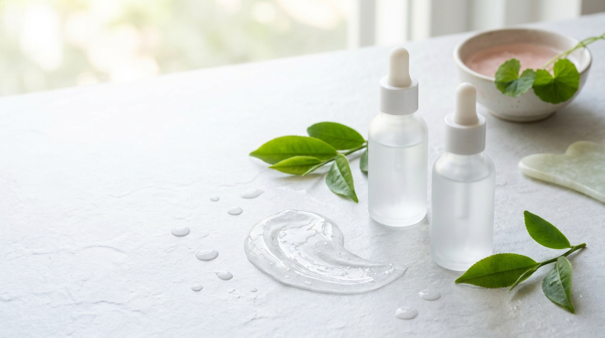
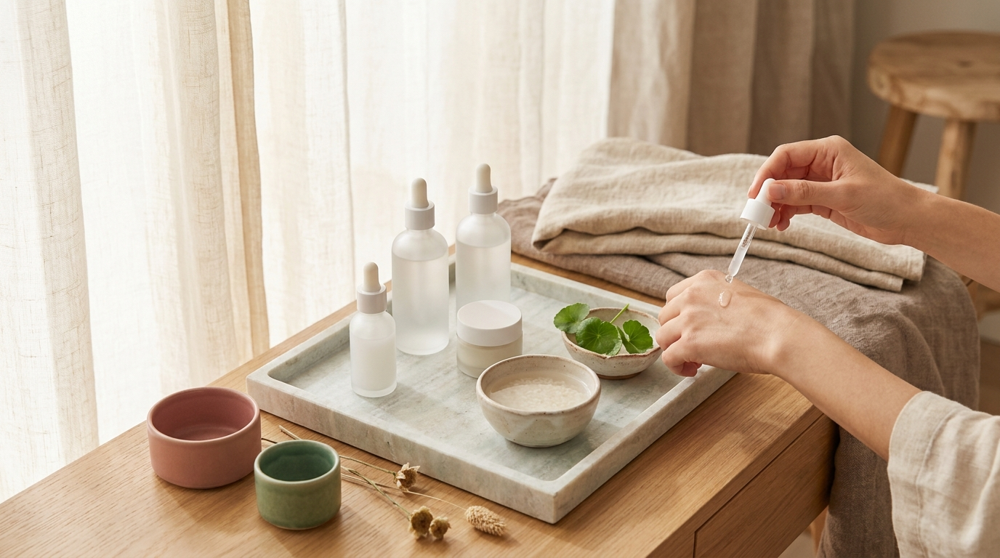

En Corea del Sur, entre finales de junio y finales de julio, el verano no es solo caluroso; está marcado por el fenómeno del *jangma* (장마), la temporada de lluvias torrenciales y una humedad ambiental que a menudo supera el 85%. Durante estas semanas, el brillo indeseado en la zona T, los poros visiblemente congestionados y los brotes imprevistos de acné se convierten en la conversación habitual en las tiendas de cosmética de Seúl.

En América Latina y España, muchas personas experimentan este mismo desafío a diario, ya sea por vivir en zonas costeras, climas tropicales o simplemente durante los meses más calurosos del año. La reacción más común frente al exceso de grasa suele ser aplicar productos secantes y astringentes o eliminar por completo la crema hidratante. Sin embargo, la cosmética coreana plantea una solución totalmente opuesta: calmar la inflamación, reponer agua pura en la piel y controlar el sebo mediante capas ultraligeras que no saturen los poros.

En esta guía revisaremos cómo estructurar una rutina coreana completa, fresca y funcional para mantener a raya los brillos y las imperfecciones sin comprometer la barrera cutánea.

## Puntos clave

- **Equilibrio hídrico sobre astringencia**: Matificar resecando la piel empeora la producción de sebo; el K-Beauty prioriza aportar agua ligera (*hydration*) sin sobrecargar con aceites pesados (*moisture*).
- **Texturas en gel y emulsiones acuosas**: Sustituir cremas densas por geles a base de agua, extractos botánicos y humectantes evita la oclusión de los poros en ambientes con alta humedad.
- **Activos botánicos calmantes**: Ingredientes como la *Houttuynia cordata* (heartleaf), el árbol de té y la centella asiática ayudan a mitigar la inflamación del acné sin irritar.
- **Protección solar de acabado seco**: El uso diario de un bloqueador solar específico con textura acuosa o toque mate es indispensable para evitar la hiperpigmentación posinflamatoria de los granitos.

---

## La paradoja de la piel grasa y deshidratada en ambientes húmedos

Uno de los conceptos más discutidos en la dermatología cosmética en Corea es el *sok-geonjo* (속건조), que se traduce literalmente como «sequedad o deshidratación interna». Describe con precisión el estado de una piel que luce brillante y seborreica en la superficie, pero que experimenta tirantez, descamación microscópica o reactividad por debajo.

Cuando el ambiente es cálido y húmedo, las glándulas sebáceas incrementan su actividad para producir más sebo, mientras que las glándulas sudoríparas expulsan sudor constantemente. Si ante este exceso de brillo se emplean limpiadores agresivos con sulfatos fuertes o tónicos con alto contenido de alcohol desnaturalizado, se elimina la capa lipídica protectora. 

El resultado es predecible: la piel detecta una pérdida transepidérmica de agua acelerada y compensa secretando todavía más grasa. Al mezclarse este sebo adicional con las células muertas y el sudor atrapado por la humedad ambiental, se genera el ecosistema ideal para la proliferación de la bacteria *Cutibacterium acnes*, desencadenando brotes y comedones.

Por ello, el objetivo de una rutina coreana para este tipo de clima no es eliminar la grasa a toda costa, sino enseñar a la piel a regularse mediante una hidratación biocompatible y activos purificantes no agresivos.

---

## Paso a paso: la rutina coreana para piel grasa en clima cálido



<p class="img-cap">※ Imagen ilustrativa generada con IA</p>

Construir una rutina funcional no requiere aplicar diez capas de productos. En climas donde el aire ya se siente pesado, la clave reside en la selección estratégica de texturas fluidas y fórmulas de rápida absorción.

### 1. Limpieza: purificar sin despojar la piel

Durante la noche, la limpieza facial debe remover el protector solar resistente al agua, el sudor acumulado y el exceso de lípidos oxidados. Para la piel grasa y con tendencia al acné, existe el temor de que los aceites limpiadores obstruyan los poros. No obstante, en la cosmética coreana abundan opciones formuladas con aceites ligeros no comedogénicos (como el de jojoba, girasol o salvado de arroz) que emulsionan de inmediato al contacto con el agua.

Si prefieres conocer en detalle cómo elegir el formato adecuado según la sensibilidad de tus brotes, puedes revisar nuestra [guía de la doble limpieza coreana: aceite vs. bálsamo según tu piel](/blog/doble-limpieza-coreana-aceite-vs-balsamo/).

Para el segundo paso nocturno (y como único limpiador por la mañana), los productos más demandados en Seúl son los geles de pH ligeramente ácido (entre 5.0 y 5.5). Estas fórmulas respetan el manto ácido de la piel e incorporan pequeñas concentraciones de derivados suaves de BHA (como el salicilato de betaína) o aceite de árbol de té para limpiar el interior de los poros con suavidad.

### 2. Tónico calmante y equilibrante

Olvídate de los tónicos astringentes tradicionales que dejan la piel ardorosa o tirante. En el K-Beauty, el tónico tiene la misión de reequilibrar el pH tras el contacto con el agua del grifo y proporcionar la primera inyección de agua fresca.

Para pieles con imperfecciones en climas sofocantes, los tónicos formulados con *Houttuynia cordata* (conocida en Corea como *Eoseongcho*, 어성초) y extracto de centella asiática se han posicionado como líderes indiscutibles. Estos extractos botánicos destacan en los listados INCI por su capacidad para desinflamar rojeces y calmar granitos activos. Si quieres profundizar en el funcionamiento de este ingrediente esencial, te recomendamos leer nuestro artículo sobre la [Centella Asiática (Cica) en K-Beauty y cómo leer su INCI](/blog/centella-asiatica-cica-beneficios-piel-sensible/).

En verano, es habitual en Corea aplicar estos tónicos mediante discos de algodón ultrafinos a modo de mascarilla rápida de 3 minutos en mejillas y frente, logrando bajar la temperatura cutánea de inmediato.

### 3. Tratamiento con sérum: control de sebo y poros

El sérum o ampolla es el vehículo idóneo para concentrar ingredientes diana. Para regular el sebo y atenuar las marcas oscuras que suelen dejar los granitos al desaparecer, la combinación estrella en las formulaciones coreanas es:

- **Niacinamida (Vitamina B3) al 2% o 5%**: Ayuda a normalizar la producción de sebo, fortalece la barrera cutánea y minimiza visualmente el tamaño del poro dilatado.
- **Zinc PCA**: Un mineral humectante con reconocidas propiedades seborreguladoras y antibacterianas que trabaja en perfecta sinergia con la niacinamida.
- **BHA suave (Betaine Salicylate)**: Al ser liposoluble, penetra a través del sebo disolviendo los tapones de suciedad y restos celulares que originan los puntos negros.

### 4. Hidratante en gel: agua fresca sin oclusión

Este es el paso donde muchas personas cometen el error de desertar. Prescindir de la hidratante en un clima húmedo provoca que la piel pierda el agua aportada por los pasos anteriores. La solución es sustituir cualquier crema densa o emoliente por un **hidratante en gel** (*water gel* o *aqua soothing gel*).

Estas fórmulas prescinden de ceras pesadas, mantecas o aceites minerales oclusivos. En su lugar, utilizan polímeros acuosos, ácido hialurónico de bajo peso molecular y derivados de azúcares como el beta-glucano para sellar la humedad, dejando un acabado completamente mate o sedoso que se absorbe en segundos.

### 5. Protector solar de toque seco o acabado invisible

En los países hispanohablantes donde el índice de radiación UV suele ser muy elevado gran parte del año, saltarse el protector solar por miedo al sudor o a los brillos es el camino más rápido hacia manchas oscuras posinflamatorias (*PIH*) y marcas de acné persistentes.

La cosmética coreana moderna ha revolucionado este paso formulando protectores solares químicos e híbridos de textura similar a una loción acuosa (*sun serum* o *water sun gel*). Contienen microesferas de sílice que absorben activamente el sudor y el exceso de brillo a lo largo del día. Puedes consultar las fórmulas más destacadas en nuestra guía sobre [protector solar coreano sin rastro blanco para piel grasa y mixta](/blog/protector-solar-coreano-piel-grasa-mixta/).

---

## Ingredientes clave del K-Beauty contra el sebo y los brotes

Al revisar las etiquetas INCI de los cosméticos coreanos mejor valorados en las plataformas de reseñas de Seúl (como Hwahae o GlowPick), se observa una clara preferencia por alternativas botánicas y biotecnológicas eficaces pero respetuosas con la piel:

```
+---------------------+---------------------------------------------------------+
| Ingrediente         | Función principal en piel grasa o con acné              |
+---------------------+---------------------------------------------------------+
| Houttuynia Cordata  | Reduce la inflamación, calma rojeces y purifica poros   |
| Melaleuca (Tea Tree)| Acción antibacteriana suave frente al C. acnes          |
| Betaine Salicylate  | Exfoliación química gentil dentro del canal sebáceo     |
| Niacinamida         | Regula la síntesis de lípidos y previene manchas        |
| Pantenol (B5)       | Hidrata profundamente sin aportar peso graso            |
+---------------------+---------------------------------------------------------+
```

La gran ventaja del salicilato de betaína frente al ácido salicílico libre tradicional (frecuente en productos occidentales a concentraciones del 2%) es su liberación progresiva, lo que reduce drásticamente el riesgo de irritación, enrojecimiento o descamación en climas donde la piel ya está estresada por el calor.

---

## Tabla comparativa: Texturas hidratantes en el K-Beauty

Para no equivocarse al comprar por internet, resulta muy útil conocer las diferencias entre las denominaciones de texturas habituales en Corea:

| Denominación en el envase | Textura y base galénica | Nivel de oclusión | Acabado en piel grasa | ¿Ideal para clima cálido/húmedo? |
| :--- | :--- | :--- | :--- | :--- |
| **Aqua Soothing Gel** | Gel traslúcido, base 100% acuosa y polímeros | Muy bajo | Fresco, toque seco, cero residuo | Sí, la opción predilecta |
| **Gel Cream** | Emulsión semitransparente con siliconas volátiles | Bajo | Sedoso, satinado suave | Sí, en rutinas de noche |
| **Light Emulsion** | Loción lechosa ultrafluida | Medio-bajo | Hidratante ligero con leve nutrición | Adecuado si hay zonas mixtas secas |
| **Rich Barrier Cream** | Crema densa con ceramidas y lípidos pesados | Alto | Brillante, protector envolvente | No recomendado (puede congestionar) |

> **Recomendación para climas extremos**: En días de humedad extrema, es habitual aplicar la regla del «menos es más». Si la piel se siente saturada tras el tónico y el sérum, es común omitir el hidratante en gel durante el día y pasar directamente a un protector solar coreano hidratante con base acuosa. La mayoría de los solares de Corea incorporan ya glicerina, pantenol y extractos calmantes, actuando eficazmente como hidratante y filtro UV en un solo paso matutino.

---

## Claves de conservación y aplicación en casa



<p class="img-cap">※ Imagen ilustrativa generada con IA</p>

El calor ambiental y la humedad constante no solo afectan a la piel; también comprometen la estabilidad de los productos cosméticos. Si se reside en una ciudad con temperaturas elevadas, es conveniente tener en cuenta estas sencillas pautas:

1. **Evitar almacenar los productos en el cuarto de baño**: El vapor de la ducha y la fluctuación térmica aceleran la degradación de conservantes y activos sensibles. Es preferible un lugar fresco, seco y protegido de la luz solar directa.
2. **Uso de espátula para geles en tarro**: Si el hidratante en gel no viene en tubo, conviene evitar introducir los dedos directamente en el recipiente. El calor ambiental facilita la colonización bacteriana por transferencia manual.
3. **Prueba de parche previa**: Siempre que se incorporen activos nuevos como el extracto de árbol de té o derivados del ácido salicílico, se aconseja realizar una prueba de parche en la mandíbula o detrás de la oreja durante 48 horas antes de extenderlo por todo el rostro.

---

## Preguntas frecuentes (FAQ)

### ¿Realmente se necesita usar hidratante si el rostro ya brilla y suda mucho?
Sí, prescindir completamente de la hidratación suele ser contraproducente. El sudor está compuesto fundamentalmente por agua y sales minerales, y al evaporarse sobre la superficie cutánea, puede incrementar la deshidratación superficial. Si la piel carece de agentes humectantes que retengan el agua en el estrato córneo, las glándulas sebáceas responderán produciendo más lípidos para intentar frenar esa evaporación. La clave no es dejar de hidratar, sino cambiar a un hidratante en gel sin aceites pesados.

### ¿La doble limpieza nocturna es segura si hay granitos con inflamación activa?
Es segura y muy recomendable, siempre que se realice con suavidad. El aceite limpiador disuelve el sebo acumulado y los filtros solares resistentes sin necesidad de frotar en exceso. Sin embargo, ante brotes con pústulas inflamadas, se aconseja no masajear el rostro durante más de 40 o 60 segundos. Debe emulsionarse siempre con agua tibia abundante para asegurar que no quede ningún residuo graso sobre el rostro antes de pasar al limpiador espumoso en gel.

### ¿Se pueden combinar niacinamida y BHA en la misma rutina de verano?
Sí, en la cosmética coreana es una de las asociaciones más comunes y eficaces para la piel grasa. El BHA trabaja en el interior del folículo piloso disolviendo el tapón de queratina y sebo, mientras que la niacinamida calma la respuesta inflamatoria y ayuda a homogenizar el tono general. En pieles sensibles, es habitual aplicar el BHA en noches alternas y reservar la niacinamida para la rutina matutina o para las noches de descanso.

### ¿Con qué frecuencia se recomienda exfoliar una piel grasa en un clima tropical o húmedo?
Aunque la sensación de pesadez invite a exfoliarse todos los días, la moderación es indispensable. La exfoliación química con BHA suave o PHA suele ser suficiente realizándola de 2 a 3 veces por semana durante la noche. Exfoliar en exceso destruye las uniones celulares saludables de la barrera cutánea, lo que dejaría la piel más vulnerable frente a las bacterias causantes del acné y aumentaría la sensibilidad frente a la radiación solar.