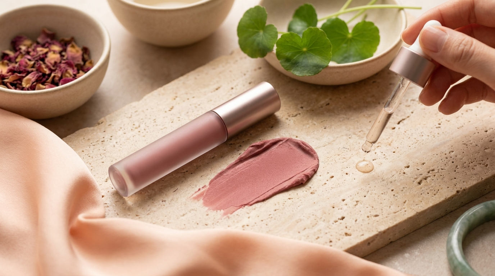
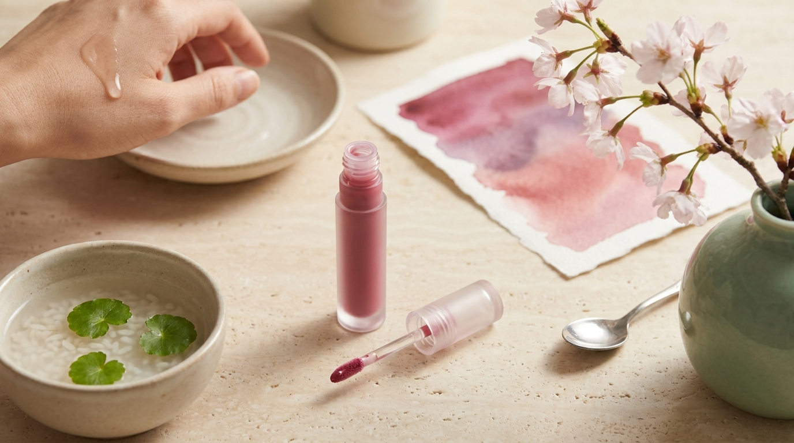

Al visitar cualquier tienda de Olive Young en barrios emblemáticos de Seúl como Myeongdong, Hongdae o Gangnam, resulta evidente que las estanterías de maquillaje están dominadas por decenas de vitrinas repletas de tintes labiales (*lip tints*). En el mercado cosmético de Corea del Sur, el lápiz labial tradicional en barra de acabado mate pesado ha cedido gran parte de su espacio a fórmulas mucho más ligeras, versátiles y confortables.

Al seguir series de televisión coreanas o contenidos de creadores en redes sociales, es común preguntarse cómo logran las actrices ese aspecto de labios frescos, degradados o con un brillo translúcido similar al cristal. La clave radica en la tecnología aplicada a los tintes labiales coreanos. No obstante, ante la variedad de categorías disponibles (acuosos, aterciopelados, aceites y bálsamos fundentes), elegir el producto adecuado puede resultar complejo si se adquieren desde el extranjero. En esta guía desglosamos las diferencias técnicas, ingredientes y acabados de cada tipología para acertar en la elección.

## Puntos clave

- **Tintes acuosos y jugosos (*Glow / Dewy Tint*):** Combinan una base de tinte que fija el color en la piel con una película externa de aceites ligeros que aporta un brillo translúcido similar al almíbar sin sensación pegajosa.
- **Tintes aterciopelados (*Velvet Tint*):** Emplean elastómeros de silicona y polvos difuminadores para crear un efecto de foco suave (*blur*), ideal para el clásico degradado coreano (*gradation lip*).
- **Bálsamos fundentes con color (*Melting Balms*):** Representan una de las tendencias con mayor demanda en Olive Young para quienes buscan nutrición intensa, mantecas vegetales y un reflejo ultra brillante de efecto volumen.
- **Elección según el estado del labio:** Los labios con tendencia a descamarse responden mejor a bálsamos fundentes y fórmulas acuosas emolientes, mientras que los tintes velvet requieren una superficie previamente hidratada.

---

## 1. Tinte acuoso y jugoso (Water & Dewy Glow Tint): el efecto labios de cristal

El acabado brillante y húmedo, a menudo llamado en Corea «labios de tanghulu» (en alusión a la fruta caramelizada cubierta por una capa fina de azúcar cristalizado), es uno de los sellos distintivos del [maquillaje coreano al estilo de las actrices de K-Drama](/blog/maquillaje-natural-actrices-kdrama-paso-a-paso/).

### ¿Cómo funciona su tecnología?

A diferencia de los brillos labiales (*lip gloss*) tradicionales de Occidente, que suelen tener bases densas y pegajosas compuestas por polibuteno pesado, los tintes acuosos coreanos utilizan emulsiones de aceite en agua (Oil-in-Water u O/W) o polímeros formadores de película (*film formers*).

1. **Fijación del tinte:** Al entrar en contacto con el labio, la fase continua acuosa permite que los colorantes hidrosolubles humecten y tiñan de forma inmediata la capa superficial de la mucosa.
2. **Separación de la capa brillante:** Momentos después de la aplicación, los glóbulos de aceites ligeros coalescen y ascienden hacia el exterior para conformar una barrera transparente y reflectante. Esto permite que el color base permanezca intacto sobre el labio incluso si la capa brillante exterior disminuye con el paso de las horas.

### Ingredientes habituales en su INCI

En las fórmulas líderes de Olive Young (como las líneas *Juicy Lasting* de Rom&nd o *Dew Tint* de Amuse), es habitual encontrar ingredientes humectantes y emolientes como:
- **Glicerina y butilenglicol:** Retienen agua en la superficie labial.
- **Extractos frutales:** Como extracto de kiwi, papaya o mango, añadidos para aportar frescura cosmética.
- **Escualano o aceite de jojoba:** Ayudan a suavizar la textura sin aportar pesadez.

### ¿Para quién es ideal?

Este formato es idóneo para quienes buscan duración prolongada junto con un aspecto fresco, hidratado y de labios visiblemente más rellenos. Es habitual recomendarlo para el uso diario en climas cálidos o templados, ya que no deja residuo graso ni atrae el cabello hacia la boca.

---

## 2. Acabado terciopelo (Velvet Tint): el difuminado elegante sin sequedad

※ Imagen ilustrativa generada con IA

El acabado mate clásico a menudo reseca los labios y marca cada pequeña línea de expresión. Para solucionar esto, la industria cosmética coreana desarrolló el concepto *Velvet*, una textura a medio camino entre una mousse y una crema empolvada que sigue siendo un pilar indiscutible del maquillaje diario en Corea.

### La estructura de los elastómeros de silicona

El principio técnico de los tintes velvet radica en el uso de compuestos como el *dimethicone crosspolymer* y polvos esféricos ultrafinos. Estos ingredientes no penetran en la piel, sino que se asientan sobre el relieve labial, rellenando ópticamente las líneas de expresión y creando una textura lisa de alta definición, semejante a un filtro de fotografía.

A diferencia de los labiales líquidos mates occidentales que se secan por completo hasta cuartearse, los tintes terciopelo coreanos mantienen cierta emoliencia:
- **Tacto sedoso:** Al frotar los labios entre sí, se siente una película suave y deslizante.
- **Fácil difuminado:** Permiten dar toques con la yema del dedo o un pincel para desdibujar los bordes exteriores, logrando el efecto *over-blur* que agranda visualmente la boca de forma sutil.

### Precauciones al usar fórmulas Velvet

Aunque resultan considerablemente más hidratantes que los mates tradicionales, las fórmulas aterciopeladas contienen menor proporción de agua libre. Si los labios presentan pellejitos o descamación activa, los pigmentos en polvo pueden adherirse a esas zonas secas y resaltar las irregularidades. Por ello, la preparación previa con un bálsamo nutritivo unos minutos antes de la aplicación es fundamental.

---

## 3. Bálsamos con color fundentes (Melting Balms): confort extremo y brillo espejo

En las últimas temporadas, los rankings de Olive Young han experimentado un auge masivo de los llamados *Melting Balms* o bálsamos fundentes. Fórmulas como las de Nature Republic (*Honey Melting Lip*) o Dasique (*Melting Candy Balm*) en formato de pulsador (*click pen*), así como opciones con dial giratorio no retráctil como Espoir (*Mega Melting Bomb*) o con mecanismo giratorio microajustable (*twist-up*) como Rom&nd (*Glasting Melting Balm*), han transformado la categoría de cuidado labial con color.

### Diferencias con un bálsamo tradicional

Un protector labial convencional suele basarse en ceras duras (como cera de abeja o parafina microcristalina) diseñadas para proteger de la intemperie sin aportar gran cantidad de pigmento ni brillo excesivo, similar al formato de los [bálsamos en formato stick o multi-balm](/blog/balsamos-multiusos-kdramas-que-son-como-usarlos/) que se aplican en el rostro. 

En contraste, los *melting balms* están formulados con puntos de fusión muy bajos (cercanos a la temperatura corporal de 36,5 °C):
- **Fundente inmediato:** Al rozar la mucosa labial, la barra sólida se derrite instantáneamente, convirtiéndose en un aceite denso y altamente reflectante.
- **Pigmentación translúcida modulable:** No tiñen la piel con la fuerza de un tinte químico, sino que aportan velos de color traslúcidos que se pueden superponer para ganar intensidad.
- **Alto contenido lipídico:** Suelen incluir concentraciones notables de aceite de argán, aceite de semilla de camelia, manteca de karité y ceramidas.

> **Recomendación de uso:** Muchos de estos envases (especialmente los de tipo pulsador o *click pen*, así como algunos sistemas giratorios con avance dosificado) están diseñados con mecanismos unidireccionales o de retorno limitado. Debido a que la fórmula es sumamente blanda para mantener su textura fundente, el producto no puede retraerse con facilidad una vez expuesto. Se recomienda presionar el pulsador o girar la base solo lo necesario para exponer menos de un milímetro de producto antes de cada aplicación.

---

## Tabla comparativa: Tintes Glow vs. Velvet vs. Melting Balms

Para ayudar a decidir qué fórmula encaja mejor con las necesidades individuales y preferencias diarias, se resumen sus principales características técnicas y cosméticas:

| Característica | Tinte Acuoso / Glow | Tinte Terciopelo / Velvet | Bálsamo Fundente / Melting |
| :--- | :--- | :--- | :--- |
| **Acabado visual** | Cristalino, acuoso, efecto espejo (*glass lips*) | Mate difuminado, sedoso, efecto aerógrafo | Brillo nutritivo profundo, ultraluminoso |
| **Fijación del color** | Media a alta (el tinte base resiste tras comer) | Media (tiñe moderadamente, requiere retoque) | Baja a media (se transfiere con facilidad) |
| **Sensación en el labio** | Fresca, muy ligera, no grasa | Suave, aérea, empolvada | Envolvente, rica, ligeramente oleosa |
| **Disimulo de pliegues** | Bueno (el reflejo de luz camufla arrugas) | Excelente (rellena ópticamente las líneas) | Muy bueno (aporta volumen por hidratación) |
| **Ideal para...** | Días largos, eventos, clima cálido | Estilos pulidos, degradados precisos | Labios secos, invierno, rutinas rápidas |
| **Retoque necesario** | Solo para recuperar brillo; el color dura | Sí, tras comidas copiosas | Frecuente, como cualquier bálsamo |

---

## Guía práctica: cómo aplicar el tinte labial coreano para un resultado impecable

※ Imagen ilustrativa generada con IA

La técnica de aplicación en el maquillaje coreano difiere notablemente del perfilado y rellenado uniforme habitual en los estilos tradicionales occidentales. Para obtener el mejor rendimiento de estas fórmulas, es recomendable seguir este procedimiento:

### Paso 1: Acondicionamiento sin residuo graso
Si se va a utilizar un tinte acuoso o terciopelo, los labios deben estar libres de grasa densa al momento de maquillar. Si existe una capa gruesa de bálsamo oclusivo, el tinte de base acuosa resbalará y no logrará fijar el color de manera uniforme. Es aconsejable aplicar bálsamo hidratante al inicio de la rutina facial y retirar el exceso suavemente con un pañuelo de papel justo antes de maquillar la zona.

### Paso 2: Creación del degradado (*Gradation Lip*)
1. Aplica una pequeña cantidad de corrector o base de maquillaje en los bordes de los labios dando toques ligeros para atenuar la línea natural de contorno.
2. Deposita dos o tres puntos de tinte exclusivamente en el centro interior del labio inferior y superior.
3. Junta los labios suavemente dos veces y utiliza la yema del dedo anular para extender el pigmento hacia afuera mediante toques suaves, asegurándote de que la mayor intensidad quede siempre en la parte interna.

### Paso 3: Fijación y acabado
- Si se usa un **tinte *glow***: conviene evitar frotar los labios repetidamente tras la aplicación. Dejar reposar la fórmula durante unos 30 a 60 segundos sin manipularla permite que la emulsión se divida correctamente y la película brillante suba a la superficie con máxima claridad.
- Si se usa un **tinte *velvet***: difuminar el borde exterior superando ligeramente la línea natural resulta ideal si se desea un efecto de labios con mayor grosor visual (*over-lip* difuminado).

> **Precaución sobre el tono personal:** En el sistema de asesoría de imagen coreano (*Personal Color*), los tonos se dividen rigurosamente entre cálidos (*Warm Tone*: corales, melocotones, ladrillos) y fríos (*Cool Tone*: frambuesas, rosas ceniza, ciruelas). Dado que los tintes acuosos interactúan con la hidratación y el tono base de la mucosa, el color final puede percibirse ligeramente más rojizo o intenso pasados unos minutos. Si se desea adquirir estos productos desde el extranjero, pueden revisarse opciones en plataformas autorizadas consultando nuestra [guía para comprar cosmética coreana online desde casa](/blog/como-comprar-cosmetica-coreana-online-desde-casa/).

---

## Preguntas frecuentes (FAQ)

### ¿Cuál de los tres formatos dura más tiempo en los labios?
Los tintes acuosos y jugosos (*Glow Tints*) ofrecen la mayor durabilidad en cuanto a pigmentación. Aunque la capa brillante superficial puede desaparecer tras comer o beber, el colorante hidrosoluble que penetró en la epidermis labial suele mantenerse visible durante varias horas. Los bálsamos fundentes, por su alta proporción de aceites libres, son los que requieren retoques más frecuentes.

### ¿Cómo evitar que el tinte se concentre únicamente en la parte interna del labio inferior?
Este problema suele deberse a dos factores: labios deshidratados con queratina acumulada en la mucosa interna o exceso de humedad al aplicar. Para evitarlo, se recomienda secar suavemente la zona interna con un bastoncillo de algodón antes de poner el producto y exfoliar periódicamente los labios de forma muy suave con un disco humedecido en tónico para retirar células muertas sin irritar.

### ¿Son aptos los tintes coreanos para personas con labios oscuros o pigmentados?
Sí, pero la elección de la fórmula es crucial. Los tintes acuosos tradicionales eran muy translúcidos y podían no cubrir bien bases labiales oscuras. Para labios con pigmentación natural pronunciada, las fórmulas *Velvet* o los tintes *Glow* de cobertura media a alta (que combinan pigmento opaco con brillo externo) proporcionan un tono mucho más fiel al del envase.

### ¿Por qué algunos tintes cambian de color minutos después de la aplicación?
Muchos tintes coreanos contienen colorantes sintéticos (como el *Red 27* o derivados del xanteno) que reaccionan ante los niveles de humedad y pH de la piel. Además, a medida que los disolventes volátiles se evaporan y la película polimérica se asienta, la concentración de pigmento aumenta, haciendo que el tono final se perciba algo más profundo o saturado que en el primer trazo.